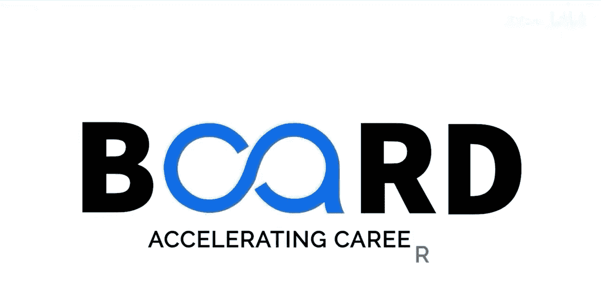

# Board Infinity【中英⚡生成式AI：提示词工程基础｜Generative AI： Prompt Engineering Basics】 p21 P21 01_评估提示性能的关键指标 -BV1AVjFzaEkP_p21-

Welcome to our final lesson of this course in the last video we checked out few real world examples of how prompt engineering is transforming workflows across industries as prompt engineering matures as a discipline evaluating performance becomes essential for continuous improvement。

In this video， we will explore key metrics and approaches for measuring how well your prompt are performing。

😊，First metric is to consider is relevance how well the AIs response addresses the actual request relevance can be measured through sampling techniques where human evaluators rate responses on a scale from completely off topic to directly addresses all aspects of the request。

For systematic evaluation develop a rubric that specifies what constitutes full。

 partial or minimal relevance of your specific use case accuracy is another critical metric。

 especially for factual task。😊，This measures whether the information provided is correct and can be verified against a reliable source。

For complex responses you might track proportions of claims that are verifiable and accurate some organizations implement fact checking workflows where responses are checked against prostate references to calculate an accuracy score completeness assesses whether the response addresses all the requirements specified in the prompt。

A simple approach is to list all the explicit and implicit requirement in your prompt and check what percentage of them are fulfilled in the response more sophisticated evaluations might weight requirements by importance。

😊，Consistency measures whether EI produces similar responses to similar prompts。

And maintains internal consistency within a single response this particularly important for applications requiring reliable outputs test consistency by running same prompt multiple times or with minor variations then measuring the variance in the response for applications where user experience matter engagement metrics are valuable these might include readability scores sentiment analysis or user feedback ratings some organizations implement T testing of different prompt formulations and measure which version generate responses that users prefer efficiency metric track resource utilization such as token usage processing time and cost。

😊，Well engineered prompts should minimize unnecessary token consumption while achieving the desired result。

😊，Trarack the ratio of input tokens to output quality to identify opportunities for prompt optimization。

For specialized applications， domain specific metric may be necessary。😊，For example。

 code transition prompts might be evaluated based on execution success。

 test coverage or performance benchmark， content creation prompts might be assessed based on SEO metrics or conversion reach。

😊，The most comprehensive evaluation involves developing a scoring system that combines these metrics weighted according to your priorities this gives you a single performance score that you can track over time as you refine your prompt remember that regular evaluation is the key to continuous improvement。

😊，Implement our systematic process for testing prompt variations and measuring their performance against your established metrics。

😊，In our next video， we will tackle the ethical dimension of prompt engineering。

 how to mitigate biases ensures responsible use of AI。😊，Thanks for watching。

 I'll see you in the next video。

