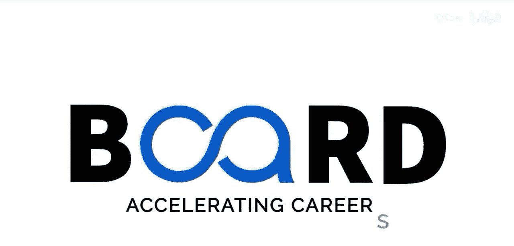

# Board Infinity【中英⚡生成式AI：提示词工程基础｜Generative AI： Prompt Engineering Basics】 p24 P24 05_课程结束与感恩 -BV1AVjFzaEkP_p24-

Congratulations on completing the Generative AI prompt Engineer basicsics course you are now equipped with the skills to effectively prompt AI models。

 optimize your performance and use AI power tools for the problem solving content generation automation and more geneative AI is revolutionizing industries and prompt engineering is the key to unlock its full potential whether you are working in business marketing software development research or creative fields your ability to effectively interact with AI will give you a competitive edge。

I hope this course has empowered you with valuable skills that you can use in your professional and creative endeavors。

😊，Thank you for joining me on this journey， I look forward to seeing you and applying these techniques to innovate and lead in the AI driven world。

 thank you。😊。

