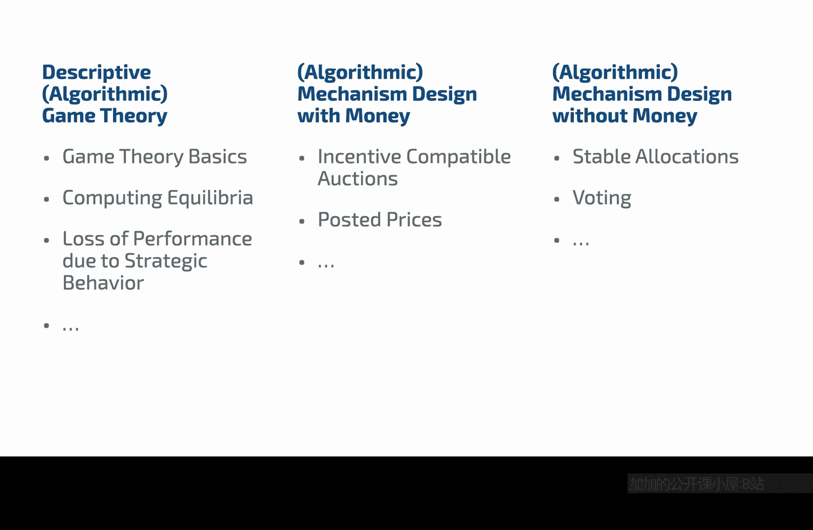

# 001：欢迎与课程概述 🎬

在本节课中，我们将了解算法博弈论这门课程的基本情况，包括其研究背景、核心问题、课程目标以及内容概览。

大家好，我是托马斯·凯塞尔海姆，波恩大学理论计算机科学教授。本学期，教学方式转为远程进行。因此，我为算法博弈论这门课程制作了系列讲座视频。我认为将这些视频公开分享会很有趣。所以，即使您并非来自波恩大学，也请随意观看这些讲座视频。

您可能会问，什么是算法博弈论？算法博弈论是一个大约20年前建立的研究领域。当时人们突然意识到，传统的算法思维方式已不再适用。在那之前，算法只是接收输入、进行计算，然后产生输出。但现在，一切都相互关联。

让我用一个简单的例子来解释。我们可以考虑一个非常传统的问题：最短路径问题。您可能只想从A点到达B点，找到最短路径，希望尽快回家。但如今，不仅您想尽快回家，而且每个人都在做同样的事情。每个人都在运行最短路径算法，以找到他们最快回家的路。这些路径以下述方式相互关联：如果右边这个人想找到最快回家的路，他们不会选择通常的最短路径，而是会选择一条因当前交通状况而拥堵较少的路径。但通过选择这条更快的路回家，他们又为其他人造成了拥堵。因此，所有不同的参与者之间存在着相互作用。这些参与者中，没有一个会考虑到其他人回家需要更长时间，他们的唯一目标是尽快回家。

这种行为可以通过策略行为来建模。策略行为或自私行为，听起来似乎很糟糕。但事实上，这不一定是一件坏事。关键在于，这是参与者不考虑整体目标，而只考虑自身效用的结果。例如，他们只想尽快回家。

我们在其他场景中也看到类似的问题和效应。例如，当您进行搜索查询时，除了实际的搜索结果，您还会看到许多广告。这是这些搜索引擎的主要收入来源。那么，由谁来决定显示哪些广告呢？每当您进行搜索查询时，都会进行一次广告拍卖，这些广告位被售出。它们通过小型拍卖以真实货币出售。例如，这里您可以看到谷歌搜索“计算机科学算法博弈论与算法机制设计”时的样子。然后我可以指定我愿意花费多少钱。因此，这里同样存在参与者行为具有策略性的情况。他们再次只考虑自身效用，希望从这些拍卖中获得最大收益。他们不会考虑让世界尽可能幸福这样的总体目标。

那么，我们可能会问：应该如何设计这样的拍卖，才能让我们对结果感到满意？还有另一个例子，即云计算。您可以看到，在这种情况下，您可以从微软Azure中选择想要配置的虚拟机类型。根据您的配置方式，您将需要支付相应的价格来租用这台虚拟机。那么，这些价格从何而来？您又将如何设定这些价格？我们可能会认为它们是由供需关系决定的。但如果您要设计一个销售这些资源的云计算界面，您会怎么做？您的目标可能是什么？您是想让世界尽可能幸福，还是想最高效地利用这些计算资源，或是想赚取尽可能多的利润？您甚至该如何为这类事物建模？所有这些问题都将在本课程中涵盖。

我们的目标可以总结如下。首先，我们想问：如何用数学方法对策略行为进行建模？其次，我们也想问：策略行为会产生什么影响？即，每个参与者只考虑优化自身效用，而不是关注让每个人都尽可能幸福的全局图景，其后果是什么？第三个问题是：如果我们要设计系统，该如何做？即，如何设计能够应对策略行为的系统？我们将了解实现这一目标的某些规则，但首先，我们必须从数学上设计我们的目标是什么。然后，我们还将看到实现这一目标的技术。

算法博弈论结合了算法理论和博弈论的各个方面。例如，我们将讨论最坏情况分析、计算复杂性或近似保证，就像在算法理论中那样。然后，我们将把这些与博弈论中普遍存在的概念结合起来，例如自私的参与者、均衡和策略。我心目中的目标受众是了解算法理论基础的人，因此您之前应该进行过最坏情况分析，或者应该知道NP完全是什么意思。但您不需要任何特定算法的具体知识。我们也不要求您具备任何博弈论的先验知识，所有这些都将在本课程中涵盖。如何对自私的参与者建模？均衡意味着什么？什么是策略？所有这些都将在本课程中介绍。

以下是本课程内容的快速概览。第一部分是关于描述性博弈论或描述性算法博弈论。首先，是博弈论基础，然后描述我们观察到的现象：是否存在均衡？我们如何计算它们？因为这是计算机科学带来的视角。这样的均衡实际上有多大可能被实现？或者，它是否可能难以计算，因此不太可能被实现？我们还将讨论诸如因这种策略行为而损失了多少效率等问题。

之后，我们将转向如何设计系统的问题。这些问题被称为机制设计。我们将首先讨论带货币的机制设计。这意味着，例如，我们将设计激励相容的拍卖或定价机制，目标是最大化收入或最大化社会福利。然后，在第三部分，我们将讨论不带货币的机制设计。这可能涉及稳定分配、稳定匹配或投票。

这些讲座的形式与传统黑板讲座非常相似，尽管它使用了21世纪的技术。然而，这意味着我手写所有内容，因为我觉得这能让讲座保持合适的节奏。除了每节课的视频，我还将提供手写笔记的PDF版本。此外，我还将提供练习表，您可以在上面练习课程内容。最后，还会有考试。

本节课中，我们一起学习了算法博弈论课程的引入部分。我们了解了这门学科的研究背景，它源于互联世界中个体策略行为带来的新挑战。我们探讨了课程将涵盖的核心问题：如何建模策略行为、其影响以及如何设计应对策略的系统。最后，我们预览了课程的主要内容结构，包括描述性博弈论、带货币的机制设计和不带货币的机制设计。