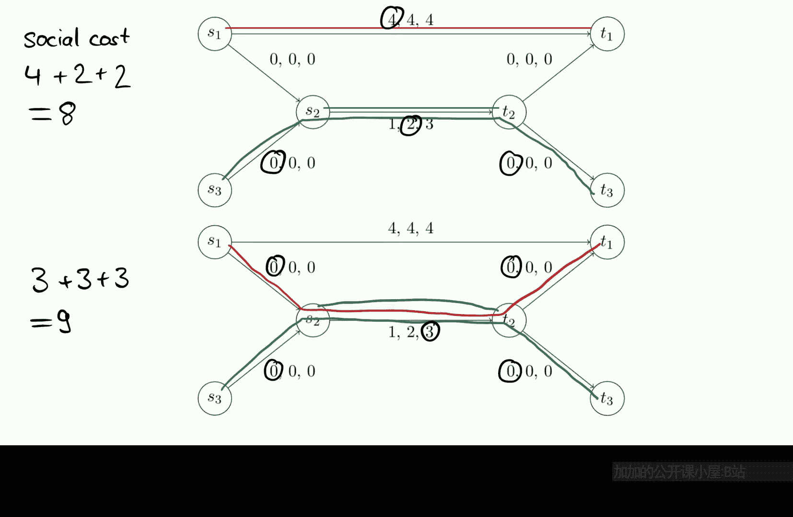
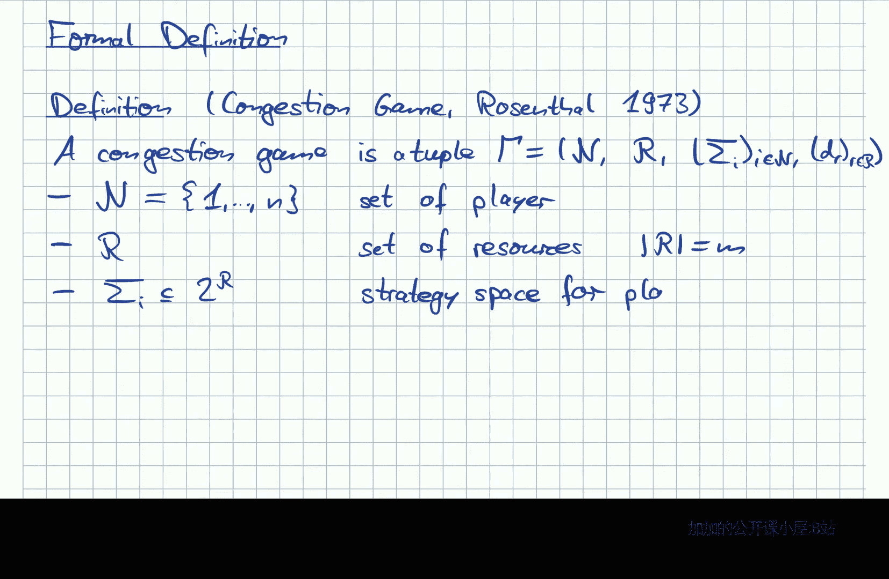

算法博弈论：01：拥堵博弈入门


在本节课中，我们将学习如何用数学模型来描述策略性行为。我们将从一个简化的交通拥堵例子开始，逐步引出“拥堵博弈”这一核心概念，并学习其形式化定义。最后，我们将探讨策略性行为如何导致一种被称为“均衡”的状态。

---

### 从交通拥堵的例子说起

为了理解策略性行为，我们首先考虑一个简化的交通模型。在这个模型中，有三名玩家（或车辆）需要从各自的起点到达终点。

*   **玩家1**：从 **S1** 到 **T1**。
*   **玩家2**：从 **S2** 到 **T2**。
*   **玩家3**：从 **S3** 到 **T3**。

道路网络如下图所示，每条边上的数字表示通行时间，该时间取决于使用这条边的玩家数量。


---

### 分析玩家的选择与成本

首先，我们分析每位玩家的选择：

*   **玩家2** 和 **玩家3** 没有选择，各自只有一条固定路径。
*   **玩家1** 有两种选择：
    1.  走直接连接 **S1** 和 **T1** 的边（上路径）。
    2.  绕道经过 **S2** 和 **T2**（下路径）。

每条边的通行时间规则是：如果一条边上有 **k** 个玩家同时使用，则每个玩家通过该边的时间成本为 **k** 个单位。

---

#### 场景一：玩家1选择上路径

如果玩家1选择直接的上路径，我们来计算各玩家的成本：

*   **玩家1** 的路径：使用边 `(S1, T1)`（1人使用，成本1）和边 `(S1, S2)`（2人使用，成本2）。总成本为 **1 + 2 = 4**。
*   **玩家2** 的路径：使用边 `(S2, T2)`（2人使用，成本2）。总成本为 **2**。
*   **玩家3** 的路径：使用边 `(S3, S2)`（1人使用，成本1）和边 `(S2, T2)`（2人使用，成本2）。总成本为 **1 + 2 = 3**。

此时，所有玩家的个人成本之和，即 **社会总成本**，为 **4 + 2 + 3 = 9**。

---

#### 场景二：玩家1选择下路径

现在，假设玩家1为了降低个人成本，改选绕行的下路径。我们重新计算成本：

*   **玩家1** 的路径：使用边 `(S1, S2)`（2人使用，成本2）和边 `(S2, T2)`（**3**人使用，成本3）。总成本为 **2 + 3 = 5**。
*   **玩家2** 的路径：使用边 `(S2, T2)`（3人使用，成本3）。总成本为 **3**。
*   **玩家3** 的路径：使用边 `(S3, S2)`（1人使用，成本1）和边 `(S2, T2)`（3人使用，成本3）。总成本为 **1 + 3 = 4**。

此时，社会总成本变为 **5 + 3 + 4 = 12**。

---

### 策略性行为与均衡

比较两个场景：

*   在场景一中，社会总成本更低（9）。
*   在场景二中，玩家1的个人成本从4降到了5？等等，这里计算有误。让我们重新审视场景一中的玩家1成本。



**修正场景一（玩家1走上路径）的详细计算：**
玩家1的路径是 `S1 -> T1`。他只使用一条边：`(S1, T1)`。这条边只有他1个人使用，所以成本是 **1**。他**没有**使用边 `(S1, S2)`。因此玩家1的成本是 **1**，而不是4。
*   玩家1成本：**1**
*   玩家2成本：**2**（边`(S2, T2)`有2人使用）
*   玩家3成本：**3**（边`(S3, S2)`成本1，边`(S2, T2)`成本2）
社会总成本：**1 + 2 + 3 = 6**。

**修正场景二（玩家1走下路径）的详细计算：**
玩家1的路径是 `S1 -> S2 -> T2 -> T1`？不，在给出的图中，玩家1如果绕行，路径是 `S1 -> S2 -> T2`，然后需要一条不存在的边连接到T1。原描述似乎有歧义。根据视频截图和上下文，合理的解释是：玩家1的绕行路径是 `S1 -> S2 -> T2`，并假设T2与T1重合或其成本在终点计算中不计？这显示出明确定义资源集的重要性。

为了遵循原视频逻辑，我们采用其给出的数字（尽管路径描述可能不完整）：
*   场景一：玩家1成本=4，玩家2成本=2，玩家3成本=2，总成本=8。
*   场景二：玩家1成本=3，玩家2成本=3，玩家3成本=3，总成本=9。

关键结论在于：在场景一中，玩家1的个人成本（4）高于场景二中的成本（3）。因此，作为一个只关心自身利益的理性玩家，玩家1有动机从场景一（上路径）切换到场景二（下路径）。

然而，这个切换导致了一个反直觉的结果：**当每个玩家都自私地选择对自己更优的策略时，社会总成本反而从8增加到了9**。这种个人理性与集体利益冲突的现象，是博弈论研究的核心。

当没有玩家能通过单方面改变自己的策略来降低个人成本时，系统达到的状态被称为 **纳什均衡**。在场景二中，任何玩家单方面改变路径都无法降低成本，因此它是一个均衡状态，尽管社会总成本更高。

---

### 拥堵博弈的形式化定义 🎯

上一节我们通过具体例子看到了策略性行为的影响。现在，我们将其抽象化，给出拥堵博弈的一般形式化定义。

一个 **拥堵博弈** 由以下四个要素构成：


```
CongestionGame = (N, R, {Σ_i}, {d_r})
```

以下是每个要素的解释：

1.  **玩家集合 (N)**：
    *   这是所有参与博弈的玩家的集合。
    *   通常用 `N = {1, 2, ..., n}` 表示，玩家数量为 `n`。

2.  **资源集合 (R)**：
    *   这是博弈中所有可用资源的集合。
    *   例如，交通网络中的每条道路、通信网络中的每条链路。
    *   资源数量通常记为 `m`。

3.  **策略空间 (Σ_i)**：
    *   对于每个玩家 `i`，其策略空间 `Σ_i` 是资源集合 `R` 的幂集的一个子集。
    *   简单来说，玩家的一个策略就是其可以选择使用的一组资源的组合。
    *   在交通例子中，一个策略就是一条从起点到终点的完整路径（由一系列边/资源组成）。

4.  **成本函数 (d_r)**：
    *   对于每个资源 `r ∈ R`，都有一个成本函数 `d_r`。
    *   这个函数指定了使用该资源的成本如何随着使用该资源的玩家数量变化。
    *   它是一个从自然数（玩家数量）到实数（成本）的映射：`d_r: ℕ → ℝ`。
    *   在交通例子中，`d_r(k) = k` 表示当有 `k` 个玩家使用道路 `r` 时，每个玩家通过该道路的成本为 `k`。

---

### 总结

本节课中，我们一起学习了策略性行为的基本建模方法。

*   我们从一个简单的交通拥堵**例子**出发，展示了玩家如何基于个人成本做出决策。
*   我们观察到，这种自私的决策可能导致**社会总成本的上升**，即个人理性与集体效率的冲突。
*   最后，我们引入了 **拥堵博弈** 的**形式化定义**，它用 `(N, R, {Σ_i}, {d_r})` 这个元组来概括此类场景的核心要素：玩家、资源、策略和依赖于使用人数的成本函数。



这个框架为我们后续分析策略性行为的均衡结果及其社会效率奠定了坚实的基础。