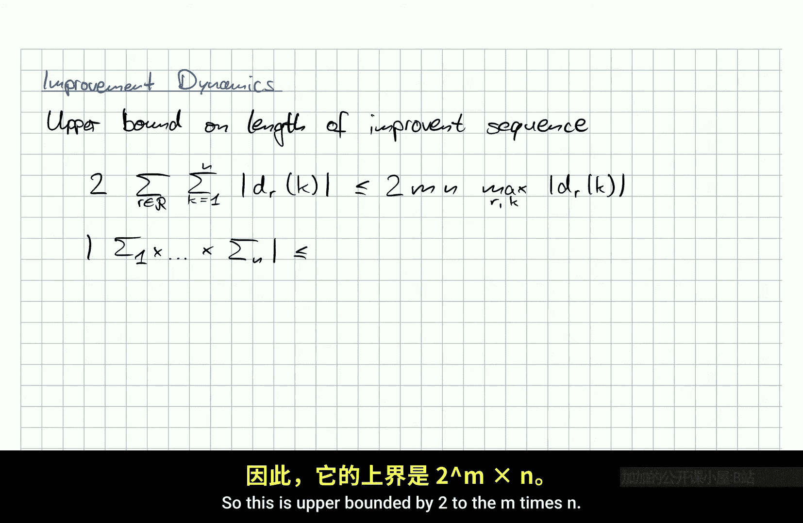

# 003：计算拥塞博弈中的均衡

欢迎回到我们的算法博弈论课程。在上一讲中，我们介绍了拥塞博弈，并证明了每个拥塞博弈总是存在一个纯纳什均衡。

今天，我们将开始探讨一个问题：计算这样的均衡是容易还是困难。这实际上是一个重要的问题，因为如果一个均衡易于计算，那么玩家很可能真的会按照这个均衡来行动。反之，如果计算均衡很困难，那么假设玩家会达到这个均衡就是一个相当强的假设。事实上，正如我们将在后续课程中展示的，一般来说，计算均衡是困难的。但对于一些特殊情况，存在多项式时间算法。今天，我们将展示两个非常有趣且简单的特殊情况。

但在开始之前，让我们先回顾一下上一讲关于拥塞博弈的内容。

## 拥塞博弈回顾

首先，什么是拥塞博弈？一个拥塞博弈由以下四个要素组成：
1.  **玩家集合**：通常记为 `{1, 2, ..., n}`。
2.  **资源集合**：通常记为 `{1, 2, ..., m}`。这些资源可以是图中的边，也可以是其他东西。
3.  **策略集合**：每个玩家 `i` 有一个策略集 `S_i`。策略是资源集合的子集，即策略空间是资源集合幂集的一个子集。
4.  **延迟函数**：每个资源 `r` 有一个延迟函数 `d_r`，它将使用该资源的玩家数量映射到一个整数。

这允许我们定义一个状态中玩家 `i` 的成本。什么是状态？状态就是每个玩家选择了一个策略，即一个来自所有策略空间笛卡尔积的 `n` 维策略向量 `S = (s_1, s_2, ..., s_n)`。

在这样的一个状态 `S` 中，玩家 `i` 的成本定义如下：取该玩家在其策略 `s_i` 中使用的所有资源，然后累加这些资源的延迟函数值，延迟函数的输入是使用该资源的玩家数量 `n_r(S)`。公式表示为：
`cost_i(S) = Σ_{r ∈ s_i} d_r(n_r(S))`

我们定义了一个纯纳什均衡：一个状态 `S` 是纯纳什均衡，当且仅当没有玩家可以通过单方面改变自己的策略来降低其成本。这意味着对于所有玩家 `i` 和所有可能的替代策略 `s_i'`，都有：
`cost_i(S) ≤ cost_i(s_i', S_{-i})`
其中 `S_{-i}` 表示除玩家 `i` 外其他所有玩家的策略。

我们证明了总是存在这样的纯纳什均衡状态。我们是如何证明的呢？我们使用了 Rosenthal 势函数。这个势函数定义如下：
`Φ(S) = Σ_{r ∈ R} Σ_{k=1}^{n_r(S)} d_r(k)`

这个势函数之所以重要，是因为我们证明了以下引理：当只有一个玩家改变其策略时，势函数的变化量恰好等于该玩家成本的变化量。这有助于证明任何改进序列都必须是有限的，因为每当一个玩家改进其策略（即降低成本）时，Rosenthal 势函数也会恰好减少相同的量。这意味着，当我们跟随这样一个改进序列时，Rosenthal 势函数会不断下降，最终必然会达到一个无法再下降的状态，即纯纳什均衡。

## 计算均衡的潜在算法

现在，让我们讨论计算这种纯纳什均衡的潜在算法。实际上，我们的存在性证明中已经隐含了一种算法：我们证明了任何改进序列都是有限的。这意味着我们可以通过以下方式找到一个均衡：从任意可能的状态开始，然后遵循一个改进序列，直到无法进一步改进为止，此时我们就得到了一个纯纳什均衡。

这是一个多项式时间算法吗？正如我们将看到的，这取决于我们所讨论的博弈结构。关键问题是：这些序列会有多长？

我们已经看到了序列长度的一个上界，这个上界就在我们的证明中。让我们把它写下来。我们上次证明的上界是：
`2 * Σ_{r ∈ R} Σ_{k=1}^{n} |d_r(k)|`
或者，我们可以说这是 `2 * m * n * max_{r, k} |d_r(k)|`。这意味着我们考虑的是所有延迟函数在所有可能输入下绝对值的最大值。

这是一个多项式上界吗？不是。在计算机科学的术语中，它只是伪多项式。为什么？因为它依赖于数值的大小。例如，数字 `2^10` 只需要 10 比特来表示。一个依赖于 `2^10` 的保证是多项式的，但这里我们只关心表示它所需的比特数。所以这不是我们想要的多项式上界，尽管它稍后会有所帮助。

我们还可以使用另一个上界：我们知道任何改进序列都是有限的，那么改进序列长度的上界是什么？它不能两次访问同一个状态，所以状态的数量也是一个上界。状态的数量如何表示？它就是所有策略空间笛卡尔积的基数，因此上界是 `2^(m*n)`。这显然是有限的，但它不是关于 `m` 和 `n` 的多项式上界。

那么，是否存在这么长的改进序列呢？还是说这只是一个很松的上界？

## 改进序列的长度

为了回答这个问题，让我们考虑一个具体的例子。假设我们有一个对称的拥塞博弈，其中所有玩家都有相同的策略集。资源集合是 `{1, 2, ..., m}`。每个玩家 `i` 的策略集 `S_i` 是资源集合的所有子集。延迟函数定义为：对于每个资源 `r`，`d_r(k) = 2^k`。

现在，考虑以下改进序列：从所有玩家都选择空集作为策略的状态开始。然后，玩家 1 将其策略改为包含资源 1。由于延迟函数是递增的，这个改变会降低玩家 1 的成本吗？实际上，由于之前没有玩家使用资源 1，现在玩家 1 使用它，成本从 0 增加到 `2^1 = 2`，所以这不是一个改进。我们需要重新设计序列。

让我们设计一个延迟函数，使得改进步骤可以持续很长时间。考虑延迟函数 `d_r(k) = -k`（负号表示成本为负，即收益）。那么，当更多玩家使用资源时，每个玩家的收益（负成本）会增加。在这种情况下，改进步骤可能是玩家不断加入使用某个资源，因为这会增加每个人的收益。然而，我们需要确保每个改进步骤都是单方面的且严格降低成本（即增加收益）。

实际上，我们可以构造一个博弈，其中改进序列的长度是指数级的。这超出了本教程的范围，但重要的是要认识到，在最坏情况下，简单的“跟随改进路径”算法可能需要指数时间才能收敛到均衡。

因此，对于一般的拥塞博弈，计算纯纳什均衡是困难的（具体来说，是 PLS-完全的，这是一个描述局部搜索问题复杂性的复杂度类）。然而，对于某些特殊结构的拥塞博弈，我们可以设计出多项式时间算法。

## 特殊情况下的多项式时间算法

在本节中，我们将看看两种特殊情况，对于它们，存在计算纯纳什均衡的多项式时间算法。

### 情况一：单资源博弈

第一种特殊情况是当博弈中只有一个资源时。虽然这听起来很简单，但它能帮助我们理解基本思想。假设只有一个资源 `r`，所有玩家都必须决定是否使用它。策略集为 `{使用， 不使用}`。延迟函数为 `d_r(k)`，其中 `k` 是使用该资源的玩家数量。

均衡状态是：要么没有玩家使用资源（如果 `d_r(1) > 0`，即使用成本高于不使用），要么所有玩家都使用资源（如果 `d_r(n) < d_r(0)`，但注意 `d_r(0)` 通常未定义或为0，实际上我们需要比较使用与不使用的成本）。更一般地，均衡是玩家数量 `k` 使得 `d_r(k) ≤ d_r(k+1)` 且 `d_r(k) ≤ d_r(k-1)`（考虑边际成本）。对于这种单资源博弈，我们可以通过检查所有可能的 `k` 从 0 到 `n` 来在多项式时间内找到均衡。

### 情况二：线性延迟函数的对称网络拥塞博弈

第二种更重要的特殊情况是当博弈是**对称的**（所有玩家有相同的策略集）并且发生在**网络**上，同时延迟函数是**线性**的。具体来说：
*   **对称**：所有玩家 `i` 有相同的策略集 `S_i = S`。
*   **网络**：资源是图的边，策略是图中从源节点 `s` 到汇节点 `t` 的路径。
*   **线性延迟**：每条边 `e` 的延迟函数形式为 `d_e(x) = a_e * x + b_e`，其中 `a_e, b_e ≥ 0`。

对于这种博弈，我们可以将其转化为一个**最小成本流问题**，从而在多项式时间内找到均衡。以下是基本思想：

1.  在均衡状态下，所有玩家都选择一条从 `s` 到 `t` 的路径，并且没有玩家可以通过单方面切换到另一条路径来降低其成本。
2.  这等价于说，在均衡时，所有被使用的路径对于每个玩家来说具有相同的（最小）成本，并且任何未使用的路径的成本都高于或等于这个成本。
3.  对于线性延迟函数，这进一步等价于一个条件：流量（玩家）在边上的分布应使得边际成本总和最小化。实际上，均衡流恰好就是**将总流量 `n` 从 `s` 发送到 `t`，且每条边 `e` 上的成本函数为 `c_e(f_e) = a_e * f_e + b_e` 的最小成本流**，其中 `f_e` 是边 `e` 上的流量。
4.  最小成本流问题有多项式时间算法（例如，使用循环消去或成本缩放算法）。

因此，算法步骤如下：
*   给定一个对称网络拥塞博弈，玩家数量为 `n`，源节点 `s`，汇节点 `t`，以及具有线性延迟函数 `d_e(x)=a_e x+b_e` 的边。
*   构造一个流网络：每条边 `e` 的容量为 `n`（或无穷大），成本函数为 `c_e(f) = a_e * f + b_e`（注意：这是一个关于流量的函数，在最小成本流中通常表示为分段线性或凸函数，对于线性情况，可以特殊处理）。
*   计算从 `s` 到 `t` 的总流量为 `n` 的最小成本流。
*   这个最小成本流对应的路径分解（即流量在路径上的分配）就对应了博弈的一个纯纳什均衡（可能需要将整数流量分配给各个玩家，由于玩家是不可分的，我们需要整数流，但最小成本流问题可以处理整数需求）。

通过这种方式，我们利用优化问题的已知算法来解决均衡计算问题。

## 总结

在本节课中，我们一起学习了：
1.  回顾了拥塞博弈的定义、玩家成本、纯纳什均衡以及 Rosenthal 势函数。
2.  探讨了通过跟随改进序列来计算均衡的自然算法，并分析了其最坏情况下的时间复杂度可能是指数级的。
3.  介绍了两种特殊情况下计算纯纳什均衡的多项式时间算法：
    *   单资源博弈可以通过直接检查解决。
    *   对于具有线性延迟函数的对称网络拥塞博弈，可以将其转化为最小成本流问题，从而利用已有的多项式时间算法求解。

理解这些特殊情况非常重要，因为它们揭示了博弈结构如何影响均衡的计算复杂度，并为处理更复杂的博弈提供了思路。在接下来的课程中，我们将继续探索其他类型博弈的均衡计算问题。