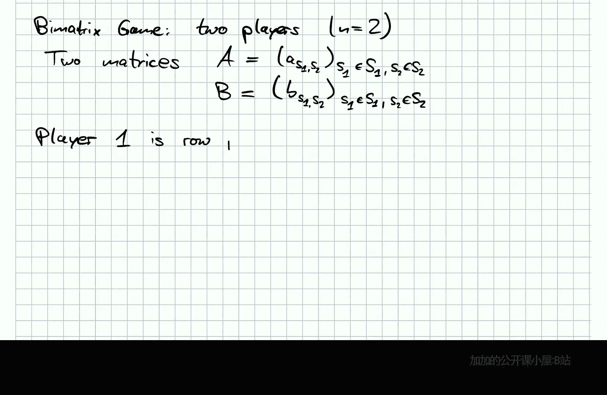

# 004：标准形式博弈与混合纳什均衡

欢迎回到我们的算法博弈论课程。很高兴你依然在这里。

到目前为止我们做了什么？我们介绍了拥堵博弈，并证明了在每一个拥堵博弈中，总是存在一个纯纳什均衡。

今天，我们将把我们考虑的博弈类别推广到所谓的**标准形式博弈**，并且也将推广**纯纳什均衡**的概念。但正如我们将看到的，并非总是存在纯纳什均衡。不过，我们将在下次课程中证明，总是存在一个**混合纳什均衡**。

但在讨论混合均衡之前，让我们先介绍更一般的博弈概念，即所谓的标准形式博弈。

## 什么是标准形式博弈？

让我们正式定义它。

我们说，一个**标准形式成本最小化博弈**是一个三元组 `(N, S, C)`。

这些符号代表什么？

*   **N** 是玩家的集合。通常玩家数量记为 `n`，玩家集合通常写作 `{1, 2, ..., n}`。
*   **S** 代表所有玩家的策略集合。对于每个玩家 `i`，我们有一个集合 `S_i`，这是该玩家的**纯策略**集合。所有玩家策略集合的笛卡尔积 `S = S_1 × S_2 × ... × S_n` 被称为**状态集**、**纯状态集**或**策略组合集**。
*   **C** 是成本函数。对于每个玩家 `i`，有一个成本函数 `C_i: S → ℝ`。这个函数将一个纯策略组合作为输入，映射到该玩家所承担的成本。

这个定义应该有些熟悉。在拥堵博弈的背景下，我们也有玩家集合 `N` 和每个玩家的策略集合。现在的符号略有不同，我在这里坚持使用标准符号，这可能偶尔会有些不便。在标准形式博弈中，`S_i` 表示策略集合，而在拥堵博弈中，`σ_i` 是集合中的一个元素。这个符号在整个课程中会保持一致，我为此提前表示歉意。

现在，所有玩家都从自己的策略集合中选择一个策略。这意味着玩家会承担特定的成本。

## 标准形式博弈的表示

实际上，我们可以将拥堵博弈纳入这个框架。如何做到呢？正如我所说，`S_i` 将再次是策略集合，在拥堵博弈的背景下，这些策略就是资源的子集。成本函数在拥堵博弈中具有特定的结构，但现在它们可以是任意函数。

我们如何定义其他类型的标准形式博弈呢？一个常见的方法是通过**双矩阵博弈**。

在双矩阵博弈中，总是有两个玩家。这意味着 `n = 2`。策略集合可以是任何我们关心的东西。成本函数现在通过两个矩阵 `A` 和 `B` 来描述，它们完全定义了成本函数。

以下是双矩阵博弈的工作原理：

*   玩家一（行玩家）选择矩阵的一个行。
*   玩家二（列玩家）选择矩阵的一个列。
*   成本由所选行和列交叉处的条目定义。

更正式地说，如果玩家一选择行 `i`，玩家二选择列 `j`，那么：
*   玩家一的成本是矩阵 `A` 中的元素 `A[i][j]`。
*   玩家二的成本是矩阵 `B` 中的元素 `B[i][j]`。

## 从纯策略到混合策略

上一节我们介绍了标准形式博弈及其表示。本节中，我们来看看当纯策略纳什均衡不存在时，如何扩展我们的均衡概念。

正如之前提到的，并非所有标准形式博弈都存在纯纳什均衡。为了解决这个问题，我们引入**混合策略**的概念。

一个混合策略允许玩家在其纯策略集合上进行概率分布。这意味着玩家不是确定性地选择一个策略，而是根据一个概率向量随机选择。

对于玩家 `i`，其混合策略 `x_i` 是一个概率分布，满足：
*   对于每个纯策略 `s ∈ S_i`，有 `x_i(s) ≥ 0`。
*   所有纯策略的概率之和为 1：`∑_{s ∈ S_i} x_i(s) = 1`。

所有玩家混合策略的组合 `x = (x_1, x_2, ..., x_n)` 称为一个**混合策略组合**。

在混合策略下，玩家的**期望成本**定义为：
`E[C_i(x)] = ∑_{s ∈ S} [ (∏_{j=1}^{n} x_j(s_j)) * C_i(s) ]`
其中，求和遍历所有可能的纯策略组合 `s = (s_1, s_2, ..., s_n)`。

## 混合纳什均衡

现在我们可以定义**混合纳什均衡**。一个混合策略组合 `x*` 是一个混合纳什均衡，如果对于每个玩家 `i` 和该玩家的任何其他混合策略 `x_i`，都有：
`E[C_i(x*_i, x*_{-i})] ≤ E[C_i(x_i, x*_{-i})]`
其中，`x*_{-i}` 表示除玩家 `i` 外所有其他玩家的均衡策略。

这意味着在均衡状态下，没有玩家可以通过单方面改变自己的混合策略来降低其期望成本。

## 总结

在本节课中，我们一起学习了：
1.  **标准形式博弈**的正式定义，它由玩家集合、策略集合和成本函数组成。
2.  如何使用**双矩阵**来表示两人博弈。
3.  当纯纳什均衡可能不存在时，引入了**混合策略**的概念，允许玩家进行随机化选择。
4.  定义了**混合纳什均衡**，它保证了在期望成本意义下，没有玩家有动机单方面偏离。

下次课程，我们将证明一个关键定理：**在任何有限的标准形式博弈中，至少存在一个混合纳什均衡**。这是博弈论中的一个基石结果。