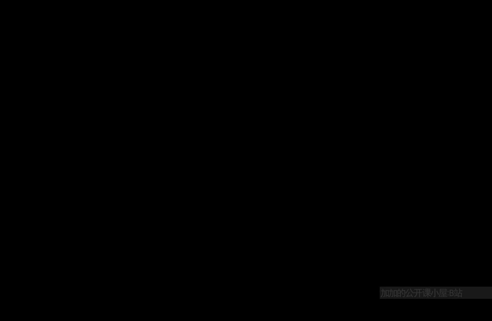
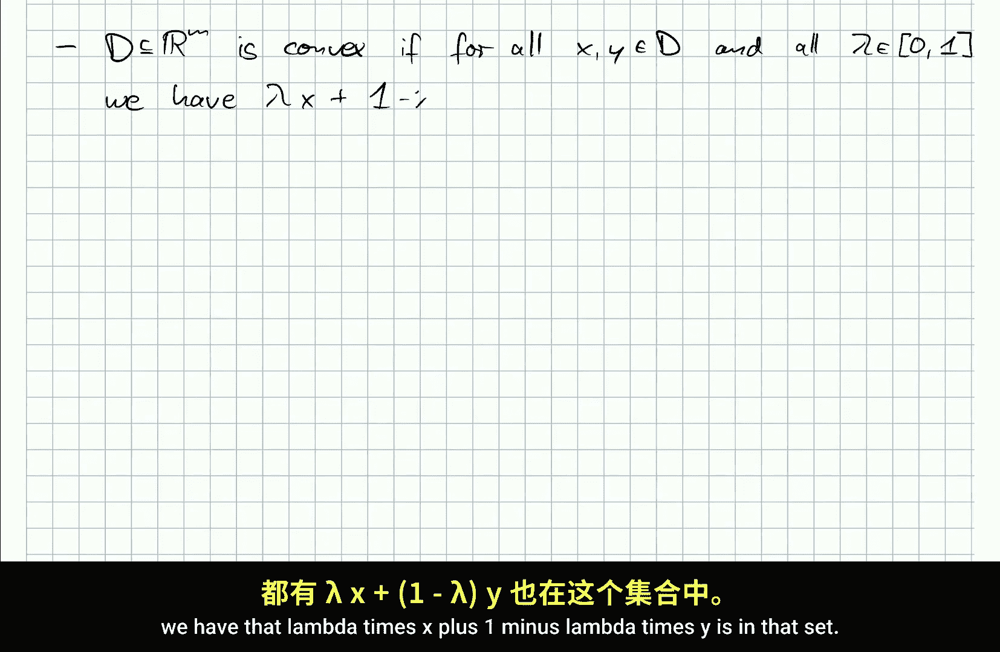

# 005：混合纳什均衡的存在性

在本节课中，我们将学习混合纳什均衡的存在性定理。我们将证明，在有限博弈中，混合纳什均衡总是存在的。为此，我们需要回顾一些概念，并引入一个重要的数学工具——布劳威尔不动点定理。

上一节我们介绍了标准形式博弈和混合纳什均衡的概念。本节中，我们将证明混合纳什均衡的存在性。

首先，让我们回顾一下标准形式博弈。到目前为止，本课程中考虑的所有博弈实际上都是成本最小化博弈，但我们也可以考虑收益最大化博弈。事实证明，今天讨论收益最大化博弈会更方便。

以下是标准形式收益最大化博弈的定义。

我们同样有 N 个玩家，每个玩家都有一组纯策略。但与成本函数不同，玩家现在有一个收益函数，通常写作 U_i。在一个状态 S 中（即每个玩家都选择了自己的一个策略），玩家 i 获得收益 U_i(S)。

之前我们是用成本 C_i 来介绍的。事实上，这完全是等价的，因为收益和成本都可以是任意数字。如果我们设 C(S) = -U(S)，那么我们得到的就完全是一个成本最小化博弈。因此，这里的目标是最大化你的收益，这完全等同于最小化你的负收益。这样，混合纳什均衡以及纯纳什均衡的概念都以一种相当直接的方式推广了。

但事实证明，对于今天的讨论，谈论收益最大化（即你实际上希望从博弈中获得尽可能多的收益）比谈论最小化自己的成本更自然一些。

今天同样有用的还有我们上次证明的这个引理，它表明：一个混合策略 Σ_i 是针对其他玩家策略 Σ_{-i} 的最佳反应，当且仅当该玩家在 Σ_i 下获得的收益不低于他或她切换到任何纯策略 S_i‘ 所能获得的收益。

这意味着，为了证明一个混合策略是最佳反应，我们实际上只需要与可能的纯策略偏离进行比较，而不是与所有可能的混合策略进行比较。

那么，我们今天想证明什么呢？今天我们将证明纳什定理，它告诉我们混合纳什均衡总是存在。但这有一个小小的前提，即它们仅在存在有限多个玩家和有限多个策略（每个玩家有有限多个纯策略）时才存在。但如果我们有这样一个有限的标准形式博弈，那么就总是存在一个混合纳什均衡。

让我们把它写下来：**每一个有限的标准形式博弈都有一个混合纳什均衡**。

“有限的标准形式博弈”是什么意思？这意味着我们有有限多个玩家，并且每个玩家有有限多个纯策略。

我们如何证明这样一个定理？这与证明拥塞博弈中纯纳什均衡的存在性相比，现在采用了一种非常不同的方式。因为我们应用的是一个不动点定理，所以我们实际上只做一个存在性证明。我们的证明实际上不是构造性的，即我们不会展示“这就是你找到这个均衡的方法”。

更准确地说，我们将应用布劳威尔不动点定理。它陈述了什么？

**每一个连续函数 F，从一个紧致的、凸的、非空的子集 D（D 是 R^m 的子集）映射到其自身，都有一个不动点 X\***。并且必须满足 F(X\*) = X\*。

那么，这一切意味着什么？也许让我们先消化一下这个定理，理解所有这些术语的含义。我希望你理解“连续”是什么意思。我也希望你知道“紧致”和“凸”是什么意思，但尽管如此，让我们慢慢地过一遍所有这些内容，以便我们真正理解它们的含义以及为什么这个陈述实际上并不那么令人惊讶。

让我们从凸性开始。我们说一个集合 D（它是 R^m 的子集）是凸的，如果对于所有位于 D 中的 X 和 Y，以及区间 [0, 1] 中的任意 λ，我们有：λ * X + (1 - λ) * Y 也在这个集合 D 中。

---

本节课中我们一起学习了混合纳什均衡的存在性定理（纳什定理）。我们了解到，在玩家数量和每个玩家的纯策略数量都有限的博弈中，混合纳什均衡总是存在的。证明的核心是应用了布劳威尔不动点定理，该定理保证了在满足特定条件（连续、紧致、凸）的集合上，自映射必然存在一个不动点。虽然这个证明是非构造性的，但它奠定了博弈论中均衡分析的重要数学基础。