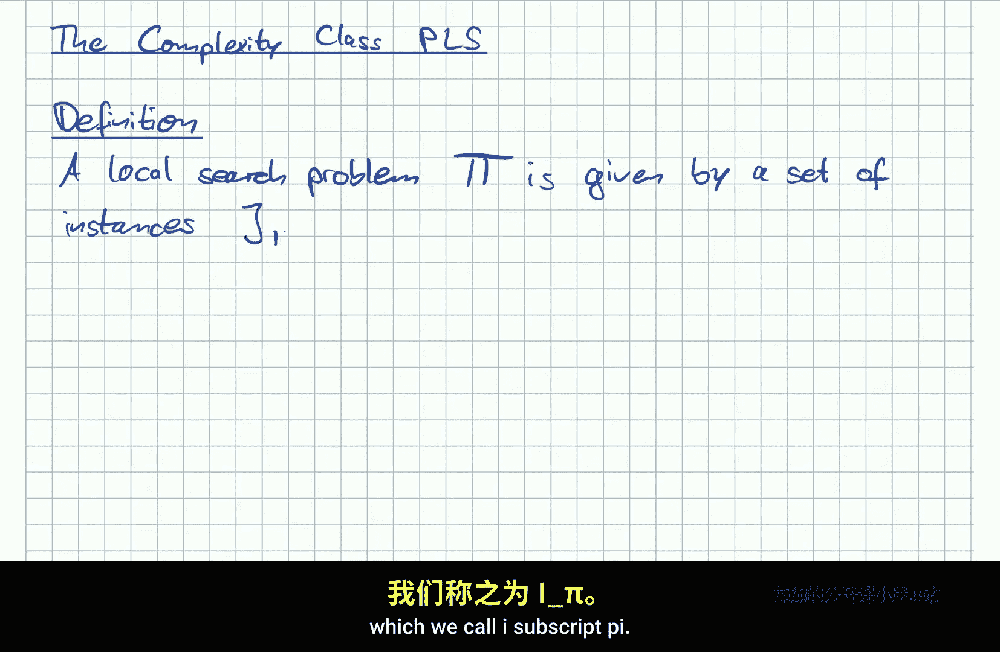

# 006：拥塞博弈中纯纳什均衡的复杂性

欢迎回到算法博弈论课程。到目前为止，我们已经介绍了拥塞博弈，并证明了拥塞博弈中总是存在纯纳什均衡。随后，我们引入了更一般的标准形式博弈，并证明了在玩家数量和每位玩家的策略数量有限的情况下，这类博弈中总是存在混合纳什均衡。

然而，我们目前还没有一个能在多项式时间内计算出这些均衡之一的算法。这确实有充分的理由，因为计算这样的均衡通常是困难的。

## 困难的含义与复杂性类别

但“困难”具体意味着什么？这是否意味着它们是NP问题？并非如此，因为NP是一个关于决策问题的复杂性类别，其答案总是“是”或“否”。而“这个拥塞博弈中是否存在纯纳什均衡？”这样的问题，答案总是“是”。因此，这是一个搜索问题，与我们通常在复杂性理论中处理的决策问题有根本的不同。

那么，复杂性理论能为这类搜索问题提供什么？搜索问题有哪些可能的复杂性类别？

## 搜索问题的复杂性类别

这类问题的特点是：给定某种输入，我们需要在输入中搜索问题的解。当然，答案也可能是“不存在这样的解”。

存在一个复杂性类别 **FP**，它代表“函数多项式时间可解”。这类似于决策问题中的P类，意味着你总能在多项式时间内找到一个解。

另一个类别是 **FNP**。这与决策问题中的NP类相对应。它意味着找到一个解可能很困难，但验证一个给定的解是否可行相对容易，可以在多项式时间内完成。

我们可能希望，在标准形式博弈中寻找混合纳什均衡，或在拥塞博弈中寻找纯纳什均衡，是FNP困难的。但这并不完全准确。实际上，这些问题是FNP的子类 **PPAD** 和 **PLS** 困难的。

具体来说，在标准形式博弈中寻找混合纳什均衡是 **PPAD完全** 问题。而在拥塞博弈中寻找纯纳什均衡是 **PLS完全** 问题。本节课我们将重点讨论PLS，但希望你能理解PPAD的定义虽然更复杂，但其本质与PLS非常相似，都是对搜索问题复杂性的一种建模。

## 输入编码的重要性

这里有一个重要的问题：如何编码输入？即使在经典的P与NP问题中，输入编码方式也至关重要。例如，存在“伪多项式时间”的概念：如果你用二进制编码数字，背包问题就变成了多项式时间可解的。在我们的问题中也有类似的影响。

对于拥塞博弈，一个关键点在于你可以非常简洁地描述它们。对于一个一般的标准形式博弈（如双矩阵博弈），你通常需要写下整个收益表。但对于拥塞博弈，你只需要指定延迟函数。这占用的输入空间要小得多。

正因为如此，遍历双矩阵博弈的整个表格，找出哪些是纯纳什均衡，相对容易。但在拥塞博弈中，事情要复杂得多，仅仅因为其输入表示本身就小得多。我们已经在改进序列长度的上下文中看到了这一点：即使只有一名玩家和M个资源，也可能有多达 `2^M` 个不同的状态，其中任何一个都可能是纯纳什均衡。始终记住，输入编码方式至关重要。

## PLS复杂性类别的定义

那么，我们如何为搜索问题定义一个复杂性类别？这显然取决于我们想要建模哪种搜索问题。对于PLS，我们建模的是**局部搜索问题**。这应该让你想起，纯纳什均衡正是Rosenthal势函数的局部最小值。因此，所有这一切的核心就是寻找这些局部最小值。

我们如何一般性地建模这样一个局部搜索问题？一个局部搜索问题 **Π** 由以下部分组成：

*   一组实例，记为 **I_Π**。

---

**本节课总结**

在本节课中，我们一起学习了算法博弈论中均衡计算的复杂性。我们明确了寻找均衡是一个搜索问题，而非决策问题。我们介绍了搜索问题的复杂性类别FP和FNP，并指出寻找混合纳什均衡和纯纳什均衡分别属于PPAD完全和PLS完全问题。我们重点探讨了PLS类别，它专门用于刻画局部搜索问题的复杂性，而拥塞博弈中的纯纳什均衡正是其势函数局部最小值的寻找问题。最后，我们强调了输入编码方式对问题复杂性的关键影响，特别是在拥塞博弈这种可以简洁表示的模型中。