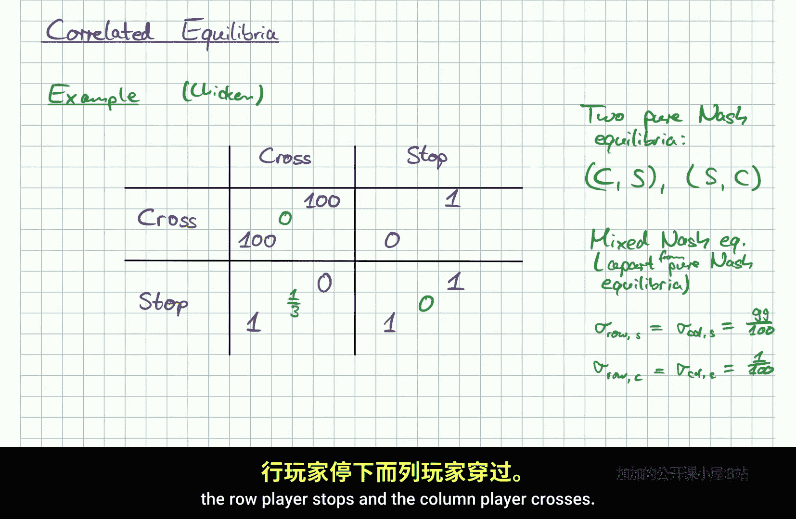

# 007：相关均衡

欢迎回到算法博弈论课程。

在本节课中，我们将要学习一种新的均衡概念——相关均衡。我们将看到，与之前讨论的纯策略纳什均衡和混合策略纳什均衡相比，相关均衡在某些情况下更容易计算。

## 课程概述

到目前为止，我们已经学习了纯策略纳什均衡，并证明了它在拥堵游戏中总是存在。我们也学习了混合策略纳什均衡，它在有限游戏中总是存在。但是，我们也了解到均衡通常难以计算，这在纯策略均衡和拥堵游戏的例子中已经体现。正如之前提到的，类似的困难性结果也适用于混合策略纳什均衡。

今天，我们将认识另一类均衡，即相关均衡，并且我们将展示它们实际上是易于计算的。

## 从一个例子开始：斗鸡博弈

让我们从一个简单的相关均衡例子开始，即斗鸡博弈。这里有两个玩家，他们拥有相同的策略：**穿越**或**停止**。

这个游戏背后的故事是：两个汽车司机正接近一个十字路口。他们可以决定穿越或停止。如果他们都决定穿越，就会发生事故，这对双方都造成很高的成本，例如设为100。如果一方停止，则停止方产生成本1（等待成本），而穿越方成本为0。如果双方都停止，则双方都产生等待成本1。

那么，这个游戏的纯策略纳什均衡是什么？实际上有两个纯策略纳什均衡：一个玩家穿越，另一个玩家停止。此外，还存在一个混合策略纳什均衡。在这两个纯均衡中，当然也是混合均衡。在混合均衡中，每个玩家停止的概率是99/100，穿越的概率是1/100。

这是我们在交通状况中通常会看到的吗？我们可能会看到这两个纯均衡之一，例如，如果某条道路有优先通行权。但我们希望永远不会看到双方在接近十字路口前抛硬币决定停止与否的情况。然而，交通灯经常出现，它告诉我们该做什么，并且遵循交通灯指示是一个好主意。因为如果不这样做，就可能发生事故。这正是相关均衡（或粗相关均衡，在这种游戏中两者相同，我们稍后会讨论区别）可以体现的思想。

## 什么是相关均衡？

相关均衡是状态上的一个概率分布。到目前为止，我们讨论的混合策略纳什均衡是策略上的概率分布向量或轮廓。这意味着混合纳什均衡实际上也为每个状态分配了一个概率，但这个概率是以一种非常明确的方式计算的：我们取各自策略被采用概率的乘积。

让我们在这个例子中看看：我们有概率 `(99/100) * (99/100)` 对应右下角方格（双方都停止），概率 `(1/100) * (1/100)` 对应左上角方格（双方都穿越），其他两个方格的概率是 `(99/100) * (1/100)`。因此，我们也可以将混合纳什均衡视为为每个状态分配概率分布。纯策略纳什均衡也这样做，但方式很平凡：它只将一个状态的概率设为1，其他状态为0。

相关均衡做的正是同样的事情，但它不是一个乘积分布。

## 相关均衡示例

那么，相关均衡可能是什么样子呢？让我们改变这个例子。我们可能不说双方以零概率穿越或停止，而是说：以概率1/3，行玩家停止，列玩家穿越；以概率2/3，行玩家穿越，列玩家停止。

## 总结

在本节课中，我们一起学习了相关均衡的概念。我们通过斗鸡博弈的例子，了解了相关均衡如何作为一种概率分布存在，并且它不要求是各玩家策略的独立乘积分布。与纯策略和混合策略纳什均衡相比，相关均衡提供了另一种协调机制，并且在某些实际场景（如交通信号灯）中自然存在。我们还了解到，相关均衡在计算上可能比纳什均衡更容易处理。