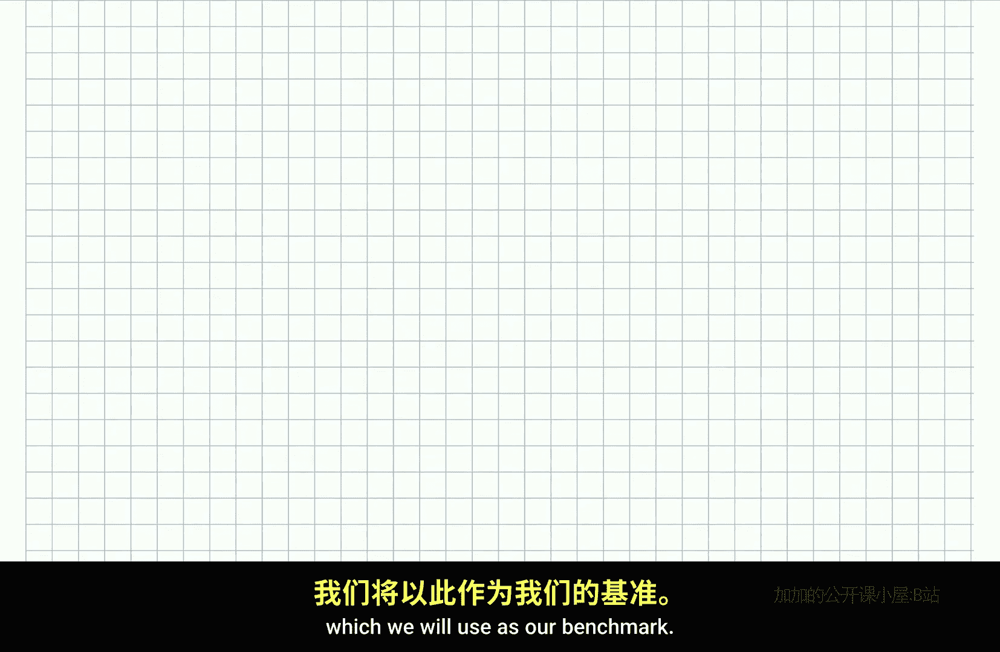

# 008：最小化外部遗憾

欢迎回来，我们继续学习算法博弈论。今天我们将要讨论的内容会非常具有算法性。

上一节我们介绍了相关均衡和粗相关均衡，并且了解了无遗憾动态。但对于这些动态过程，缺失的一环是每个玩家个体用来选择下一步策略的算法。我们了解到，这个算法必须满足无遗憾保证，才能确保所有玩家的整体行为最终收敛到一个粗相关均衡。

正如之前所说，现在唯一缺失的部分就是这些算法如何工作。让我们再次回顾一下这类算法的问题陈述，我们在上一节已经初步介绍过。

## 问题设定

我们将进行 **T** 轮游戏。在每一轮 **t** 中，会发生以下事情：

1.  我们有一个玩家。
2.  该玩家选择一个概率分布 **p^t**，这是一个向量 `(p1^t, p2^t, ..., pN^t)`，代表她对 **N** 个策略的选择概率。
3.  然后，一个对手选择一个成本向量 **l^t**，为每个策略分配一个成本值。我们假设这些成本值在 **0** 到 **1** 之间。
4.  接着，根据概率分布 **p^t** 随机抽取一个策略 **i^t**。
5.  玩家承担成本 **l_i^t^t**，并且获知整个成本向量 **l^t**。

理解事件发生的顺序至关重要：玩家在对手选择成本向量之前就已经确定了概率分布，但玩家尚未确定具体执行哪个策略，这个策略是在对手给出成本之后才根据概率分布抽取的。

## 基准的选择

一个自然的基准是“事后看来最优的行动序列”。这个基准会是怎样呢？那就是在每一轮 **t** 都选择成本最低的那个行动，然后对所有轮次求和：

**公式：** `最佳行动序列成本 = Σ_t ( min_i l_i^t )`

然而，这个基准过于强大，因为对手可以根据玩家选择的概率分布来调整成本。让我们看一个例子来理解为什么。

假设只有 **2** 个策略。对手可以这样选择成本向量 **l^t**：
*   如果玩家给第一个策略分配的概率 **p1^t ≥ 0.5**，则令 **l^t = (1, 0)**。
*   否则，令 **l^t = (0, 1)**。

因为玩家总是至少对一个策略分配至少 0.5 的概率，对手可以据此调整。在这种情况下，算法的期望成本在每一轮至少是 0.5，因此总期望成本至少为 **0.5T**。然而，“事后看来最优的行动序列”成本总是 0，因为每一轮都有一个成本为 0 的行动。

因此，我们需要一个不同的、更合理的基准。

## 外部遗憾的定义

我们将使用的基准是“外部遗憾”。外部遗憾衡量的是，与始终固定选择某一个策略相比，我们的算法多付出了多少成本。

**公式：** `外部遗憾 R^T = [ Σ_t l_i^t^t ] - [ min_i Σ_t l_i^t ]`

其中：
*   `Σ_t l_i^t^t` 是算法实际承担的累积（期望）成本。
*   `min_i Σ_t l_i^t` 是固定选择某个策略 **i** 所能获得的最小累积成本（在所有策略中取最小）。

我们的目标是设计算法，使得随着轮数 **T** 增加，**平均外部遗憾 R^T / T** 趋近于 0。这样的算法被称为“无外部遗憾”算法。

## 算法设计思路

那么，如何设计这样的算法呢？核心思想是：根据策略过去的表现来调整选择它的概率。表现越好（累积成本越低）的策略，在未来被选中的概率应该越高。

一个经典且直观的算法是“乘性权重更新算法”（MWU），有时也称为“Hedge 算法”或“指数权重算法”。以下是它的工作原理。

### 乘性权重更新算法（MWU）

**初始化：**
*   设置权重：对于每个策略 **i**，`w_i^1 = 1`。
*   参数：选择一个学习率 **η > 0**，通常 `η = sqrt( (ln N) / T )`，如果我们知道总轮数 **T** 的话。

**在每一轮 t = 1, 2, ..., T 中：**
1.  **根据权重选择分布：** 根据当前权重计算选择每个策略的概率。
    **公式：** `p_i^t = w_i^t / ( Σ_j w_j^t )`
2.  **根据分布 p^t 随机选择策略 i^t，并观察成本向量 l^t。**
3.  **更新权重：** 对于每个策略 **i**，用观察到的成本更新其权重。成本越高，权重惩罚越大。
    **公式：** `w_i^{t+1} = w_i^t * (1 - η)^(l_i^t)`
    *   由于 `l_i^t` 在 0 到 1 之间，`(1 - η)^(l_i^t)` 是一个介于 `(1 - η)` 和 `1` 之间的因子。成本为 0 时权重不变，成本为 1 时权重乘以 `(1 - η)`。

以下是该算法的关键特性说明：

*   **概率更新：** 算法通过降低高成本策略的权重，从而降低其未来被选中的概率。
*   **学习率 η：** 参数 η 控制着更新的强度。η 越大，对近期成本的响应越迅速，但波动也可能更大。
*   **理论保证：** 可以证明，MWU 算法的外部遗憾上界为 **O( sqrt(T ln N) )**。这意味着平均遗憾以 **O( sqrt( (ln N) / T ) )** 的速度趋近于 0。

## 从个体算法到均衡

现在，让我们回到最初的博弈论背景。如果在一个多人博弈中，每个玩家都独立运行一个这样的无外部遗憾算法（如 MWU）来选择自己的策略，那么长期来看，所有玩家策略的联合分布会收敛到该博弈的一个**粗相关均衡（CCE）**。

**原因如下：**
1.  无外部遗憾保证意味着，对于每个玩家来说，她所采用的策略序列不比她始终固定选择任何一个单一策略差。
2.  在博弈中，固定选择某个策略的收益，可以与针对其他玩家历史平均行为的最佳反应收益进行比较。
3.  通过遗憾最小化的性质，可以推导出没有玩家能够通过单方面偏离到固定策略来显著改善自己的收益，这正是粗相关均衡的定义。

## 总结

本节课我们一起学习了算法博弈论中连接个体学习与群体均衡的关键工具：无遗憾算法。

*   我们首先明确了**在线决策问题**的设定：玩家顺序选择混合策略，对手随后给出成本，玩家根据混合策略抽样行动并承担成本。
*   我们认识到“最优固定行动”是一个合理且可实现的比较基准，并据此定义了**外部遗憾**。
*   我们重点介绍了**乘性权重更新算法（MWU）**，它通过根据历史成本指数式地更新策略权重，实现无外部遗憾。
*   最后，我们了解到，当博弈中的每个玩家都运行此类无外部遗憾算法时，他们的长期行为会收敛到博弈的一个**粗相关均衡**。

这为我们提供了一种分布式的、基于学习的途径来达到博弈的均衡状态，是算法博弈论中的一个核心概念。