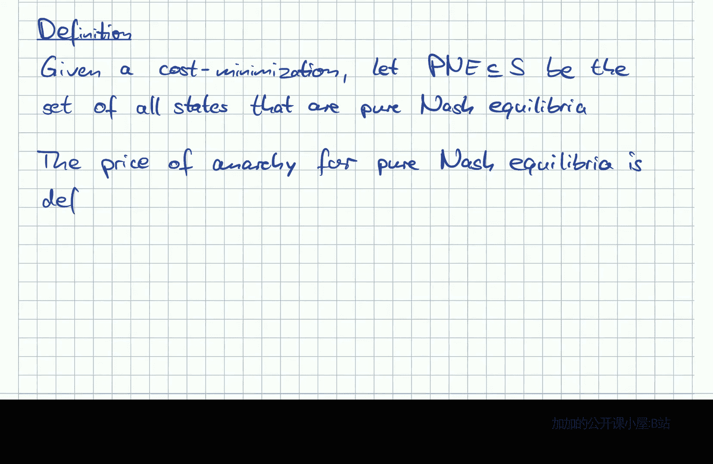

# 009：无政府状态代价

欢迎回到我们的算法博弈论课程。

到目前为止，我们已经学习了多种建模策略行为的方法。更准确地说，我们学习了均衡概念，这些概念反映了策略行为可能导致的状态。但在之前的讨论中，我们隐含地认为策略行为对社会而言是某种“坏事”。今天我们将探讨这一点，并尝试使用所谓的“无政府状态代价”来量化这种影响。

我们将讨论均衡的社会成本。

## 什么是社会成本？

社会成本有多种定义方式。我们今天将使用的概念如下：一个状态 **S** 的社会成本，我们简单地写作所有参与者所承担成本的总和。你可能也想取所有参与者成本的最大值，这实际上取决于你，以及你认为哪种方式最能反映当前情境下的社会成本概念。但今天，我们只采用最小化所有参与者成本总和这一视角。

## 均衡与社会最优的差异

正如我们所见，在均衡状态下，社会成本可能并非最小。让我们通过一个非常具体的例子再次观察这一点。

我们来看一个对称网络拥塞博弈。其中，从起点 **S** 到终点 **T** 只有两条路径：上边和下边。上边的延迟函数是递增的：如果只有一个参与者使用该资源，延迟为 **1**；如果有两个参与者使用，延迟为 **2**，依此类推。而下边的延迟始终是 **4**，无论有多少参与者使用这条边。

那么，这里可能发生什么？一般来说，有五种可能的状态：所有参与者都使用上边；一个参与者使用下边，其余三个使用上边；等等。当然，对个人而言，你是哪个参与者很重要，但对于我们的分析来说，这并不重要。因此，我们可以为这五种不同的状态写下它们的社会成本。

以下是所有参与者使用不同路径组合时的社会成本计算：

*   **所有4人使用上边**：每人延迟为 **4**，社会成本为 `4 * 4 = 16`。
*   **3人使用上边，1人使用下边**：上边3人每人延迟为 **3**，下边1人延迟为 **4**，社会成本为 `3 * 3 + 4 = 13`。
*   **2人使用上边，2人使用下边**：上边2人每人延迟为 **2**，下边2人每人延迟为 **4**，社会成本为 `2 * 2 + 2 * 4 = 12`。
*   **1人使用上边，3人使用下边**：上边1人延迟为 **1**，下边3人每人延迟为 **4**，社会成本为 `1 + 3 * 4 = 13`。
*   **所有4人使用下边**：每人延迟为 **4**，社会成本为 `4 * 4 = 16`。

现在的问题是，哪些状态是纳什均衡？如果所有参与者都使用上边，这实际上是一个纳什均衡。同样，如果三个参与者使用上边，一个参与者使用下边，这也是一个纳什均衡。同时，我们看到对社会最有利的情况，即社会成本仅为 **12**，是当两个参与者使用上边，两个参与者使用下边时。这意味着，由于策略行为，我们承担了比最优分配更高的社会成本。

## 无政府状态代价的正式定义

那么，如何以更正式或更量化的方式描述这一点呢？社会最优成本是 **12**，而均衡状态下的社会成本可能高达 **16**。这就是我们所说的“无政府状态代价”，即 **16** 与 **12** 的比率，因为它衡量了由于策略行为导致成本增加的倍数。

我们也可以考虑 **13** 除以 **12** 的比率，这实际上是“稳定代价”，我们可能下次会讨论，它比较的是这些均衡中最好的一个与社会最优成本。

但正如我所说，今天我们感兴趣的是无政府状态代价。这是均衡状态下的社会成本与最优社会成本之间最差的比率。

对于一个成本最小化博弈，我们设 **P** 为所有纳什均衡状态的集合。那么，对于纳什均衡的无政府状态代价定义为：

其中，**SC(S)** 表示状态 **S** 的社会成本，**S*** 表示社会最优状态。

## 总结

在本节课中，我们一起学习了如何量化策略行为对社会造成的负面影响。我们引入了“社会成本”的概念，并通过一个具体的拥塞博弈例子，展示了均衡状态下的社会成本可能高于社会最优成本。最后，我们正式定义了“无政府状态代价”这一核心指标，它衡量了在最坏均衡情况下，社会成本相对于最优成本的放大倍数。