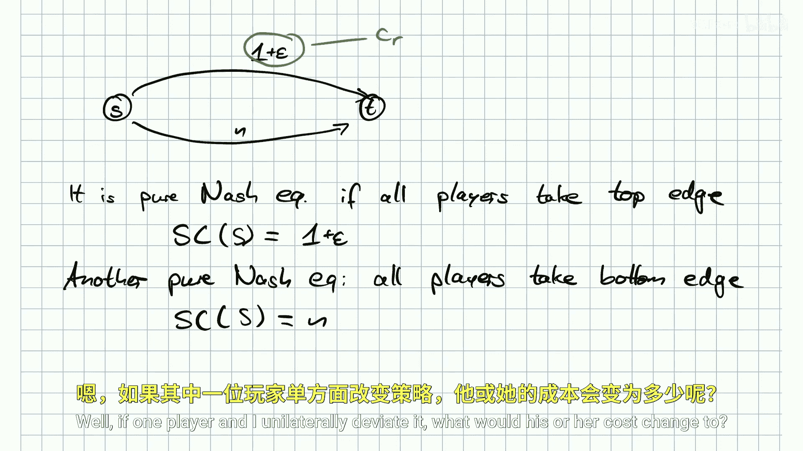

# 010：成本与市场共享游戏中的低效性

在本节课中，我们将继续探讨由策略行为导致的低效性。我们将首先介绍一个更乐观的衡量标准——**稳定代价**，并将其与上节课介绍的**无政府代价**进行对比。随后，我们将视角从成本最小化游戏转向收益最大化游戏，并分析相关技术有何异同。

## 稳定代价：一个更乐观的视角

上一节我们介绍了无政府代价，它衡量了最差均衡与社会最优解之间的差距，是一种较为悲观的视角。本节中，我们来看看一个更乐观的衡量标准——**稳定代价**。它比较的是**最佳均衡**与社会最优解之间的差距。

我们将在一个特殊的拥塞游戏——**成本共享游戏**的背景下讨论稳定代价。

### 什么是成本共享游戏？

成本共享游戏是拥塞游戏的一种特例，其延迟函数具有特定的形式。

**定义**：一个成本共享游戏是一个拥塞游戏，其中所有资源的延迟函数都具有以下形式：
`d_r(x) = c_r / x`
其中 `c_r` 是资源 `r` 的常数成本。

这意味着，使用资源 `r` 的玩家将**平均分摊**该资源的成本 `c_r`。

那么，如何计算一个状态的社会成本呢？与上节课一样，社会成本是所有玩家个人成本的总和。在成本共享游戏中，玩家的成本是其使用的所有资源的延迟值之和。通过重新排列求和顺序，我们可以得到一个更简洁的表达式：

社会成本 = Σ（所有被至少一个玩家使用的资源 `r` 的 `c_r` 值）

我们的目标是，在这样的成本共享游戏中，界定一个纯纳什均衡的社会成本。

## 无政府代价的糟糕表现

不幸的是，在成本共享游戏中，无政府代价可能非常糟糕。让我们通过一个简单的例子来看。

考虑以下网络：
*   有一个源点和一个汇点。
*   上边路径的成本为 `1 + ε`（其中 ε 是一个极小的正数）。
*   下边路径的成本为 `n`（n 为玩家数量）。

图中标注的是每条边的 `c_r` 值。

这个设置中的纯纳什均衡是什么？

1.  **一个均衡（也是社会最优）**：所有 `n` 个玩家都走上边。此时社会成本为 `1 + ε`。
2.  **另一个均衡**：所有 `n` 个玩家都走下边。此时社会成本为 `n`。

为什么第二个状态也是纳什均衡？让我们分析一下：
*   在当前状态下，所有 `n` 个玩家共享成本为 `n` 的下边，因此每个玩家的个人成本为 `1`。
*   如果其中一名玩家单方面偏离，改为独自走上边，那么他需要独自承担上边的成本 `1 + ε`。
*   由于 `1 + ε > 1`，对于这名玩家来说，偏离会使他的个人成本升高。因此，没有玩家有动机单方面改变策略，这构成了一个纳什均衡。

尽管所有玩家都走上边对每个个体和社会整体都更好（个人成本约为 `(1+ε)/n`，社会成本为 `1+ε`），但“所有玩家都走下边”这个糟糕的均衡也可能稳定存在。这是因为个体如果率先采用更优的技术（上边），可能会因为与他人不兼容而承受更高的短期成本。

这个例子展示了“协调失败”的现象，也说明了为什么无政府代价（比较最差均衡）在此类游戏中会非常高。

## 从成本最小化到收益最大化

以上我们讨论的都是成本最小化游戏。在课程的第二部分，我们将回到无政府代价的概念，但将其应用于**收益最大化游戏**。我们将探讨分析技术有哪些相似与不同之处。

## 总结

本节课中我们一起学习了：
1.  **稳定代价**的概念，它比较最佳均衡与社会最优解，提供了一个更乐观的低效性衡量标准。
2.  在**成本共享游戏**这一特定拥塞游戏中，由于协调失败问题，**无政府代价**可能非常高，存在社会成本极高的糟糕均衡。
3.  我们通过一个简单的网络路由例子，具体说明了多个均衡的存在以及个体理性如何导致整体低效的结果。