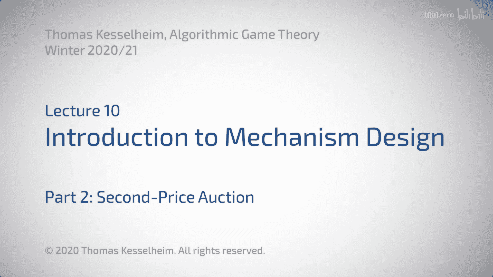

# 011：机制设计导论

欢迎回到算法博弈论课程。今天我们开始学习一个新主题：机制设计。更具体地说，我们首先从**带金钱的机制设计**开始，在本学期稍后，我们也会学习**不带金钱的机制设计**。

到目前为止，我们的目标只是理解博弈以及博弈中发生的策略行为。今天，我们要问的问题是：**我们应如何设定博弈的规则，以实现某个期望的结果？** 不仅今天，实际上在本学期剩余的时间里，我们都在探讨这个问题。

作为入门示例，我们今天考虑**出售一件物品**的问题。

## 问题设定与目标

我们可能有一件想要出售的物品。我们的目标是**让世界的总幸福感尽可能高**。这意味着我们的目标不是赚尽可能多的钱，而是确保世界从这件物品中获得的价值（对我们而言，物品本身没有价值）尽可能大。

这看起来是怎样的？你可能会想运行一个**首价密封拍卖**。

## 首价密封拍卖

以下是首价密封拍卖的运作方式：

*   有一系列出价者。
*   每个出价者写下他们的出价，即他们愿意为这件物品支付多少钱。
*   然后你找出出价最高的人。
*   在这个例子中，最高出价是20欧元，所以我们以20欧元的价格出售该物品。

这是一个出售物品的好方法吗？还是有更好的方法？为了讨论这个问题，我们首先需要推导一个数学模型，并捕捉其中可能发生的策略行为。

## 首价密封拍卖的数学模型

我们刚才看到的是一个所谓的**密封投标首价拍卖**。我们有 `n` 个参与者，在这个语境下也常被称为**出价者**。每个出价者 `i` 报告一个出价 `b_i`。他们同时进行。然后，**出价最高**的出价者获胜，并支付**他/她自己的出价** `b_i`。当然，我们需要定义一个平局决胜规则，因为可能存在相同的出价。例如，我们可以让索引最小的出价者获胜，或者任何你偏好的其他规则。

### 参与者偏好建模

我们如何捕捉参与者的偏好？我们假设每个出价者 `i` 对**获胜**有一个**估值** `v_i`。这是一个非负实数。出价者 `i` 的估值 `v_i` 表示他/她认为该物品值多少钱。

那么，给定出价向量 `b`，出价者 `i` 的效用 `u_i` 将是：
*   如果出价者 `i` 获胜：`u_i = v_i - b_i`
*   如果出价者 `i` 失败：`u_i = 0`

这个 `v_i` 以货币单位表示我有多看重这个物品。我的效用就是我的估值减去我的支付。在这个拍卖中，如果我赢了，我支付的就是我自己的出价 `b_i`。如果我输了，我的效用是0，因为我空手而归。如果我出价高于我的估值并且赢了，那么我将获得负效用，因为我支付了超过物品实际价值的价格。但希望我不会出价超过实际价值。

### 首价拍卖的问题

这是一个好的博弈吗？它至少有一个优点：**非常容易解释**。但缺点是什么？我们实际上并不知道这些估值 `v_i`，这是非常重要的。没有人提前知道这些估值。出价者需要知道其他出价者的出价，才能选择自己的最优反应。

让我们再看一下之前的例子。出价是 `[20, 15, 10, 5]`。现在问：对于这些参与者来说，这样出价是一个**纯策略纳什均衡**吗？即使我们不知道他们的估值，我们也能看出，这**不可能**是一个纯策略纳什均衡。

因为，那个出价20的出价者，这怎么可能是最优反应呢？如果这个出价者出价，例如，7.02，那么他/她仍然肯定会赢，但支付的钱少得多，从而获得更高的效用。

令人惊奇的是，有更好的方法来设计这样的机制，使得不仅存在纳什均衡，而且出价变得非常简单。这就是所谓的**次价拍卖**，我们接下来将看到它。

## 次价拍卖

现在，我们转向次价拍卖。首先回顾一下首价拍卖：密封投标首价拍卖中，每个出价者报告一个出价，出价最高者获胜，并支付他/她自己的出价。

我们看到，通常**真实出价**（即 `b_i = v_i`）并不是一个纯策略纳什均衡。因为如果你以很大优势获胜，你会想要降低你的出价。相对于你的真实估值，真实出价通常不是最优反应。

---

**本节课中，我们一起学习了机制设计的基本概念，并通过出售单件物品的例子，对比了首价密封拍卖和次价密封拍卖。我们建立了拍卖的数学模型，定义了参与者的估值和效用函数，并指出了首价拍卖中真实出价通常不是均衡策略的问题，为引入更优的次价拍卖机制做好了铺垫。**