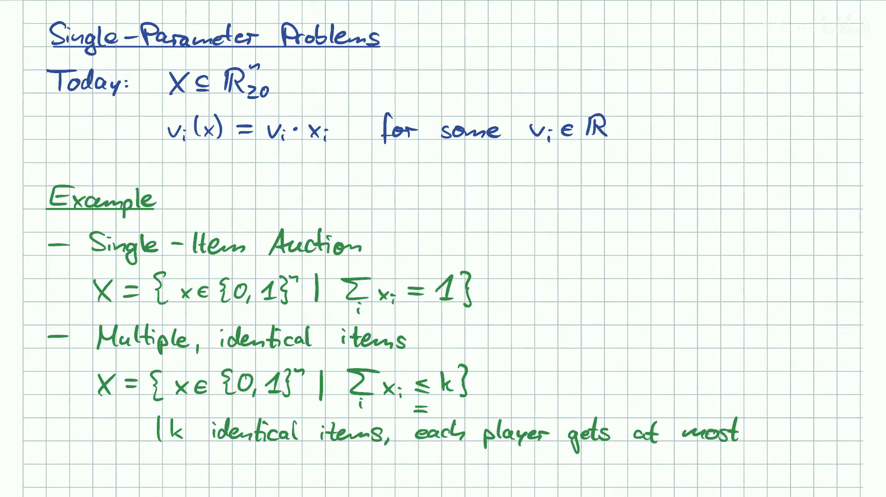

# 012：单参数机制

欢迎回到算法博弈论课程。上一讲我们介绍了带金钱的机制设计主题，并给出了真实机制的定义。

本节课的目标是更深入地理解，一个机制需要满足哪些必要和充分条件才能成为真实机制。

但在开始之前，让我们快速回顾一下所有定义。我们有 `n` 个参与者，在此上下文中也常称为投标人，我们用 `1` 到 `n` 为其编号。

我们有一个结果空间 `X`，通常它可以是一个任意集合。不过今天我们将做一个更具限制性的假设，关于结果空间的类型，稍后会详细说明。

每个参与者都有一个私有的估值函数 `vi`，它将结果集合映射到实数。这意味着每个参与者为每个可能的结果分配一个价值，这个价值也可能是负数，表示参与者认为该结果会带来某种成本。

我们将 `Vi` 称为参与者 `i` 所有可能估值函数的集合，而 `V` 是这些集合的笛卡尔积，即所有估值组合的集合。

上一讲我们定义得更一般化，但对于今天而言，考虑直接机制就足够了。一个直接机制对应一个结果规则和一个支付规则。

结果规则根据输入的声称估值组合确定一个结果，支付规则则根据该组合确定每个参与者的支付。在直接机制中，参与者的出价就是他们声称的估值。

结果规则接收所有出价，并将其映射到结果空间中的一个结果。同时，支付规则将其映射为每个参与者的支付。例如，我们考虑过的单一物品拍卖，可能的结果是谁赢得物品，通常赢家支付一定金额，而输家不支付任何费用。但一般来说，我们并不局限于这种机制。

现在，参与者的效用是什么？参与者的效用是拟线性效用。当我们看到出价（即投标人或参与者声称的估值）时，我们计算一个结果 `f(b)`，然后用真实的估值函数 `vi` 评估该结果，再减去投标人的支付，其差值就是参与者的效用。我们通常省略上标 `M`，它指的是我们应用的是哪个机制。效用取决于 `b`（游戏中的策略），也取决于 `vi`（作为机制设计者我们不知道的私有估值函数）。

因此，我们关注的是占优策略激励相容机制，简称真实机制。一个直接机制被称为占优策略激励相容，当且仅当以下不等式成立：对于任何出价组合，任何参与者将其出价单方面改为其真实估值 `vi`，而不是任何其他出价 `bi`，其效用都不会降低，无论其他参与者如何行动。

今天，我们将更深入地理解这实际上意味着什么，并且我们将针对一类特殊的机制设计问题——单参数问题——来进行分析。

什么是单参数问题？我们今天的假设是：我们的结果空间 `X` 是 `n` 维非负实数向量的一个子集。并且，每个估值函数可以表示为 `vi * xi`，其中 `vi` 是一个实数。我们再次重载了符号，就像在单一物品拍卖中所做的那样，在那里 `vi` 是将价值与每个结果关联起来的函数，现在我们说这实际上可以用某个实数乘以我得到的 `xi` 来表示。

这可能是什么样子？例如，单一物品拍卖可以简单地表示为：`X` 是所有满足 `Σ xi = 1` 的 `{0, 1}^n` 向量集合。首先，这是 `R^n` 中非负向量的一个子集。这里，如果参与者 `i` 获得物品，则 `xi = 1`，否则为 `0`。

但也有其他场景可以这样描述。举一个简单的例子，我们可能有多个相同的物品。我们也可以用这种方式定义，但此时我们会有至多 `k` 个物品。这意味着我们有 `k` 个相同的物品，每个参与者最多只能得到一个。我们也可以轻松地定义这一点，只需将这里的条件改为 `Σ xi ≤ k`。这样，一个参与者实际上最多可以得到两个物品，但此时我们对估值函数的形式有所限制。

