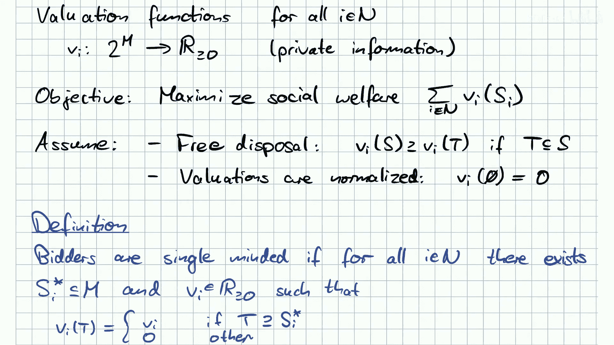

# 013：组合拍卖的贪心机制

欢迎回到算法博弈论课程。在之前的课程中，我们介绍了带金钱的机制设计。我们学习了**真实机制**的概念，并通过迈尔森引理，得到了在单参数设定下，使一个机制成为真实机制的出色特征描述。

本节课中，我们将利用这一特征描述，为组合拍卖构建真实机制。这意味着我们需要设计一个**结果规则**，本质上就是一个决定如何分配物品的算法。然后，根据迈尔森引理，我们可以推导出必须应用何种**支付规则**，从而得到一个整体的真实机制。

这种方法适用于一般的组合拍卖，但仅适用于我们可以再次理解为单参数设定的子类。因为对于非单参数的一般设定，迈尔森引理不成立。顺便提一下，那些情况要复杂得多。

首先，让我们回顾一下组合拍卖的定义。

## 组合拍卖定义

在组合拍卖中，我们有：
*   **N** 个投标人（或玩家），集合记作 **N**，通常编号为 1 到 n。
*   **M** 件物品，集合记作 **M**，通常编号为 1 到 m。

**可行分配** 是集合的向量。每个集合是物品集合的幂集中的一个元素。同时，我们希望每件物品最多被分配一次。这意味着对于任意两个不同的投标人 i 和 i‘，他们获得的物品集合必须不相交。

**估值函数** 为每个玩家定义了其对任意物品集合的非负价值，这些信息是私有的。

**目标** 是最大化社会福利。即，将所有玩家对其所获物品集合的估值相加求和。

我们进一步假设：
*   **自由处置权**：这是一个专业术语，意味着如果我获得物品集合 S，那么我对 S 的估值至少不低于我对 S 的任何子集 T 的估值。换句话说，获得更多物品对我无害。这也可以简单地称为**单调性**。
*   **估值标准化**：意味着对空集的估值为 0。所以，如果我什么都没得到，我的价值是 0；如果我得到更多，我的价值将是非负的。

## 单参数设定与单需求投标人

一般来说，组合拍卖并非单参数设定。因为这些估值函数无法仅用单一参数来表达，而这正是单参数设定的核心要求。

然而，我们今天考虑的估值函数特例，确实可以解释为单参数设定。我们的假设是：投标人是**单需求**的。每个投标人只对某一个特定的物品子集感兴趣。如果我至少得到这个子集，我就满意；如果没得到，我的满意度就和什么都没得到一样。

以下是正式定义：

我们说投标人是**单需求**的，如果对于每个投标人 i，存在一个特定的物品子集 **S_i*** 和一个非负实数 **v_i**，使得投标人 i 对物品集合 T 的估值满足以下公式：

**v_i(T) = v_i， 如果 T 是 S_i* 的超集；否则为 0。**

我们在这里再次重载了符号 **v_i**，它既表示函数，也表示该函数可以取的值。这应该很熟悉，因为在单物品拍卖等单参数设定中，我们做过完全相同的事情。

所以，**v_i** 是我对集合 S_i* 的估值。如果我至少得到了 S_i*（意味着我可能得到更多物品），我的价值总是 v_i。但如果我没有得到完整的 S_i*（即使 S_i* 包含 100 件物品而我得到了 99 件），我的价值总是 0。

接下来，我们看看如何应用这一点。