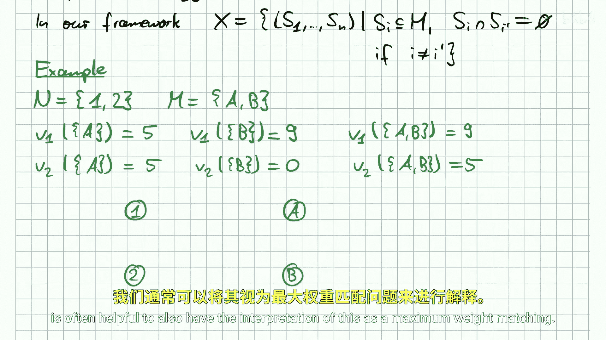

# 014：VCG机制

欢迎回到算法博弈论课程。在之前的课程中，我们介绍了带货币的机制设计的一般问题和框架，并对单参数问题有了很好的理解。我们明确了使一个机制成为真实机制的条件：分配规则必须是单调的，支付规则必须遵循迈尔森引理中的公式。

在本节课中，我们将超越单参数问题，考虑更一般性的问题。对于这些问题，我们将再次展示一种构建真实机制的技术。然而，这并不像单参数问题那样具有普适性，因为对于更一般的设定，我们没有一个像单参数问题那样精确的、能完全刻画真实机制的条件。

## 一般性设定回顾

首先，让我们快速回顾一下定义。我们仍然有一个包含 `N` 个参与者（或投标人、代理人）的集合 `N`。我们有一个结果空间 `X`，它可以是任意集合。在单参数问题的背景下，`X` 有特定的结构，但今天我们并不关心它具体是什么。

每个参与者 `i` 都有一个私有的估值函数 `v_i`，它将结果映射到实数：
`v_i: X → ℝ`

我们用 `V_i` 表示参与者 `i` 所有可能的估值函数的集合，用 `V` 表示所有估值组合的集合。

一个直接机制 `M` 由两部分组成：
1.  **结果规则 `f`**：它接收一个声称的估值组合（即每个投标人声称自己的估值函数是什么），并输出一个结果。
    `f: V → X`
2.  **支付规则 `p`**：它接收同样的输入（声称的估值组合），并输出一个支付向量（即每个投标人需要支付的金额）。
    `p: V → ℝ^N`

我们仍然讨论拟线性效用，这意味着参与者 `i` 在机制 `M` 下的效用 `u_i` 是：
`u_i(v_i, b) = v_i(f(b)) - p_i(b)`
其中 `b` 是所有人声称的估值组合。

我们称一个直接机制是占优策略激励相容的，或者简称为真实的，如果对于任何参与者 `i`、其真实估值 `v_i` 以及任何可能的报价 `b_i'`，无论其他参与者报价如何，该参与者如实报价 `v_i` 所获得的效用，都至少不低于他报任何其他价 `b_i'` 所获得的效用。

单参数设定是上述框架的一个特例。但也存在非单参数的设定，例如组合拍卖。

## 组合拍卖示例

在组合拍卖中，我们有一个包含 `M` 件物品的集合 `M`。我们可以将这些物品分配给 `N` 个投标人。

每个投标人 `i` 有一个估值函数 `v_i`，它将物品的子集映射到一个非负实数：
`v_i: 2^M → ℝ_+`

在我们的框架中，结果空间 `X` 就是所有将物品划分给投标人的分配方案。每个分配方案是一组互不相交的物品子集 `(S_1, ..., S_N)`，满足 `S_i ⊆ M` 且 `S_i ∩ S_j = ∅`（当 `i ≠ j` 时）。

这里需要注意语法上的细微差别：在更一般的框架中，估值函数 `v_i(x)` 的输入是整个分配结果 `x`，这意味着我的估值可能取决于邻居得到了什么物品。而在组合拍卖的标准定义中，`v_i(S_i)` 通常只取决于我自己得到的物品集合 `S_i`。但本质上，我们可以将后者视为前者的一个特例（即我的估值只依赖于分配结果中属于我的那部分），因此组合拍卖可以纳入我们的通用框架。

让我们看一个具体例子。假设有两个投标人（1和2）和两件物品（A和B）。我们可以任意定义估值函数。

例如，投标人1的估值函数 `v_1` 可能是：
*   得到物品 A：价值 5
*   得到物品 B：价值 9
*   得到物品 A 和 B：价值 9

这是一个单位需求函数的例子，因为投标人只关心他得到的最有价值的物品（这里是B），一旦得到B，再得到A并不会增加额外价值。

投标人2的估值函数 `v_2` 可能是：
*   得到物品 A：价值 5
*   得到物品 B：价值 0
*   得到物品 A 和 B：价值 5

这同样是一个单位需求函数。

可以看到，描述每个投标人的偏好需要多个数值（例如，对物品A和B分别有一个估值），因此这不是一个单参数问题。

## 从社会福利最大化到真实机制

上一节我们介绍了非单参数问题，如组合拍卖。本节我们将探讨如何为这类问题构建真实机制。核心思想源于一个简单的问题：如果我们只想最大化社会福利（即所有参与者估值之和），什么样的机制能激励参与者说真话？

假设我们有一个结果规则 `f`，它总是选择能最大化声称的社会福利的结果。即，对于声称的估值组合 `b`：
`f(b) ∈ argmax_{x ∈ X} Σ_{i ∈ N} b_i(x)`

现在的问题是：我们应该如何设计支付规则 `p`，使得整个机制 `(f, p)` 是真实的？也就是说，对于每个参与者 `i`，如实报告其真实估值 `v_i` 是占优策略。

维克瑞-克拉克-格罗夫斯机制提供了一个解决方案。以下是其支付规则的设计思路：

参与者 `i` 的支付 `p_i(b)` 由两部分组成：
1.  首先，计算当参与者 `i` **不参与**时，其他参与者能获得的最大社会福利。记这个值为 `W_{-i}(b_{-i})`，其中 `b_{-i}` 是其他所有人的报价。
    `W_{-i}(b_{-i}) = max_{x ∈ X} Σ_{j ≠ i} b_j(x)`
2.  然后，计算当参与者 `i` **参与**时，在其他参与者声称的估值下，他们实际获得的社会福利。即，在机制选择的最终结果 `f(b)` 中，其他参与者的估值之和。
    `Σ_{j ≠ i} b_j(f(b))`

VCG机制规定参与者 `i` 的支付额为：
`p_i(b) = W_{-i}(b_{-i}) - Σ_{j ≠ i} b_j(f(b))`

这个公式可以理解为：参与者 `i` 需要为他“造成的社会福利损失”付费。他支付的是，由于他的参与，导致其他参与者获得的总价值减少了多少（与他不在场时他们能获得的最佳总价值相比）。

另一种等价且常见的表述是：
`p_i(b) = b_i(f(b)) - [Σ_{j ∈ N} b_j(f(b)) - W_{-i}(b_{-i})]`
中括号内的部分 `[Σ_{j} b_j(f(b)) - W_{-i}(b_{-i})]` 是参与者 `i` 的参与为整个系统带来的社会福利增量。因此，支付额等于参与者 `i` 声称的估值，减去他声称自己带来的社会福利增量。这种形式更直接地体现了“内部化外部性”的思想。

## VCG机制为何是真实的？

我们已经定义了VCG机制：结果规则 `f` 最大化声称的社会福利，支付规则 `p` 如上所述。现在我们来论证其真实性。

关键点在于，对于参与者 `i`，当他考虑是否如实报价时，他的效用函数为：
`u_i(v_i, b) = v_i(f(b)) - p_i(b)`

将VCG支付公式 `p_i(b) = W_{-i}(b_{-i}) - Σ_{j ≠ i} b_j(f(b))` 代入：
`u_i(v_i, b) = v_i(f(b)) - [W_{-i}(b_{-i}) - Σ_{j ≠ i} b_j(f(b))]`
`= [v_i(f(b)) + Σ_{j ≠ i} b_j(f(b))] - W_{-i}(b_{-i})`
`= Σ_{j ∈ N} b_j(f(b)) - W_{-i}(b_{-i})` （注意，这里 `b_i` 是参与者 `i` 的报价，不一定是其真实估值 `v_i`）

现在，`W_{-i}(b_{-i})` 是一个常数，它只依赖于其他参与者的报价 `b_{-i}`，而与参与者 `i` 自己的报价 `b_i` 无关。因此，为了最大化自己的效用 `u_i`，参与者 `i` 的目标就是最大化第一项 `Σ_{j ∈ N} b_j(f(b))`。

但请注意，`f(b)` 正是那个能最大化 `Σ_{j ∈ N} b_j(x)` 的结果。所以，如果参与者 `i` 如实地报告 `b_i = v_i`，那么机制选择的结果 `f(b)` 将最大化包含其真实估值的总和 `v_i(x) + Σ_{j ≠ i} b_j(x)`，这恰好就是参与者 `i` 效用函数中他所能影响的部分。因此，如实报告 `v_i` 是最大化其自身效用的最佳策略。

如果参与者 `i` 谎报为其他某个 `b_i'`，那么机制将最大化 `b_i'(x) + Σ_{j ≠ i} b_j(x)`，而这个结果通常不会最大化包含其真实估值 `v_i` 的总和，从而导致其效用可能降低。因此，在VCG机制下，说实话是占优策略。

## VCG机制的应用与性质

VCG机制是一个强大而通用的工具，它可以将任何社会福利最大化问题转化为一个真实的机制。以下是其一些关键性质和应用场景：

*   **真实性**：如上所述，VCG机制是占优策略激励相容的。
*   **效率性**：在真实报价的均衡下（即所有人都说真话），机制选择的结果能最大化真实的社会福利。这是设计目标使然。
*   **个体理性**（在适当条件下）：如果参与者的估值是非负的（即对任何结果 `x`，`v_i(x) ≥ 0`），并且“不分配任何东西”是一个可能的结果（且其价值为0），那么VCG机制通常满足个体理性（即参与者的效用非负）。因为支付额 `p_i` 不会超过参与者 `i` 声称的估值 `b_i(f(b))`（在某些表述下），当他说真话时，其效用非负。
*   **应用实例**：
    *   **组合拍卖**：VCG机制是理论上完美的解决方案。结果规则将物品分配给能产生最大总价值的组合，支付规则则如上述计算。然而，在实际中，计算最优分配（即解决组合优化问题）通常是NP难的，这限制了其直接应用。
    *   **公共物品提供**：决定是否修建一座桥，成本如何分摊。VCG机制可以决定修建是否有效率（总估值 > 成本），并确定每个人的支付。
    *   **网络路由与频谱分配**：在需要分配稀缺资源以最大化整体效益的场景中，VCG机制提供了理论基准。

尽管性质优良，VCG机制也有一些潜在缺点，如计算复杂性高、预算可能不平衡（收取的总支付不等于成本或零）、以及对合谋的脆弱性等。这些是机制设计实践中需要权衡的问题。

## 总结

在本节课中，我们一起学习了VCG机制。我们从回顾超越单参数问题的一般机制设计框架开始，并以组合拍卖为例进行了说明。

核心内容在于，对于任何以社会福利最大化为目标的结果规则，我们都可以通过一种特定的支付规则——即让每个参与者为其行为导致的其他人的福利损失付费——来使整个机制变得真实。这种支付规则就是VCG支付。

我们详细推导了VCG支付公式 `p_i(b) = W_{-i}(b_{-i}) - Σ_{j ≠ i} b_j(f(b))`，并论证了在此支付规则下，参与者如实报告其私有估值是其占优策略，因为这样做能最大化其自身效用。

最后，我们探讨了VCG机制的主要性质（真实性、效率性）和一些典型应用场景，同时也简要提及了其在实际中可能面临的挑战。VCG机制是算法博弈论中连接优化与激励的一个基础而重要的范例。