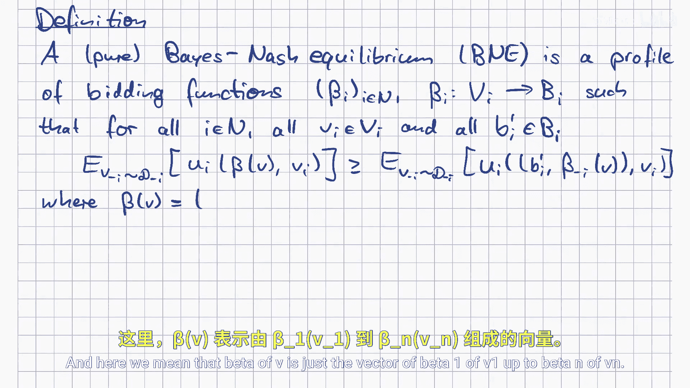

# 015：贝叶斯-纳什均衡


欢迎回到算法博弈论课程。在过去的课程中，我们学习了说真话机制，更准确地说，是占优策略激励相容机制。这类机制的特性是，无论其他参与者如何行动，参与者（或投标人）总是希望报告其真实估值。对他们来说，报告真实估值是一个占优策略。

然而，我们也看到，有时这种方法行不通。有时无法设计出一个简单的说真话机制。那么，我们为何要坚持这种“说真话”的特性呢？我们又该如何理解非说真话的机制？这正是我们今天要开始解答的问题。

## 如何分析非说真话机制？

既然我们仍然需要考虑参与者会进行策略性行为，那么当报告真实估值不符合其最佳利益时，他们可能会撒谎。我们可能想做的，就是考虑由此产生的博弈的纯策略或混合策略纳什均衡。

但是，这种方法有一个很大的弱点。对于纯策略或混合策略纳什均衡，你总是需要考虑所有参与者都**知道**彼此估值的情况。为什么？因为要找到这个均衡，所有参与者都必须知道其他参与者的效用函数是怎样的，而效用函数依赖于这些私人估值。这使得这种方法有些薄弱。

例如，对于第一价格拍卖，我们可能会争论说，如果存在一个纯策略或混合策略纳什均衡，那将非常理想。但是，参与者们究竟如何才能达到这样一个纳什均衡呢？他们在那里选择的策略取决于其他参与者的估值，而这恰恰是私人信息。

因此，今天我们将认识一个适用于**不完全信息**的均衡概念。也就是说，参与者不知道其他参与者的真实估值，但他们对此有一个信念。这被称为**贝叶斯-纳什均衡**。

## 贝叶斯-纳什均衡的定义

让我们看看它是如何定义的。我们假设：

*   投标人 `i` 的估值 `v_i` 是从某个分布 `D_i` 中独立抽取的。
*   这些分布对所有投标人都是已知的。

现在，每个参与者（或投标人）将选择一个出价 `b_i`。当然，这个投标人知道他/她自己的估值 `v_i`，但不知道其他投标人的出价 `b_{-i}`，只知道 `b_{-i}` 是从哪些分布中抽取的。

我们如何描述这一点？换句话说，每个投标人 `i` 选择一个**出价函数**，我们称之为 `β_i`，它将所有可能估值的集合映射到出价集合。我们说，当估值是 `v_i` 时，投标人 `i` 出价 `β_i(v_i)`。

例如，**真实出价**就是函数 `β_i(v) = v`。

现在，我们说，如果**没有参与者可以通过单方面选择不同的出价函数而获益**，那么这样一组为每个参与者选择的出价函数就是一个贝叶斯-纳什均衡。

在某种程度上，我们可以将其理解为一场选择出价函数的博弈。策略现在就是出价函数。我们感兴趣的是这个“出价函数博弈”的一个纯策略纳什均衡。

更正式地，定义如下：

一个**纯策略贝叶斯-纳什均衡**（简称 BNE）是一个出价函数组合 `β_i`（对于每个参与者 `i`），其中 `β_i` 将投标人 `i` 的可能估值映射到其可能的出价。

均衡条件定义为：对于所有参与者 `i`、所有可能的估值 `v_i` 以及所有可能的偏离出价 `b_i'`，以下不等式成立：

```
E[ u_i( β(v), v_i ) ] ≥ E[ u_i( b_i', β_{-i}(v_{-i}), v_i ) ]
```

这里，`β(v)` 表示向量 `(β_1(v_1), ..., β_n(v_n))`，而期望 `E` 是对其他参与者的估值 `v_{-i}` 根据其分布 `D_{-i}` 取的。



## 总结

在本节课中，我们一起学习了贝叶斯-纳什均衡。我们首先回顾了说真话机制的局限性，并提出了分析非说真话机制的需求。接着，我们指出了传统纳什均衡在处理私人信息时的不足，从而引出了适用于不完全信息场景的贝叶斯-纳什均衡概念。


我们详细定义了贝叶斯-纳什均衡：在已知估值分布的情况下，每个参与者选择一个将私人估值映射为出价的函数；均衡状态是指，给定其他参与者的策略（函数），任何参与者都无法通过单方面改变自己的出价函数来增加其期望效用。这为我们分析更广泛的机制（如第一价格拍卖）提供了强大的理论工具。