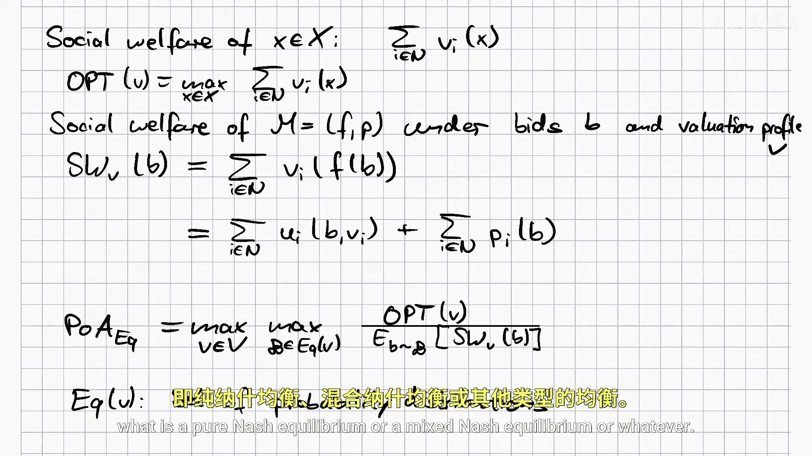

# 016：平滑机制

欢迎回到算法博弈论课程。在上一讲中，我们开始讨论非真实机制，例如第一价格拍卖。我们引入了贝叶斯纳什均衡的概念，以正式描述在参与者不知道其他参与者估值的情况下，他们可能如何行动。

在本节课中，我们将把讨论范围从第一价格拍卖推广到更一般的机制。我们也会再次回顾第一价格拍卖，并完整地理解为何其贝叶斯纳什均衡下的社会福利仍然相当不错。

## 机制设计基础回顾

在开始新内容之前，让我们快速回顾一下机制设计的基本定义。

我们将有 **n** 个参与者（投标人或代理人）。我们有一个结果空间 **X**，每个参与者 **i** 都有一个私有的估值函数 **v_i**，它将结果映射到实数。今天，我们假设这些实数是非负的，就像我们在第一价格拍卖中通常假设的那样。

参与者报告出价。我们现在不局限于直接机制，所以出价可以是任意的。**B_i** 是参与者 **i** 的可能出价集合，**B** 是所有这些集合的笛卡尔积，即所有出价组合的集合。

一个机制 **M = (f, p)** 接收一个出价组合 **b** 作为输入。其中：
*   **f(b)** 是结果规则，它将出价组合映射到一个结果。
*   **p(b)** 是支付规则，它将出价组合映射为一个支付向量。今天同样假设支付是非负的。

我们之前讨论的是占优策略激励相容，但今天不涉及。我们仍然保留拟线性效用的概念。因此，当参与者 **i** 的真实估值为 **v_i**，出价组合为 **b** 时，其效用为：
**u_i(b; v_i) = v_i(f(b)) - p_i(b)**

## 均衡与无政府价格

如前所述，我们今天不讨论真实性，而是考虑由这类机制诱导的博弈。然后，我们可以考虑一个贝叶斯纳什均衡。

那么，在这个背景下，纯贝叶斯纳什均衡意味着什么？给定一个固定的估值组合 **v**，一个出价组合 **b** 是一个纯贝叶斯纳什均衡，当且仅当对于每一个参与者 **i**，其出价 **b_i** 带来的效用至少不低于选择任何其他可能出价 **b_i'** 带来的效用。用公式表示：
**u_i(b; v_i) ≥ u_i((b_i', b_{-i}); v_i)， 对于所有可能的 b_i'**

同样，你也可以推广到混合纳什均衡或相关均衡的概念。关键在于，这是一个完全信息设定，因为估值组合 **v** 是固定的，每个参与者都有自己固定的估值。我们关注的是贝叶斯纳什均衡，这意味着策略甚至可能依赖于其他参与者的确切估值。

现在的问题是：这种均衡的无政府价格是多少？即，与最优社会福利相比，这种纯贝叶斯纳什均衡有多好？

为了更精确，我们定义社会福利。某个结果 **x** 的社会福利是所有参与者估值的总和：
**SW(v, x) = Σ_i v_i(x)**

那么，对于估值组合 **v**，最优社会福利 **OPT(v)** 就是可能达到的最大社会福利。

我们也可以写出机制 **M** 在出价组合 **b** 下的社会福利（依赖于估值组合 **v**）：
**SW_v(M, b) = Σ_i v_i(f(b))**

由于拟线性效用，这也可以写成所有参与者效用之和加上所有支付之和。

现在，我们可以定义无政府价格。对于一个均衡概念 **EQ**（例如纯贝叶斯纳什均衡），其无政府价格 **PoA** 定义为：
**PoA(EQ) = max_v [ OPT(v) / min_{β ∈ EQ(v)} E_{b~β}[SW_v(M, b)] ]**
其中，**EQ(v)** 是在估值组合 **v** 下满足均衡概念 **EQ** 的所有概率分布（出价策略组合）的集合。这个比值总是至少为 1，因为最优社会福利至少和机制在均衡下实现的任何福利一样好。

## 总结

本节课我们一起回顾了机制设计的基本框架，特别是非真实机制下的博弈设定。我们明确了贝叶斯纳什均衡在机制设计语境下的定义，并引入了用于衡量均衡效率损失的无政府价格概念。这为我们后续分析更广泛的机制类别及其均衡性质奠定了基础。