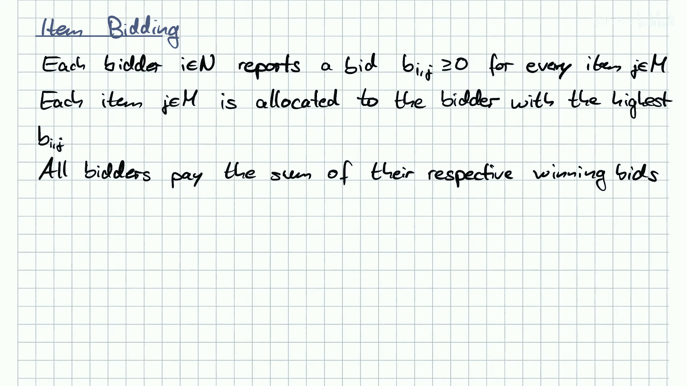

# 017：简单组合拍卖


欢迎回到算法博弈论课程。在之前的几讲中，我们介绍了基础纳什均衡的概念以及平滑机制的概念。所有这些内容都是为了分析非真实机制。今天，我们将更具体地探讨一个应用场景：组合拍卖。

## 概述

在本节课中，我们将学习组合拍卖，并分析两种不同的机制。我们将证明这两种机制都是平滑的。根据上一讲的结果，这能立即推导出这些机制在基础纳什均衡（以及其他均衡概念）下的无政府价格上界。在开始之前，我们先回顾一下相关定义。

## 背景回顾

我们考虑一个组合拍卖。这意味着我们有 **n** 个投标人（或玩家），记作集合 **N**（编号从1到n），以及 **M** 件物品，记作集合 **M**（编号从1到m）。

每个投标人 **i** 都有一个私有的估值函数 **vᵢ**，该函数将物品的子集映射到非负实数。我们遵循惯例，假设该函数是单调的（获得更多物品不会降低你的价值），并且获得零件物品时价值为零。

我们试图找到一个机制，它由一个结果规则和一个支付规则组成，两者都以投标组合作为输入。结果规则决定一个分配结果（即将物品分配给投标人），支付规则定义投标人需要支付多少。我们仍假设投标人总是支付非负金额。

请注意，这些机制不一定是直接机制，因为投标组合中的“投标”不一定是估值函数。事实上，我们今天要讲的第一个机制就是一个间接机制，而第二个机制是直接机制。

## 平滑机制定义

那么，是什么让一个机制变得“平滑”呢？我们称一个机制是 **(λ, μ)-平滑** 的，如果以下条件成立：

取任意的估值向量（即估值组合）**v**。对于任意玩家 **i**，必须存在一个安全的偏离投标 **bᵢ***，使得对于任意的投标组合 **b**，以下不等式成立：

**Σᵢ uᵢ(bᵢ*, b₋ᵢ) ≥ λ · OPT(v) - μ · Σᵢ pᵢ(b)**

其中：
*   **uᵢ(bᵢ*, b₋ᵢ)** 是当玩家 **i** 单方面采用投标 **bᵢ*** 而其他玩家保持投标 **b₋ᵢ** 时，玩家 **i** 的效用。
*   **OPT(v)** 是最优社会福利。
*   **pᵢ(b)** 是在投标组合 **b** 下玩家 **i** 的支付。

这一定义意味着，对于基础纳什均衡、相关均衡、混合纳什均衡等均衡概念，其无政府价格（PoA）总是以 **max(μ, 1) / λ** 为上界。

因此，我们今天要做的核心工作就是证明特定机制的平滑性，这将作为直接推论，帮助我们界定无政府价格的上界。

## 机制一：物品独立投标

现在，让我们来看第一个机制：物品独立投标。具体来说，我们将在一个组合拍卖中，**独立地**出售每一件物品。你可以将其想象为一系列平行的eBay拍卖。

这种机制是非真实的，因为你甚至无法向机制透露你真实的偏好（例如，你只想要一部手机，但无法告诉系统“只有当我赢得所有拍卖时，我才想要这些手机”）。因此，这是一个间接机制，你提交的投标并不直接反映你的真实估值。

以下是该机制更形式化的描述：

**机制描述：物品独立投标（第一价格）**

每个投标人 **i** 为每一件物品 **j** 报告一个投标 **bᵢⱼ**。然后，每件物品 **j** 被分配给对该物品投标最高的投标人。获胜的投标人需要支付其所有获胜物品的投标之和。

用伪代码表示：
```
for each item j in M:
    winner = argmax_i (b_ij)
    allocate item j to winner
    payment_i += b_ij for the winner i
```



这个机制不真实的原因有很多。首先，即使对于单件物品，其支付规则也是第一价格拍卖，我们知道第一价格拍卖不是真实的。此外，这种投标方式本身也无法真实反映偏好，因为你无法报告完整的估值函数，只能为每件物品单独投标，然后你可能赢得多件物品。

在下一节中，我们将分析这个机制，并证明它在特定参数下是平滑的。

## 总结

本节课我们一起回顾了组合拍卖和平滑机制的定义。我们介绍了第一种机制——物品独立投标（第一价格），并指出了其非真实的特性。在接下来的课程中，我们将证明该机制的平滑性，并探讨其对均衡结果效率的保证。