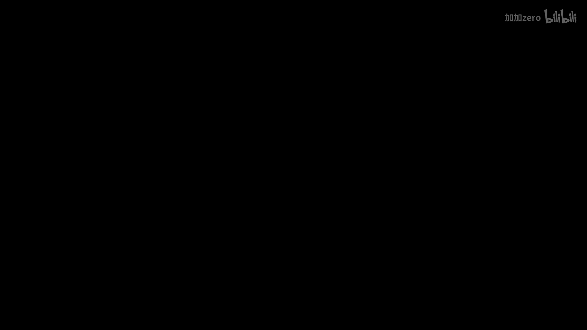
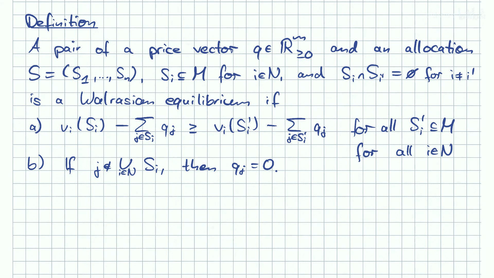

# 018：瓦尔拉斯均衡

欢迎回到算法博弈论课程。在之前的课程中，我们深入学习了机制设计，特别是组合拍卖。我们之前考虑的机制总是某种形式的拍卖，即你和所有其他参与者提交出价，然后机制根据出价进行分配。但除非你是专业的艺术品收藏家，否则这并非你日常的购物体验。

通常，你只是走进商店，看到标明的价格，然后决定是否以这个价格购买一件商品，或者以双倍价格购买两件。我们如何用数学来刻画这类场景？此外，这种方式是否高效？我们能否获得良好的社会福利？这正是我们今天要探讨的问题，我们将借助经典经济理论，并在下次课程中讨论一种更通用的算法方法。

今天，我们将只关注经典经济理论，即认识**瓦尔拉斯均衡**的概念。这是什么？我们再次有 **n** 个参与者（或代理人，也可称为买家）和 **m** 件物品。每个参与者 **i** 都有一个估值函数 **vᵢ**，它从物品集合的幂集映射到非负实数。与之前不同，我们现在考虑完全信息，即这些估值是公开的。因此，今天的问题完全不涉及激励参与者透露其真实估值，而是关注是否存在“好”的价格。是否存在好价格，这由瓦尔拉斯均衡的概念来形式化。

## 什么是瓦尔拉斯均衡？🤔

瓦尔拉斯均衡以经济学家莱昂·瓦尔拉斯命名。它被定义为一个**价格向量 p** 和一个**分配 S**（即向量 **S₁, …, Sₙ**，每个 **Sᵢ** 是 **M** 的子集）的组合，且这些集合互不相交（每件物品最多分配给一个参与者）。我们称 **(p, S)** 为一个瓦尔拉斯均衡，当满足以下两个条件：

1.  **个体理性/最优性**：对于每个参与者 **i** 和所有可能的物品子集 **Sᵢ‘**，有：
    **vᵢ(Sᵢ) - Σ_{j∈Sᵢ} pⱼ ≥ vᵢ(Sᵢ‘) - Σ_{j∈Sᵢ‘} pⱼ**
    这个条件应对所有参与者 **i** 成立。

2.  **市场出清**：如果一件物品 **j** 没有被分配给任何参与者（即不在任何 **Sᵢ** 的并集中），那么它的价格必须为零：**pⱼ = 0**。

让我们仔细看看这些条件。瓦尔拉斯均衡与我们之前见过的均衡（如纳什均衡）不同。在纳什均衡中，每个参与者选择策略，且没有参与者愿意单方面偏离。在这里，参与者实际上并不选择策略。然而，瓦尔拉斯均衡形式化了每个参与者都应对其分配和价格感到满意的直觉。

具体来说，第一个条件意味着，给定当前价格，每个参与者 **i** 获得的物品包 **Sᵢ** 能最大化其准线性效用（价值减去支付价格）。换句话说，没有参与者会宁愿选择另一个不同的物品包。

第二个条件更具技术性，但也很直观：如果一件物品没有被分配出去，那么它的价格自然应该为零。这也与第一个条件相结合：如果一件物品未被分配且价格为零，那么任何参与者都不能通过免费获得这件额外物品而变得更开心。

因此，在瓦尔拉斯均衡中，没有参与者对其所得感到不满，也没有参与者希望获得与当前分配不同的物品组合。同时，未分配的物品价格为零，这确保了市场是“出清”的。

## 总结 📝

在本节课中，我们一起学习了**瓦尔拉斯均衡**这一经典经济理论概念。我们了解到，它由一组价格和一个分配方案构成，并满足两个核心条件：每个参与者在给定价格下都获得了对其而言最优的物品包，以及所有未分配的物品价格为零。这为我们分析存在标价的市场环境提供了一个形式化框架。在接下来的课程中，我们将探讨更一般的算法方法，并比较它们之间的差异。