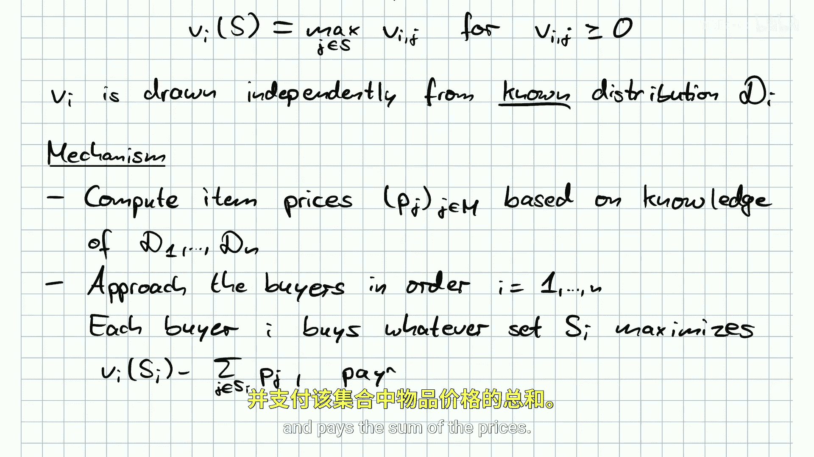

# 019：不完全信息下的定价机制

欢迎回到算法博弈论课程。上一讲我们开始探讨一个问题：价格能在多大程度上协调市场？这意味着，与运行拍卖不同，例如在组合拍卖中，我们更希望为不同商品设定价格，使得买家能获得他们最偏好的商品组合，同时社会总福利至少能近似最大化。

上一讲中，我们在此背景下了解了瓦尔拉斯均衡的概念，它正是一组价格和分配方案，使得每个买家都对自己获得的东西感到满意，即没有买家会想要获得另一组商品。

今天，我们将用一个更现代的理论方法来补充这一点。这个方法同样设定价格，但买家会一个接一个地到来，并选择他们偏好的商品集合。正如我们将看到的，这确实带来了一些差异。我们仍然会证明一个福利保证，但无法证明我们能获得最优的社会总福利，而只能证明是近似最优的。但同时，我们所需的信息也更少。希望你能看到其中的许多相似之处和不同之处。

## 模型定义

我们讨论的精确模型是什么？与任何组合拍卖一样，我们有 **n** 个买家，构成集合 **N**（通常编号为 1 到 n），以及 **M** 件商品。

每个买家 **i ∈ N** 拥有一个私人的估值函数 **vᵢ**，该函数为每个商品集合分配一个非负实数。我们假设这些是**单一参数估值函数**。也就是说，对于非负的 **vᵢⱼ**，有：

**vᵢ(S) = max_{j ∈ S} vᵢⱼ**

换句话说，每个买家原则上可以被分配多件商品，但如果他们被分配了多件商品，他们只关心其中价值最高的那一件。

与上一讲相比，这里已经有所不同：今天的估值函数被假定为私有的，而不是像在瓦尔拉斯均衡理论中那样是公开知识。但是，我们再次做出与贝叶斯纳什均衡背景下相同的假设：我们预先知道这些估值函数所服从的概率分布。这意味着 **vᵢ** 是独立地从分布 **Dᵢ** 中抽取的，并且这些分布是已知的。除此之外，我们没有其他假设。所以，这些分布是已知的，但估值函数是私有的。

## 定价机制

现在，我们将研究以下类型的机制：

1.  首先，我们基于对 **D₁, …, Dₙ** 的了解，计算每件商品 **j** 的价格 **pⱼ**。
2.  然后，我们按顺序 **1, 2, …, n** 接触买家。
3.  每个买家 **i** 购买能最大化其效用 **vᵢ(Sᵢ) - Σ_{j∈Sᵢ} pⱼ** 的商品集合 **Sᵢ**，并支付该集合的总价格 **Σ_{j∈Sᵢ} pⱼ**。

这个机制非常简单，关键在于第一步：如何计算这些价格。我们基于已知的分布来计算价格，当然我们并不知道具体的估值函数，因为那是私人信息。然后我们按顺序接触买家，每个买家选择能最大化其购买效用的集合，并支付相应价格。

这也可以表示为一个分配函数 **f**，即机制的结果规则。支付规则也很容易描述。但这样说可能有点误导，因为现在代理人的行为方式不是告诉我们他们的估值函数然后我们分配，而是他们从剩余的商品中选择自己偏好的东西。

我这样说的原因是，现在很明显这是一个**真实（说真话）的机制**。为什么？我有什么理由虚报或选择其他方案吗？当轮到我时，我可以选择不同的集合，但虚报我的估值、声称另一个集合让我更快乐有什么意义呢？当然没有，因为我只是选择能最大化我效用的集合。因此，真实性很容易实现。

当然，这需要付出代价：我们现在必须预先知道这些分布，并且必须固定价格。而像 VCG 这样的机制则不需要这些。但让我们先继续。

## 机制分析

本节中，我们将分析这种定价机制的性能。我们关心的是其产生的社会总福利与最优福利的比值。

我们定义社会福利为所有买家估值之和：**SW = Σᵢ vᵢ(Sᵢ)**，其中 **Sᵢ** 是机制分配给买家 **i** 的集合。最优社会福利 **OPT** 是指在所有可能的分配中，能使总估值最大化的那个分配所对应的社会福利。

我们将证明，在适当的定价下，这种顺序定价机制可以实现至少 **1/2** 的近似比，即 **E[SW] ≥ (1/2) * E[OPT]**，其中期望是关于估值分布的。

证明思路如下：我们需要将机制的社会福利与最优社会福利联系起来。一个关键概念是**门槛价格**，即商品被分配时的价格。我们将展示，对于每件商品，其价格至少是“错过”该商品的买家（即本可能获得更高价值但因顺序靠后或价格原因未获得该商品的买家）的估值的一半。

通过巧妙地设定价格（例如，基于分布设置一个保留价），并利用单一参数估值函数的性质，我们可以对总福利进行下界估计，从而得出近似比保证。

## 总结

本节课中，我们一起学习了不完全信息下的顺序定价机制。我们首先回顾了完全信息下的瓦尔拉斯均衡，然后引入了分布已知但估值私有的贝叶斯设定。我们描述了一个简单的机制：基于先验分布设定商品价格，然后让买家按顺序选择最大化其效用的商品集合。

我们指出，该机制是真实的，因为买家没有动机偏离其真实偏好。最后，我们概述了该机制能达到至少 **1/2** 近似社会福利的理论保证。这种机制以需要先验分布信息为代价，换来了简单性和真实性，是协调市场的一种有效且易于理解的方法。