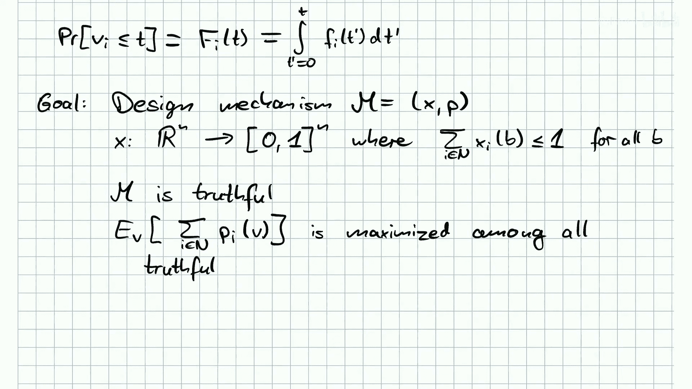

# 020：收益最大化

欢迎回到我们的算法博弈论课程。在之前的几讲中，我们对机制设计，特别是以实现社会福利最大化为目标，已经有了很好的理解。这意味着我们可能有一个或多个物品，然后我们希望将这些物品分配给买家，以最大化他们估价的总和。

今天，我们将转向一个不同的目标，即我们希望最大化收益。这意味着我们希望最大化支付款项的总和。并且我们将回到只有一个物品的情况。

您可能记得，在只有一个物品的情况下，通过例如运行第二价格拍卖，最大化社会福利是相当容易的。我们甚至不需要事先知道任何估价信息。然而，如果我们想最大化收益，情况就不完全是这样了。因为，举例来说，如果我们只有一个买家，我们该如何最大化收益呢？这个买家可以声称任意小的估价，我们可能应该把物品给他，但无法强制收取任何费用。

这就是为什么我们像在其他情况下一样，假设我们事先知道估价是从哪些概率分布中抽取的。基于这种先验知识，我们设计一个诚实的机制，目标是最大化收益。

## 模型设定

首先，让我们写下我们的模型。

*   我们有 **N** 个投标人。
*   所有投标人的集合再次用大写 **N** 表示。
*   只有一个物品。
*   每个投标人 **i** 对物品有一个私人估价 **v_i**，并会报告一个出价 **b_i**。
*   我们假设每个 **v_i** 是从分布 **D_i** 中独立抽取的。
*   **D_i** 是公开已知的。
*   估价的取值范围是从 **0** 到某个最大值 **v_max**。因此，买家可能拥有的价值有一个上限 **v_max**。
*   此外，我们假设这些分布是连续的。因此，其概率密度函数称为 **f_i**，其累积分布函数称为 **F_i**。

这意味着我们现在可以写出概率 **P(v_i ≤ t)**，这也可以写成 **F_i(t)**，或者写成从 **0** 到 **t** 对 **f_i(t)** 的积分。

## 目标与机制设计

我们的目标是设计一个机制。一个机制仍然由一个结果规则和一个支付规则组成。由于我们现在将密度函数称为 **f**，我们将结果规则称为分配规则 **x**，而不是 **f**，除此之外，其他部分相同。

因此，目标是设计一个机制，它是一个结果规则和支付规则的对。这个结果规则将出价向量映射到介于 **0** 和 **1** 之间的数字向量，其中这些条目的总和最多为 **1**。

这如何解释呢？有一种非常自然的理解方式：如果其中一个条目确实是 **1**，而其他条目是 **0**，那么这就是一种可能的结果，表示该买家获得了物品。否则，我们也可以将其解释为一个概率分布。例如，我们可以说买家 **A** 以 **1/2** 的概率获得物品，买家 **B** 以 **1/3** 的概率获得物品，买家 **C** 以 **1/6** 的概率获得物品。但这些概率甚至不必总和为 **1**，如果我们决定保留物品，总和也可以小于 **1**。因此，一种可能的分配结果就是给出全零向量，表示没有人获得物品。

我们的目标是机制 **M** 应该是诚实的。我们希望最大化当买家如实报告时，支付款项的总和。

## 核心要求与优化

再次强调，我们希望设计一个诚实的机制。每个诚实的机制都附带一个支付规则。当然，我们限制自己考虑那些不会多次分配物品且是诚实的机制。在所有这类诚实的机制中，我们希望选择那个在投标人如实报告时，能最大化期望支付总和的机制（可能不止一个）。

您可能会问，为什么我们坚持要诚实的机制？实际上，这并非绝对必要，对此有更一般的陈述。我们现在先不讨论这一点。关键在于，因为机制是诚实的，我们可以预期买家会如实报告他们的真实估价，只有这样，最大化这个目标才有意义。

---

**本节课总结**

在本节课中，我们一起学习了收益最大化的基本模型设定。我们从社会福利最大化转向了收益最大化这一新目标，并回到了单一物品的场景。我们明确了模型的关键要素：多个投标人、单一物品、私人估价服从已知的独立分布。我们定义了机制设计的目标——在诚实机制下最大化期望总支付，并解释了分配规则可以表示确定性的分配或概率性的分配。这为后续深入探讨最优拍卖设计奠定了基础。