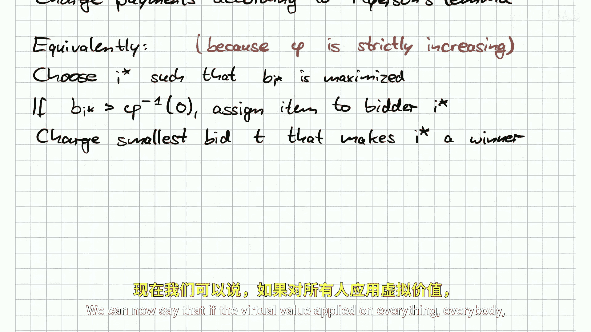

# 021：同分布下的收益最大化 💰

在本节课中，我们将继续学习收益最大化问题，但聚焦于一个特殊场景：**单物品拍卖**，并且假设所有竞拍者的估值服从**相同的分布**。我们将利用上一讲推导出的“期望收益等于期望虚拟福利”这一关键等式，来设计最优的拍卖机制。

上一讲我们介绍了收益最大化问题，并推导了期望收益与期望虚拟福利相等的等式。本节中，我们来看看在这个特殊设定下，如何应用该等式来构建最优拍卖。

## 场景回顾与假设

我们有 `n` 个竞拍者，构成集合 `N = {1, 2, ..., n}`。我们拍卖**一件物品**。每个竞拍者 `i` 对该物品有一个私人估值 `v_i`，这些估值从一个已知的分布中独立抽取。

本节课的核心假设是：**所有竞拍者的估值分布是相同的**。因此，我们不再需要下标 `i` 来区分分布，统一记为 `D`。该分布具有累积分布函数 `F` 和概率密度函数 `f`。

## 关键工具：虚拟估值函数

上一讲我们证明了虚拟估值函数在收益最大化中的核心作用。对于估值 `t`，其虚拟估值 `φ(t)` 定义为：

`φ(t) = t - (1 - F(t)) / f(t)`

虚拟估值总是小于或等于实际估值，因为它减去了一项。对于较小的 `t`，`φ(t)` 甚至可能为负。我们今天的另一个重要假设是：**虚拟估值函数 `φ(t)` 是严格递增的**。满足此条件的分布被称为“正则分布”。

## 收益与虚拟福利的等价关系

我们之前推导的关键等式是：一个真实（ truthful ）机制的期望收益，等于其分配规则所产生的**期望虚拟福利**。具体公式如下：

`E[收益] = E[ Σ_i φ(v_i) * x_i(v) ]`

其中，`x_i(v)` 表示在估值组合 `v` 下，竞拍者 `i` 获得物品的概率（1或0）。对于单物品拍卖，`Σ_i x_i(v) ≤ 1`。

这个公式看起来很像社会福利公式，只不过把每个竞拍者的实际估值 `v_i` 替换成了其虚拟估值 `φ(v_i)`。因此，**最大化期望收益，等价于在每次拍卖中，选择能最大化总虚拟福利的分配方案**。

## 最优拍卖机制的构建

基于上述原理，我们可以构建一个真实的最优拍卖机制。其分配规则非常简单：

**将物品分配给虚拟估值最高的竞拍者，但前提是其虚拟估值必须为正数。否则，卖家保留物品。**

由于我们假设所有竞拍者分布相同，因此他们使用同一个虚拟估值函数 `φ`。这意味着，比较虚拟估值 `φ(b_i)` 的高低，等价于比较其出价 `b_i` 本身的高低（因为 `φ` 是严格递增函数）。因此，分配规则可以简化为：

1.  **找出出价最高的竞拍者** `i* = argmax_i b_i`。
2.  计算其虚拟估值 `φ(b_i*)`。
3.  如果 `φ(b_i*) > 0`，则将物品分配给竞拍者 `i*`；否则，卖家保留物品。

根据迈尔森引理，在一个真实的直接拍卖中，赢家的支付价格是其能获胜的**最低出价**（即临界价格）。在我们的机制中，竞拍者 `i*` 要获胜，需要满足两个条件：一是出价最高，二是其虚拟估值大于0。

因此，赢家 `i*` 的支付价格 `p_i*` 是以下两者中的**最大值**：
*   **第二高出价**：确保自己是出价最高者。
*   **虚拟估值为0对应的估值**：即 `φ^{-1}(0)`，确保自己的虚拟估值大于0。

用公式表示，赢家的支付为：
`p_i* = max( 第二高出价, φ^{-1}(0) )`

## 机制步骤总结

以下是完整的“最优拍卖”步骤：

以下是该拍卖机制的具体执行流程：

1.  **竞拍**：每个竞拍者 `i` 提交出价 `b_i`。
2.  **确定赢家**：找出出价最高的竞拍者 `i*`。
3.  **分配决策**：计算 `φ(b_i*)`。若 `φ(b_i*) > 0`，则 `i*` 赢得物品；否则，卖家保留物品，无人获胜。
4.  **计算支付**：如果 `i*` 获胜，其支付金额为 `p_i* = max( 第二高出价, φ^{-1}(0) )`。其他竞拍者支付为0。

这个机制被称为 **“带有保留价的二价拍卖”** 。其中，`r = φ^{-1}(0)` 就是**最优保留价**。卖家在心里设定一个底价 `r`，只有当最高出价超过 `r` 时才会售出物品，并且售价是第二高出价和 `r` 中较高的那个。

## 本节课总结

本节课中，我们一起学习了在同分布假设下的单物品最优拍卖设计。我们回顾了虚拟估值函数和收益-虚拟福利等价关系这两个核心工具。通过应用这些工具，我们推导出：**对于正则分布，最优拍卖机制就是带有最优保留价的二价拍卖**。这个机制不仅理论最优，而且简单易行，完美体现了理论对实践的精妙指导。