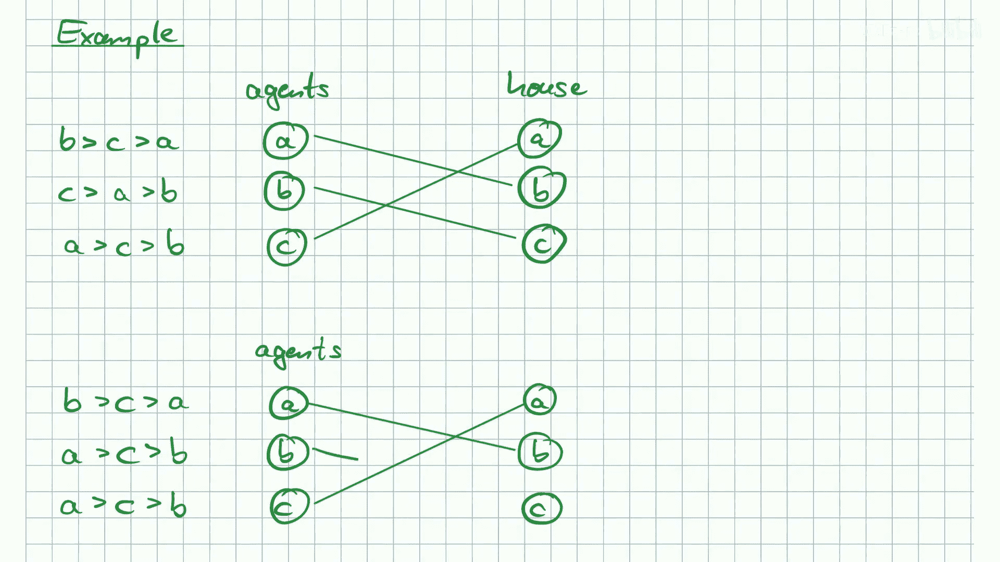

# 022：无货币分配机制

欢迎回到算法博弈论课程。在过去的几周里，我们学习了大量关于使用货币的机制设计知识。但是，如果你不想用金钱来引导人们走向正确的方向，以实现期望的结果，该怎么办呢？

为什么可能不想使用货币？或许是因为收取金钱不可行，或者出于某些伦理原因。那么，在这种情况下我们能做什么呢？在接下来的几讲中，我们将了解一些关于无货币机制设计的知识。

遗憾的是，情况远不如之前清晰，设置通常也更为复杂。这有很好的原因：到目前为止，我们所做的一切都是以货币单位来衡量的。我指的不仅仅是支付，还包括你对物品的估值。我们也是用货币单位来表达的，例如，我认为这个物品值5，那个值3，那么估值更高的人就应该得到物品，因为这能最大化社会福利。

然而，如果没有货币，我们该如何比较哪个物品对谁更有价值呢？正如你将看到的，我们必须更仔细地思考，所谓“获得一个理想的结果”究竟意味着什么。

现在，我想考虑的第一个问题是一个非常简单的场景：每个参与者都带一件物品到市场，我们称之为“房子”，他们希望通过交换这些房子，让每个人在交换后都尽可能满意。当然，你也可以用金钱来做这件事，即每个人都卖掉自己的房子，然后再买房子。这甚至可能是此类场景下的一种可行机制。

但在这里，我们希望完全不用金钱来完成这件事。那么，这会是什么样子呢？

和往常一样，我们有 N 个参与者，我称他们为 I（没有特别的理由），我们仍然称他们为玩家。集合用大写 N 表示。他们每个人最初都拥有一件物品，我们称之为房子，意思是，你实际上只需要一栋房子来居住，不需要两栋，但你肯定应该有一栋房子住。

那么，我们现在的目标是什么？目标是重新分配这些房子，让参与者更满意。这意味着，我们希望找到一个一一对应的映射 π，它只是一个从 N 到 N 的映射。这意味着，在重新分配之后，参与者 I 将获得房子 π(i)。

正如我所说，我们不用金钱来做这件事。所有关于“让参与者更满意”的表达，我们都不会用货币单位来衡量。当然，你可以说，我认为这座豪宅值200万，那座值300万，所以我更喜欢那座300万的豪宅。但是，为什么你多获得100万的感知价值，就比另一个人只多获得1000的感知价值更重要呢？因此，我们实际上并不用货币单位来表达所有这些偏好。我们不说我估价这栋房子这么多，而是说，这是我的房子偏好排序列表，我喜欢这栋房子胜过那栋，又胜过另一栋。

因此，每个参与者对所有房子都有一个完整的偏好排序列表，且没有并列项。让我们看看这可能是什么样子。

我们有参与者 A、B 和 C。他们也带来了房子 A、B 和 C。例如，第一个参与者可能偏好房子 B 胜过 C，胜过 A。第二个参与者可能偏好房子 C 胜过 A，胜过 B。第三个参与者可能偏好房子 A 胜过 C，胜过 B。在这种情况下，事情非常简单，因为每个人最偏好的房子都不同。所以我们可以给参与者 A 房子 B，给参与者 B 房子 C，给参与者 C 房子 A，这样所有人都会很高兴。他们都会成为世界上最幸福的人，因为他们得到了自己最喜欢的房子。

所以我们的映射 π 就是这个二分图中的完美匹配。但是，通常情况不会这么顺利。当然，可能有一栋豪宅是每个人都想要的，而我们无法让每个人都得到他们最偏好的房子。例如，情况可能如下所示。

再次，我们有参与者 A、B 和 C。他们每人带来房子 A、B 和 C。参与者 A 现在和之前一样，偏好房子 B 胜过 C，胜过 A。但参与者 B 现在偏好房子 A 胜过 C，胜过 B。参与者 C 的偏好我们也不修改。如果我们现在进行同样的交换会发生什么？

那么人们现在有多高兴呢？参与者 A 仍然得到了最偏好的房子，但参与者 B 没有得到最偏好的房子。