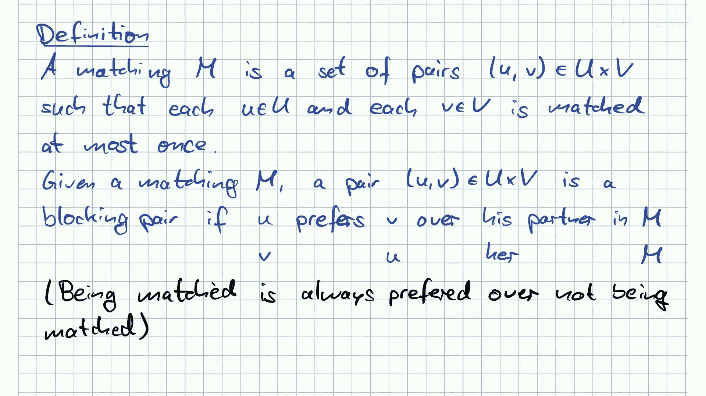

**算法博弈论：第22讲：稳定匹配** 👩‍❤️‍👨

在本节课中，我们将学习**稳定匹配**问题。上一讲我们介绍了无金钱的机制设计领域，并看到了两个例子。我们了解到，由于无法用货币单位表达偏好，而只能将其编码为偏好排序，因此情况比有金钱时更为复杂。我们认识的一个例子是房屋分配问题，我们找到了一个房屋的重新分配方案，使得每个人都满意，即不存在一组人宁愿自行交换也不愿加入我们的分配方案。

今天，我们将考虑一个非常相似但有一个主要区别的问题：在房屋分配问题中，房屋本身不在乎谁住在里面。但今天我们要考虑的是一个**双方都有偏好**的匹配问题。传统上，这被表述为一个婚姻问题：我们有一组男性和一组女性，我们想将男性与女性进行匹配。我个人认为这是所有可能动机中最弱的一个，因为现实中的婚姻并非如此。更合理的应用场景可能是将求职者与雇主进行匹配。但由于文献中通常使用婚姻的表述，我们也将沿用，并谈论男性和女性。

那么，我们这里的设定是什么？我们有一个男性集合 **U** 和一个女性集合 **V**。每个男性 **u ∈ U** 对女性有一个偏好排序，每个女性 **v ∈ V** 对男性也有一个偏好排序。这里的排序是**全序**，即每个人都对另一方进行了排名，且没有并列情况。

例如，假设男性集合是 {X, Y, Z}，女性集合是 {A, B, C}。偏好列表可能如下：
*   男性 X：A > B > C
*   男性 Y：A > C > B
*   男性 Z：C > A > B
*   女性 A：X > Y > Z
*   女性 B：Z > X > Y
*   女性 C：Y > X > Z

我们的目标是将男性与女性进行匹配，并且我们希望这个匹配是**稳定的**。这意味着，类似于房屋分配问题，每个人都满意我们分配给他们的对象，具体来说：不存在这样一对男女，他们彼此更喜欢对方，而不是自己当前的匹配对象。

让我们正式定义一下。一个**匹配 M** 是一组 (u, v) 对的集合，其中 u ∈ U，v ∈ V，并且每个男性和女性**至多**被匹配一次。给定匹配 M，一对 (u, v) 被称为**阻碍对**，如果：
1.  男性 u 比起他在 M 中的当前伴侣，更喜欢女性 v。
2.  女性 v 比起她在 M 中的当前伴侣，更喜欢男性 u。

这里有一个重要的约定：**被匹配总是优于不被匹配**。因此，如果双方都未被匹配，他们当然更愿意组成一对。

一个匹配 M 被称为**稳定的**，如果其中**不存在任何阻碍对**。

---

在定义了稳定匹配之后，一个自然的问题是：这样的匹配是否总是存在？如果存在，我们如何找到它？下一节我们将介绍一个著名的算法来解决这个问题。

**盖尔-沙普利算法**（又称“延迟接受”算法）可以找到一个稳定匹配。以下是该算法的步骤：

1.  **初始化**：所有男性和女性最初都是未匹配状态。
2.  **求婚轮次**：在每一轮中，每个尚未被匹配（或尚未被所有他喜欢的女性拒绝）的男性，向他偏好列表中尚未拒绝过他的、排名最高的女性“求婚”。
3.  **回应**：每位女性在收到求婚时，会将她当前的求婚者（如果有的话）与她更偏好的一位进行临时匹配。如果她更偏好新的求婚者，她会拒绝当前的临时伴侣（使他恢复自由身，可以在后续轮次中继续求婚）。如果她更偏好当前的临时伴侣，她会拒绝新的求婚者。
4.  **终止**：当没有男性需要再求婚时（即所有男性要么已匹配，要么已被所有他喜欢的女性拒绝），算法终止。此时形成的临时匹配就是最终的稳定匹配。

这个算法保证会终止，并且产生的匹配是稳定的。值得注意的是，这个算法是**男性最优**的，即它产生的稳定匹配对男性来说是最好的可能结果（同时，对女性来说是对应的最差可能结果）。如果交换角色，由女性主动求婚，则会得到**女性最优**的稳定匹配。

---

本节课中，我们一起学习了**稳定匹配问题**。我们首先定义了问题的设定，即双方都有严格偏好排序的匹配场景。然后，我们形式化地定义了**稳定匹配**的概念，其核心是匹配中不存在**阻碍对**。最后，我们介绍了寻找稳定匹配的**盖尔-沙普利算法**，该算法通过多轮“求婚”和“接受/拒绝”的过程，总能找到一个稳定匹配，并且这个匹配对主动求婚的一方是最优的。

理解稳定匹配及其算法，是学习机制设计和市场设计的重要基础，它在学校录取、器官捐献、求职招聘等许多现实场景中都有广泛应用。