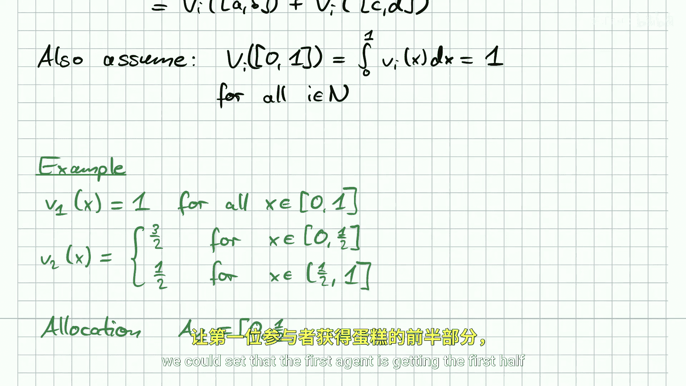

# 024：公平分配与蛋糕切割问题 🍰

在本节课中，我们将学习机制设计中一个不涉及金钱的经典问题：公平分配。我们将以“蛋糕切割”为例，探讨如何将一个连续资源（如蛋糕）分配给多个参与者，使得分配结果满足某种公平性标准。本节将介绍蛋糕切割问题的数学模型、核心概念以及一种简单的分配机制。

## 蛋糕切割问题简介

上一节我们介绍了机制设计的基本概念，本节中我们来看看一个具体的应用场景：公平分配。这类问题在日常生活中很常见。例如，一组员工需要分配不同的工作时间班次，每个人对早班、晚班或周末班次可能有不同的偏好。目标是如何分配班次，使得整体上每个人都尽可能满意。

我们将在一个简化的设置中考虑这个问题。与之前学期中见过的不可分割物品分配不同，这里我们考虑一个完全可分割的资源，但人们对资源的不同部分有不同偏好。这个资源通常被比喻为一块“蛋糕”。

## 数学模型 🧮

我们如何用数学来刻画这个场景？

*   蛋糕被建模为一个从0到1的区间：`[0, 1]`。
*   一块蛋糕“块”是若干个子区间的并集。
*   有 `n` 个参与者（代理人）。
*   每个参与者 `i` 有一个估值函数 `V_i`，它为每一块蛋糕分配一个非负的价值。

为了具体描述偏好，我们假设存在一个密度函数 `v_i(x)`，它将区间 `[0, 1]` 映射到非负实数。估值函数 `V_i` 由该密度函数的积分给出：
`V_i(X) = ∫_X v_i(x) dx`
其中 `X` 是分配给参与者 `i` 的蛋糕块（一个或多个子区间的并集）。这意味着估值在不相交的区间上是可加的。

需要注意的一点是，分配开区间或闭区间并不影响结果，因为单点的积分值为零。我们通常假设每个人对整个蛋糕的总估值是相同的（即归一化为1），但关键在于他们更偏好蛋糕的哪一部分。

## 偏好示例 📊

以下是几个具体的偏好示例：

*   **无差别参与者**：密度函数 `v_i(x) = 1` 对所有 `x ∈ [0, 1]` 成立。这意味着该参与者对蛋糕的任何部分都同等喜欢。
*   **偏好左半部分的参与者**：密度函数在 `[0, 0.5]` 区间为 `1.5`，在 `[0.5, 1]` 区间为 `0.5`。该参与者认为左半块蛋糕价值 `0.75`，右半块价值 `0.25`，但整个蛋糕的总价值仍是 `1`。

这些例子展示了个人对蛋糕不同部分的主观价值判断差异。

## 一个简单的分配机制

那么，我们可以如何进行分配呢？一个直观的想法是进行平均分割。

以下是“我切你选”机制在两人情况下的步骤：
1.  由第一位参与者将蛋糕切成他认为价值相等的两块。
2.  由第二位参与者从这两块中挑选他更喜欢的一块。
3.  第一位参与者获得剩下的那块。

这种机制能保证对于两位参与者而言，分配结果是“无嫉妒”的，即没有人会认为别人分到的蛋糕比自己分到的更好。

## 总结

本节课中，我们一起学习了公平分配中的蛋糕切割问题。我们建立了将连续资源建模为区间、用密度函数和积分表示参与者偏好的数学模型，并通过“我切你选”的例子，初步了解了如何设计满足基本公平性（无嫉妒）的分配机制。在后续课程中，我们将探讨更多参与者和更复杂公平标准下的切割算法。