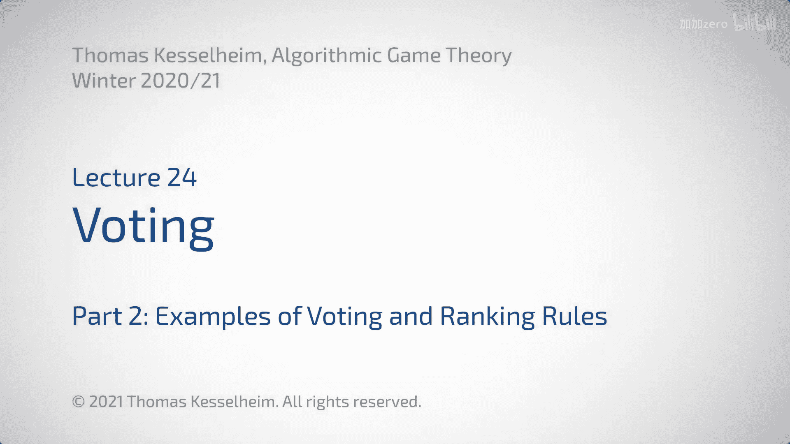

# 025：投票机制

欢迎回到算法博弈论课程。本节课我们将讨论机制设计中的一个主题，该主题对大多数人而言，明确不涉及金钱，即投票。

这意味着我们可能需要设计一个机制，例如总统选举。我们有多个候选人，需要决定谁将赢得总统职位。这可能意味着每位选民只需说出他们偏好的候选人，或者他们可能告诉我们更多信息，这取决于我们特定的设计。

如果你只有两名候选人，那么有一个非常标准的形式：谁获得更多选票，谁就赢得选举。我们暂时搁置平局处理的问题，因为两名候选人获得完全相同票数的情况很少发生。

这种方式被广泛使用，并且有充分的理由。因为只有少数选民会对结果不满意。多数选民会说，好的，这是我偏好的结果，并且在这种情况下，没有比这更好的结果了。

但是，当你有三个或更多候选人时，情况就变得复杂得多。你可能在现实中见过这种情况，例如市长选举。你可能会想，我可以投票给我最喜欢的候选人，但他或她的机会很小，所以我可能想支持我第二喜欢的候选人，因为他或她更有可能获得相对多数票，从而比我最不希望当选的人获得更多选票。

因此，这里涉及一些策略性投票，这是我们应提出的问题之一：是否存在方法可以避免选民必须采取策略性行为？在此之前，我们还应提出一个问题：我们如何确定获胜者？即使每个人都告诉我们他们最喜欢谁、第二喜欢谁等等，我们如何确定获胜者？因为规则有好坏之分。

但在开始这一切之前，让我们先引入一个形式化模型。因为这是一个没有金钱的环境，我们无法用货币单位来表达“我喜欢这个候选人这么多”，而是再次定义一个偏好顺序。

形式化定义如下：我们有 **N** 个智能体（代理人），以及 **M** 个候选人。我们称候选人的集合为 **Γ**。每个智能体 **i** 都有一个对 **Γ** 的**完整偏好列表**，且没有平局。

我们将使用以下符号表示：如果智能体 **i** 偏好候选人 **A** 胜过 **B**，偏好 **B** 胜过 **C**，我们写作：
**A ≻ᵢ B ≻ᵢ C**
这当然意味着 **A ≻ᵢ C**，即具有传递性。

现在我们的问题是什么？首先是**投票问题**：给定所有这些偏好顺序，我们需要从 **Γ** 中确定**一个获胜者**。其次是**排序问题**：要求我们不仅确定获胜者，还要确定所有候选人的**完整排名顺序**。同样，给定所有偏好顺序，我们的目标是确定一个**社会排名**。

这意味着除了找到获胜者，我们还需要说明谁是第二名、第三名等等。因此，我们的目标是设计一个排序规则或投票规则。这两个问题非常相似，排序问题当然要求我们做更多工作，但根本上它们是相似的。

那么，是什么让这变得困难？我们被赋予了这些个体智能体的偏好顺序，必须以某种方式找到一个折中方案或共识。我们没有客观函数，所以什么是好的结果实际上取决于我们的设计。例如，对于投票问题，一种方法是随机从 **Γ** 中选择一个获胜者，或者选择获得最少票数的候选人。换句话说，你查看这些偏好顺序，然后选择在多数偏好顺序中排名最差的候选人，或者作为首选被最少智能体选择的候选人。当然，这些都没有实际意义，但为什么这不是一个好的投票规则？为什么选择最少人喜欢的候选人不好？这是我们需要形式化的内容。

---

我们都见过投票和排序规则的例子。现在，我想首先讨论这些规则，讨论它们如何融入我们的框架，以及它们在多大程度上是好的或不好的排序/投票规则。

我想考虑的第一个规则是**多数制投票**。它是如何运作的？在多数制投票中，每位选民只有一票，他们只需投票给他们最喜欢的候选人。