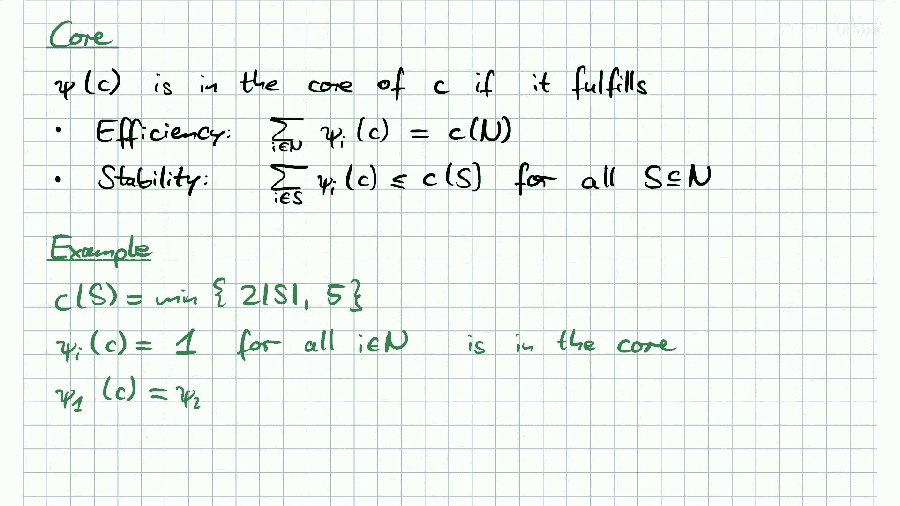

# 026：成本分摊


欢迎回到算法博弈论课程，这是我们今天的最后一讲。非常感谢大家坚持到现在。本节课我们将讨论一个话题，这个话题也可称为公平分配，但通常被称为成本分摊。

## 概述

在本节课中，我们将学习成本分摊问题的基本模型，并探讨两种不同的成本分摊方法及其满足的性质。我们将从定义模型开始，然后介绍核心解的概念，并分析其特性。

## 问题模型

首先，我们定义一个模型。我们有 **N** 个智能体，也称为大写 **N**。我们还有一个成本函数 **C**。这个成本函数将智能体的所有子集映射到一个实数。**C(S)** 表示子集 **S** 自行承担的成本。我们假设空集的成本为零，但其他子集的成本原则上也可以是负数。

例如，考虑购买火车票的场景。假设有5个智能体。一张单人票价格为2欧元，一张团体票（适用于3人及以上）价格为5欧元。那么，对于任意智能体子集 **S**，其成本 **C(S)** 为：
```
C(S) = min(2 * |S|, 5)
```
如果只有两个人买票，成本是4欧元；如果只有一个人买票，成本是2欧元；但如果有三个或更多人，他们可以购买团体票，成本是5欧元。

我们的核心问题是：如何将整个群体 **N** 的总成本 **C(N)** 分摊给所有智能体，使得总成本被完全覆盖，并且每个智能体都感到被公平对待。

更正式地说，目标是找到一个成本分摊向量 **ξ(C)**，它依赖于成本函数 **C**，将成本分摊给所有 **n** 个智能体。当所有智能体一起时，他们恰好覆盖总成本。

在我们的例子中，分摊方式有多种可能：例如，前两个智能体各付2欧元，第三个智能体付1欧元；或者第一个智能体付全部5欧元，其他智能体不付钱；或者每个智能体各付1欧元。其中一些方式可能比其他方式更“合适”。这正是我们今天要探讨的问题：是什么让一个成本分摊向量显得公平或合适？

## 核心解

第一种选择成本分摊向量的方法是所谓的“核心”。

一个成本分摊向量要属于核心，必须满足两个性质。

我们说 **ξ(C)** 在成本函数 **C** 的核心中，如果它满足以下条件：

一方面，它应满足称为**效率**的性质。我们已经见过这个性质：个体成本份额的总和应等于所有智能体在一起的总成本。个体成本的总和应恰好收回社会成本。

另一方面，我们还有**稳定性**。这意味着：对于任何智能体子集 **S**，该子集中智能体的成本份额之和不超过该子集 **S** 自行承担的成本 **C(S)**。也就是说，没有任何联盟通过这个成本分摊向量支付的成本，会超过他们自己单独行动（例如，仅为这个群体购买火车票）所承担的成本。

在我们的例子中，是否存在一个核心结果？是的，存在。

我们之前有：
```
C(S) = min(2 * |S|, 5)
```
那么，一个可能的核心结果是什么？例如，我们可以设：
```
ξ_i(C) = 1， 对于所有 i
```
这将在核心中。或者，我们也可以这样分摊成本：前两个智能体各支付2欧元...



（注：原文在此处中断，后续内容未提供。根据要求，教程应基于提供的原文内容生成，因此教程在此结束。）

## 总结


本节课中，我们一起学习了成本分摊问题的基本模型。我们定义了智能体集合 **N** 和成本函数 **C**，并通过火车票的例子进行了说明。接着，我们介绍了核心解的概念，它要求成本分摊方案同时满足**效率性**（总成本完全覆盖）和**稳定性**（任何子集支付的成本不超过其独立承担的成本）。我们通过具体例子验证了核心解的存在性。理解核心解是评估分摊方案是否公平合理的重要基础。