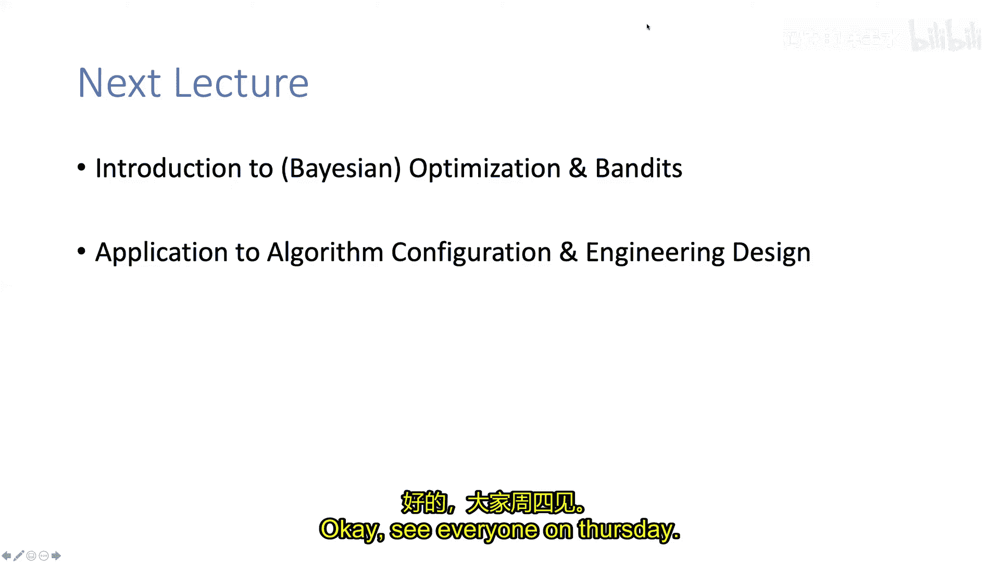

# 001：课程概述与导论

在本节课中，我们将学习数据驱动算法设计的基本概念、课程结构以及该领域的一些核心应用场景。我们将了解如何利用数据和机器学习来自动化或优化传统算法的设计过程。

## 课程结构与要求

欢迎来到CS 159机器学习专题课程的第一讲。本学期的主题是数据驱动的算法设计。

当前社会正面临由COVID-19疫情带来的前所未有的挑战。加州理工学院的全体教职员工希望大家保持安全，尽量减少对自己和身边易感人群的风险。

课程的前几讲将重点介绍基础知识，帮助大家为期末项目提案做好准备。后续讲座将更多地转为讨论课形式，主要讨论课程主题、相关论文和算法思想。如果学生希望讨论更广泛的问题，也欢迎提出。

### 课堂注意事项
*   使用Zoom时，请注意所有私聊信息都会被录制下来，因此请勿通过Zoom聊天发送私人消息。
*   默认情况下，所有参会者进入会议时均处于静音状态。如需提问，请使用“举手”功能。

### 课程详情
*   **讲师**：Zong Yu，研究方向为机器学习。
*   **助教**：一名主要助教（Jalin）和两名次要助教（How和Joe）。
*   **课程网站与Piazza**：所有课程通知将通过Piazza发布。课程网站链接可在讲师主页找到。

### 课程风格与评分
本课程是研究生级别的课程，旨在让学生广泛了解前沿研究主题，并深入某一主题完成最终的研究项目。课程假设学生具备成熟的学习能力，不会进行过多手把手的指导。

**评分构成如下：**
*   **20% 展示部分**：今年改为**博客文章**形式，作为书面展示。
*   **80% 期末项目**：包括项目报告和最终展示。如果因客观原因无法进行口头展示，可能会寻找替代方案（例如也改为博客文章）。

**重要日期：**
*   博客文章截止日期：4月24日（课程第四周结束）。
*   项目提案截止日期：5月1日（非最终绑定，旨在促使形成具体提案，助教将提供反馈）。
*   项目展示日期：6月3日至5日。
*   项目报告截止日期：包含毕业生的组为6月6日；仅包含非毕业生的组为一周后。

### 关于期末项目
课程的重点是帮助大家完成一个严谨的算法模型设计项目。这需要一定的数学基础，但难度不会太高，后续课程会讲解相关数学知识。

**“严谨”意味着**：能够清晰地陈述假设、将其形式化、说明模型或方法如何利用或满足这些假设，并严谨地推理这些设计选择的下游影响（可能带有可证明的保证，但非必需）。

**优秀的期末项目通常属于以下三类之一：**
1.  **纯理论**：研究证明技术，尝试扩展、证明或应用于新场景。
2.  **算法与模型**：为现有算法或模型进行扩展，或为新场景设计新算法。
3.  **应用**：将数据驱动算法设计方法应用于某个新领域（例如生物化学）。

历史上，大多数小组会混合第二和第三点。项目不限于课堂涵盖的论文，课程网站提供了大量参考文献，助教也会提供项目起点建议。

### 关于分组
大部分学生将自行组队。根据上周的调查，仍有相当一部分学生正在寻找组员。课程将在接下来的一周左右设法帮助大家匹配组队。如有建议，欢迎通过邮件提出。

---

## 数据驱动算法设计的应用

上一节我们介绍了课程的基本情况，本节中我们来看看数据驱动算法设计在现实世界中有哪些应用场景。这些应用展示了手动设计的启发式算法或求解器如何可能通过机器学习进行自动化改进。

数据驱动算法设计在许多领域都有实际应用，以下是一些例子：

*   **字符串处理**：在生物化学等领域，涉及序列比对、转录组组装、折叠等。这些应用中的许多算法目前是手动设计的，可以想象使用机器学习来自动设计部分或全部算法。
*   **规划问题**：例如火星探测车任务规划、3D打印路径规划、生态保护规划等。这类问题通常是NP完全或NP难问题，人们会针对特定领域设计启发式算法，可以设想使用学习来自动设计这些启发式方法。
*   **工程实验设计**：在设计新结构、化学品或患者治疗方案时，通常涉及一个运行实验、测量结果、选择新实验的优化过程。可以利用学习来加速或增强这个过程。
*   **自动定理证明**：可用于软件验证、飞行系统安全验证等领域。
*   **拍卖设计**：许多复杂的组合拍卖是NP难的，人们使用启发式方法来解决。
*   **概率推断**：例如在变分自编码器等深度生成模型中，每次测试时实际上都在运行一个优化算法（推断算法），其中就使用了学习技术。

这只是部分示例，如果你有自己的问题领域，可以在Piazza上提问，我们可以收集更多可能的应用和算法。

---

## 为何需要数据驱动设计？

了解了应用场景后，我们自然会问：为什么我们需要数据驱动的算法设计？在许多情况下，手动设计算法存在局限性，而数据驱动的方法提供了新的可能性。

以下是一些自然而然地需要考虑数据驱动算法设计的情况：

*   **求解器包含可调参数**：许多求解器有大量可调参数（例如权重、子模块运行时长）。如果能针对具体问题找到最佳参数，算法可以运行得非常快，反之则可能很慢。可以利用学习来预测这些参数。
*   **求解器依赖启发式方法**：例如A*搜索需要可采纳启发函数，梯度下降使用各种动量项。这些启发式方法可能在一个领域有效，在另一个领域则不然。如果有一个代表性问题的数据集，或许可以学习到比手动调整更好或更快的启发式方法。
*   **求解器依赖关键子程序**：例如，某些求解器需要一个子程序来识别搜索算法中下一个需要剪枝的重要变量。实际上可以利用学习来设计这些子程序。

既然存在这些可以利用数据自动指定算法组件的地方，接下来的问题就是：我们具体该如何做？

---

## 方法论清单

在考虑如何使用数据时，我们需要一个系统的检查清单。不能随意使用数据，必须仔细思考数据的使用方式是否真正解决了问题。这对于我们专注于如何训练求解器以加速求解过程尤为重要。

高层次的方法论清单如下：
1.  数据是**预先收集**的还是**在线收集**的？
2.  是否有**预先收集的测量结果**？仅有问题实例不够，通常还需要对问题实例进行测量（例如，运行求解器并测量其在该问题上的速度），这类似于监督学习中的标注。
3.  学习的是**有状态模型**还是**无状态模型**？
    *   **有状态模型**：在求解器运行过程中持续使用，输入是求解器的当前状态（例如，当前搜索树）。
    *   **无状态模型**：只设置求解器的全局参数，然后让求解器像黑盒一样运行，不关注其内部状态。

以下是几个具体示例，帮助我们理解这些概念：

**示例一：预先收集 & 有状态**
*   **场景**：与NASA/JPL合作，为火星车设计更快的路径规划算法（一个NP难的组合优化问题）。
*   **过程**：从历史数据或火星卫星图像中预先收集大量火星地形障碍分布数据，将其编译为优化问题。利用“学习搜索”技术学习一个搜索启发函数。当遇到新的火星地形（测试实例）时，假设训练集具有代表性，学习到的启发函数应能比现有求解器更快地解决规划问题。
*   **关键点**：假设训练实例具有代表性；在测试实例上应用训练好的求解器；由于有大量预先收集的数据，可以使用数据饥渴、高容量的模型（如神经网络）来学习。

**示例二：在线收集 & 无状态**
*   **场景**：蛋白质工程（例如Francis Arnold课题组的工作）。目标是设计一种新蛋白质（通过突变参考蛋白），以最大化某些功能。
*   **过程**：合成突变体，筛选其功能（如结合亲和力），从而收集训练数据（输入基于特征，输出基于功能测量）。训练一个模型，并迭代地指导优化过程的下一个步骤。这个过程涉及湿实验室循环。
*   **关键点**：数据在线收集，因此算法必须选择收集哪些数据（即筛选哪些突变体）。由于数据集相对较小，通常使用比深度神经网络更简单的模型。对于新的蛋白质工程任务，可能需从头开始此过程，因为简单模型难以泛化到新的相关问题实例。

**示例三：预先收集 & 无状态**
*   **场景**：解决旅行商问题（TSP）或其变种（如亚马逊的物流路径规划）。这是一个NP难问题。
*   **过程**：拥有一个TSP问题实例的训练集。调整求解器的超参数，使其在该分布上表现最佳。测试时，对于来自同一分布的新问题，调优后的求解器运行速度会快得多。
*   **关键点**：在训练实例上调整现有求解器的超参数；假设训练实例具有代表性；在测试实例上应用调优后的求解器。

---

## 问题设置分类

在概述了应用和方法后，我们需要更系统地思考如何分解“学习优化”的设置，使其适用于特定类别的算法。本节我们将介绍四种高级别的问题设置分类，这将构成我们理解本课程主题的基本框架。

以下是四种主要的问题设置类别，每种都对应一类经典算法：

1.  **算法配置**：本质上是超参数调优。许多求解器有大量可调参数，目标是为特定领域的数据集找到最佳参数设置。
2.  **连续优化**：例如梯度下降。我们可以思考如何学习一个类似于梯度下降但本身是学习得到的算法。
3.  **树搜索**：离散优化的典型例子，需要启发式方法来指导如何导航搜索树。例如，DeepMind的AlphaGo就使用学习来快速导航游戏树，在合理计算时间内找到获胜走法。
4.  **预测子结构或实例化关键子程序**：主求解器需要某个子程序来识别问题中的特定结构。如果能用学习预测这些子结构，且效果优于手工设计的子程序，那么求解器就能运行得更快或更好。

接下来，我们将逐一简要探讨这些类别，让大家对每个主题的技术细节有个初步了解。

---

### 1. 算法配置

算法配置，在更广义上也被称为超参数调优。其基本思想是：我们有一个算法A（例如整数规划求解器），它接收问题实例x和参数θ作为输入，输出一个解。我们假设要将该求解器应用于一个问题分布（例如亚马逊所有物流问题构成的分布）。目标是调整求解器的超参数θ，以优化某个目标函数L。

目标函数L通常是在问题分布P(x)上的期望损失。L的具体形式可以是：
*   **运行时间**：直到找到最优解的时间（如果我们能验证最优性）。
*   **解质量**：在给定时间限制（例如10秒）后找到的最佳解的质量。
*   **曲线下面积**：解质量随时间变化曲线下的面积，衡量了整体成本。

**基本迭代流程如下：**
1.  初始化一个空的测量集S。
2.  从训练集中选择一个（或一组）问题实例X。
3.  选择一组参数θ。
4.  选择一个运行时间限制T_max。
5.  对每个选中的问题实例，使用参数θ运行求解器，直到终止或达到T_max。
6.  记录测量结果（包括解质量z），并将其添加到测量集S中。
7.  重复步骤2-6，直到总时间预算耗尽。
8.  返回迄今为止找到的最佳参数θ。

该流程中的设计选择主要在于步骤2、3、4：如何选择要测量的问题实例、参数以及运行时间限制。

**版本一：简单随机采样**
*   **选择X**：每次测量都使用训练集中的所有实例。
*   **选择θ**：从参数空间中随机采样。
*   **T_max**：设为无穷大或一个非常大的数。
*   **优缺点**：**优点**是超级简单，易于理论分析和实现。**缺点**是θ的搜索是朴素的试错法，可能耗时很长；在所有训练实例上花费相等时间可能非常浪费；过大的T_max可能导致阻塞在某个难题上。

**版本二：贝叶斯优化**
*   **选择X**：同样使用所有训练实例。
*   **选择θ**：使用贝叶斯优化算法选择。
*   **T_max**：设为无穷大。
*   **核心思想**：将问题简化为一个标准的贝叶斯优化问题。我们有一个目标函数F(θ)（例如，在所有训练实例上的平均损失），我们可以对任何θ进行（带噪声的）测量z = F(θ) + noise。贝叶斯优化在每次迭代中，基于对F的贝叶斯信念选择一个θ，进行测量，更新信念，以高效地找到最优θ。
*   **优缺点**：**优点**是贝叶斯优化是一个成熟领域，有大量算法、理论支持和现成软件可用。**缺点**是仍然在所有训练实例上花费相等时间，且大T_max可能浪费。

**版本三：监督学习代理**
*   **选择X**：使用所有训练实例。
*   **选择θ**：随机采样（用于数据收集）。
*   **T_max**：设为无穷大。
*   **关键点**：将步骤2-6视为**数据收集过程**，用于训练一个监督学习模型（如神经网络）。该模型学习预测给定问题实例x和参数θ时的成本z。训练完成后，对于任何给定的新问题实例x，我们可以通过最小化该神经网络的输出来选择最佳的θ。
*   **优缺点**：**优点**是简化为监督学习，易于实现；一个额外的好处是现在可以根据不同的问题实例x选择不同的θ，实现了更灵活的配置。**缺点**是需要采样大量的(θ, x)对，且大T_max可能浪费。

这些只是实例化基本流程的几种简单方法。实践中已有许多更巧妙的方法，这让我们对该领域的研究有了初步了解。

---

### 2. 连续优化

现在，我们来看看连续优化，其中梯度下降是一个典型例子。在深入之前，需要简要了解强化学习和模仿学习，因为它们为理解某些高级主题提供了框架。这两种范式都描述了**有状态的顺序决策过程**。

*   **环境**：即优化问题。
*   **代理**：即求解器（如树搜索或梯度下降求解器），试图在优化问题的“地形”中导航。
*   **过程**：环境给出状态（例如当前中间解） -> 代理采取动作（对当前解的局部更新） -> 环境给出新状态和奖励。
*   **目标**：找到最优策略（即决策规则）。
*   **模仿学习 vs 强化学习**：主要区别在于目标函数。模仿学习试图模仿现有求解器提供的示范；强化学习则直接优化环境给出的奖励信号。

许多求解器本质上是顺序决策过程（贪婪算法、梯度下降等）。因此，我们可以将这些求解器视为一个代理或策略，其状态是当前中间解，目标是找到高奖励（低成本）的状态。换句话说，与其手工设计这个局部决策过程，不如尝试**学习一个局部决策过程**。

**将梯度下降视为策略**
梯度下降可以看作一个手工设计的策略H。它接收优化问题描述x和当前解θ，并预测一个局部更新（即负梯度乘以步长η）。梯度下降可能收敛缓慢。如果我们反复解决某一类优化问题，并且拥有这类问题的训练集，我们能否学习一个更好的局部更新规则，使得在测试时能更快地解决新问题？

**论文示例一：《Learning to learn by gradient descent by gradient descent》**
*   **应用场景**：快速训练大型神经网络。他们使用一个较小的神经网络（如LSTM）来学习局部更新规则（即替代梯度下降的优化器），以便在部署时能快速训练一个新的大型神经网络。
*   **框架**：将优化过程公式化，使得从父损失函数L到优化器H的整个链条是**完全可微**的，从而可以通过梯度下降来学习H。
*   **结果**：在固定优化步数（如100步）内，学习到的优化器（LSTM）比传统优化器（如SGD、Adam）达到更低的损失。有趣的是，即使训练时只用了100步，测试时运行200步（超出训练分布）也能良好泛化。

**论文示例二：《Iterative Amortized Inference》**
*   **背景**：“摊销优化”指使用学习来预测优化问题的解（例如变分自编码器中的编码器网络）。这可以看作T_max=1的情况，优点是极快，但存在“摊销差距”——单次预测的解可能并非最优。
*   **方法**：迭代摊销优化将T_max设为大于1（如10、20），训练一个神经网络进行多次局部更新，以快速接近最优解，从而消除摊销差距。
*   **策略形式**：学习到的更新规则H由两部分组成：H1是“门控策略”，输出一个介于0和1之间的掩码；H2是“更新策略”，预测一个新位置。更新公式为 `θ_new = θ_old + H1(...) ⊙ H2(...)`，其中⊙是逐元素乘积。这种形式将步长（元素级）的预测与方向的预测解耦。
*   **结果**：在简单的二维优化问题上，只需不到10次迭代就能达到全局最优，收敛速度远快于梯度下降。

**关于计算成本的讨论**
一个关键问题是：训练和使用另一个神经网络作为优化器，在墙钟时间上是否真的划算？
*   **摊销思想**：成本是**预先支付**的。我们花费时间离线学习一个优化器，旨在使**测试时**解决单个优化问题的速度大大加快。这适用于需要反复解决同一类优化问题的场景（例如，谷歌为众多小企业提供快速训练定制神经网络的服务）。
*   **迭代成本**：学习到的优化器每一步都需要运行神经网络的前向传播，因此单步比SGD慢。但其优势在于所需的总步数远少于SGD。只有当步数减少带来的收益足以抵消单步增加的成本时，墙钟时间才会更快。在迭代摊销推断中，通常T_max很小（约10步），因此整体上可能更快。

---

### 3. 离散优化与树搜索

接下来，我们转向离散优化，特别是树搜索算法。这类算法（如A*搜索、分支定界、迭代加深）也可以被视为代理或策略在进行局部决策。由于问题的离散性，进行完全可微的学习更加困难，因此更需要利用模仿学习和强化学习。

**典型问题：最小顶点覆盖**
给定一个图，找到一个能覆盖所有边的最小顶点集。这可以表述为一个整数规划问题，其中变量是二进制的。状态是变量的（可能部分）赋值，目标是找到一个完全赋值且成本低的状态。

**核心思想**：我们是在组合空间中进行离散搜索。人们编写搜索启发式方法来指导这个过程。问题在于：如何学习做出好的局部决策？

**示例结果**
在一项关于混合整数规划的工作中，与商业求解器Gurobi比较。在搜索树访问的状态数量（预算）固定的情况下，学习到的局部搜索方法能找到更好的解。这意味着**学习到的方法用更少的搜索步骤找到了好解**。但这**不一定**意味着墙钟时间更快，因为Gurobi虽然搜索了更多节点，但每个节点的处理可能更快（它不需要每次决策都运行神经网络前向传播）。这体现了**所需决策步骤数**与**每步决策耗时**之间的权衡。

---

### 4. 预测子结构

最后，我们探讨预测子结构。许多现有求解器本身已经非常快（经过高度优化）。即使学习到的方法迭代步数更少，但如果每步慢得多，总墙钟时间可能仍不占优。这些求解器的性能通常依赖于问题的某些关键属性。

**两种范式：**
1.  **预测关键变量**：例如“后门变量”。如果先确定这些变量，就能快速确定其余变量。学习目标是预测哪些变量是后门变量，从而优先处理它们，避免指数级爆炸。
2.  **预测分解**：如果求解器在问题规模超过一定大小时性能下降，我们可以将大问题分解为多个小问题，分别求解后再组合。学习目标是预测如何对问题进行划分/分解。

**示例：大邻域搜索（预测分解）**
使用学习（或任何方法）将所有变量划分为若干组。每次固定除一组外的所有变量，在该组变量上运行求解器，然后轮换。学习问题是预测这种划分。
*   **优点**：直接利用现有求解器的优秀实现，可能在墙钟时间上立即具有竞争力。
*   **缺点**：非常依赖于现有求解器在子问题上表现良好，并且能够找到这样的子问题划分。

**实证结果**：在一项工作中，使用学习预测问题划分，然后在子问题上运行Gurobi，最后组合解。这种方法（图中的绿色和橙色线）在墙钟时间上击败了直接在完整问题上运行Gurobi的方法。

---

## 模型选择

在讨论了各种学习流程后，我们必须认识到模型选择同样至关重要，它直接影响方法的实际效果。虽然本课程讲座中对此强调较少，但它是实践中的重要细节。

以下是一些常用的模型类别及其适用场景：

*   **图神经网络**：适用于图结构的问题，例如混合整数线性规划（变量和约束构成二分图）、图优化问题。
*   **循环神经网络（如LSTM）**：适用于需要保持历史信息的顺序优化，可以隐式学习动量等概念。
*   **卷积神经网络**：适用于需要处理像素等感知输入的问题。
*   **高斯过程**：适用于算法配置等场景，其不确定性估计有助于在有限预算下决定收集哪些数据（主动学习）。通常用于数据量相对较小的在线或主动学习场景。
*   **XGBoost**：在原型开发阶段非常有用，因为训练速度通常比图神经网络快得多。

---

## 总结

本节课中，我们一起学习了数据驱动算法设计的概貌。我们首先了解了课程的结构、要求和目标。接着，探讨了该领域广泛的应用场景，从生物信息学到物流规划。然后，我们分析了为何需要数据驱动的方法，并介绍了一个系统的方法论清单来指导思考。在此基础上，我们将问题设置分为四大类：算法配置、连续优化、离散树搜索和预测子结构，并对每一类进行了初步的技术探讨。最后，我们简要提及了模型选择的重要性。

通过本讲，你应该对数据驱动算法设计有了一个全局性的认识，并能够判断自己感兴趣的问题是否适合采用这些方法。在接下来的课程中，我们将深入探讨贝叶斯优化、强化学习等具体技术，并将其应用于算法配置和工程设计等问题中。