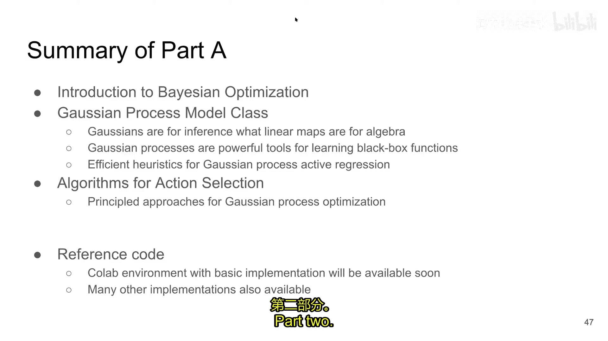
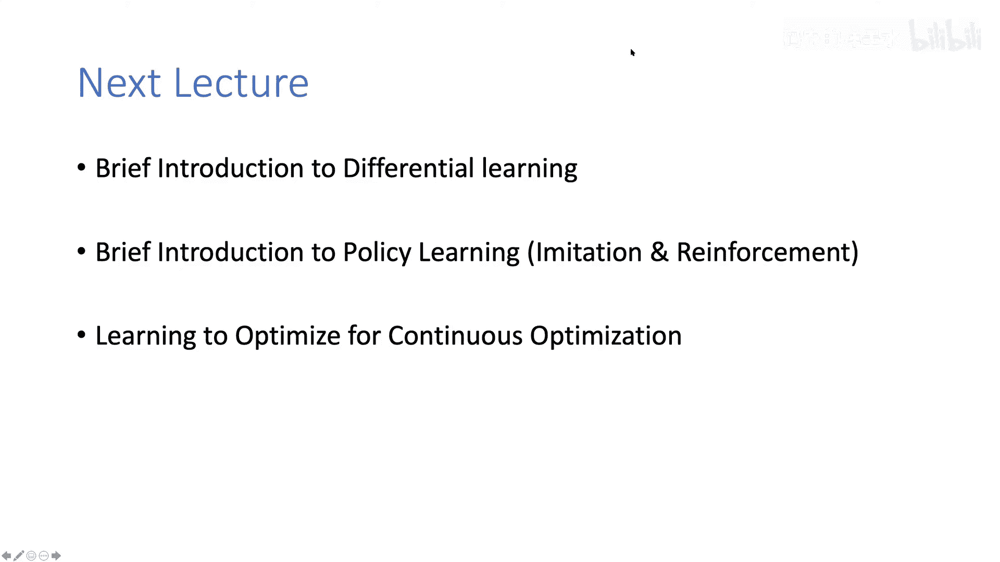

# 002：贝叶斯优化


在本节课中，我们将学习贝叶斯优化的核心概念，这是一种用于目标导向实验设计的范式。我们将从高斯过程模型的基础讲起，探讨其与多臂老虎机问题的联系，并介绍几种用于选择实验点的算法。最后，我们将讨论如何将贝叶斯优化应用于算法配置问题。

## 第一部分：贝叶斯优化简介

贝叶斯优化是一种迭代、自适应的实验设计范式。实验设计者（可以是人或算法）在实验平台上运行实验，测量响应变量，并根据测量结果更新其信念，以设计下一个实验。整个过程的目标是最大化某种效用，即找到能产生最佳结果的实验。

### 问题形式化

我们有一个实验预算 `T`，每个实验成本相同。在每一轮迭代 `t`，我们：
1.  选择一个实验 `x`。
2.  运行实验并测量结果 `y = f(x) + 噪声`。
3.  将 `(x, y)` 添加到测量集 `S` 中。
4.  更新我们的贝叶斯模型。

最终目标是找到一个我们认为是最大化器的行动 `x_hat_star`，并最小化**简单遗憾**：`f(x_star) - f(x_hat_star)`，其中 `x_star` 是真实的未知最优行动。

一个相关的问题是**多臂老虎机**，其设置相同，但目标是最小化**累积遗憾**：`∑_{t=1}^{T} [f(x_star) - f(x_t)]`。如果算法能实现较小的累积遗憾，通常也意味着它能实现较小的简单遗憾。

### 高斯过程模型

为了进行贝叶斯优化，我们需要一个模型类来表示我们对未知适应度函数 `f` 的信念。高斯过程是一个强大的选择。

高斯过程由均值函数 `μ(x)` 和核函数 `k(x, x')` 完全指定。它是一个函数的概率分布，其关键性质是：函数值在任何有限点集上的联合分布都是一个多元高斯分布。

高斯过程的后验推断公式如下：
```
后验均值: μ_{t}(x) = k(x, X) [K + σ^2 I]^{-1} y
后验方差: σ_{t}^2(x) = k(x, x) - k(x, X) [K + σ^2 I]^{-1} k(X, x)
```
其中 `X` 是已观测点集，`y` 是观测值，`K` 是 `X` 中所有点对的核矩阵。

高斯过程回归的负对数后验等价于带有L2正则化的最小二乘回归。我们使用高斯过程不仅是为了得到均值预测，更重要的是为了量化预测的不确定性。

### 选择实验点的算法

上一节我们介绍了高斯过程模型，本节我们来看看如何利用这个模型来选择下一个实验点。

**主动学习**的目标是全局精确地拟合函数 `f`，其算法是**不确定性采样**：总是选择后验方差最大的点。

对于贝叶斯优化（目标是找到最大值），我们需要平衡**探索**（减少不确定性）和**利用**（选择当前认为最好的点）。以下是两种常用算法：

1.  **高斯过程上置信界算法**：选择最大化 `μ_t(x) + β_t * σ_t(x)` 的点，其中 `β_t` 控制置信水平。这是一种“不确定性下的乐观”策略。
2.  **汤普森采样**：从当前后验分布中采样一个函数 `f_tilde`，然后选择最大化 `f_tilde` 的点。其直觉是，选择某个行动 `x` 的概率近似等于 `x` 是真实最优行动的概率。

在实践中，如果行动空间是离散且有限的（例如一百万个选项），求解上述最大化问题是可行的。汤普森采样通常是默认推荐算法，因其经验性能良好，且与GP-UCB具有相同的最坏情况理论保证。

## 第二部分：算法配置中的应用

现在，我们将把贝叶斯优化的概念应用到本课程的核心问题之一：算法配置。

### 问题设置

算法配置的典型场景是：我们有一个求解器（例如，用于组合优化或训练神经网络），其性能受一组超参数 `θ` 影响。我们有一个代表性的训练问题实例集。目标是调整 `θ`，使得求解器在从相同分布中采样的新测试实例上表现良好。

迭代过程如下：
1.  选择一个（或一组）问题实例 `x`。
2.  选择超参数配置 `θ`。
3.  选择运行时间预算 `T_max`。
4.  运行配置为 `θ` 的求解器处理实例 `x`，时间不超过 `T_max`。
5.  记录性能测量结果（如运行时间、解的质量）。
6.  重复直到总计算预算耗尽，返回找到的最佳配置。




### 直接归约为贝叶斯优化

最直接的归约方式是：在每次迭代中，使用贝叶斯优化算法（如GP-UCB或汤普森采样）智能地选择 `θ`，对训练集中的**所有**实例进行评估，并将 `T_max` 设置为一个固定的大值。这使得每次迭代成本相同，符合标准贝叶斯优化框架。这在超参数调整针对**单个固定问题**（如为一个特定数据集调整神经网络）时效果很好。

### 其他互补方法

然而，直接归约忽略了两个重要方面：运行时间预算的差异和评估时的方差。以下是两种解决这些问题的互补方法：

*   **Hyperband算法**：此算法“朴素地”选择 `θ`（例如随机采样），但“智能地”分配运行时间预算 `T_max`。其核心思想是连续多轮进行淘汰赛：每轮给予所有候选配置相同的总时间预算，运行它们，淘汰表现差的一部分，增加剩余配置的预算，重复直到只剩一个配置。这适用于不同配置所需运行时间差异很大的情况。
*   **SMAC算法**：此算法专注于处理在**多个问题实例**上评估配置时的高方差。它不会在每轮评估所有训练实例，而是对实例进行子采样，并让所有候选配置在**相同的**子样本上运行，以公平比较。同时，它也可以结合问题实例的特征，学习一个能根据实例特征预测最佳配置的条件模型。

此外，**算法组合选择**将思想扩展到不仅调整一个求解器的参数，而是从多个不同的求解器中为给定的问题实例动态选择最可能表现好的一个。

## 总结



本节课我们一起学习了贝叶斯优化的核心框架。我们首先介绍了其问题形式化以及作为模型类的高斯过程。接着，我们探讨了用于平衡探索与利用的算法，如GP-UCB和汤普森采样。最后，我们将这些概念应用于算法配置问题，看到了贝叶斯优化的直接应用及其局限性，并介绍了如Hyperband和SMAC等能处理运行时间预算和评估方差的互补方法。这些工具共同构成了数据驱动算法设计的基础。