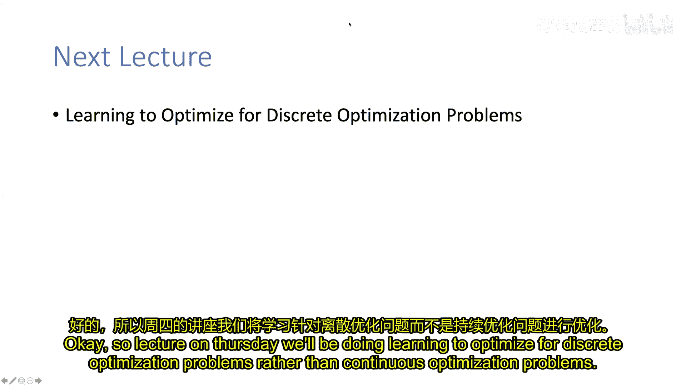
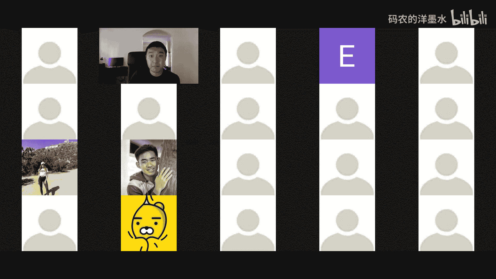

# 003：面向持续优化的学习

在本节课中，我们将学习如何利用深度学习技术来改进传统的连续优化算法。我们将探讨如何将优化过程本身视为一个可学习的计算图，从而训练出比手工设计的梯度下降法更高效的优化器。

## 课程公告

以下是关于课程的一些重要通知。

**寻找队友**：课程初期调查显示，部分同学正在寻找项目队友。我们已在 Piazza 论坛上启用了“寻找队友”功能。请前往置顶的“寻找队友”帖子，按照说明填写表格并发布新帖，以便我们协助匹配。请务必在今天（12月14日，星期二）结束前完成。

**博客文章指南**：我们已为博客文章创建了专门网站，并提供了一个优秀博文范例模板（如右侧截图所示）。课程网站上的指南也已更新。核心要求是：选择一个主题进行深入探索，撰写一篇约10-15分钟阅读时长的博文。右侧模板的阅读时长约为13分钟。

我们建议你从课程网站“博客文章指南”下列出的10篇入门论文中选择一个主题。这些是助教和我认为本课程最基础的论文。你可以使用课程网站“代码与数据”部分链接的实现代码，或自行实现一个简单示例，以理解该方法的特性，然后撰写博文进行解释。同时，请阅读课程网站上提供的大量参考文献，了解该方法的可能扩展方向。这不仅是为了理解核心技术概念，也是为了理解该方法在更广阔背景下的定位。博文提交截止日期为4月24日（下周五），大约12天后。此项任务以小组（3-4人）形式完成。

**答疑时间**：助教和我将在下周安排线上答疑时间，具体细节将通过 Piazza 公布。如果因时间安排无法参加，我们也可以另行安排时间会面。

**协作环境推荐**：我们强烈推荐使用 **Google Colab** 作为实验环境。Colab 是 Google Research 提供的在线笔记本环境，便于 AI 研究者快速上手和运行代码。它提供在线存储和计算资源，网上已有许多与本课程相关的实用笔记本可供下载。对于希望快速入门并运行代码的同学来说，这是一个极佳的起点。课程网站上链接了 Colab 教程以及我们自己编写的示例笔记本。

## 今日课程大纲

今天讲座的大纲如下：
1.  回顾深度学习和微分计算。
2.  以此为基础，切入**面向持续优化的学习**，其核心思想是学习出比手工设计的基于梯度的优化器更好的优化器。
3.  讨论如何在神经网络中**嵌入微分优化**。
4.  最后简要讨论当学习过程**不可微分时如何使用强化学习**。这是本节课的主要内容。

## 深度学习与微分计算回顾

首先，我们简要回顾一些基础知识。

在分类等监督学习任务中，目标是学习一个决策边界来（近似）区分正负样本点。我们在 CS155 中学到的第一个模型是线性模型，例如逻辑回归，它通过梯度下降法最小化对数损失（或称交叉熵损失）进行训练。

当我们开始关注高度非线性的决策边界时，深度学习变得相关。我们希望能找到一个函数类来很好地近似这个复杂的边界，同时易于学习。

一种方法是扩展原始特征的特征表示。另一种方法是使用多个线性决策边界组合成一个非线性边界，这本质上就是深度学习的核心思想。另一种理解方式是通过布尔运算来思考。例如，与门和或门在线性可分的布尔特征空间中是可分的，但异或门不是。然而，我们可以通过组合与门和非门等基本门电路来构建实现异或功能的电路。

神经网络当然可以近似这类电路。从本讲座和本课程的角度，特别是本节课，我们将把神经网络和这类电路都视为**计算图**。计算图中的每个节点对其输入执行某种计算并产生输出。对于神经网络，每个节点对输入应用一个线性函数，然后加上一个非线性激活函数（如 ReLU）。

对于神经网络和一般的可微分计算图，每个节点中执行的计算是通过某种可微分的参数化方式定义的。因此，它可以通过梯度下降法进行学习。

一个深度前馈网络就是一个可微分计算图，它有许多层，每层有一组所谓的隐藏单元。每个隐藏层节点都是一个计算节点：它接收来自前一层的输入，应用一个线性函数（其参数是该线性模型的权重），然后应用一个非线性激活函数，最后将输出传递给下一层。这就是一个计算图。

我们希望所有部分都可微分的一个原因是，我们可以通过微分优化或微分学习来设置这个计算图的参数。换句话说，我们有一个可微分的目标函数（如损失函数）。在监督学习中，损失函数通常是在监督训练集上定义的对数损失或交叉熵损失。我们将神经网络（一个计算图）的最终输出与真实标签比较，计算损失。这个损失函数对于计算图的输出是可微分的。

同时，计算图本身对其参数（例如每个隐藏单元的权重）也是可微分的。这意味着我们可以应用链式法则。给定这个全局损失函数和一个可微分计算图，我们可以应用链式法则进行微分学习，以学习一个能优化（如最小化）目标函数的计算或函数。之后，我们可以应用梯度下降法来学习这个计算图的参数化表示。

## 将优化视为计算图

让我们将前馈神经网络视为计算图。前馈神经网络在某种意义上类似于“单遍”计算：它不维护任何状态或记忆，给定输入即产生输出，没有循环或特殊函数调用。如果我们把神经网络写成代码，它就是一行接一行的代码。

现在，让我们将梯度下降法本身也视为一个计算图。假设当前状态由 θ_t 表示。我们拥有关于某个损失函数的梯度 ∇L(θ_t)。然后，我们以这些为输入执行一些计算（可能只使用其中一个），并输出一个结果。这个结果与当前状态相加，得到新状态 θ_{t+1}。这个过程随着 t 递增而重复，新状态 θ_{t+1} 成为新的 θ_t 并反馈回这个计算图。因此，这是一个循环或递归计算图。

在梯度下降中，计算模块 G（目前显示为黑盒）基本上是图中所示的公式。我们可以如下实现这个计算图：忽略当前状态输入，只取梯度，乘以负的学习率 η，然后输出。接着，新状态被反馈回去。因此，梯度下降可以看作是一个完全手工设计的计算图。

那么带动量的梯度下降呢？我们继续在计算图的背景下思考这些不同的操作。图中展示了一个非常简单的带动量版本（仅用于演示）。我们沿梯度方向加上动量项进行更新，然后使用过去梯度的指数衰减累积来更新动量项。这也是一个计算图，其中我们同时更新状态和动量项。这个过程也是循环的。

需要记住的是，我们有一个通用的“记忆”概念。在带动量的梯度下降中，我们维护这个记忆（即动量），它是一种对过去发生事情的内存。问题是：我们能否学习一个更好的优化器，以某种方式利用这种通用记忆概念，使其可能比这种手工设计的、明确将记忆解释为动量的方式执行梯度下降更快？这就是**学习优化**的核心思想。

## 学习优化与循环神经网络

为了实现这种带记忆的学习优化，我们需要借助循环神经网络。回想一下，循环神经网络接收输入序列并产生输出序列，同时维护一个隐藏层。该隐藏层的值（橙色节点）不仅是当前输入的函数，也是前一个隐藏层输出的函数。这个循环神经网络的参数编码在箭头中，所有相同颜色的箭头共享完全相同的权重。因此，这个神经网络的每一列都是具有不同输入的完全相同的计算图。

我们也可以将循环神经网络视为前馈神经网络，只要我们固定或限定迭代次数。这样，前馈神经网络的深度就等于步数，这对学习有影响，因为随着深度增加，梯度下降和链式法则会变得越来越困难。梯度下降或反向传播算法在这里被称为**随时间反向传播**。

那么，学习优化作为循环深度学习是怎样的呢？让我们回到之前的计算图。新状态和更新后的记忆被反馈回计算模块，计算模块输出更新后的记忆和新状态，如此循环。这本质上就是一个循环神经网络。它与标准循环神经网络的主要区别在于：图中右上角有一个非常明确的加法操作（计算图的输出与当前状态相加以产生新状态），并且此计算图的输入之一是我们试图优化的某个目标函数的梯度。这两点是这个特定循环神经网络架构中固定的部分，其余部分则像一个自由形式的通用循环神经网络，其中记忆单元是循环隐藏单元的输出。

## 可微分学习框架

现在，让我们形式化地讨论可微分学习。

我们有一个想要优化的目标函数 L(θ)，其中 θ 是优化景观的当前状态。我们假设损失函数 L 关于 θ 是可微分的，这意味着我们可以在任何 θ 处获得损失函数的零阶和一阶信息。

我们有一个可微分计算图 G，它由一组可微分参数 φ 参数化。它输出状态偏移量 Δ 和更新后的循环输出 M（记忆）。这个计算图中硬编码的部分是：新状态等于当前状态加上这个状态偏移量或更新量。

我们假设 G 的输出关于 G 的参数是可微分的，并且 G 的输入关于 G 的参数也是可微分的（或者反之，关键是链式法则成立）。因此，通过链式法则，我们可以递归地、通过随时间反向传播来估计参数 φ。

M 项是循环部分，要求我们进行随时间反向传播，因为 M 既是这个神经网络的输出，也是其输入。在带动量的梯度下降中，它是被手工赋予特定含义的；而在这里，它只是一个将被学习用来最小化损失函数的有用记忆单元。

通常，我们会固定时间范围（总迭代次数 T）。然后，我们将其视为一个具有特殊结构的循环神经网络进行训练。损失函数是：神经网络在每一步输出一个 θ_t（如果将顶部的加法操作视为神经网络硬编码的一部分），那么它在每一步都会产生损失 L(θ_t)。我们希望最小化所有 T 个时间步上的损失之和。这就是可微分训练的方式，就像一个循环神经网络。

在测试时，我们固定 G，并迭代地应用它：从一个初始 θ 开始，传入梯度，传入一些初始记忆（通常是随机初始化或标准基本初始化），预测新的 θ，计算梯度，将其反馈回循环神经网络，记忆以循环方式更新，基本上就是展开一个经典循环神经网络的预测。

## 学习优化实例分析

现在，我们将深度学习与类似梯度下降的思想在可微分计算和计算图的范式下统一起来，并查看学习优化的具体实例。

首先，再次讨论我们在第一讲中简要提到的论文《通过梯度下降学习梯度下降法》。在这篇论文中，状态 θ 是一个更大神经网络的参数化表示。优化器 G 可以是一个手工设计的基于梯度的优化器，也可以是一个学习到的基于梯度的优化器。整体要最小化的损失函数是这个更大神经网络的监督学习损失。这种设置基本上就是我们上面描述的框架。

需要强调的是，计算这篇论文中底部公式的梯度需要进行更多的链式法则，因为 θ_t 是更大神经网络的参数。为了计算这个更大神经网络的损失及其梯度，我们需要进行大量的链式法则，然后才能将其输入到我们学习的计算图中。这就是为什么这篇论文被称为“通过梯度下降学习学习”。

论文中使用 LSTM（一种循环神经网络）作为学习优化器。在相对简单的数据集上，学习优化器（LSTM）的性能优于各种手工设计的基于梯度的优化器（损失越低越好）。有趣的是，在训练时他们设定了100步的时间范围，而在测试时，即使运行到200步，学习优化器也能在一定程度上泛化，尽管它从未见过后100步中完全相同的梯度输入或状态。

需要注意的是，就迭代次数而言，学习优化器收敛得更快，但每次迭代可能更昂贵，因为现在需要应用一个神经网络。因此，只要这个小型神经网络（学习优化器）每次迭代的计算开销不超过传统优化器的两倍（在这个例子中），那么它就是值得的。

论文还展示了在更复杂的数据集（如 CIFAR-10 图像分类）上的结果。其中一个图表测试了学习优化器能否用于不同的学习问题：如果学习优化器在一个任务（如 CIFAR-2，一个二分类问题）上训练，然后应用于另一个相关但完全不同的 CIFAR-2 数据集，它仍然可以表现得非常好。这表明学习到的优化器可以泛化到新的、相关的领域。

## 迭代摊销推断

另一个例子是**迭代摊销推断**，即摊销优化。这个概念在深度概率模型或深度生成模型中非常流行。其思想是，在许多深度生成模型（如自编码器）中，需要进行推断以给定输入推断某些潜在变量。如果使用变分推断，这个推断过程实际上是一个优化问题。你可以训练一个神经网络来预测这个优化问题的输出，这样在测试时，你只需预测解决方案，而不是求解优化问题。这被称为**摊销变分推断**。

在计算图的背景下，这可以被视为仅运行此计算图一个时间步（T_max = 1）。本课程助教之一 Joe Moreno 指出，如果只运行一步，会产生所谓的**摊销差距**：学习到的计算图预测的解决方案可能没有达到全局最优。

在 Joe 的工作中，他使用了不同的架构：不是简单地将预测加到 θ 上，而是使用一个门控机制来权衡当前状态和新状态的预测。其中，G1 和 G2 输出向量，圆圈点表示逐元素乘法。G1 可以解释为门控计算，决定在多大程度上保持当前位置或跳转到 G2 预测的位置。同样，这里的一切都是可微分的。

这项工作展示了在变分推断的背景下，经过不超过10步优化，这个神经网络可以在优化景观中实现大幅跳跃，并最终收敛到非常接近全局最优解的位置。就迭代次数而言，该方法比标准优化器（如 RMSProp）快大约100倍。只要运行这个小型学习优化器 G 的计算时间少于运行 RMSProp 的100倍，那么这就是一个更快的算法。在实践中，Joe 已验证该方法在实际运行时间上比标准基于梯度的优化器快几个数量级。

## 元学习

接下来，我们讨论第一讲中未涵盖的内容：**元学习**。这是 Chelsea Finn、Pieter Abbeel 和 Sergey Levine 在2017年的工作。基本思想是：假设我们希望在测试时进行领域自适应。这意味着在训练时，我们有一个监督学习问题的分布（可以视为不同的任务）。每个任务对应一个不同的损失函数，并且与一个可能很小的训练集相关联。我们假设这些学习问题或任务是相互关联的。

在最简单的元学习形式中，目标是学习一个两阶段优化器：第一阶段是初始猜测 θ_0；第二阶段是我们可以快速将 θ_0 微调到单个任务。这可以表示为：我们有一组来自不同任务的损失函数作为输入，对于每个任务，我们希望最小化其损失。我们想找到一个 θ_0，使得通过一次（或少数几次）梯度步就能达到该任务的 θ*。当然，我们也可以将优化器本身作为黑盒学习，而不仅仅是固定为标准梯度下降。

元学习的好处是，它可以在部署时快速适应新任务（可能只有很少的训练数据），学会跨训练任务共享信息以实现快速适应（无论是在训练时间还是泛化能力上）。图中显示，元学习方法通过仅一两次梯度步就能更快地学习。

元学习的核心概念可以与学习到的基于梯度的优化器概念相结合，这本身就是一个有趣的研究课题。

## 在神经网络中嵌入可微分优化

接下来的两个主题会简短一些：**在神经网络中嵌入可微分优化**。

到目前为止，我们的思路是：我们有一个优化问题 L，想要训练一个迭代优化器（如基于梯度的优化器）来优化 L，并假设一切都是可微分的，且 L 是完全定义好的。但情况并非总是如此。为了理解另一种视角，我们来看 Brandon Amos 和 J. Zico Kolter 在卡内基梅隆大学的工作——OptNet，该工作首次出现在 ICLR 2017。

首先，我们看一个二次规划问题。我们希望找到最小化该二次损失函数的 θ，并满足线性约束。如果这个优化问题的参数完全指定，这是一个相对容易解决的凸优化问题。

现在的问题是：我们能否学习这些参数，使得这个优化问题的解能给出我们想要的结果？换句话说，假设这些优化问题的参数是一个神经网络的输出。那么，我们可以在神经网络内部有一个优化层：使用现有求解器解决这个优化问题（一旦指定参数，优化问题就容易解决）。我们有一些输入 X，将其传递给一个前馈神经网络，该网络的输出即是这个优化问题的参数，然后我们运行这个优化问题并获得输出。

那么，这个优化问题最优解的一些性质是什么？对于熟悉拉格朗日乘子法的同学，这里写出了 QP 的拉格朗日函数。我们关注在最优性下满足的 KKT 条件。你可以将其粗略地类比为梯度下降的最优条件（梯度为零）。

假设矩阵 A 和向量 b 是神经网络的输出。那么，对这个约束进行微分（应用链式法则）可以得到一种形式。这意味着我们可以**微分地通过 KKT 条件**。换句话说，我们可以刻画 QP 的解如何随其输出参数的变化而发生可微分的变化。这意味着，一旦我们解决了这个优化问题，我们就可以通过链式法则将变化传递回前馈神经网络部分。

因此，如果你有一个优化问题，并且在最优性下有一些条件，你可以将其视为神经网络的一层（尽管不是简单的一层，而是一个优化层）。

一个例子是数独游戏。输入是部分填充的数独谜题，输出是完全填充的解。可以选择标准的监督训练损失（如平方损失）。预测的 θ 即是这个受约束的优化问题的预测解。论文中展示，这种方法在测试时可以达到与卷积神经网络相当的性能，并且不会过拟合。这表明，OptNet 架构实际上正在学习数独有效解的约束规则，而将问题视为图像的卷积神经网络可能难以学习这些约束。因此，如果你认为存在支配解应如何呈现的规则或约束，那么可以将其编码在 A、b、G、c 中，这种结构使得学习这类约束变得更容易。

## 不可微分情况下的强化学习

最后，我们简要讨论当学习不可微分时如何使用强化学习。

考虑学习优化不可微分的情况：假设我们无法获得梯度，只能测量逐点损失值（即只有损失函数的零阶信息）。这属于强化学习范畴。

回顾策略学习（包括强化学习和模仿学习）。我们使用强化学习 notation：状态（在我们案例中是 θ），动作（新 θ 或对 θ 的更新），环境是世界（即损失景观），代理是我们的优化器。目标是找到一个能最大化奖励的代理。这里，奖励是损失函数值（我们只能测量损失函数值，不知道其梯度）。

最简单的算法是 **REINFORCE** 算法。我们有一个由参数 φ 参数化的策略 π，它输出动作上的分布。第一步，我们对策略进行“滚出”，采样轨迹（因为策略输出的是分布，我们从中采样）。我们可以测量这些轨迹上每个 θ_t 的逐点损失，但无法测量损失关于 θ 的梯度。第二步，通过赋予策略一个分布，我们可以使用该分布来平滑损失。关于参数 φ 的损失梯度是这个损失的光滑版本，其中我们只有损失函数的逐点测量值。然后，我们可以对这个光滑梯度进行梯度下降，以更新学习优化器的参数 φ。

因此，在学习优化的背景下，强化学习可以被视为基于采样的优化。智能体在优化景观中尝试随机轨迹，观察损失函数值（即环境奖励），并通过采样学习如何做出更智能的优化步骤序列以最小化损失。

当然，我们希望尽可能使其可微分。但如果问题的某些方面不可微分，你只能对其进行采样，然后进行平滑估计并对该平滑估计求梯度。

简要提一下 Google Brain 的论文《通过强化学习进行神经优化器搜索》。他们不仅旨在找到性能优异的优化器，还试图在优化器中加入更多结构，以发现新的优化原则。他们展示了学习到的优化器优于标准基于梯度的优化器。需要指出的是，随着转向强化学习，训练这些优化器会变得越来越昂贵，因为采样极其耗时。

## 总结

本节课中，我们一起学习了如何将连续优化过程构建为可学习的计算图。我们回顾了深度学习与微分计算的基础，探讨了将梯度下降等优化算法本身视为计算图的思想。接着，我们深入研究了**学习优化**的核心框架，它利用循环神经网络来学习比手工设计更高效的优化器。我们分析了两个具体实例：通过梯度下降学习梯度下降法，以及迭代摊销推断。此外，我们还介绍了**元学习**如何学习快速适应新任务的初始化器和优化器，以及如何通过 **OptNet** 在神经网络中嵌入可微分的优化层。最后，我们简要讨论了当优化问题不可微分时，如何利用**强化学习**的采样方法进行学习优化。下节课，我们将转向离散优化问题的学习与优化。