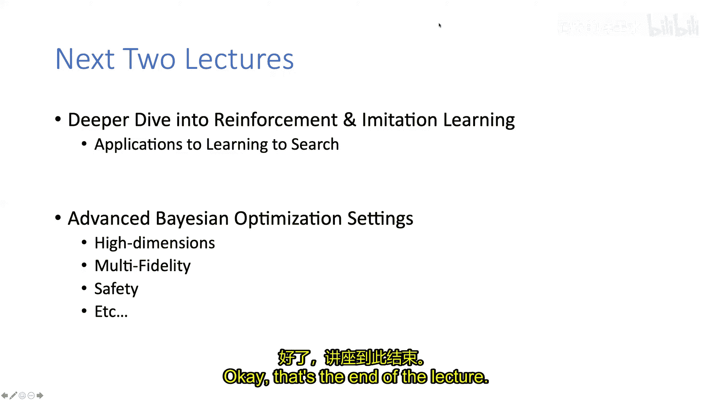

# 004：面向离散优化的学习

在本节课中，我们将要学习如何将机器学习应用于离散优化问题，主要聚焦于“学习如何搜索”这一核心思想。我们将探讨多种算法结构，并了解如何通过学习来改进这些算法中的关键决策组件。

---

## 什么是离散优化？

从高层次来看，离散优化是在离散空间上的任何优化问题。例如，在规划问题中，机器人需要决定绕过障碍物的方向（左或右），这是一个离散的二元决策。在围棋等棋盘游戏中，每一步落子也是一个离散选择。旅行商问题需要在离散的路径集合中选择一条最优路径。缓存控制器在内存满时需要选择一个特定的缓存位置进行驱逐，这同样是离散的。与上一讲讨论的连续优化问题不同，离散优化问题的解空间是离散的，从一个解切换到另一个解通常意味着一个“跳跃”。

---

## 基本方法与部分解

解决离散优化问题有多种基本方法。本讲将重点讨论其中几种。一种常见的方法是构建**部分解**，即算法从一个空解或初始解开始，逐步添加元素，直到形成一个完整的解。另一种方法是从一个完整的解开始，然后通过局部修改来寻找更好的解。还有一些方法将不同算法组合在不同的阶段使用。

为了理解部分解，我们以**最小顶点覆盖**问题为例。给定一个图，目标是选择最少的顶点，使得每条边都至少有一个端点被选中。一个**完整解**是覆盖了所有边的顶点集合。一个**部分解**则是只覆盖了部分边的顶点集合。算法可以从部分解开始，逐步添加顶点，直至形成一个完整且（希望是）最优的解。

---

## 场景一：贪心算法与学习代理函数

我们从一个通用的黑箱优化问题开始：我们希望在一个离散（通常是组合爆炸的）集合 **X** 中，找到一个解 **x**，以最小化成本函数 **F(x)**。如果除了能查询 **F(x)** 外没有其他信息，这就是黑箱优化。

然而，在许多实际问题中，真实的成本函数 **F(x)** 可能非常**稀疏**（例如，在围棋中，只有游戏结束才能知道输赢）或**评估成本极高**（例如，需要运行复杂的模拟器）。在这种情况下，直接使用 **F(x)** 进行搜索效率低下。

解决方案是学习一个**代理函数**（或称启发式函数）。这个代理函数应该比原始函数更**稠密**或更**易于评估**。然后，我们可以将这个学习到的代理函数嵌入到一个简单的搜索算法中，例如**贪心算法**。

贪心算法（或称最佳优先搜索）非常简单：从一个空的部分解开始，在每一步，都选择能最大程度改进当前代理函数值的操作，并承诺该选择（不回溯）。

**核心问题**：我们能否学习到一个好的代理函数，使得简单的贪心算法表现优异？这就是学习与离散算法的第一个交汇点。

---

### 方法一：强化学习（处理稀疏奖励）

当真实目标函数在动作空间中非常稀疏时（如围棋的胜负），我们可以使用**强化学习**来学习代理函数。以 **Q学习** 为例：

1.  从问题分布中采样一个问题实例。
2.  初始化一个空的部分解。
3.  对于T次迭代：
    *   以概率 ε 随机选择一个动作（探索），以概率 1-ε 选择当前估计最优的动作（利用）。
    *   执行动作，更新部分解。
    *   基于最终得到的奖励（如是否获胜）来更新Q函数（即代理函数）。

通过这种方式，智能体通过随机探索收集数据，并学习预测哪些局部动作可能带来好的最终回报。训练阶段可能很耗时，但一旦学成，测试阶段的贪心搜索会非常快。

---

### 方法二：模仿学习（处理评估昂贵的稠密函数）

当目标函数是稠密的但评估成本极高时（如机器人运动规划的物理模拟），我们可以使用**模仿学习**。

1.  在训练阶段，我们多次查询昂贵的模拟器（或优化器），收集（状态，成本）数据对。
2.  使用监督学习（如回归）来训练一个神经网络，使其能够模仿或预测这个昂贵的成本函数。
3.  在测试阶段，我们使用这个学习到的、快速的代理函数来驱动贪心算法。

关键挑战在于如何更智能地查询模拟器以获取高质量的训练数据，这将在下一讲中深入讨论。

---

**本节总结**：我们学习了最简单的算法结构——贪心算法。其核心思想是学习一个代理函数，使得贪心决策能导向好的解。我们看到了两种学习场景：使用强化学习处理稀疏奖励，以及使用模仿学习处理评估昂贵但稠密的函数。

---

## 场景二：A*搜索与学习启发函数

贪心算法简单快速，但它不回溯，可能找到次优解后就停止。我们需要能保证找到最优解的算法结构，同时希望它尽可能高效。**A*搜索** 就是这样一个算法。

在A*搜索中，我们将问题建模为图搜索：目标是找到从初始状态到目标状态的最优路径。我们为每个状态（部分解） **x** 计算一个评估函数：
**f(x) = g(x) + h(x)**
*   **g(x)**：从起始状态到状态 **x** 的实际成本（已知）。
*   **h(x)**：从状态 **x** 到目标状态的**启发式估计成本**。

算法使用一个按 **f(x)** 排序的优先队列。在每一步，它扩展 **f(x)** 值最小的节点。

**h(x)** 的性质至关重要：
*   如果 **h(x)** 是**可采纳的**（即对于所有 **x**，**h(x) ≤ h\*(x)**，其中 **h\*(x)** 是真实最优成本），那么A*搜索保证能找到最优解。
*   如果 **h(x) ≡ 0**，A*退化为广度优先搜索（BFS），保证最优但效率低下。
*   **h(x)** 越接近真实的 **h\*(x)**，A*搜索的效率就越高。

**核心问题**：手工设计一个好的可采纳启发函数 **h(x)** 很难。我们能否**学习**它？

---

### 模仿学习用于A*搜索

我们可以利用一个现有的、较慢但能保证最优的求解器（例如，使用曼哈顿距离的A*）在训练实例上运行。这个求解器会生成从起点到目标的最优路径。

学习目标是：训练一个启发函数 **h(x)**，使得在搜索树的每个节点上，位于最优路径上的子节点比不在其上的子节点具有更低的 **f(x)** 值。这样，学习到的A*搜索会优先沿着最优路径前进，减少不必要的探索，从而提高效率。

实验表明，通过这种模仿学习学到的启发函数，可以比手工设计的启发函数（如曼哈顿距离）更高效地引导搜索，扩展更少的节点就能找到最优解。

---

**本节总结**：我们介绍了A*搜索这一更复杂但能保证最优的算法结构。其效率关键取决于启发函数 **h(x)**。我们可以通过模仿学习，利用现有求解器产生的数据来学习一个高效的、可采纳的启发函数。

---

## 场景三：整数规划、分支定界与学习分支策略

许多组合优化问题可以表述为**混合整数线性规划**。其标准形式是：
最小化 **cᵀx**
满足 **Ax ≤ b**，且 **x** 中部分变量为整数。

求解MIP的经典算法是**分支定界**。其核心思想是：
1.  **线性规划松弛**：将整数变量松弛为连续变量，求解得到的线性规划（LP）。LP的解提供了原MIP问题最优值的**下界**（即可采纳的启发值）。
2.  **分支**：选择一个整数变量，将其固定为两个不同的整数值，从而将原问题分解为两个子问题。
3.  **定界**：求解每个子问题的LP松弛。如果某个子问题的下界超过当前找到的**最佳整数解**的值（上界），则**剪枝**该子问题（因为其不可能包含更优解）。
4.  重复此过程，直到上下界重合，即找到最优解。

在分支定界中，我们需要做两个关键决策：
1.  **定界**：使用LP松弛获得下界（可采纳启发式）。这部分是确定的。
2.  **分支**：选择哪个变量进行分支？这个**分支策略**极大地影响搜索效率。

---

### 模仿学习用于分支策略

与A*搜索类似，我们可以利用一个现有的分支定界求解器（如SCIP、Gurobi）在训练问题实例上运行。这个求解器会生成一棵搜索树，其中包含了到达最优解路径上的节点（好决策）和许多导致死胡同的节点（坏决策）。

学习目标是：训练一个模型（例如，基于图神经网络或手工特征），使其在搜索树的每个节点上，能够预测哪个变量是最有希望的分支变量，从而让求解器尽可能沿着通往最优解的路径前进，减少不必要的回溯和探索。

通过这种方式学习的分支策略，在解决新的同类问题时，通常可以比求解器内置的启发式策略探索更少的节点，从而更快地找到最优解。

---

**本节过渡**：以上方法都属于“构造型”算法，从部分解逐步构建完整解。接下来，我们看看另一类从完整解出发的算法。

---

## 场景四：邻域搜索与学习问题分解

邻域搜索从一个完整的（可能是随机的）解开始，然后反复地对其应用局部修改（“移动”），试图找到更好的解。这类方法在搜索中不维护一棵树，而是直接操作完整解。

将学习应用于此类算法的一个有效范式是：**使用学习来指导如何利用现有求解器**。具体来说，不是替换求解器内部的启发式规则，而是学习如何将原问题**分解**成更容易解决的子问题，然后调用现有的、高度优化的求解器来解决这些子问题。

例如，在整数规划中：
1.  **学习一个分解**：将整数变量集合划分成多个块。
2.  **固定与求解**：固定除一个块之外的所有变量，然后使用现有求解器（如Gurobi）优化这个块内的变量。
3.  **循环**：遍历所有块，重复此过程，直到满足停止条件。

这种方法的好处是：
*   **利用成熟求解器**：直接利用了工业级求解器在速度和鲁棒性上的优势。
*   **提升效率**：求解一个小规模的子问题比求解整个问题快得多。
*   **竞争实际运行时间**：由于每个子问题求解极快，整体算法在挂钟时间上可能极具竞争力。

实验表明，这种“学习分解+调用求解器”的方法，在某些问题上可以比直接运行顶级商业求解器快上千倍。

---

## 其他应用：可满足性模理论求解

可满足性模理论是用于程序验证等形式化方法的核心工具。SMT求解器内部也使用了类似分支定界的复杂搜索策略。研究已表明，使用模仿学习来合成SMT求解器内部的决策策略（如如何化简公式、选择哪个变量分支），可以在工业标准验证基准上，实现比手工调优的顶尖求解器快上千倍的加速。这凸显了学习技术即使在高度专业化、已有数十年优化历史的领域，也能带来突破性进展。

---

## 课程总结

在本节课中，我们一起学习了如何将机器学习与离散优化算法相结合。我们探讨了多种算法结构：
1.  **贪心算法**：通过学习代理函数来改进其决策质量，适用于稀疏或评估昂贵的奖励函数。
2.  **A*搜索**：通过学习可采纳的启发函数来提高其搜索效率，同时保证最优性。
3.  **分支定界法**：通过学习分支变量选择策略，来减少搜索树的大小，加速整数规划求解。
4.  **邻域搜索/分解方法**：通过学习如何将问题分解，从而高效利用现有的强大求解器作为子程序。

核心思想是**将学习注入到传统离散算法的关键决策点中**，无论是学习一个评估函数、一个启发函数，还是一个分解策略。这使我们能够结合机器学习的数据驱动能力和传统算法的最优性/可靠性保证，设计出更加强大的数据驱动算法。