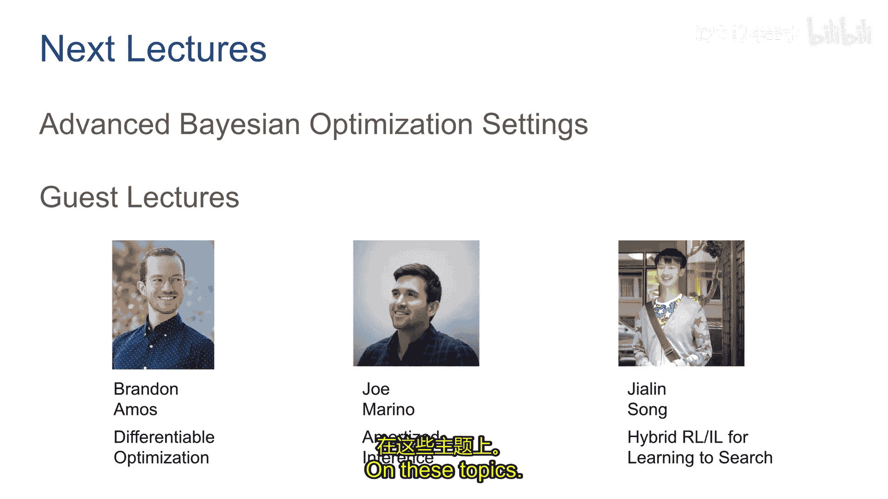

# 005：强化学习、模仿学习及其在学习优化中的应用 🧠

在本节课中，我们将学习强化学习和模仿学习的基本概念，并探讨它们如何应用于学习优化问题。我们将从定义核心组件开始，逐步深入到具体的算法，最后将这些概念与之前课程中见过的优化问题联系起来。

## 概述

强化学习和模仿学习是两种用于训练智能体在环境中做出决策的范式。它们共享一些核心组件，但在目标设定和数据来源上有所不同。理解这两种方法对于设计数据驱动的算法至关重要。

## 核心组件

任何学习系统，无论是强化学习还是模仿学习，都包含四个基本要素：

1.  **环境**：智能体与之交互的世界或模拟器。
2.  **策略类**：智能体用于做决策的函数集合，通常由参数 `θ` 参数化，记作 `π_θ`。
3.  **损失/目标函数**：用于评估策略好坏的指标。
4.  **算法**：用于根据上述组件学习最优策略的优化方法。

上一节我们介绍了学习系统的基本构成，本节中我们来看看强化学习和模仿学习在目标设定上的关键区别。

## 强化学习 vs. 模仿学习

**强化学习**的目标是直接最大化从环境中获得的累积奖励。智能体通过试错来探索环境，收集状态-动作对及其奖励的样本，并以此作为学习信号。其目标通常形式化为：
`max_π E_{s~d_π}[R(s, π(s))]`
其中 `d_π` 是由策略 `π` 诱导的状态分布，`R` 是环境给出的奖励函数。

**模仿学习**的目标是模仿专家演示的行为。我们获得一系列专家在特定状态下采取的动作作为演示，目标是学习一个策略，使其在相同状态下做出的决策与专家一致。其目标可以形式化为：
`min_π E_{s~d_π}[L(π(s), a^*(s))]`
其中 `a^*(s)` 是专家在状态 `s` 下采取的动作，`L` 是衡量策略输出与专家动作差异的损失函数。

关键区别在于：在模仿学习中，每个状态下的“正确”动作（来自专家）是已知的，这类似于监督学习；而在强化学习中，我们通常只观察到所执行动作的奖励，对于未尝试的动作奖励是未知的，这带来了探索的挑战。

## 强化学习基础

现在，让我们深入探讨强化学习的具体细节。我们将介绍一些标准符号和核心概念。

### 符号与定义

以下是强化学习中常用的标准符号：

*   **状态 (s)**：对环境的观测。
*   **动作 (a)**：智能体可以执行的操作。
*   **策略 (π)**：将状态映射到动作的函数。可以是确定性的 `a = π(s)`，也可以是随机的 `a ~ π(·|s)`。
*   **动态/转移函数 (T)**：描述环境如何变化：`s_{t+1} ~ T(·|s_t, a_t)`。
*   **轨迹 (τ)**：执行策略产生的状态-动作序列：`τ = (s_0, a_0, s_1, a_1, ...)`。
*   **奖励函数 (R)**：给出在状态 `s` 采取动作 `a` 所获奖励的函数：`r = R(s, a)`。
*   **折扣因子 (γ)**：介于0和1之间的数，用于权衡当前奖励与未来奖励的重要性。
*   **价值函数 (V^π)**：策略 `π` 的期望累积折扣奖励：`V^π(s) = E[∑_{t=0}^{∞} γ^t R(s_t, a_t) | s_0 = s]`。
*   **Q函数 (Q^π)**：在状态 `s` 采取动作 `a`，然后遵循策略 `π` 所获得的期望累积折扣奖励：`Q^π(s, a) = E[R(s, a) + γ V^π(s‘)]`。

### 策略梯度方法

策略梯度方法直接对策略参数 `θ` 进行梯度上升，以最大化期望奖励 `J(θ) = E_{τ~π_θ}[∑ γ^t R(s_t, a_t)]`。

**策略梯度定理**是此类方法的基石。它指出：
`∇_θ J(θ) = E_{s~d_π, a~π_θ(·|s)}[∇_θ log π_θ(a|s) * Q^π(s, a)]`
这个公式允许我们使用从当前策略 `π_θ` 中采样的轨迹来估计梯度。

**REINFORCE 算法**是最简单的策略梯度算法。它使用从完整轨迹获得的蒙特卡洛回报 `G_t` 作为 `Q^π(s_t, a_t)` 的无偏估计：
`θ ← θ + α * G_t * ∇_θ log π_θ(a_t|s_t)`
其优点是简单且无偏，缺点是对于长轨迹，蒙特卡洛估计的方差可能非常高，导致学习缓慢。

为了降低方差，**演员-评论家方法**引入了一个参数化的评论家网络来估计 `Q^π(s, a)`，代替蒙特卡洛回报。这样虽然可能引入偏差，但能显著降低方差，通常能加速学习。

### 探索与 Q-学习

强化学习的一个核心挑战是**探索-利用权衡**。智能体需要在尝试新动作（探索）和利用已知能获得高奖励的动作（利用）之间取得平衡。

**Q-学习**是另一类重要的算法，它不直接学习策略，而是学习最优的 Q 函数 `Q*(s, a)`。最优策略可以通过选择具有最高 Q 值的动作来得到：`π*(s) = argmax_a Q*(s, a)`。

基本的 Q-学习算法使用 **ε-贪心探索**：以概率 `ε` 随机选择动作（探索），以概率 `1-ε` 选择当前估计的最佳动作（利用）。然后通过时序差分更新来优化 Q 函数参数。

## 模仿学习基础

了解了强化学习后，我们转向模仿学习。我们将重点介绍最简单和最常用的方法。

### 行为克隆

**行为克隆**是模仿学习中最直接的方法，它将问题简化为监督学习。

1.  收集专家演示数据集 `D = {(s_i, a_i^*)}`，其中状态 `s_i` 来自专家策略诱导的分布 `d_{π^*}`。
2.  训练一个策略 `π_θ`，以最小化在数据集 `D` 上的预测误差：
    `min_θ Σ_i L(π_θ(s_i), a_i^*)`

行为克隆的优点是极其简单。然而，它有一个主要缺点：**分布不匹配**。训练数据来自专家策略的分布 `d_{π^*}`，但测试时，我们策略 `π_θ` 自身的行为会诱导出不同的状态分布 `d_{π_θ}`。如果 `π_θ` 在某个状态犯了一个小错误，导致进入一个专家从未访问过的新状态，行为克隆将无法提供正确的应对方式，错误可能会累积并导致灾难性失败。

### 交互式模仿学习：DAgger

为了解决行为克隆的分布不匹配问题，**交互式模仿学习**方法在训练过程中持续查询专家。

**DAgger (数据集聚合)** 算法是一个经典代表：
1.  用行为克隆初始化策略 `π_1`。
2.  对于迭代 `i = 1 to N`：
    a. 使用当前策略 `π_i` 在环境中运行，收集轨迹，得到状态集 `D_i`。
    b. 对于 `D_i` 中的每个状态，查询专家应该采取什么动作 `a^*`。
    c. 将所有新数据 `(s, a^*)` 聚合到总数据集 `D` 中。
    d. 在聚合数据集 `D` 上重新训练策略 `π_{i+1}`。

DAgger 通过让专家在策略自身访问的状态上提供反馈，确保了训练分布逐渐逼近测试分布，从而能够学习到更鲁棒的策略。

## 与学习优化的联系

最后，我们将强化学习和模仿学习的概念与“学习优化”问题联系起来。在许多优化任务中，我们可以将求解过程视为一个顺序决策问题。

### 结构化预测作为模仿/强化学习

考虑序列预测问题（如隐马尔可夫模型中的维特比解码）。我们可以将其重新表述：
*   **状态**：当前已预测的序列前缀。
*   **动作**：选择下一个输出标记。
*   **策略**：一个神经网络，根据当前前缀预测下一个标记。
*   **专家演示**：真实的序列标签。

这可以直接应用**模仿学习**（如 DAgger）来训练一个贪婪的解码策略，使其尽可能接近最优序列。如果我们有一个可以评估序列好坏的奖励函数（例如，在机器翻译中的 BLEU 分数），也可以使用**强化学习**来直接优化该奖励。

### 学习组合优化启发式算法

对于组合优化问题（如旅行商问题），传统的求解器可能很慢。我们可以学习一个快速的启发式策略：
*   **状态**：当前部分解（如已访问城市的集合、当前城市）。
*   **动作**：下一个要添加的元素（如下一个要访问的城市）。
*   **奖励**：最终完整解的目标函数值（如路径总长度的负值）。
*   **专家演示**：传统求解器（如 Gurobi）在训练时生成的（可能次优的）解。

这创造了一个混合设置：我们可能有稀疏的奖励（只在找到完整解时获得）和次优但昂贵的专家。因此，结合模仿学习（从专家初始化）和强化学习（进一步优化奖励）的方法变得非常有吸引力。许多最新研究正是沿着这个方向，使用图神经网络作为策略，并通过策略梯度或 Q-学习进行训练。

## 总结

在本节课中，我们一起学习了：
1.  **强化学习**和**模仿学习**的基本框架与核心区别。
2.  强化学习的核心概念，包括**策略梯度定理**、**REINFORCE**、**演员-评论家方法**以及**Q-学习**。
3.  模仿学习的主要方法，特别是**行为克隆**的局限性以及**DAgger**算法如何通过交互式查询来解决分布不匹配问题。
4.  如何将这些范式应用于“学习优化”问题，例如将**结构化预测**和**组合优化**重新构建为顺序决策过程，从而可以利用从演示或环境奖励中学习到的策略来替代或增强传统优化算法。

理解这些工具为设计高效、数据驱动的算法提供了强大的基础，特别是在需要与复杂环境交互或模仿专家行为的场景中。