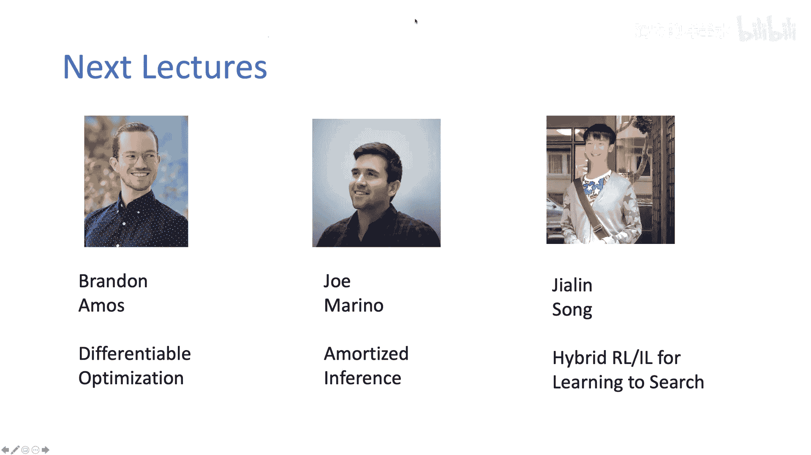

# 006：高级贝叶斯优化设置

在本节课中，我们将学习贝叶斯优化的一些高级设置。我们将回顾贝叶斯优化的基本框架，然后深入探讨几种核心算法，并了解如何将这些算法应用于更复杂和实际的场景，例如处理安全约束、偏好反馈、多保真度实验和高维空间。

## 概述与回顾

上一节我们介绍了贝叶斯优化的基本概念。本节中，我们来看看其更高级的应用场景。

贝叶斯优化的基本学习设置如下：我们有一个输入空间 **X** 和一个未知的适应度函数 **f(x) = y**。我们基于已有的观测数据，对函数 **F** 维持一个贝叶斯信念。实验设计者从输入空间中选择一个动作 **x** 进行实验，获得测量结果 **y**，然后将这个数据点加入训练集并更新后验信念。这个过程不断重复。

这种交互协议不仅适用于贝叶斯优化，也适用于其他三种交互式机器学习范式：
*   **主动学习**：目标是尽可能准确地发现关于环境的“真相”或构建模型。
*   **贝叶斯优化**：目标是找到输入空间中的**单个最佳动作**，使得最终采纳该动作的效用最大化。
*   **多臂老虎机**：目标是随时间推移**最大化累积效用**，例如推荐系统或临床试验。

这三种范式共享相同的交互协议，区别在于选择动作 **x** 的算法目标不同。本节课我们聚焦于贝叶斯优化。

## 遗憾的定义与分析

为了衡量算法性能，我们引入两个关键概念：简单遗憾和累积遗憾。

*   **简单遗憾**：算法在整个交互过程结束后，承诺一个它认为的最佳动作 **x̂***。简单遗憾定义为真实最优值 **f(x*)** 与算法所选动作值 **f(x̂*)** 之差：`简单遗憾 = f(x*) - f(x̂*)`。
*   **累积遗憾**：在每一轮交互 **t**，算法选择动作 **x_t** 并获得效用 **f(x_t)**。累积遗憾定义为每一轮最优效用 **f(x*)** 与实际获得效用之差的总和：`累积遗憾 = Σ_{t=1}^{T} [f(x*) - f(x_t)]`。

累积遗憾的上界通常可以推导出简单遗憾的上界。直观上，如果一个算法能有效控制每一轮的损失（累积遗憾小），那么它最终找到的解（简单遗憾）也会很好。

## 核心贝叶斯优化算法

以下是三种核心的贝叶斯优化算法。

### 高斯过程上置信界

GP-UCB 是一种经典算法，它通过平衡“利用”和“探索”来选择动作。

在每个时间步 **t**，算法选择能最大化以下上置信界函数的 **x**：
`UCB(x) = μ_t(x) + β_t * σ_t(x)`
其中 **μ_t(x)** 是后验均值（对性能的最佳估计），**σ_t(x)** 是后验标准差（不确定性），**β_t** 是一个权衡参数。

**算法思想**：选择那些要么期望值很高（利用），要么不确定性很大（探索）的区域。

### 汤普森采样

汤普森采样是另一种流行算法，它通过从后验分布中采样来平衡探索与利用。

在每个时间步 **t**，算法：
1.  从当前高斯过程后验中采样一个函数 **f̂**。
2.  选择在这个采样函数下能最大化效用的动作 **x**：`x_t = argmax_x f̂(x)`。

**算法思想**：不确定性高的区域，其采样值方差大，有时会被赋予很高的值，从而促使探索。

### 最大价值熵搜索

MES 算法专门为最小化简单遗憾而设计。

它选择能最大化与最优值 **f*** 互信息的动作 **x**：
`α(x) = I( f*; y | D, x )`
其中 **I** 表示互信息，**D** 是已有数据。

**算法思想**：选择那些最能帮助我们确定全局最优值 **f*** 位置的动作。

## 高级设置与应用

现在，我们利用上述核心算法，探讨贝叶斯优化在更复杂场景下的应用。

### 1. 安全约束下的偏好学习

**问题背景**：在医疗应用（如脊髓刺激疗法）中，我们需要优化设备参数以帮助患者，但必须保证治疗过程安全（不引起疼痛或不适），并且从患者那里获得可靠的反馈（绝对评分不可靠，相对偏好更可靠）。

**解决方案**：
*   **安全建模**：使用一个独立的高斯过程对安全函数 **s(x)** 进行建模，并设定安全阈值 **h**。安全区域定义为后验下界高于阈值的区域：`S_t = { x: μ_{s,t}(x) - β * σ_{s,t}(x) >= h }`。
*   **偏好反馈**：不直接查询 **f(x)** 的值，而是比较两个动作 **x_a** 和 **x_b**，获得偏好反馈（哪个更好）。
*   **两阶段算法**：
    1.  **安全区域扩展**：从一个初始安全点出发，乐观地（选择能最大可能扩展安全边界的点）查询安全函数，逐步扩大已知的安全区域。
    2.  **安全区域内优化**：在最终的安全区域内，使用基于偏好的贝叶斯优化算法（如GP-UCB或汤普森采样的变体）来寻找最优参数。

这种方法确保了所有实验都在高概率安全的区域内进行，并利用了更可靠的偏好反馈。

### 2. 混合主导反馈

**问题背景**：在人与算法协作的场景（如外骨骼步态优化）中，人类专家不仅能在算法提供的选项间做出选择，还能主动提出自己认为更好的建议。

**解决方案**：扩展偏好学习框架，纳入人类主动提出的建议 **x̃**。算法将这些建议转化为一组偏好对（例如，**x̃** 优于算法提出的 **x_a** 和 **x_b**），并与传统的偏好反馈一同用于更新模型。这种混合主导的方式能更快地收敛到最优解。

### 3. 多保真度与可变成本优化

**问题背景**：在许多科学和工程领域（如纳米光子器件设计），存在不同保真度（精度）的模拟器。高保真度模拟准确但昂贵，低保真度模拟便宜但粗糙。

**解决方案**：
*   **联合建模**：使用多输出高斯过程联合建模目标函数（高保真）和辅助函数（低保真）。
*   **成本效益决策**：算法动态决定在每一步是运行低保真实验还是高保真实验。决策基于一个成本效益比，该比率权衡了获取信息的能力与实验成本。
*   **分层优化**：初期大量使用低保真模拟快速排除性能很差的区域，后期在缩小的有希望区域内集中使用高保真模拟进行精细优化。

### 4. 高维贝叶斯优化

**问题背景**：当输入维度很高时，在连续空间中选择最大化获取函数的点（求解 `argmax`）计算代价极高（通常需要离散化，导致维度灾难）。

**解决方案**：利用问题可能存在的**有效低维结构**。即使参数空间维度很高，目标函数可能只在一个低维子空间内变化。
*   **线性贝叶斯优化**：算法在当前最佳点 **x̂** 附近随机选择一个一维子空间（一条线），然后在这个一维空间上运行标准的贝叶斯优化。找到该线上的最优点后，以此为新起点，重复过程。
*   **原理**：如果存在低维有效子空间，随机线最终会与之相交。一旦相交，后续的优化过程就会保持在该子空间内，从而将高维优化问题转化为一系列廉价的一维优化问题。

### 5. 批量并行优化

**问题背景**：在某些实验（如蛋白质工程）中，实验周期长，需要一次性提交一批实验并行进行，以提高效率。

**解决方案**：
*   **批量GP-UCB**：顺序地构建批次。每选出一个点加入批次后，暂时假设我们观测到的是该点的后验均值（即最不意外的结果），更新后验，然后基于这个“虚拟”后验选择下一个点。
*   **批量汤普森采样**：更自然地并行化。只需从后验中独立采样 **M** 个函数，然后分别取每个采样函数的最大值点，这 **M** 个点就构成了一个批次。

### 6. 超越简单高斯过程

**问题背景**：标准高斯过程与固定核函数可能无法捕捉复杂函数结构。

**解决方案**：**深度核学习**。将核函数中的特征映射 **φ(x)** 替换为神经网络的输出，从而学习一个数据驱动的核函数。例如，将 RBF 核改为：`k(x, x‘) = exp( -||神经网络(x) - 神经网络(x’)||^2 / 2 )`。通过最大化边缘似然来联合训练神经网络参数和高斯过程超参数。

## 总结

本节课我们一起学习了贝叶斯优化的高级设置。我们从简单遗憾和累积遗憾的概念出发，回顾了GP-UCB、汤普森采样和MES等核心算法。接着，我们深入探讨了如何将这些算法应用于一系列实际挑战：通过两阶段策略处理安全约束和偏好反馈；利用混合主导反馈融合人类专家知识；采用多保真度建模平衡成本与精度；使用线性BO等方法应对高维空间的计算挑战；以及通过批量策略实现并行实验。最后，我们简要介绍了深度核学习作为扩展模型表达能力的方向。这些技术使得贝叶斯优化能够解决更多样化、更贴近实际的应用问题。