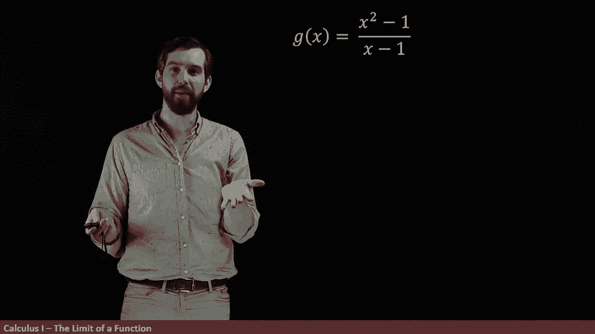
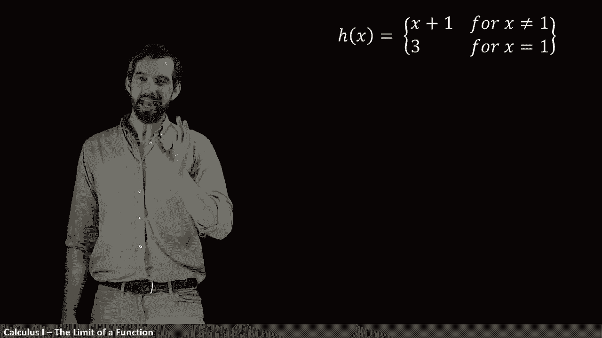
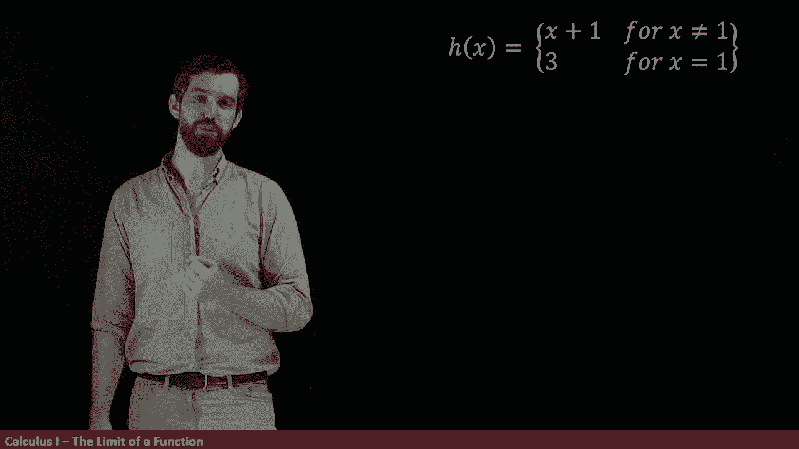
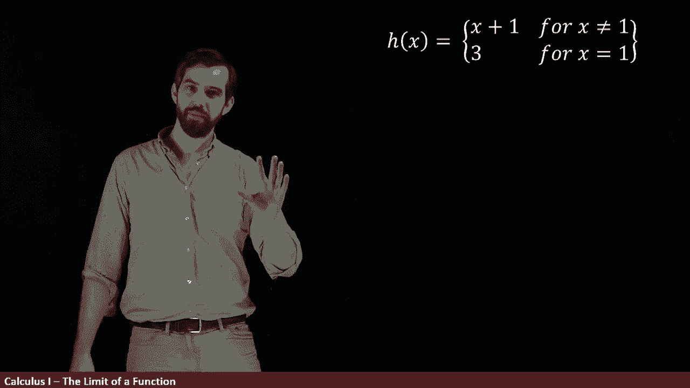

# 第一部分 3：L3 - 三个函数的故事 _ 极限入门（第一部分） 📘

在本节课中，我们将通过对比三个不同的函数来探讨极限的概念。我们将分析函数 **F(x)**、**G(x)** 和 **H(x)**，它们表面上看起来略有不同，但我们将探究它们在多大程度上是相同的，或者是否存在有意义的差异。

---

## 🔍 函数 F(x) = x + 1

首先，我们来看函数 **F(x) = x + 1**。它的图像是一条直线，非常简单明了。

**公式：**
```
F(x) = x + 1
```

这个函数在整个实数域上都有定义，其图像是一条斜率为1、截距为1的直线。



---

## 🔍 函数 G(x) = (x² - 1) / (x - 1)

接下来，我们分析函数 **G(x) = (x² - 1) / (x - 1)**。当我们看到分子和分母都是多项式时，应该立刻想到是否可以因式分解并进行约分。

**公式：**
```
G(x) = (x² - 1) / (x - 1)
```

我们可以对分子进行因式分解：
```
x² - 1 = (x - 1)(x + 1)
```
因此，函数可以重写为：
```
G(x) = [(x - 1)(x + 1)] / (x - 1)
```

现在，只要 **x - 1 ≠ 0**（即 **x ≠ 1**），我们就可以约去分子和分母中的 **(x - 1)**，得到：
```
G(x) = x + 1  (当 x ≠ 1 时)
```

这与 **F(x)** 的表达式完全相同。然而，关键区别在于当 **x = 1** 时，分母为零，函数 **G(x)** 在该点没有定义。因此，**G(x)** 的图像与 **F(x)** 的直线几乎相同，只是在 **x = 1** 处有一个“空洞”（用空心圆表示）。

---

## 🔍 函数 H(x)：分段定义函数

最后，我们来看一个分段定义的函数 **H(x)**。如果你之前没有见过这种表示法，它的意思是函数在不同的区间内由不同的表达式定义。

**公式：**
```
H(x) = { 3,       当 x = 1 时
       { x + 1,   当 x ≠ 1 时
```





这意味着：
*   当 **x = 1** 时，**H(1) = 3**。
*   当 **x ≠ 1** 时，**H(x) = x + 1**，这与 **F(x)** 相同。

因此，**H(x)** 的图像在除了 **x = 1** 点之外的所有地方，都是一条与 **F(x)** 相同的直线。在 **x = 1** 处，函数值被特别定义为3，所以在图像上该点是一个实心点，位于高度为3的位置。

---



## 🔄 三个函数的对比

现在，让我们回顾并对比这三个函数：

*   **F(x)** 在 **x = 1** 处的值为 **F(1) = 2**。
*   **G(x)** 在 **x = 1** 处没有定义（因为分母为零）。
*   **H(x)** 在 **x = 1** 处的值为 **H(1) = 3**。

由此可见，这三个函数在 **x = 1** 这一点上是不同的：**F** 有值2，**G** 无定义，**H** 有值3。然而，在除了 **x = 1** 之外的**所有其他点**上，这三个函数的行为完全一致，都等于 **x + 1**。

---

## 📝 本节总结

本节课中，我们一起学习了极限概念的初步引入。通过分析 **F(x)**、**G(x)** 和 **H(x)** 这三个函数，我们看到了它们虽然在 **x = 1** 点处有细微差别（值不同或无定义），但在该点附近却表现出完全相同的行为趋势。这种“在一点附近”的行为，正是我们接下来要深入学习的**极限**概念的核心。理解这一点是学习微积分中极限思想的重要基础。