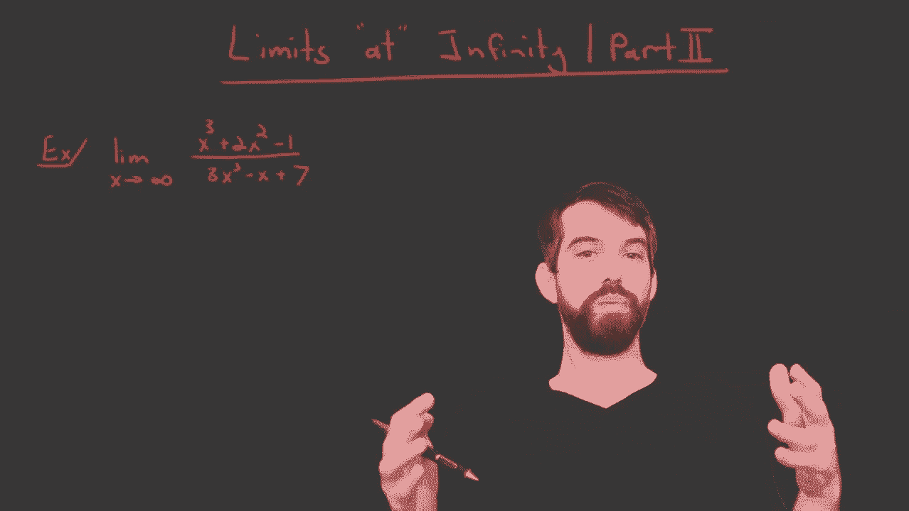
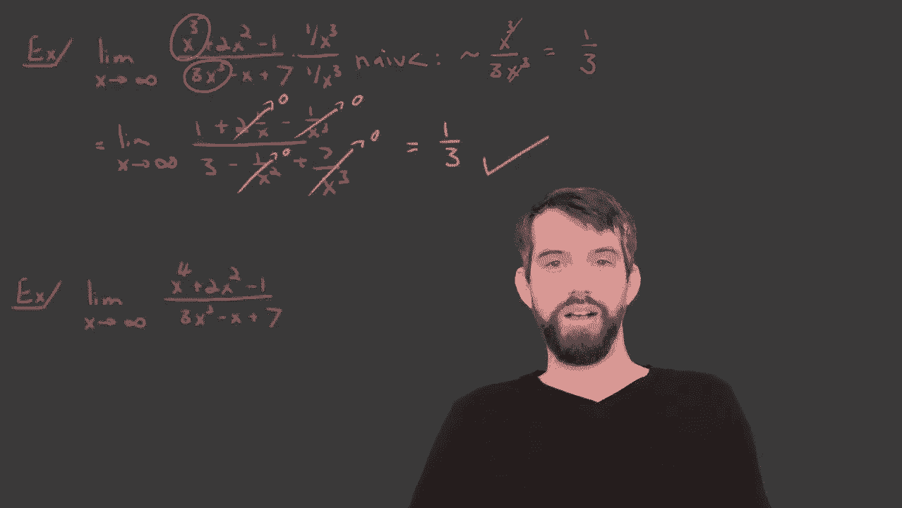

# 第一部分 15：计算有理函数在无穷远处的极限 📘

在本节课中，我们将学习如何计算有理函数（即多项式除以多项式）在无穷远处的极限。我们将通过几个例子，逐步展示标准方法，并确保每一步都严谨清晰。



---

## 🧠 概述

当我们需要计算形如 **多项式 / 多项式** 的有理函数在 **x → ∞** 时的极限时，关键在于比较分子和分母中最高次项的增长速度。本节课将通过三个具体例子，演示如何严谨地完成这一计算。

---

## 📝 第一个例子：最高次项相同

考虑以下有理函数：

```
f(x) = (x³ + 2x² - 1) / (3x³ - x + 7)
```

我们的目标是计算 **lim (x→∞) f(x)**。

### 直观理解

当 **x** 变得非常大时（例如一百万或十亿），分子中的 **-1** 和 **2x²** 项相对于主导项 **x³** 来说影响微乎其微。同样，分母中的 **-x** 和 **+7** 相对于 **3x³** 也几乎可以忽略。因此，函数的行为主要由最高次项决定：

```
f(x) ≈ (x³) / (3x³) = 1/3
```

所以，我们猜测极限是 **1/3**。但数学需要严谨的证明，不能仅靠猜测。

### 严谨计算

为了严谨地证明，我们采用一个技巧：分子和分母同时除以最高次项 **x³**。

```
lim (x→∞) (x³ + 2x² - 1) / (3x³ - x + 7)
= lim (x→∞) [ (x³/x³) + (2x²/x³) - (1/x³) ] / [ (3x³/x³) - (x/x³) + (7/x³) ]
= lim (x→∞) [ 1 + (2/x) - (1/x³) ] / [ 3 - (1/x²) + (7/x³) ]
```

现在，我们利用已知的极限法则。当 **x → ∞** 时，所有形如 **1/xⁿ (n>0)** 的项都趋于 **0**：

```
lim (x→∞) 1/x = 0
lim (x→∞) 1/x² = 0
lim (x→∞) 1/x³ = 0
```

将这些极限代入表达式：

```
= (1 + 0 - 0) / (3 - 0 + 0)
= 1/3
```

这样，我们就严谨地验证了我们的直观猜测：**lim (x→∞) f(x) = 1/3**。

---

## 🚀 第二个例子：分子的次数更高

现在，我们稍微修改第一个例子，将分子的最高次项改为 **x⁴**：

```
g(x) = (x⁴ + 2x² - 1) / (3x³ - x + 7)
```

计算 **lim (x→∞) g(x)**。

### 直观分析

此时，分子的主导项是 **x⁴**，分母的主导项是 **3x³**。当 **x** 非常大时，函数的行为近似于：

```
g(x) ≈ (x⁴) / (3x³) = x/3
```

由于 **lim (x→∞) x/3 = ∞**，我们猜测这个极限会发散到无穷大。

### 严谨计算

我们再次使用技巧：分子和分母同时除以分母的最高次项 **x³**。

```
lim (x→∞) (x⁴ + 2x² - 1) / (3x³ - x + 7)
= lim (x→∞) [ (x⁴/x³) + (2x²/x³) - (1/x³) ] / [ (3x³/x³) - (x/x³) + (7/x³) ]
= lim (x→∞) [ x + (2/x) - (1/x³) ] / [ 3 - (1/x²) + (7/x³) ]
```



同样，当 **x → ∞** 时，所有 **1/xⁿ** 项都趋于 **0**：

```
= lim (x→∞) [ x + 0 - 0 ] / [ 3 - 0 + 0 ]
= lim (x→∞) x / 3
= ∞
```

因此，极限发散到无穷大，验证了我们的猜测。

---

## ⬇️ 第三个例子：分母的次数更高

最后，我们考虑分子的次数低于分母的情况：

```
h(x) = (x² + 2x² - 1) / (3x³ - x + 7)
```

注意，这里分子实际上是 **3x² - 1**，但为了保持形式一致，我们写作原式。计算 **lim (x→∞) h(x)**。

### 直观分析

分子的主导项是 **x²**，分母的主导项是 **3x³**。函数的行为近似于：

```
h(x) ≈ (x²) / (3x³) = 1/(3x)
```

由于 **lim (x→∞) 1/(3x) = 0**，我们猜测这个极限为 **0**。

### 严谨计算（简述）

我们可以采用同样的技巧，分子分母同时除以 **x³**（分母的最高次项）。过程与之前类似，最终所有含有 **x** 的项在分子上都会变成 **1/xⁿ** 的形式并趋于 **0**，而分母会趋于一个常数。因此，整个分数的极限为 **0**。

```
lim (x→∞) h(x) = 0
```

---

## ✅ 总结与通用方法

本节课我们一起学习了计算有理函数在无穷远处极限的通用方法。

以下是核心步骤：
1.  **识别最高次项**：分别找出分子和分母中 **x** 的最高次幂。
2.  **比较次数**：
    *   如果 **分子最高次数 = 分母最高次数**，极限等于最高次项系数的比值。
    *   如果 **分子最高次数 > 分母最高次数**，极限为 **∞** 或 **-∞**（取决于系数的正负）。
    *   如果 **分子最高次数 < 分母最高次数**，极限为 **0**。
3.  **严谨验证**：为了严谨起见，总是通过 **分子分母同时除以分母的最高次项** 来展开计算，并利用 **lim (x→∞) 1/xⁿ = 0** 这一基本极限来简化表达式。

通过这种方法，我们可以快速而准确地判断任何有理函数在 **x → ∞** 时的行为。