# 第一部分 16：复合函数的无穷极限与无穷远处的极限 📘

在本节课中，我们将分析一个特定的函数：**e^( (x-3)/(x-2) )**。我们的目标是找出这个函数的所有垂直渐近线和水平渐近线。

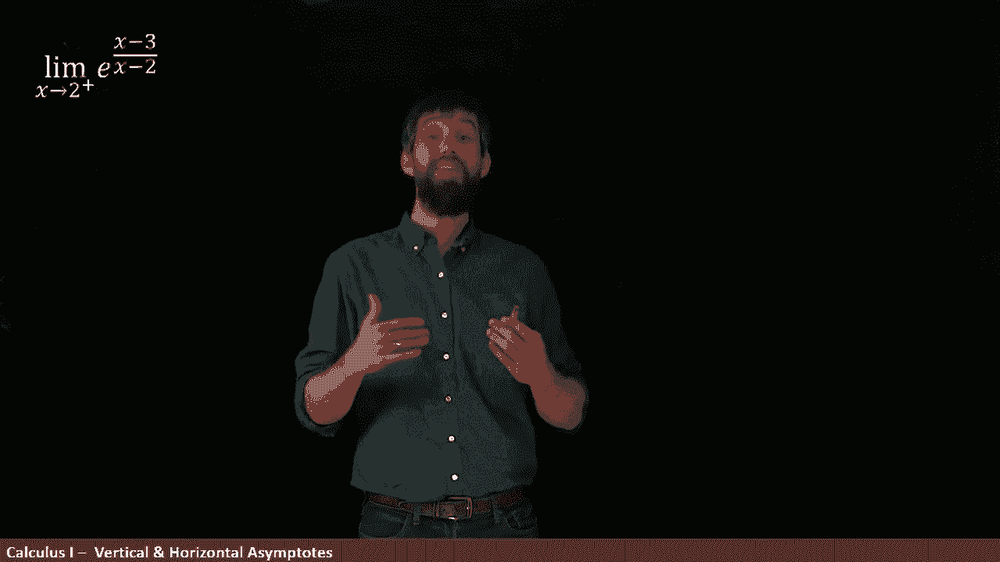

---

## 🔍 分析特定极限：当 x 从右侧趋近于 2

我们首先研究当 x 从右侧趋近于 2 时的极限。选择这个点是因为函数内部的分式 `(x-3)/(x-2)` 在 `x=2` 时分母为零，这可能是一个问题点。

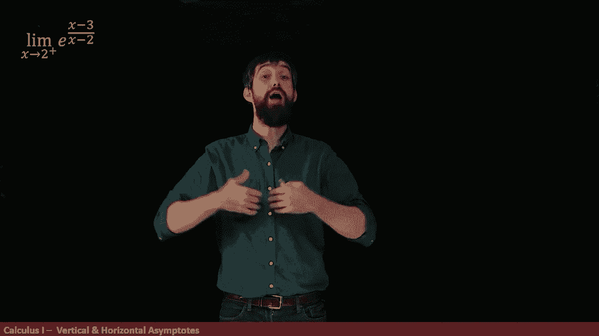

**极限表达式为：**
```
lim (x→2⁺) e^( (x-3)/(x-2) )
```

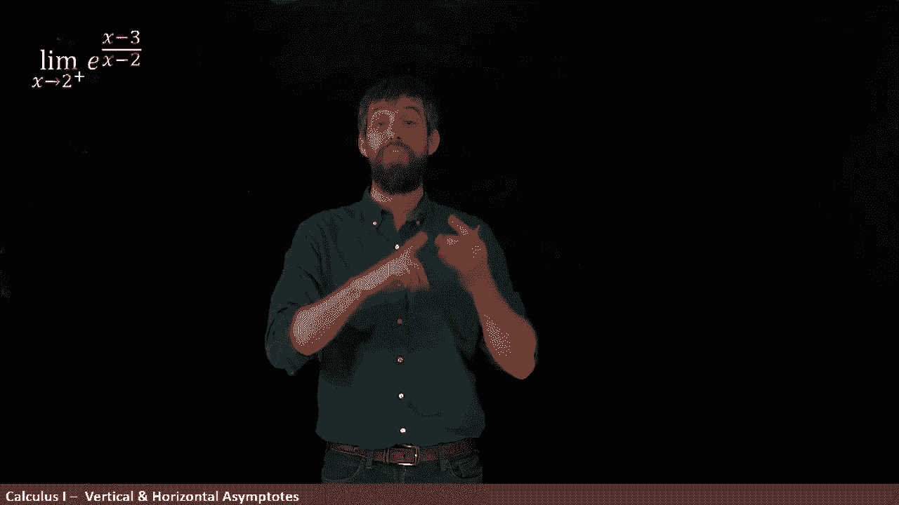

由于指数函数 `e^x` 是连续函数，我们可以先计算内部函数的极限，再将结果代入外部函数。

### 计算内部函数的极限

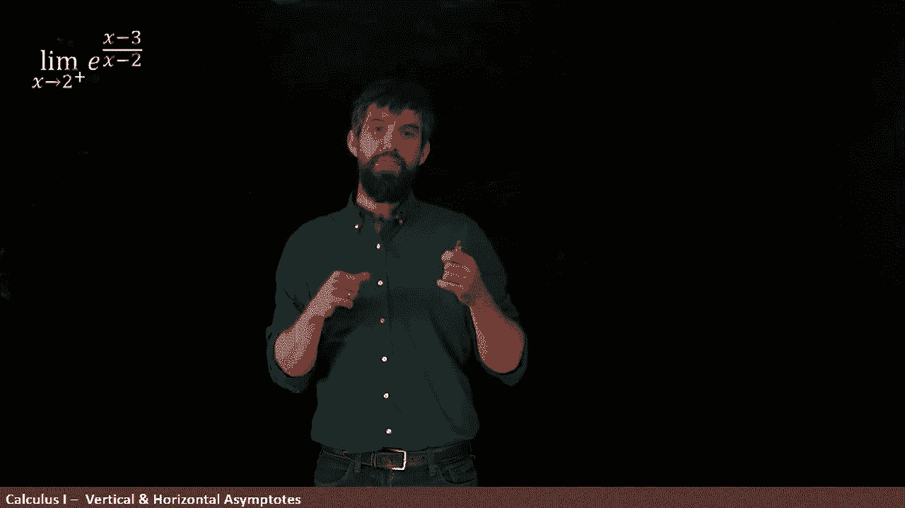

我们计算：
```
lim (x→2⁺) (x-3)/(x-2)
```

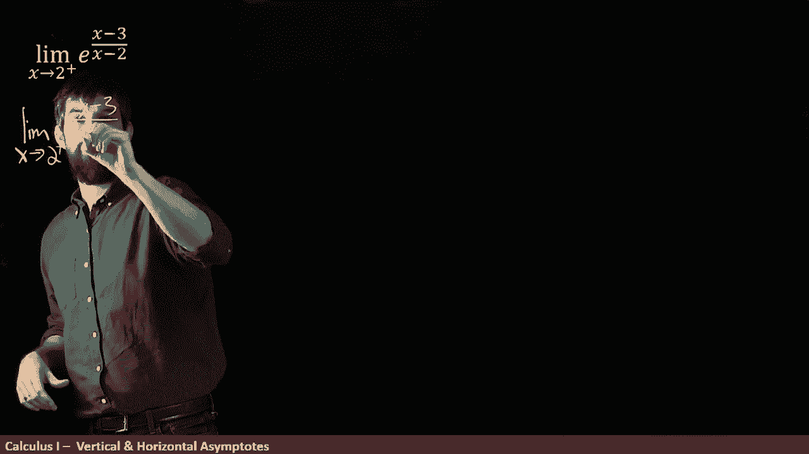

以下是分析步骤：

*   **分析分母：** 当 x 从右侧（如 2.1, 2.01）趋近于 2 时，`(x-2)` 的值非常接近 0，且为正数。我们记作 `0⁺`。
*   **分析分子：** 将 x=2 代入 `(x-3)`，得到 `-1`，是一个负数。
*   **综合判断：** 因此，这个极限的形式是 `(-1) / (0⁺)`。一个负数除以一个趋近于 0 的正数，结果将趋向于 **负无穷大 (-∞)**。

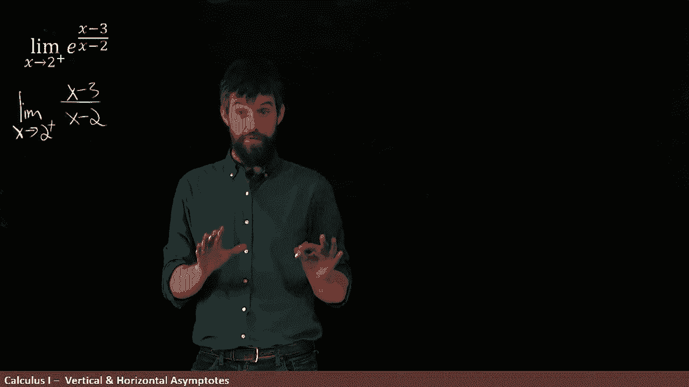

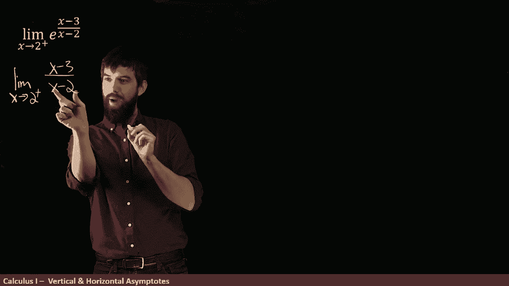

所以，我们得到：
```
lim (x→2⁺) (x-3)/(x-2) = -∞
```

### 代入外部函数

现在，我们将内部函数的极限结果代入原极限：
```
lim (x→2⁺) e^( (x-3)/(x-2) ) = e^(-∞)
```

我们需要回忆 `y = e^x` 的图像。当 `x → -∞` 时，函数值 `e^x` 无限趋近于 0。

因此：
```
e^(-∞) = 0
```

**结论：** 当 x 从右侧趋近于 2 时，函数的极限是 0。这**不是**一个垂直渐近线。

---

## 🔄 分析另一侧：当 x 从左侧趋近于 2

上一节我们分析了从右侧趋近于 2 的情况，本节我们来看看从左侧趋近会有什么不同。

**极限表达式为：**
```
lim (x→2⁻) e^( (x-3)/(x-2) )
```

我们同样先计算内部函数的极限。

### 计算内部函数的极限

计算：
```
lim (x→2⁻) (x-3)/(x-2)
```

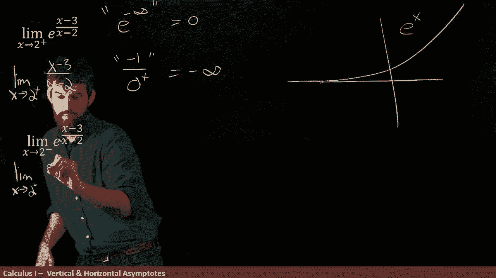

以下是分析步骤：

*   **分析分母：** 当 x 从左侧（如 1.9, 1.99）趋近于 2 时，`(x-2)` 的值非常接近 0，且为负数。我们记作 `0⁻`。
*   **分析分子：** 将 x=2 代入 `(x-3)`，得到 `-1`，依然是负数。
*   **综合判断：** 因此，这个极限的形式是 `(-1) / (0⁻)`。一个负数除以一个趋近于 0 的负数，结果将趋向于 **正无穷大 (+∞)**。

所以，我们得到：
```
lim (x→2⁻) (x-3)/(x-2) = +∞
```

### 代入外部函数

现在，我们将内部函数的极限结果代入原极限：
```
lim (x→2⁻) e^( (x-3)/(x-2) ) = e^(+∞)
```

根据 `y = e^x` 的图像，当 `x → +∞` 时，函数值 `e^x` 趋向于正无穷大。

因此：
```
e^(+∞) = +∞
```

**结论：** 当 x 从左侧趋近于 2 时，函数的极限是正无穷大。所以，**`x = 2` 是函数的一条垂直渐近线**。

---

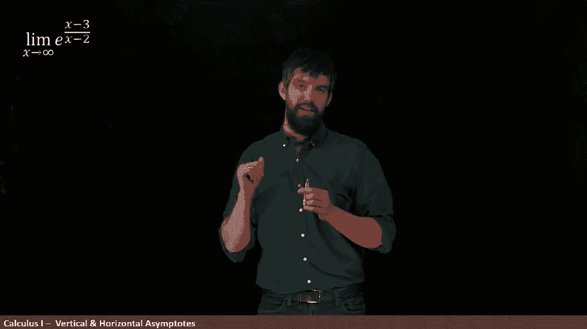

## ↔️ 寻找水平渐近线

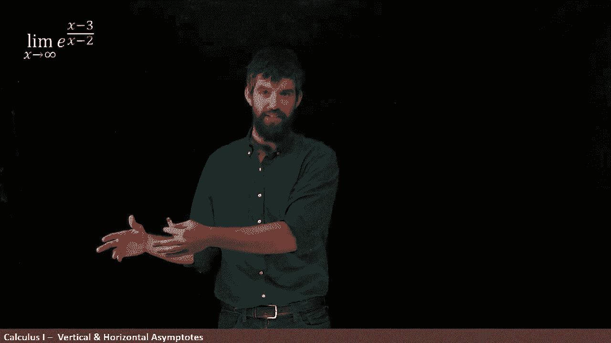

我们已经找到了垂直渐近线。水平渐近线描述的是当 `x → +∞` 或 `x → -∞` 时函数的行为。

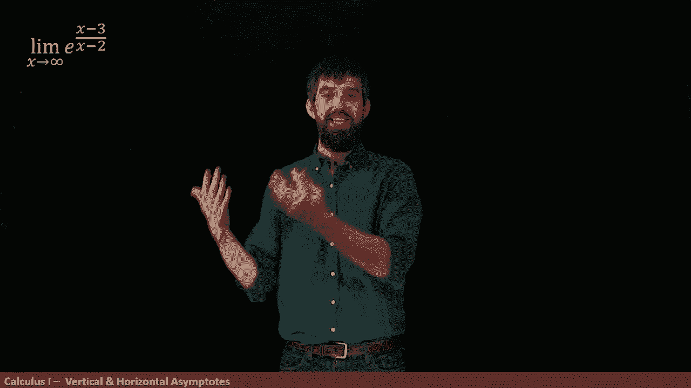

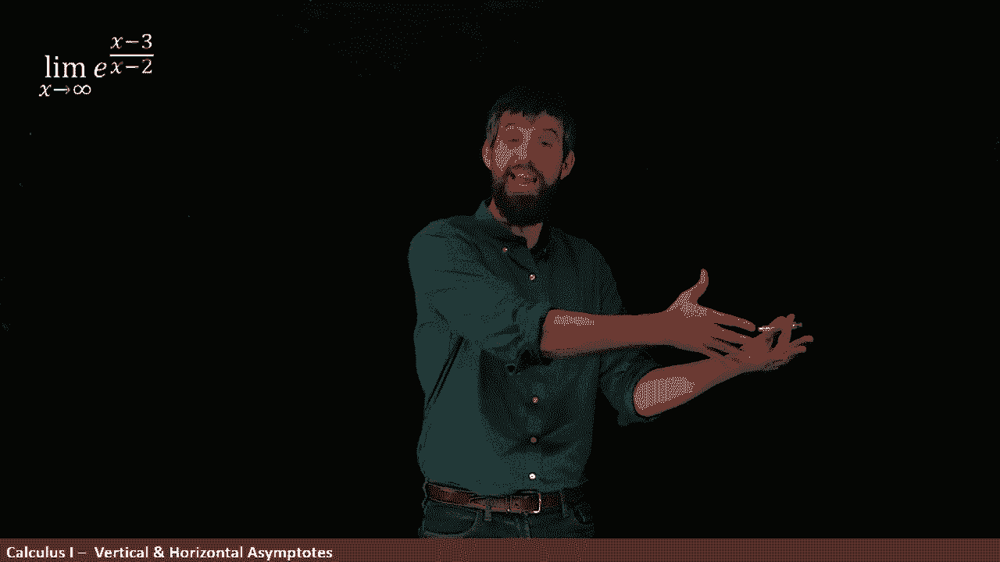

### 当 x 趋近于正无穷大

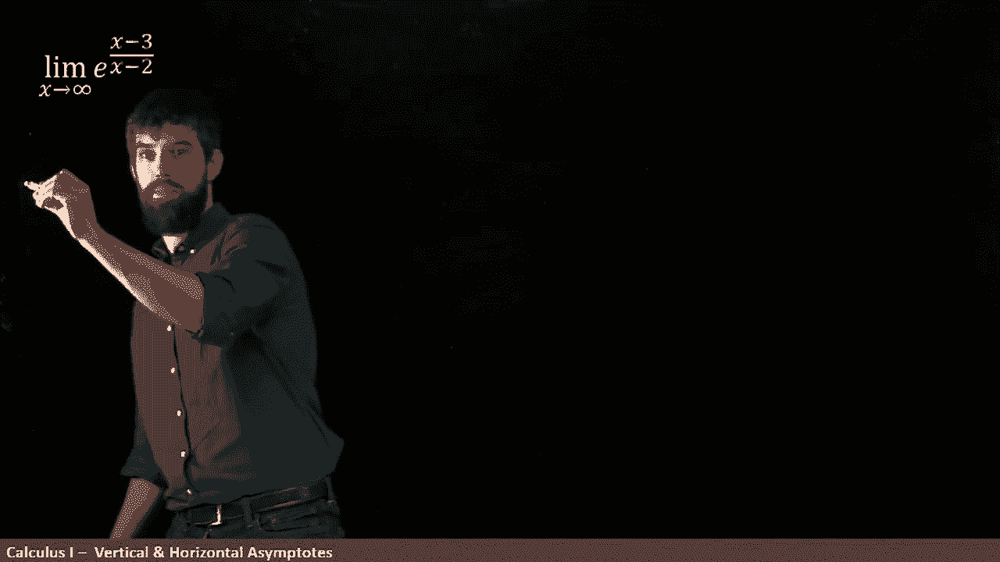

**极限表达式为：**
```
lim (x→+∞) e^( (x-3)/(x-2) )
```

我们再次先计算内部有理函数的极限。

对于形如多项式的有理函数，计算其在无穷远处的极限有一个简单方法：比较分子和分母的最高次项。

*   分子 `(x-3)` 的最高次项是 `x`，系数为 1。
*   分母 `(x-2)` 的最高次项也是 `x`，系数为 1。

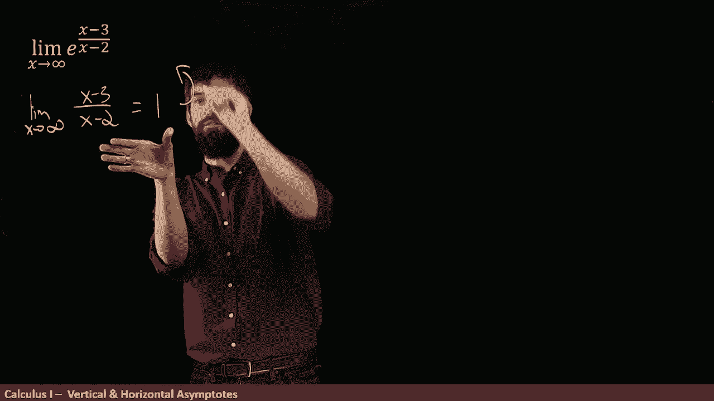

当 `x → +∞` 时，`(x-3)/(x-2)` 的极限等于最高次项系数之比，即 `1/1 = 1`。
```
lim (x→+∞) (x-3)/(x-2) = 1
```

将其代入外部函数：
```
lim (x→+∞) e^( (x-3)/(x-2) ) = e¹ = e
```

所以，当 `x → +∞` 时，函数值趋近于常数 `e`。因此，**`y = e` 是一条水平渐近线**。

### 当 x 趋近于负无穷大

**极限表达式为：**
```
lim (x→-∞) e^( (x-3)/(x-2) )
```

内部函数的极限计算过程与正无穷时完全相同。分子分母的最高次项依然是 `x`，系数比仍然是 `1/1 = 1`。
```
lim (x→-∞) (x-3)/(x-2) = 1
```

将其代入外部函数：
```
lim (x→-∞) e^( (x-3)/(x-2) ) = e¹ = e
```

**结论：** 当 `x → -∞` 时，函数值同样趋近于常数 `e`。因此，函数在两侧共享同一条水平渐近线 **`y = e`**。

---

## 📊 函数图像概览

本节课中我们一起计算了四个关键极限，它们共同描绘了函数 `e^( (x-3)/(x-2) )` 的基本形状。

以下是总结：

1.  **`lim (x→2⁺) f(x) = 0`**：从右侧接近 `x=2` 时，函数值趋近于 0（一个有限值，非渐近线）。
2.  **`lim (x→2⁻) f(x) = +∞`**：从左侧接近 `x=2` 时，函数值趋向正无穷。因此，**`x = 2` 是一条垂直渐近线**。
3.  **`lim (x→+∞) f(x) = e`**：当 x 趋向正无穷时，函数值趋近于常数 e。
4.  **`lim (x→-∞) f(x) = e`**：当 x 趋向负无穷时，函数值也趋近于常数 e。因此，**`y = e` 是一条水平渐近线**。

基于这些信息，我们可以勾勒出函数的大致图像：
*   图像在 `x=2` 左侧向上无限延伸（垂直渐近线）。
*   图像在 `x=2` 右侧则平滑地趋近于点 `(2, 0)`。
*   在远离 `x=2` 的两侧，图像都逐渐趋近并最终“压平”在水平线 `y = e` 附近。

理解这些极限行为，能帮助我们快速把握函数的整体结构和关键特征。