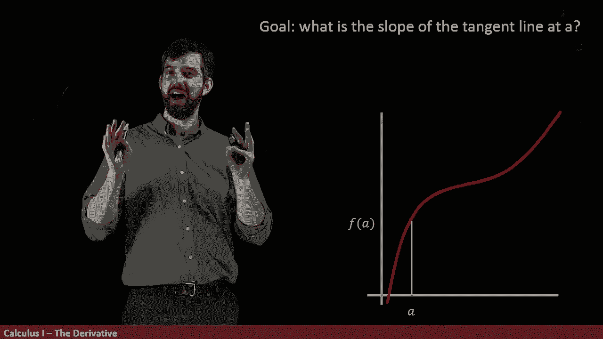
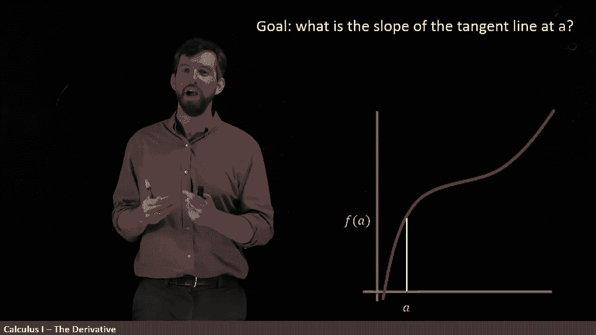
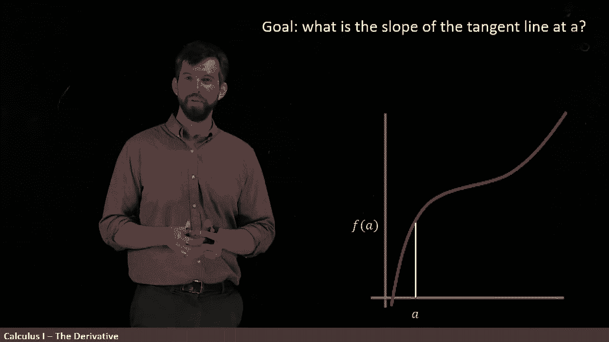
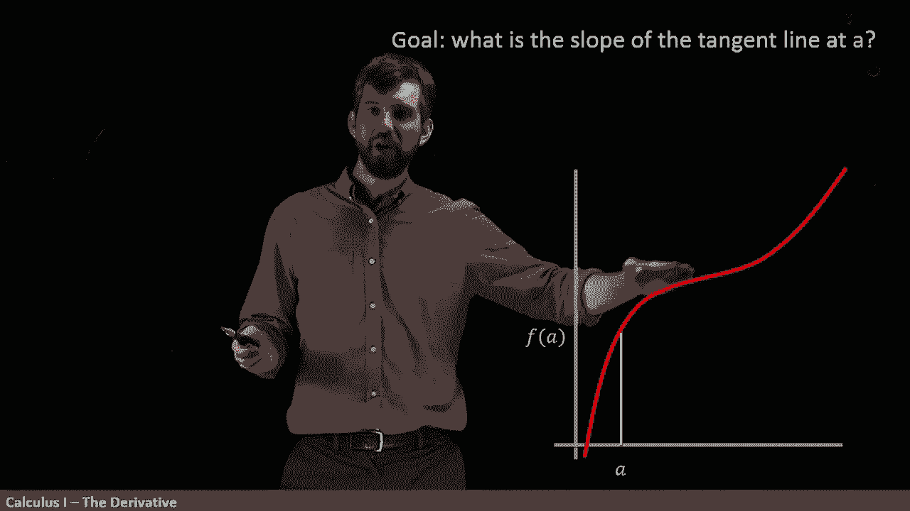
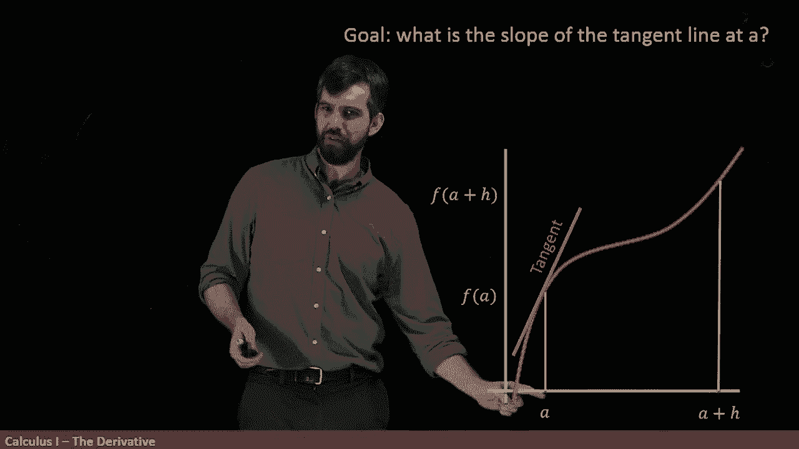
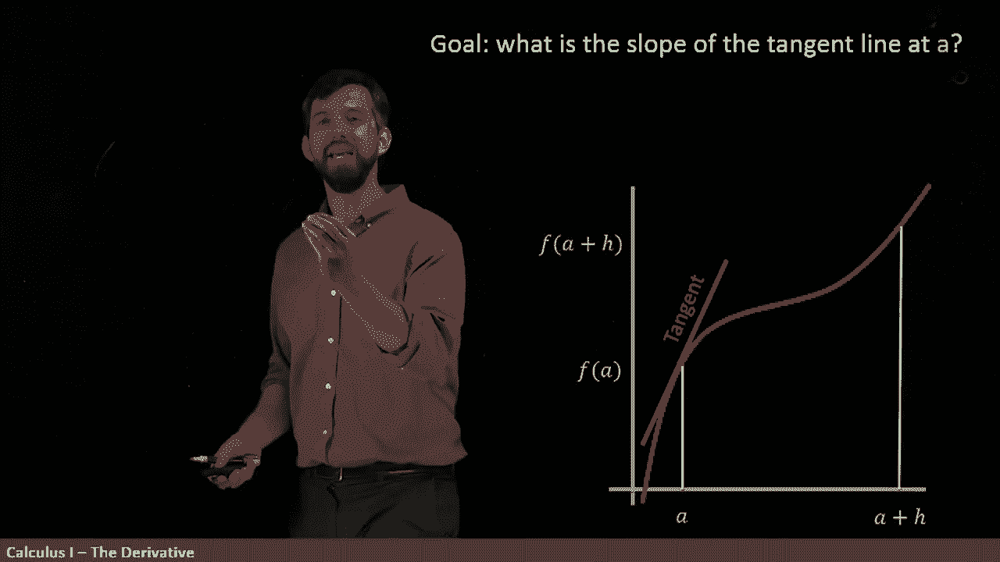
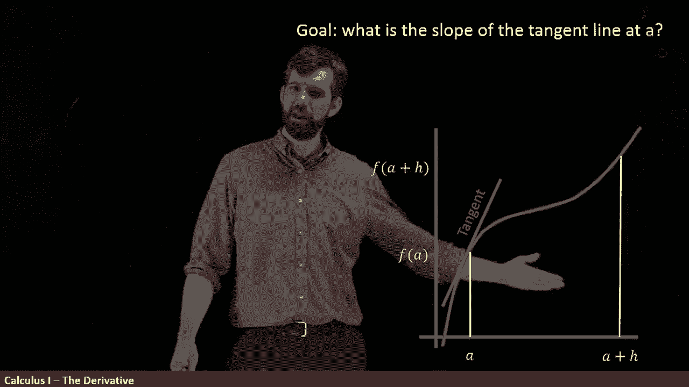
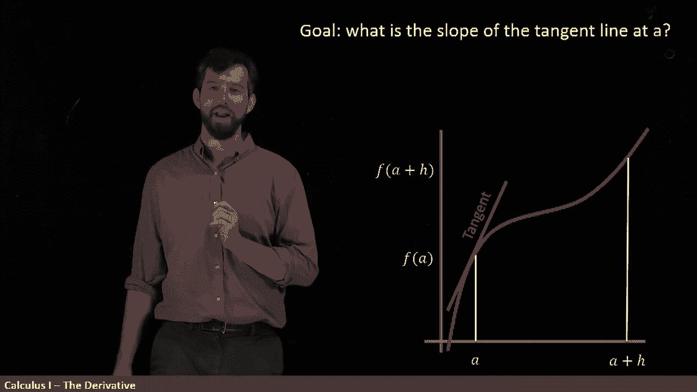
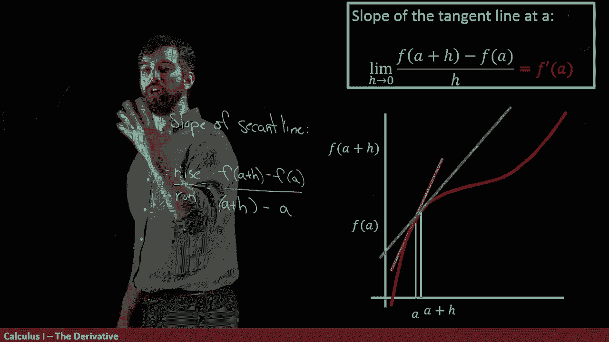

# 第一部分 18：导数的定义（第一部分） 📘

在本节课中，我们将学习微积分中的一个核心概念——导数的定义。我们将从几何角度出发，直观地理解导数，并最终给出其严格的数学定义。

---

## 🎯 目标：求切线的斜率

首先，我们有一个函数，用红色曲线表示。我们选择曲线上的一个特定点，其横坐标为 `a`，纵坐标为 `f(a)`。

我们的目标是求出曲线在点 `(a, f(a))` 处的**切线斜率**。

那么，什么是切线呢？切线是经过该点并与曲线“恰好相触”的一条直线。它不会尖锐地穿过曲线，而是平滑地贴合在曲线上。虽然这里没有给出精确的数学定义，但我们可以直观地理解，切线是在该点处与曲线贴合得最“平坦”的直线。

现在的问题是：我们如何计算这条切线的斜率，或者说，如何求出这条直线的方程？

---

## 🔍 核心思路：用割线逼近切线

为了计算切线斜率，我们将采用一种间接的方法。我们会在点 `a` 附近引入另一个点。

这个新点的横坐标不是 `b`，而是 `a + h`。这里的 `h` 是一个很小的数，表示 `a` 与 `a + h` 之间的水平距离。在图中，为了清晰，`h` 被夸大了，但请想象 `h` 是一个非常小的正数或负数。

我们为什么要引入这个点呢？因为我们知道如何定义和计算**割线**。割线是连接曲线上两点的直线。现在，我们连接点 `(a, f(a))` 和点 `(a+h, f(a+h))`，就得到了一条割线。

**核心思想**是：当 `h` 非常大时（如图中所示），割线和切线看起来完全不同。但是，如果 `h` 变得非常小，两个点就非常接近，那么这条割线就会成为切线的一个非常好的近似。

因此，我们的策略是：用连接 `(a, f(a))` 和 `(a+h, f(a+h))` 的割线的斜率，来近似我们想要求的切线斜率。

---

## 📐 计算割线的斜率

任何直线的斜率都等于“垂直变化量”（上升高度）除以“水平变化量”（前进距离）。

以下是计算割线斜率的步骤：

1.  **上升高度**：从 `f(a)` 上升到 `f(a+h)`。因此，垂直变化量是 `f(a+h) - f(a)`。
2.  **前进距离**：从 `a` 前进到 `a+h`。因此，水平变化量是 `(a+h) - a = h`。

所以，割线的斜率公式为：
`斜率 = (f(a+h) - f(a)) / h`

这个公式对任何 `h` 值（正或负）都成立，它给出了割线的斜率。

---

## 🚀 从近似到精确：极限的定义

我们之前提到，当 `h` 非常小时，割线斜率是切线斜率的一个好近似。现在，让我们想象 `h` 不断变小，趋近于 0 的过程。

随着 `h` 越来越小，点 `(a+h, f(a+h))` 越来越靠近点 `(a, f(a))`，相应的割线也越来越贴近切线。当 `h` 无限趋近于 0 时，割线就无限趋近于切线本身。

因此，我们通过取极限，从割线斜率的近似公式中得到切线斜率的精确值。我们定义函数 `f` 在点 `a` 处的**导数**（记作 `f'(a)`）为：

`f'(a) = lim (h -> 0) [ (f(a+h) - f(a)) / h ]`

**导数的几何意义**：`f'(a)` 就是曲线 `y = f(x)` 在点 `(a, f(a))` 处的切线斜率。
**导数的代数意义**：`f'(a)` 就是上面这个极限表达式的值。

---

## 📝 总结

本节课我们一起学习了导数的定义。

1.  我们从几何问题出发：如何求曲线上某一点的切线斜率。
2.  我们引入了割线的概念，并利用割线斜率来近似切线斜率。
3.  我们推导出割线斜率的计算公式：`(f(a+h) - f(a)) / h`。
4.  我们通过让两点无限接近（即令 `h` 趋近于 0）并取极限，从近似走向精确，最终得到了导数的正式定义公式。

这个定义是微积分的基石，它将函数的局部变化率（切线斜率）与一个极限过程联系了起来。在后续课程中，我们将学习如何利用这个定义来计算各种函数的导数。