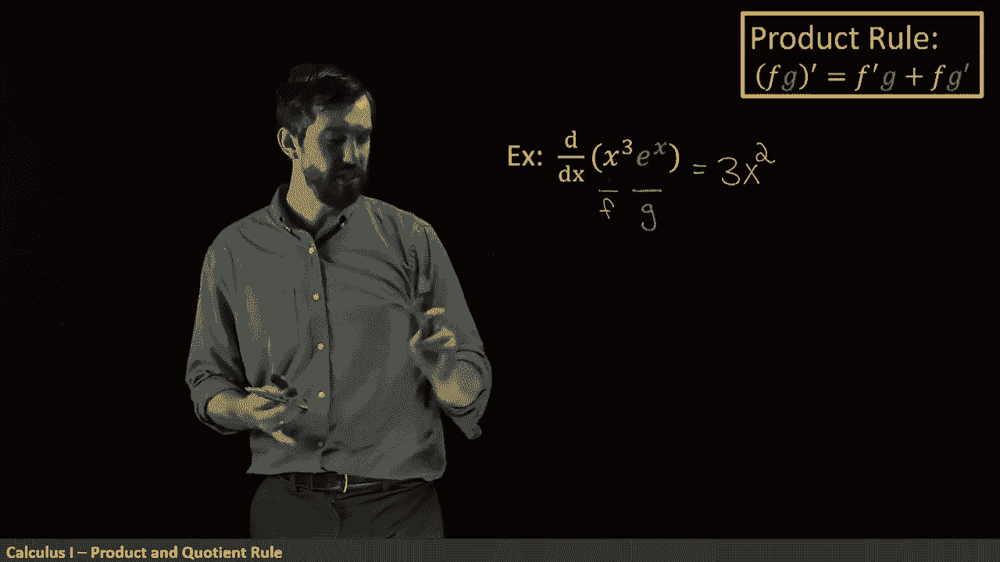
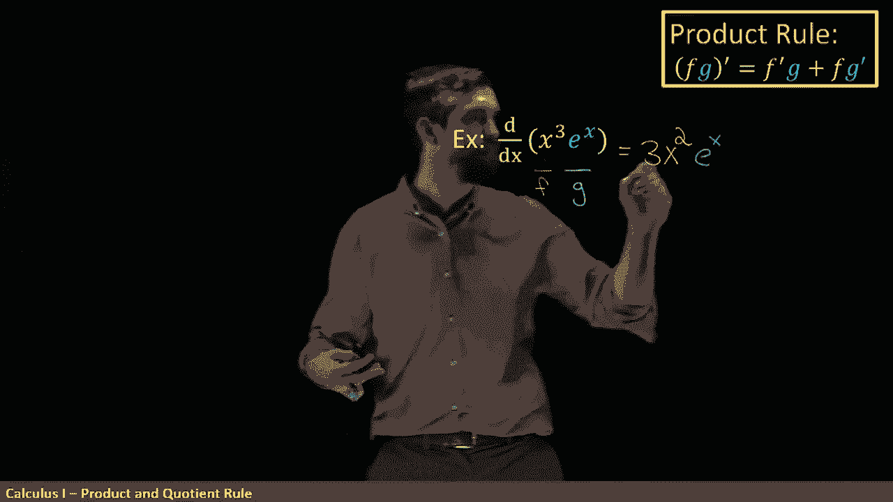

# 第一部分 25：乘积与商法则 📚

在本节课中，我们将学习如何对函数的乘积与商求导。我们已经掌握了指数函数、多项式函数以及它们的和与标量倍数的导数计算。接下来，我们将扩展我们的工具集，学习处理更复杂的函数组合形式。

## 📖 概述

我们的目标始终如一：尽可能多地掌握不同类型函数的导数计算方法。目前，我们已经了解了指数函数、多项式函数，以及它们的和与标量倍数的导数。本节课，我们将重点学习如何对函数的**乘积**与**商**求导。

例如，`x³ * e^x` 是两个函数 `x³` 和 `e^x` 的乘积。而 `x³ / e^x` 则是一个商。我们将学习计算这类表达式导数的规则。

## ✖️ 乘积法则

首先，我们来看乘积法则。该法则指出，两个函数 `F(x)` 和 `G(x)` 乘积的导数计算方式如下：

**公式：** `(F * G)' = F' * G + F * G'`

请注意，乘积的导数**不等于**导数的乘积（即 `(F * G)' ≠ F' * G'`）。这是一个常见的误解。例如，`x²` 可以看作是 `x * x`。我们知道 `(x²)' = 2x`，但如果错误地应用 `F' * G'` 规则（两者导数均为1），会得到错误的结果1。

这个法则也可以用莱布尼茨记号表示，但 `F'G + FG'` 的形式更为简洁。

### 乘积法则应用示例

让我们通过一个具体例子来应用这个法则：求 `x³ * e^x` 的导数。

以下是计算步骤：
1.  首先，识别函数 `F` 和 `G`。这里，令 `F = x³`，`G = e^x`。
2.  接着，分别计算 `F'` 和 `G'`。根据幂法则，`F' = 3x²`。根据指数函数求导法则，`G' = e^x`。
3.  最后，代入乘积法则公式：`(F * G)' = F' * G + F * G' = (3x²) * (e^x) + (x³) * (e^x)`。

因此，`(x³ * e^x)' = 3x²e^x + x³e^x`。

通过乘积法则，我们能够相对轻松地求出两个函数乘积的导数，前提是我们知道每个单独函数的导数。

## ➗ 商法则

上一节我们介绍了乘积的求导方法，本节中我们来看看如何处理两个函数的商。商法则用于计算形如 `F(x) / G(x)`（其中 `G(x) ≠ 0`）的函数的导数。

商法则的公式如下，需要特别注意运算顺序和符号：

**公式：** `(F / G)' = (F' * G - F * G') / G²`

这个公式与乘积法则在分子上类似，但变成了减号，并且整体除以分母的平方。

### 商法则应用示例

现在，让我们应用商法则来计算 `x³ / e^x` 的导数。

以下是计算步骤：
1.  识别函数：令 `F = x³`，`G = e^x`。
2.  计算导数：`F' = 3x²`，`G' = e^x`。
3.  代入商法则公式：
    *   分子为：`F' * G - F * G' = (3x²) * (e^x) - (x³) * (e^x)`
    *   分母为：`G² = (e^x)² = e^(2x)`

因此，`(x³ / e^x)' = (3x²e^x - x³e^x) / e^(2x)`。

我们可以进一步简化这个表达式。注意到分子和分母都有公因子 `e^x`，可以约去一个：

`(3x²e^x - x³e^x) / e^(2x) = e^x(3x² - x³) / e^(2x) = (3x² - x³) / e^x`

## 🎯 总结

本节课中，我们一起学习了微积分中两个非常重要的求导法则：
*   **乘积法则**：`(F * G)' = F' * G + F * G'`
*   **商法则**：`(F / G)' = (F' * G - F * G') / G²`

我们以指数函数 `e^x` 和幂函数 `x^n` 为基础，通过加法、标量乘法，以及本节课新增的乘积与商法则，极大地扩展了我们能够求导的函数范围。随着未来学习更多基础函数和规则，我们将能够处理越来越复杂的函数导数计算。