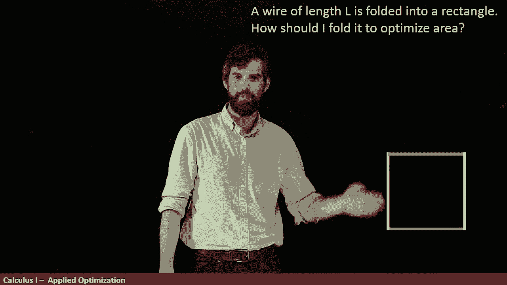
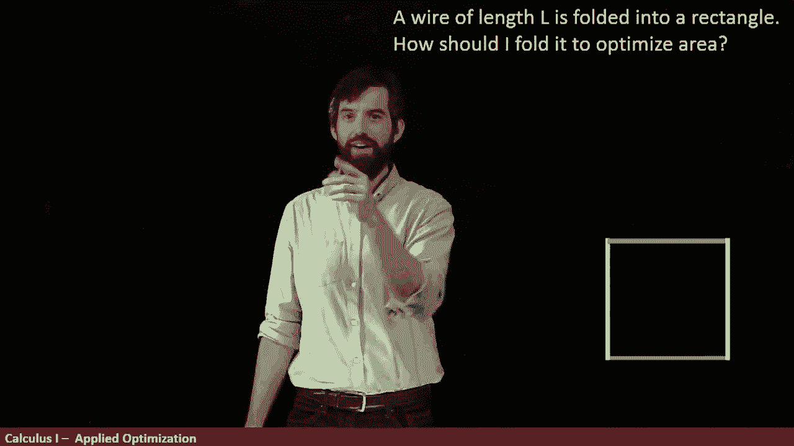
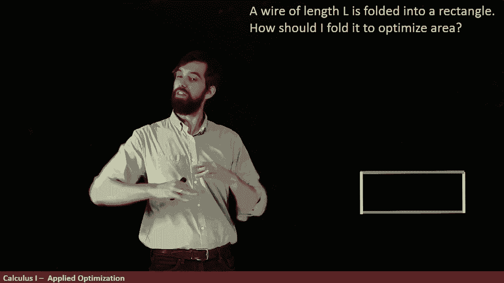
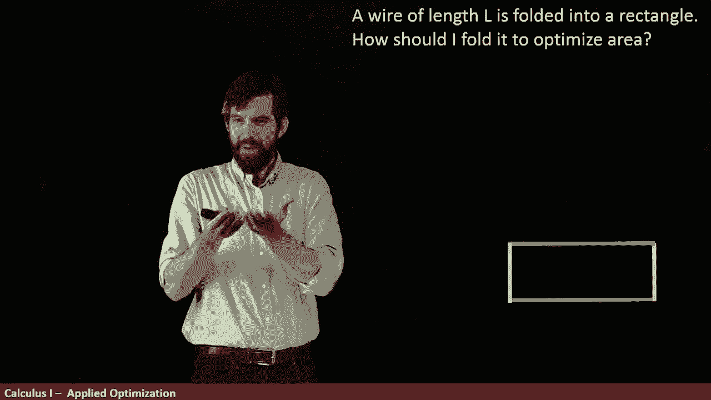
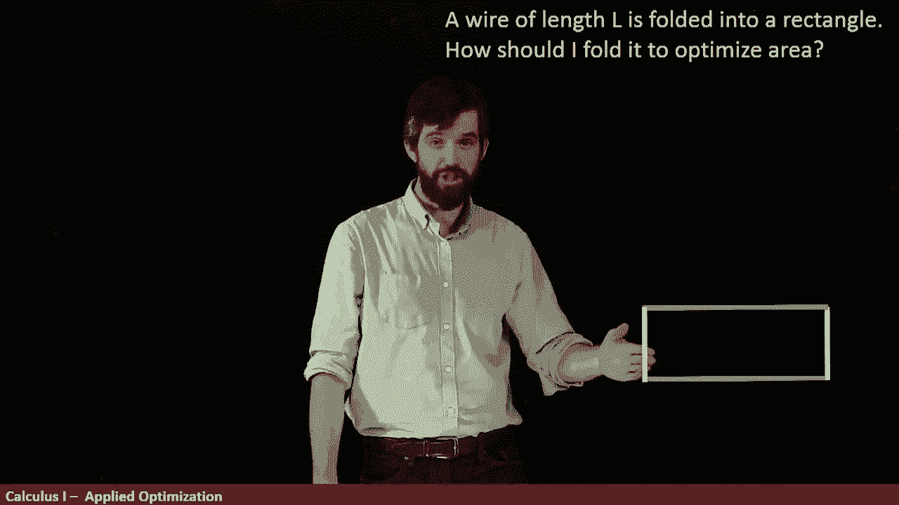
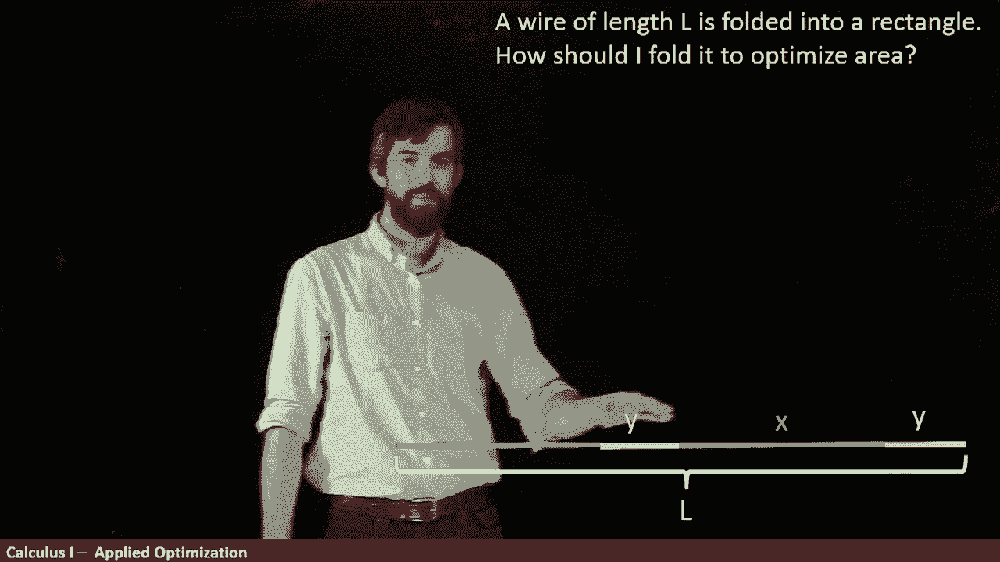
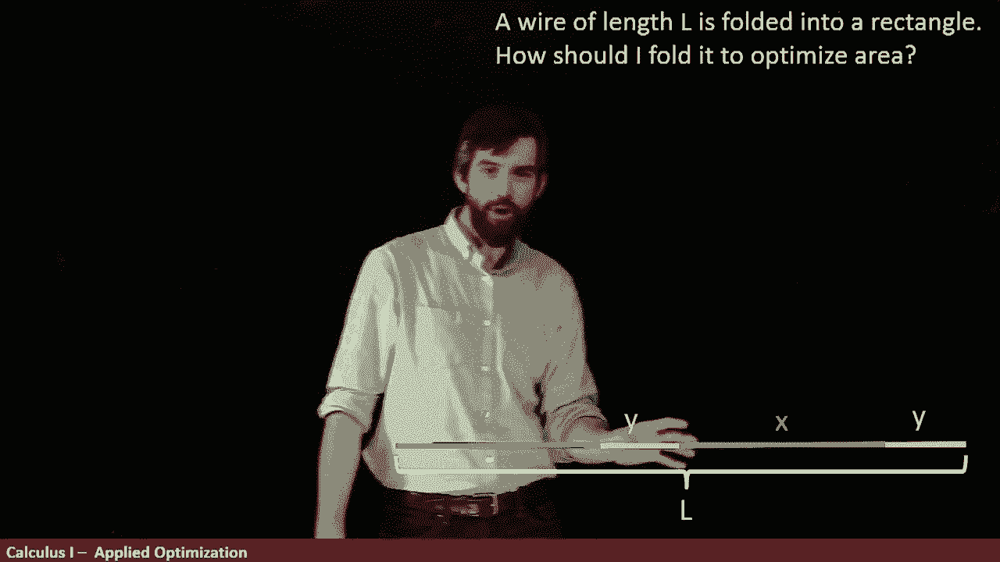
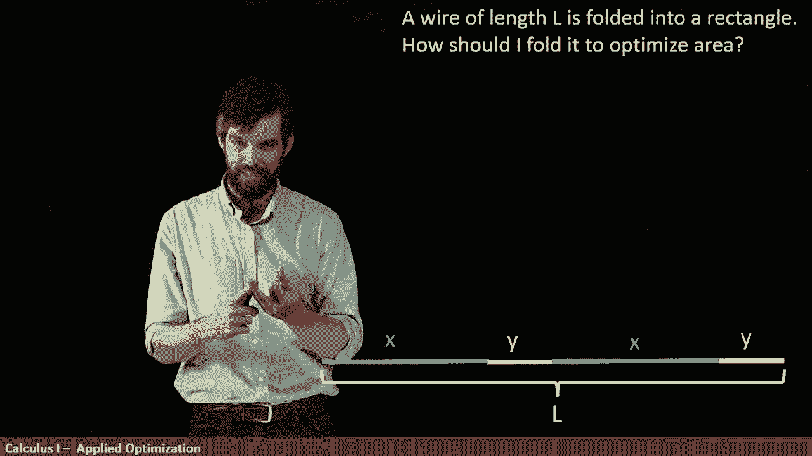
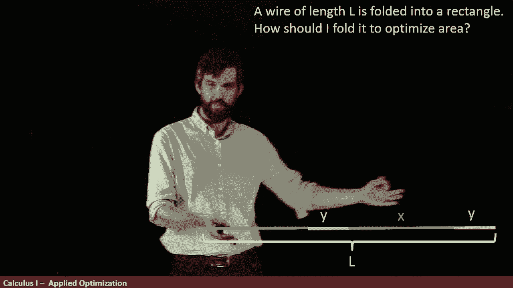

# 第一部分 42：将导线弯折成最大矩形 | 优化问题示例 📐

在本节课中，我们将学习一个经典的优化问题：如何将一段固定长度的导线弯折成一个矩形，使得该矩形的面积最大。我们将通过建立约束方程和优化方程，并利用导数求解，来找到这个最优解。

---

## 🔗 问题描述与建模

想象我们有一段长度为 **L** 的导线。我们的目标是将它弯折成一个矩形。矩形有两条相等的长边（我们设为 **x**）和两条相等的短边（我们设为 **y**）。

以下是问题的关键图示：

上一节我们介绍了问题的背景，本节中我们来看看如何用数学语言来描述它。

我们需要建立两个核心方程。

### 约束方程

约束方程描述了我们必须遵守的条件。在这里，总导线长度 **L** 是固定的，它必须等于矩形四条边的长度之和。

以下是约束条件的推导过程图示：

因此，约束方程可以写为：
**2x + 2y = L**

### 优化方程

优化方程是我们希望最大化（或最小化）的目标。在这个问题中，我们希望矩形的面积最大。

矩形的面积公式为：
**A = x * y**

---

## 🧮 转化为单变量问题

直接对面积 **A = x * y** 求导会遇到困难，因为它包含两个变量 **x** 和 **y**。我们需要利用约束方程，将面积表达为单一变量的函数。

以下是变量替换过程的图示：

我们可以从约束方程中解出 **y**：
**2x + 2y = L → y = (L - 2x) / 2**

然后将这个 **y** 的表达式代入面积公式：
**A(x) = x * [(L - 2x) / 2] = (Lx)/2 - x²**

现在，面积 **A** 就变成了只关于变量 **x** 的函数。

---

## 📈 求导与寻找临界点

现在我们可以对单变量函数 **A(x)** 求导，并令其为零，以找到可能的最大值点。

以下是求导过程的图示：

对 **A(x) = (Lx)/2 - x²** 求导：
**A'(x) = L/2 - 2x**

令导数等于零以寻找临界点：
**L/2 - 2x = 0**

解这个方程：
**2x = L/2 → x = L/4**

我们找到了一个临界点 **x = L/4**。

---

## ✅ 验证最大值

仅仅找到临界点还不够，我们需要确认它确实对应着面积的最大值，而不是最小值或拐点。我们可以通过检查端点值或使用一阶导数测试来验证。

以下是验证过程的图示：

**检查端点：**
*   当 **x = 0** 时，矩形退化为一条线段，面积 **A = 0**。
*   当 **x = L/2** 时，根据约束方程 **y = 0**，矩形同样退化为线段，面积 **A = 0**。

两个端点处的面积都是零，而中间存在正面积（例如当 **x = L/8** 时），因此临界点 **x = L/4** 很可能对应最大值。

**一阶导数测试：**
*   当 **x < L/4** 时，**A'(x) = L/2 - 2x > 0**，函数递增。
*   当 **x > L/4** 时，**A'(x) = L/2 - 2x < 0**，函数递减。

函数先增后减，因此在 **x = L/4** 处取得极大值，也就是我们寻找的最大值。

---

## 🧊 几何解释与结论

最后，让我们看看这个最优解在几何上意味着什么。

如果 **x = L/4**，代入约束方程：
**2*(L/4) + 2y = L → L/2 + 2y = L → 2y = L/2 → y = L/4**

我们发现，**y** 也等于 **L/4**。

这意味着，当矩形的长和宽相等时，面积最大。换句话说，**用固定长度的导线围成面积最大的矩形是一个正方形**。

其边长为：**L/4**。

---

## 📝 总结

本节课中我们一起学习了如何解决“将导线弯折成最大矩形”的优化问题。我们回顾一下核心步骤：

1.  **建立模型**：定义变量 **x**（长）和 **y**（宽）。
2.  **列出方程**：
    *   约束方程：**2x + 2y = L**（总长度固定）。
    *   优化方程：**A = x * y**（最大化面积）。
3.  **化简问题**：利用约束方程，将面积 **A** 表示为单变量 **x** 的函数：**A(x) = (Lx)/2 - x²**。
4.  **求导求解**：对 **A(x)** 求导，令 **A'(x) = 0**，解得临界点 **x = L/4**。
5.  **验证结果**：通过检查端点或一阶导数测试，确认该临界点对应最大值。
6.  **得出答案**：最优解是 **x = y = L/4**，即弯折成一个正方形时面积最大。

这个例子清晰地展示了解决优化问题的标准流程：建模、建立方程、化简、求导、验证、解释。