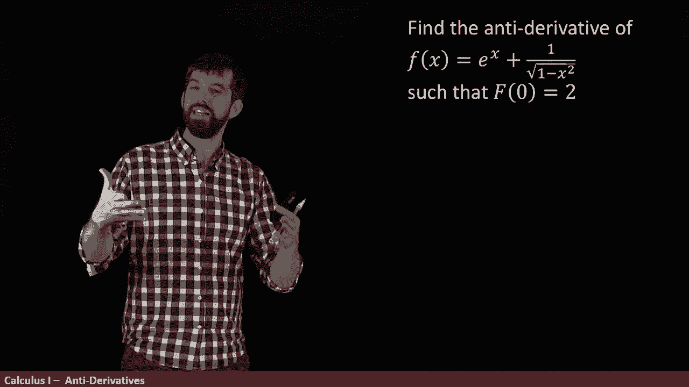
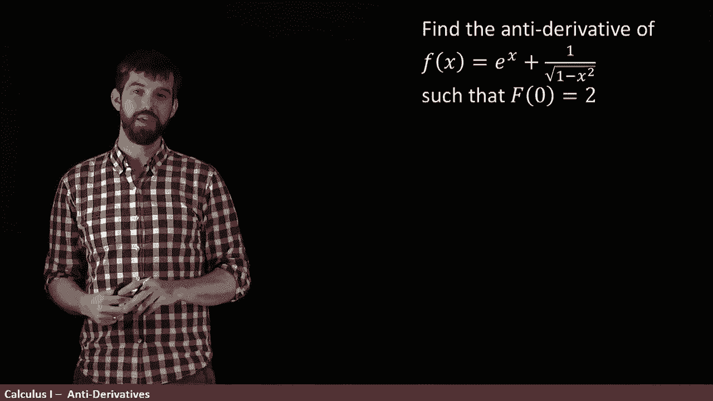
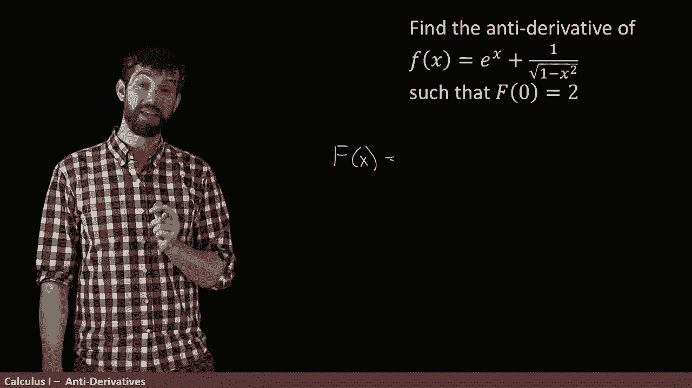
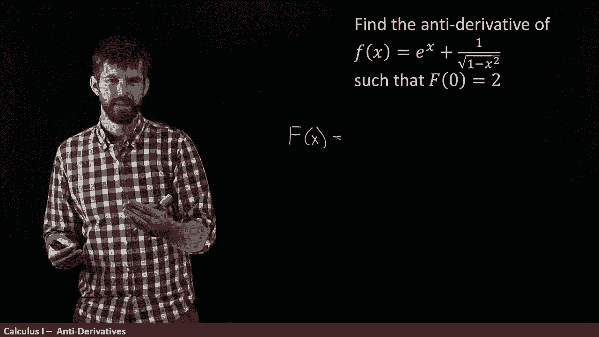
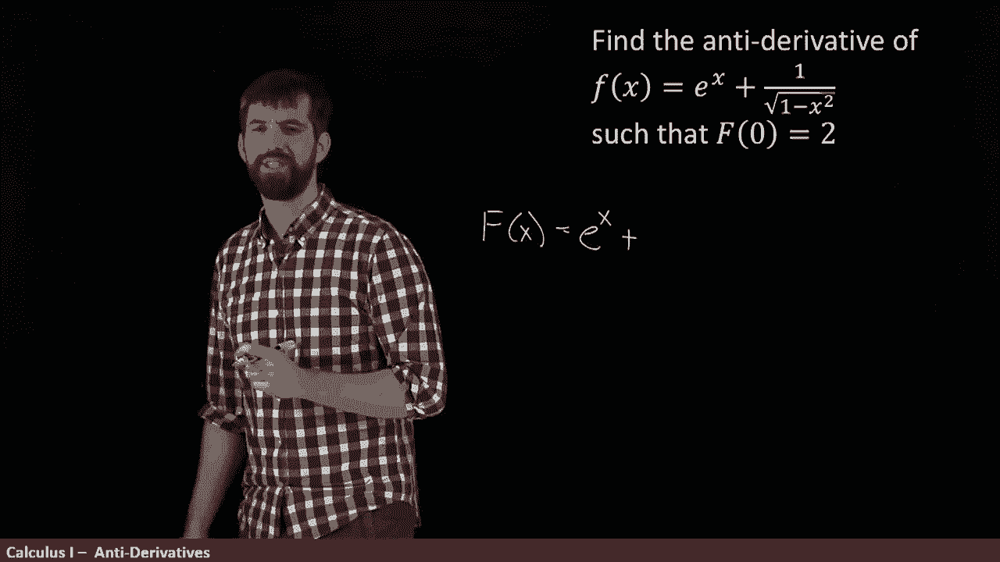
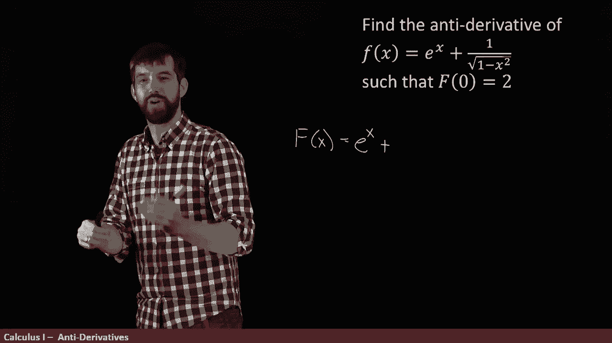
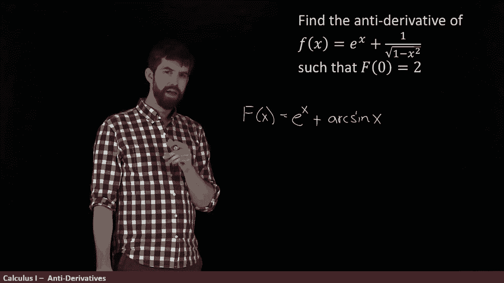
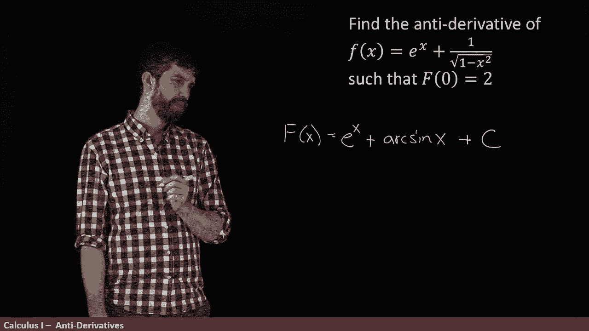

# 第一部分 46：求解原函数中的常数 📘

在本节课中，我们将学习如何求解原函数中的常数项。具体来说，我们将通过一个具体问题，展示如何利用给定的函数值条件来确定原函数中的常数 `C`。



---

## 🔍 问题概述


我们要求解函数 `f(x) = e^x + 1/√(1-x²)` 的一个特定原函数 `F(x)`。这个原函数需要满足一个额外条件：`F(0) = 2`。

我们知道，一个函数的**原函数族**（即不定积分）包含一个任意的常数 `C`。因此，存在无穷多个原函数。给定的条件 `F(0) = 2` 将帮助我们确定这个常数 `C` 的具体值。



---


## 📝 分步求解



上一节我们介绍了问题的背景，本节中我们来看看具体的求解步骤。

### 第一步：求一般原函数

首先，我们需要求出 `f(x)` 的**一般原函数** `F(x)`，即其不定积分。





*   `f(x)` 的第一部分是 `e^x`。我们知道 `e^x` 的导数就是它本身，因此它的原函数也是 `e^x`。
*   第二部分是 `1/√(1-x²)`。这是一个需要识别的常见导数形式。回忆一下，`arcsin(x)` 的导数正是 `1/√(1-x²)`。因此，这一部分的原函数是 `arcsin(x)`。

将两部分结合，并加上任意常数 `C`，我们得到一般原函数：



**公式：**
```
F(x) = e^x + arcsin(x) + C
```



---



### 第二步：利用条件确定常数 C

现在，我们利用给定的条件 `F(0) = 2` 来确定常数 `C` 的值。

将 `x = 0` 代入我们得到的一般原函数公式：

**计算过程：**
```
F(0) = e^0 + arcsin(0) + C
     = 1 + 0 + C
     = 1 + C
```

题目要求 `F(0) = 2`，所以我们建立方程：
```
1 + C = 2
```

解这个简单的方程：
```
C = 1
```

---

## ✅ 最终答案

因此，满足 `F(0) = 2` 的那个特定原函数是：

**公式：**
```
F(x) = e^x + arcsin(x) + 1
```

---

## 💡 总结与延伸

本节课中我们一起学习了如何利用特定点的函数值来确定原函数中的常数 `C`。核心步骤是：先求出**一般原函数**（包含 `+ C`），然后代入已知条件解出 `C`。

这个“常数 `C`”在微积分的应用中至关重要。例如，速度是距离的导数。如果只知道速度函数，想求出具体的距离函数，就必须通过求原函数（积分）来实现。这时出现的常数 `C` 就代表了初始位置。**只知道速度变化，而不知道起点，是无法确定最终位置的**。这种导数与原函数之间的对称关系，在物理、工程等众多领域都有广泛应用。