# 第一部分 54：换元积分中的常数调整 📘

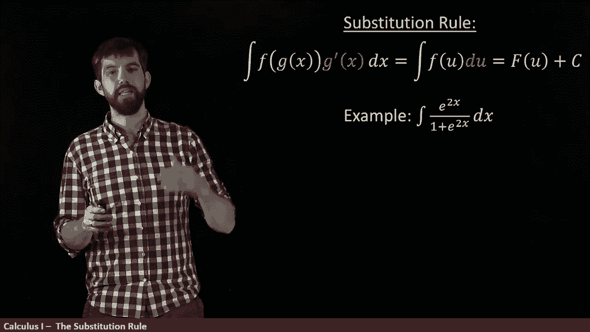

在本节课中，我们将通过一个具体例子，学习如何在换元积分法中处理常数因子。我们将计算一个包含指数函数的积分，并演示如何通过调整常数来应用换元法。

---

## 🔍 问题引入

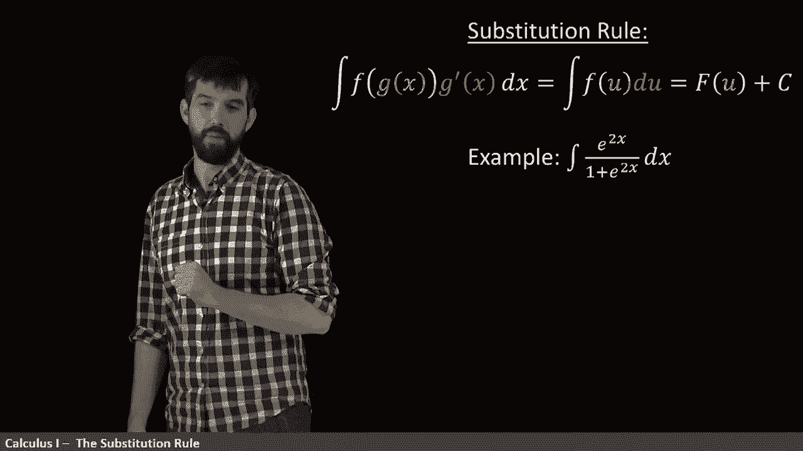

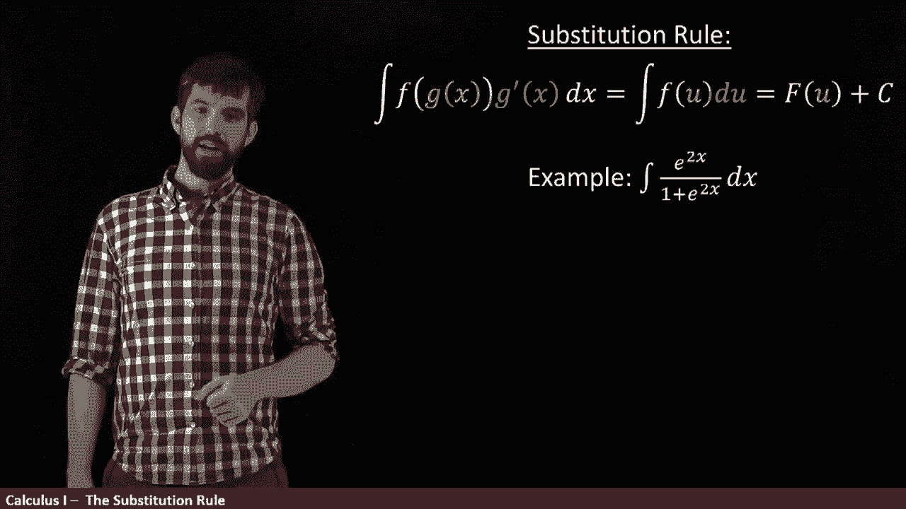

我们考虑以下积分：

\[
\int \frac{e^{2x}}{1 + e^{2x}} \, dx
\]

观察这个表达式，可以发现分子 \( e^{2x} \) 与分母 \( 1 + e^{2x} \) 的导数 \( 2e^{2x} \) 非常相似，仅相差一个常数因子 2。这提示我们可以尝试使用换元积分法。

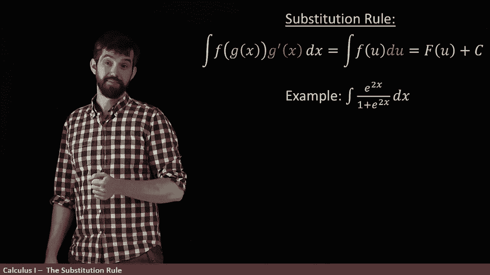

---

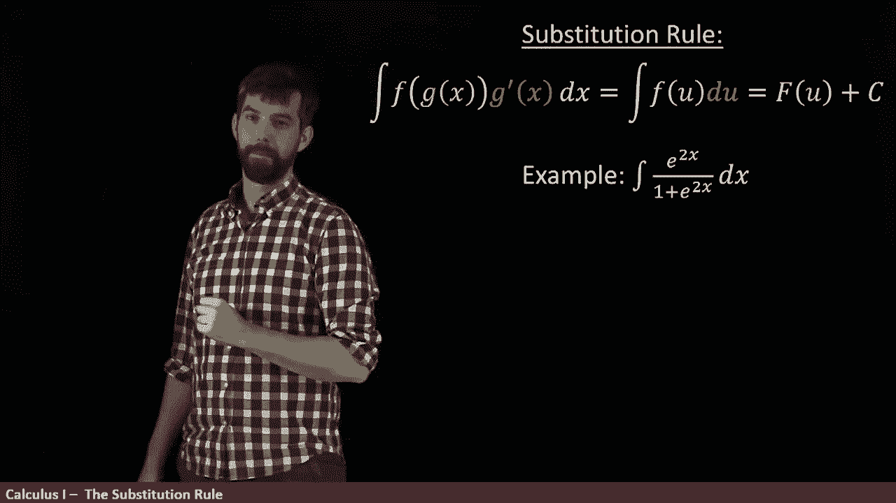

## 🧩 设定换元变量

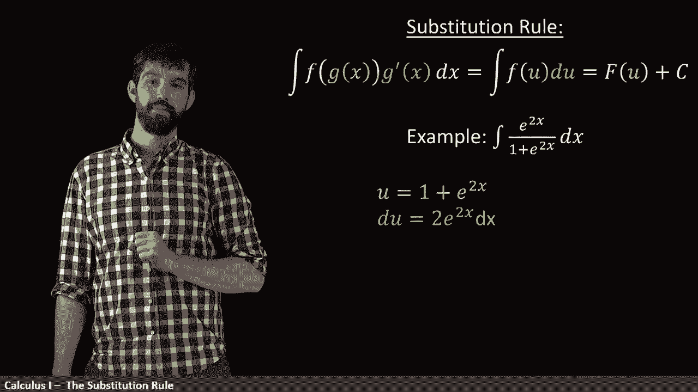

我们尝试设：

\[
u = 1 + e^{2x}
\]

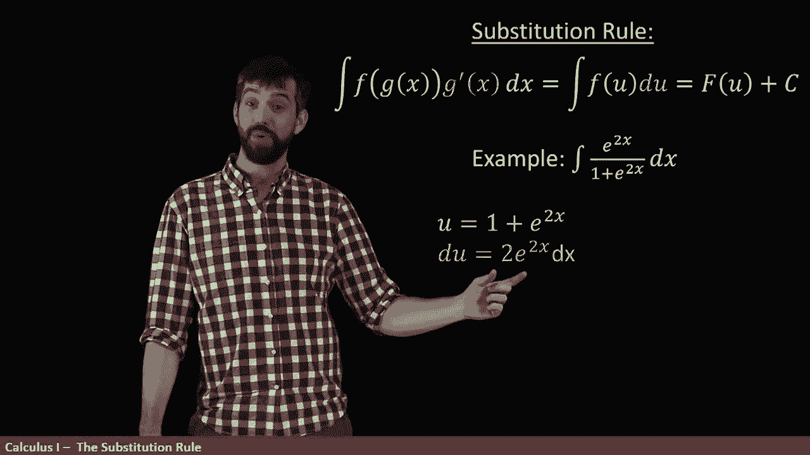

接下来，计算 \( u \) 的微分 \( du \)：

\[
du = 2e^{2x} \, dx
\]

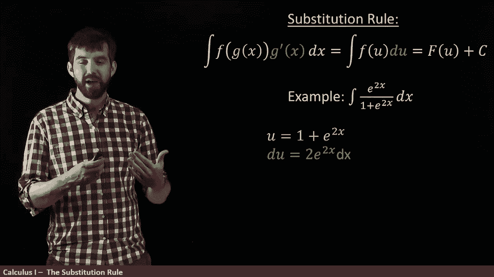

现在，原积分中的分子是 \( e^{2x} \, dx \)，而我们得到的是 \( 2e^{2x} \, dx \)。为了匹配，我们需要引入一个常数因子 \( \frac{1}{2} \) 进行调整。

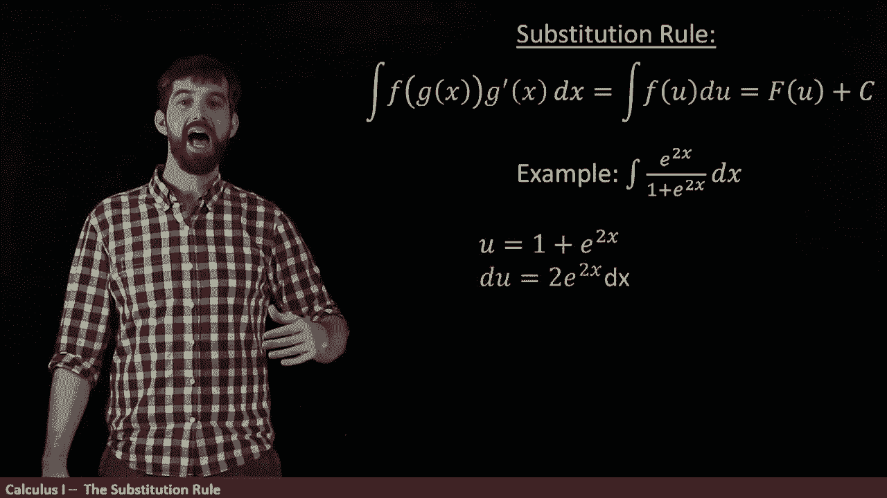

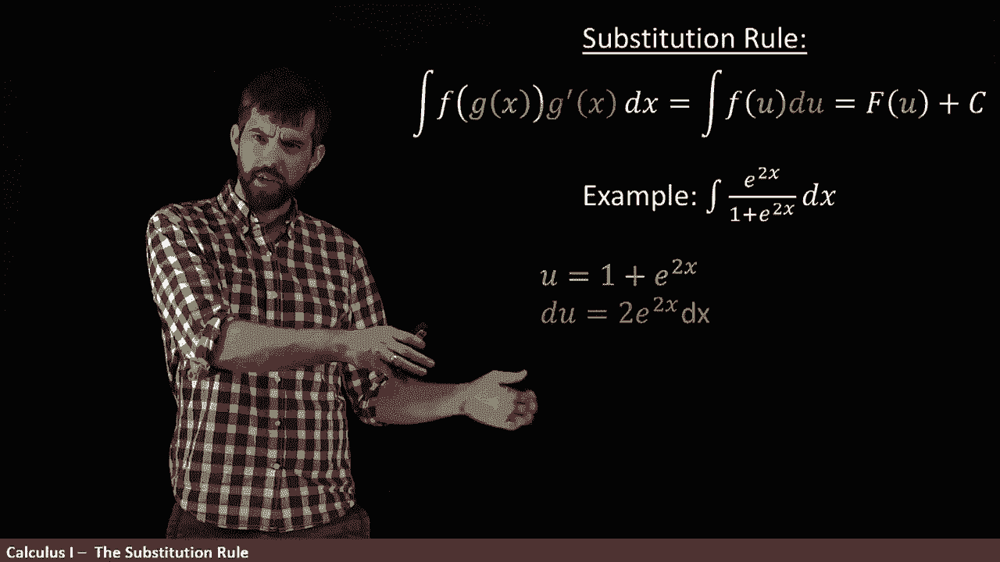

---

## 🔄 调整常数并代入

将原积分改写为：

\[
\int \frac{e^{2x}}{1 + e^{2x}} \, dx = \frac{1}{2} \int \frac{2e^{2x}}{1 + e^{2x}} \, dx
\]

这样，分子部分 \( 2e^{2x} \, dx \) 正好等于 \( du \)，而分母 \( 1 + e^{2x} \) 就是 \( u \)。因此，积分变为：

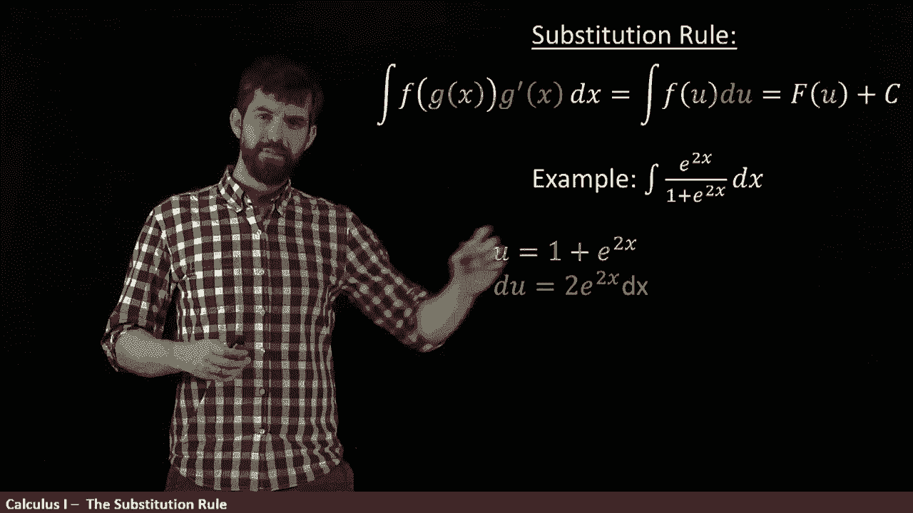

\[
\frac{1}{2} \int \frac{1}{u} \, du
\]

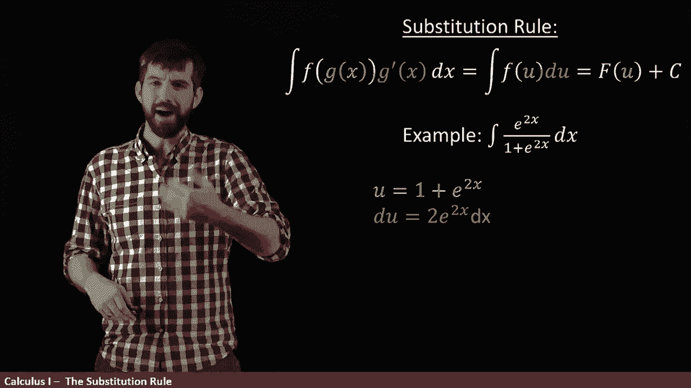

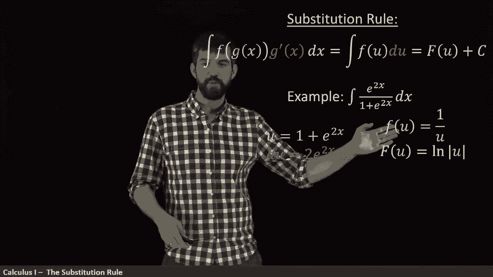

---

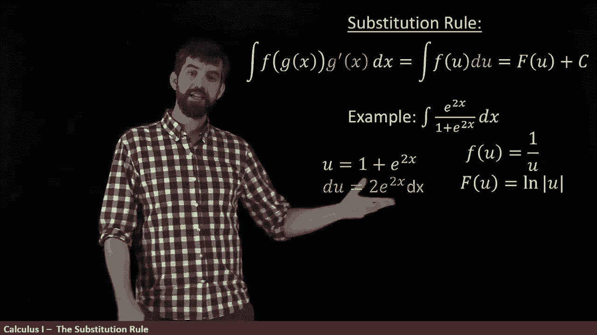

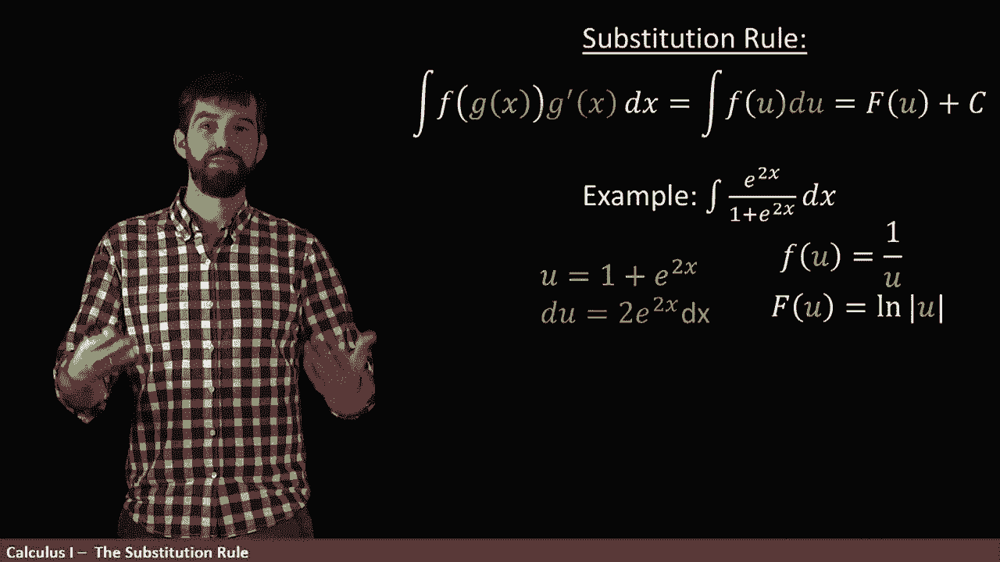

## 📈 计算积分

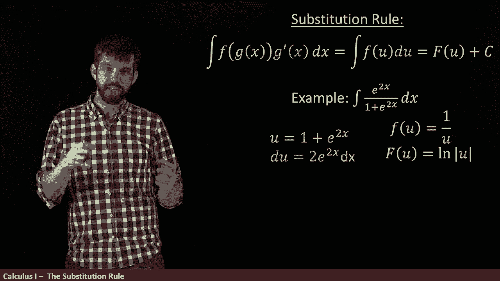

我们知道：

\[
\int \frac{1}{u} \, du = \ln |u| + C
\]

因此：

\[
\frac{1}{2} \int \frac{1}{u} \, du = \frac{1}{2} \ln |u| + C
\]

最后，将 \( u = 1 + e^{2x} \) 代回，得到最终结果：

\[
\int \frac{e^{2x}}{1 + e^{2x}} \, dx = \frac{1}{2} \ln |1 + e^{2x}| + C
\]

---

## 💡 关键步骤回顾

以下是应用换元法并调整常数的核心步骤：

1.  **识别模式**：观察被积函数，寻找其某部分与另一部分的导数相似，可能相差一个常数因子。
2.  **设定换元**：令 \( u \) 等于那个“另一部分”（通常是复合函数的内层或分母）。
3.  **计算微分**：求出 \( du \)，并检查与原积分中微分部分的差异。
4.  **调整常数**：通过乘以或除以一个常数，使 \( du \) 的表达式与积分中的微分部分完全匹配。这相当于乘以 1，不改变积分值。
5.  **代入并积分**：将整个积分用 \( u \) 和 \( du \) 表示，计算这个更简单的积分。
6.  **回代变量**：将结果中的 \( u \) 用原变量表达式替换。

---

## 🌐 关于积分的一般性思考

需要指出的是，积分通常比微分更困难。对于由基本函数（如 \( e^x \)、\( \sin x \)、多项式等）通过四则运算和复合构成的函数，我们总有明确的微分法则可以求导。

然而，求积分则不然。许多积分能够求解，是因为我们可以通过技巧（如这里的换元法）将其转化为已知的标准形式。但并非所有积分都有这样简洁的法则可以应用，这也是积分学更具挑战性的地方。

---

## 📝 总结

本节课中，我们一起学习了如何通过换元积分法求解 \( \int \frac{e^{2x}}{1 + e^{2x}} \, dx \)。核心在于识别出 \( e^{2x} \, dx \) 与 \( d(1 + e^{2x}) \) 相差一个常数因子 2，并通过乘以 \( \frac{1}{2} \) 再乘以 2 的技巧进行调整，从而成功应用换元公式，最终得到结果 \( \frac{1}{2} \ln |1 + e^{2x}| + C \)。掌握这种识别和调整常数因子的能力，是熟练运用换元积分法的关键。