# 第一部分 58：第三次考试全解析：积分、微积分基本定理与优化 📘

在本教程中，我们将一起详细解析一份微积分1的第三次考试试卷。我们将涵盖积分、微积分基本定理、优化问题以及函数作图等核心主题。通过逐步拆解每一道题目，你将学习如何应用关键概念来解决问题。

---

## 📝 问题一：由导数求原函数

我们已知一个函数的导数 **F'(x) = 3e^x + 2sin(x)**，以及一个初始条件 **F(0) = 3**。我们的目标是求出 **F(π)** 的值。

首先，我们需要找到原函数 **F(x)**。这可以通过对导数进行不定积分来实现。

**F(x) = ∫ F'(x) dx = ∫ (3e^x + 2sin(x)) dx**

计算这个积分：
*   **∫ 3e^x dx = 3e^x**
*   **∫ 2sin(x) dx = -2cos(x)**

因此，我们得到：
**F(x) = 3e^x - 2cos(x) + C**，其中 **C** 是积分常数。

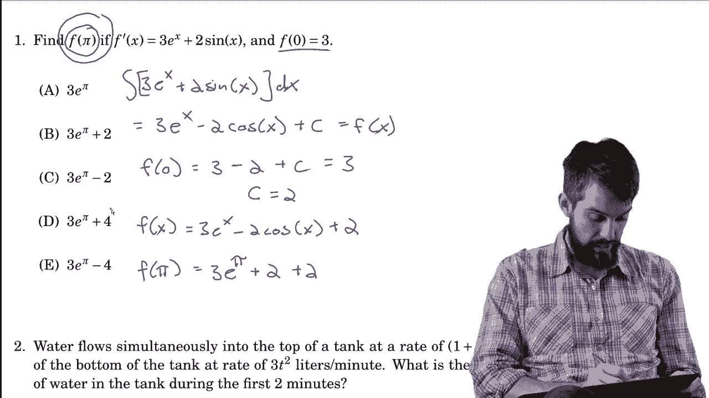

接下来，我们利用初始条件 **F(0) = 3** 来求解常数 **C**。
将 **x = 0** 代入：
**F(0) = 3e^0 - 2cos(0) + C = 3*1 - 2*1 + C = 1 + C**
令其等于 3：**1 + C = 3**，解得 **C = 2**。

所以，具体的原函数为：
**F(x) = 3e^x - 2cos(x) + 2**

最后，计算 **F(π)**：
**F(π) = 3e^π - 2cos(π) + 2 = 3e^π - 2*(-1) + 2 = 3e^π + 4**

---

## 📝 问题二：净变化问题

水以速率 **1 + 4t³** 升/分钟流入水箱，同时以速率 **3t²** 升/分钟流出。问题是求前两分钟内的净变化量。

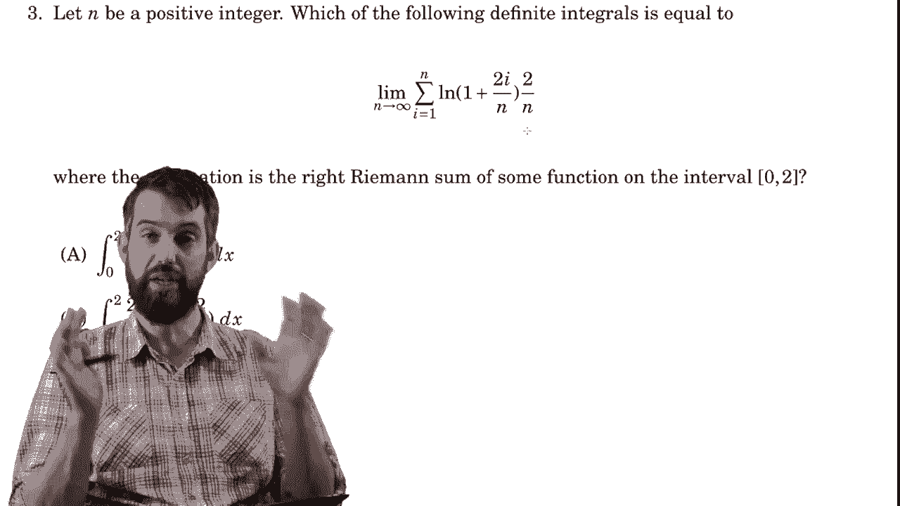

净变化量等于流入速率减去流出速率在时间区间上的积分。

**净变化 = ∫₀² [(1 + 4t³) - (3t²)] dt = ∫₀² (1 + 4t³ - 3t²) dt**

计算定积分：
**∫₀² (1 + 4t³ - 3t²) dt = [t + t⁴ - t³] 从 0 到 2**
代入上限 **t=2**：**2 + 16 - 8 = 10**
代入下限 **t=0**：**0 + 0 - 0 = 0**
因此，净变化量为 **10 - 0 = 10** 升。

---

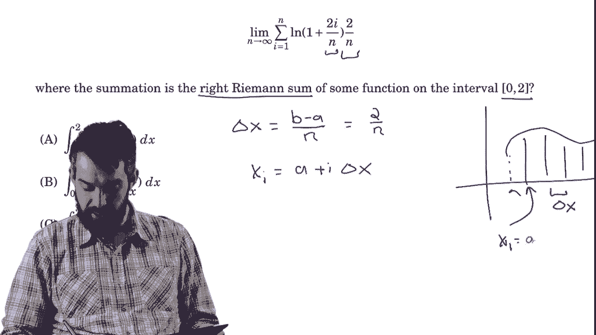

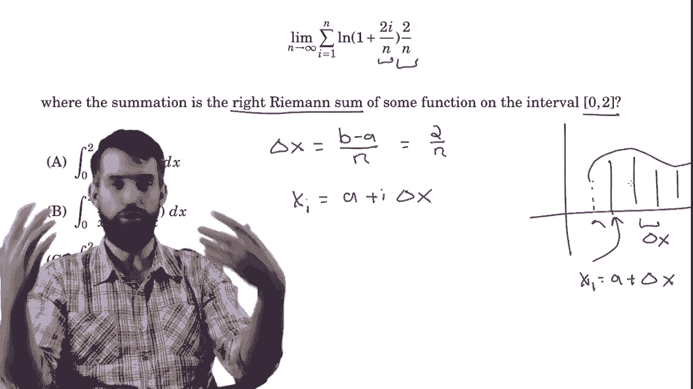

## 📝 问题三：黎曼和与定积分

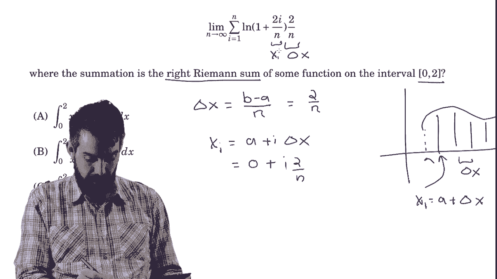

题目给出了一个极限求和表达式，并说明它代表在区间 **[0, 2]** 上使用右端点的黎曼和。我们需要找出它对应的定积分。

关键公式回顾：
*   区间宽度：**Δx = (b - a)/n = (2 - 0)/n = 2/n**
*   右端点坐标：**x_i = a + iΔx = 0 + i*(2/n) = 2i/n**

观察求和式：**lim (n→∞) Σ (i=1 to n) [ (2/n) * ln(1 + 2i/n) ]**
其中，**2/n** 对应 **Δx**，而 **ln(1 + 2i/n)** 对应函数在 **x_i = 2i/n** 处的值，即 **f(x_i) = ln(1 + x_i)**。

因此，该黎曼和对应的定积分为：
**∫₀² ln(1 + x) dx**

---

## 📝 问题四：积分区间的可加性

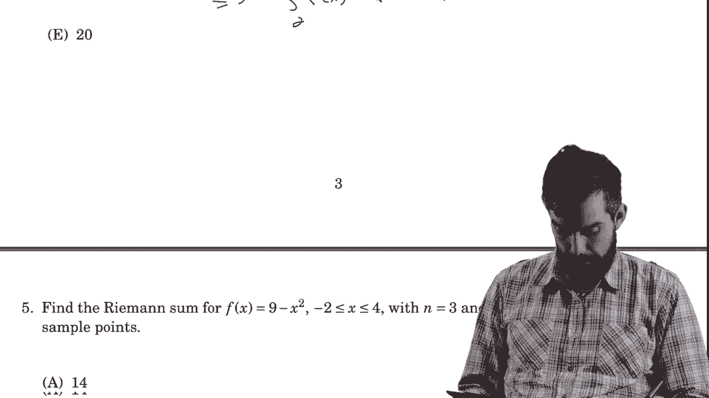

已知三个定积分的值：
1.  **∫₁² f(x) dx = 3**
2.  **∫₈¹ f(x) dx = -7** （注意上下限顺序）
3.  **∫₂⁸ 2f(x) dx = ?**

我们需要求第三个积分的值。首先利用积分区间的可加性：
**∫₁⁸ f(x) dx = ∫₁² f(x) dx + ∫₂⁸ f(x) dx**

我们已知 **∫₁² f(x) dx = 3**，但需要 **∫₁⁸ f(x) dx**。已知 **∫₈¹ f(x) dx = -7**，根据积分上下限互换变号的性质，可得 **∫₁⁸ f(x) dx = 7**。

代入公式：**7 = 3 + ∫₂⁸ f(x) dx**，解得 **∫₂⁸ f(x) dx = 4**。

但题目要求的是 **∫₂⁸ 2f(x) dx**，根据常数倍性质：
**∫₂⁸ 2f(x) dx = 2 * ∫₂⁸ f(x) dx = 2 * 4 = 8**

---

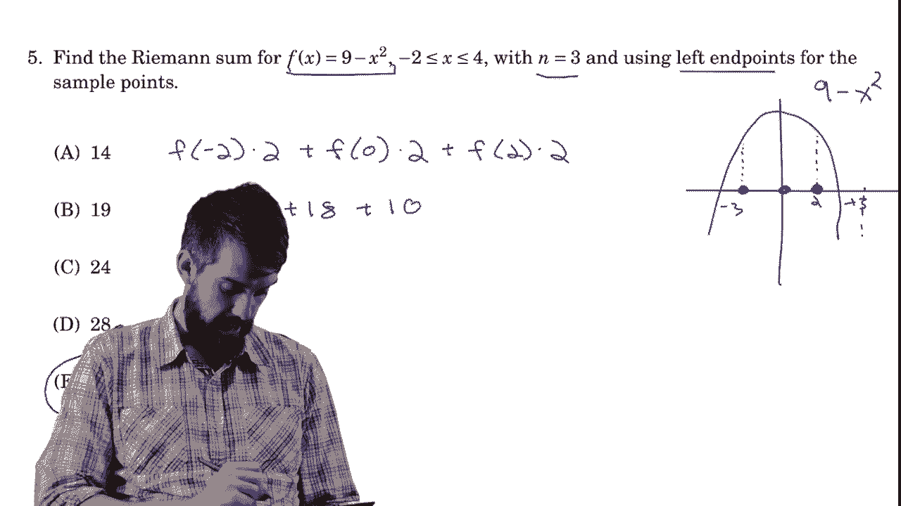

## 📝 问题五：左端点黎曼和

函数为 **f(x) = 9 - x²**，区间为 **[-2, 4]**，要求用三个子区间和左端点计算黎曼和。

将区间 **[-2, 4]** 三等分，每个子区间宽度为 **Δx = (4 - (-2))/3 = 2**。
三个子区间为：**[-2, 0], [0, 2], [2, 4]**。
左端点分别为：**x₀ = -2, x₁ = 0, x₂ = 2**。

黎曼和 **S = f(-2)*Δx + f(0)*Δx + f(2)*Δx**
计算函数值：
*   **f(-2) = 9 - (-2)² = 5**
*   **f(0) = 9 - 0² = 9**
*   **f(2) = 9 - 2² = 5**

因此，**S = (5 * 2) + (9 * 2) + (5 * 2) = 10 + 18 + 10 = 38**

---

## 📝 问题六：微积分基本定理 I

题目要求计算导数：**d/dx [ ∫_{√x}^{5} ln(t) dt ]**

这是微积分基本定理第一部分的典型应用，但需要注意两点：
1.  积分上限是常数 **5**，下限是变量 **√x**，这与标准形式（上限是变量）相反。
2.  下限是 **√x** 而不仅仅是 **x**，需要应用链式法则。

首先，交换积分上下限以匹配标准形式，这会引入一个负号：
**∫_{√x}^{5} ln(t) dt = - ∫_{5}^{√x} ln(t) dt**

现在，令 **g(x) = ∫_{5}^{√x} ln(t) dt**。根据微积分基本定理和链式法则：
**g'(x) = [ln(√x)] * (d(√x)/dx) = ln(x^{1/2}) * (1/(2√x)) = (1/2)ln(x) * (1/(2√x))**

别忘了我们前面引入的负号。因此，最终答案为：
**d/dx [原积分] = - g'(x) = - [ln(√x) / (2√x)]**

---

## 📝 问题七：代数化简后积分

计算定积分：**∫₁² (2x + x³)/x³ dx**

被积函数是一个分式，但分子是多项式之和。我们可以先将其拆分为更简单的项：

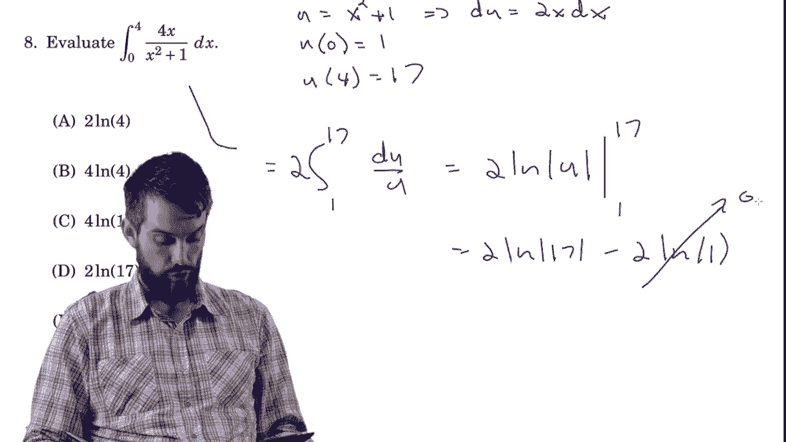

**(2x + x³)/x³ = 2x/x³ + x³/x³ = 2/x² + 1**

因此，原积分转化为：
**∫₁² (2/x² + 1) dx = ∫₁² (2x⁻² + 1) dx**

计算积分：
**∫ (2x⁻² + 1) dx = -2x⁻¹ + x = -2/x + x**

代入上下限计算：
在 **x=2** 处：**-2/2 + 2 = -1 + 2 = 1**
在 **x=1** 处：**-2/1 + 1 = -2 + 1 = -1**
定积分值 = **1 - (-1) = 2**

---

## 📝 问题八：换元积分法

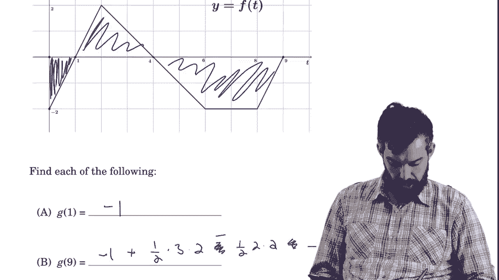

计算定积分：**∫₀⁴ (4x) / (x² + 1) dx**

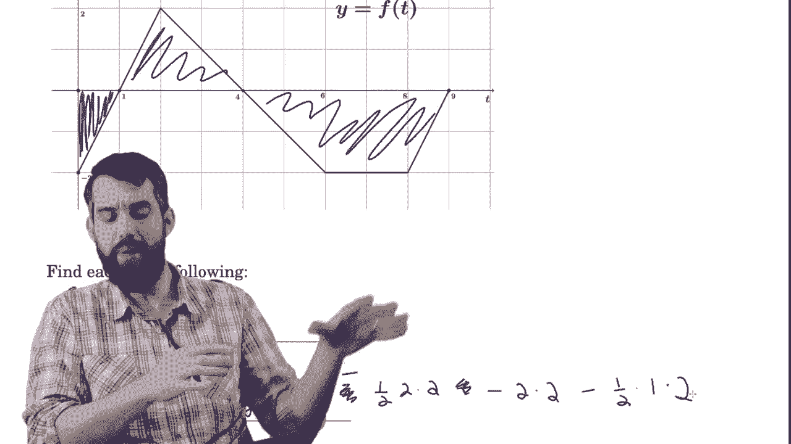

观察被积函数，分母的导数 **d(x²+1)/dx = 2x**，与分子 **4x** 成比例。这提示我们使用换元法。

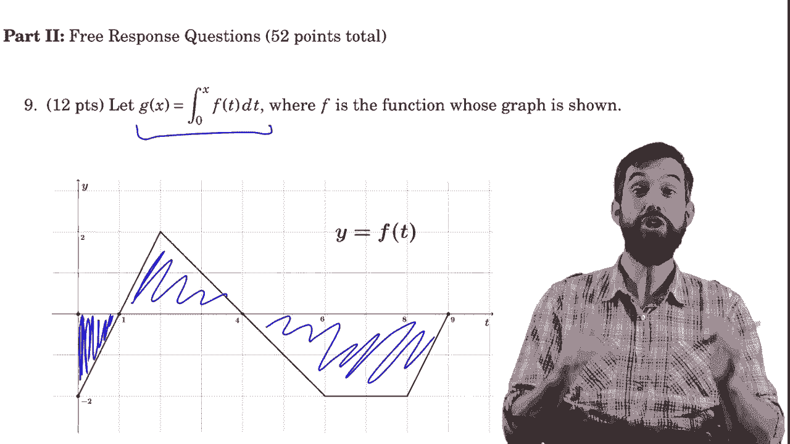

令 **u = x² + 1**，则 **du = 2x dx**。
我们现有 **4x dx**，可以写成 **2 * (2x dx) = 2 du**。

同时，需要改变积分限：
当 **x = 0** 时，**u = 0² + 1 = 1**
当 **x = 4** 时，**u = 4² + 1 = 17**

原积分变为：
**∫₀⁴ (4x)/(x²+1) dx = ∫₁¹⁷ (2 du) / u = 2 ∫₁¹⁷ (1/u) du**

计算积分：**2 ∫₁¹⁷ (1/u) du = 2 [ln|u|] 从 1 到 17 = 2(ln17 - ln1) = 2 ln17**

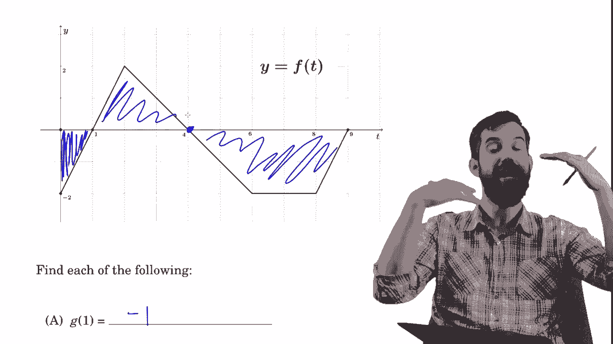

---

## 📝 问题九：由导函数图像分析原函数

已知 **g(x) = ∫₀ˣ f(t) dt**，并给出了 **f(x)** 的图像（由直线段组成）。我们需要分析 **g(x)**。

以下是基于 **f(x)** 图像（假设其为分段线性函数）的分析步骤：

1.  **求 g(1)**：
    **g(1) = ∫₀¹ f(t) dt**，即 **f(t)** 在 **[0,1]** 上与 x 轴围成的**有向面积**。根据图像，这是一个底为1、高为-2的三角形，面积为 **-1**。所以 **g(1) = -1**。

2.  **求 g(9)**：
    **g(9) = ∫₀⁹ f(t) dt**。这需要计算从 0 到 9 所有部分的有向面积之和。将图像分成多个三角形和矩形，分别计算它们的面积（在 x 轴上方为正，下方为负），然后求和。

3.  **求 g'(7) 和 g''(7)**：
    根据微积分基本定理，**g'(x) = f(x)**。因此，**g'(7) = f(7)**，即函数 **f** 在 **x=7** 时的 y 值。
    同理，**g''(x) = f'(x)**。所以 **g''(7) = f'(7)**，即 **f** 在 **x=7** 处的切线斜率。

4.  **求 g(x) 的绝对最大值和递增区间**：
    *   **绝对最大值**：**g(x)** 在 **f(x)** 从正变负的点（即 **f(x)** 的零点且从左往右由正变负）可能取得极大值。观察 **f(x)** 图像，找到面积累积停止增加并开始减少的点。
    *   **递增区间**：**g(x)** 递增当且仅当其导数 **g'(x) = f(x) > 0**。因此，找出 **f(x)** 图像在 x 轴上方的区间即可。

---

## 📝 问题十：换元积分法 (不定积分 I)

计算不定积分：**∫ [1 / (x(1 + 2ln x)³)] dx**

被积函数分母结构复杂，尤其是 **(1 + 2ln x)³**。尝试令 **u = 1 + 2ln x**。

则 **du = (2/x) dx**，即 **(1/x) dx = (1/2) du**。

将原积分用 **u** 表示：
**∫ [1/( (1+2ln x)³ )] * (1/x) dx = ∫ [1/u³] * (1/2) du = (1/2) ∫ u⁻³ du**

计算积分：
**(1/2) ∫ u⁻³ du = (1/2) * (u⁻² / -2) + C = -1/(4u²) + C**

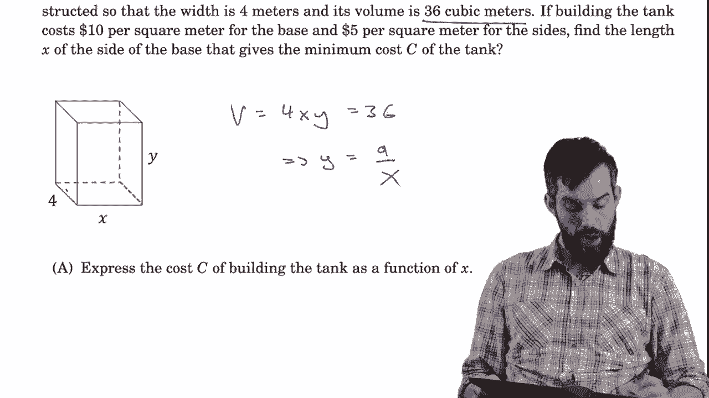

最后，将 **u = 1 + 2ln x** 代回：
**∫ [1 / (x(1 + 2ln x)³)] dx = -1 / [4(1 + 2ln x)²] + C**

---

## 📝 问题十一：换元积分法 (不定积分 II)

计算不定积分：**∫ x√(x-4) dx**

被积函数包含根号 **√(x-4)**，令 **u = x - 4** 是一个自然的选择。

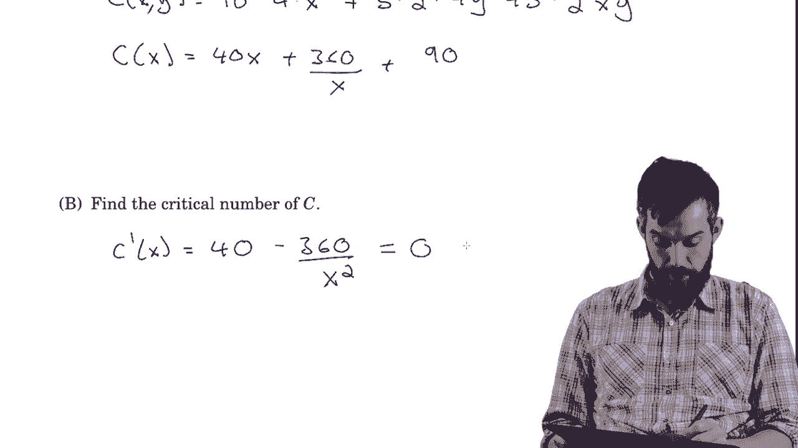

则 **du = dx**，且 **x = u + 4**。

代入原积分：
**∫ x√(x-4) dx = ∫ (u + 4)√u du = ∫ (u + 4) * u^{1/2} du = ∫ (u^{3/2} + 4u^{1/2}) du**

分别积分：
**∫ u^{3/2} du = (2/5) u^{5/2}**
**∫ 4u^{1/2} du = 4 * (2/3) u^{3/2} = (8/3) u^{3/2}**

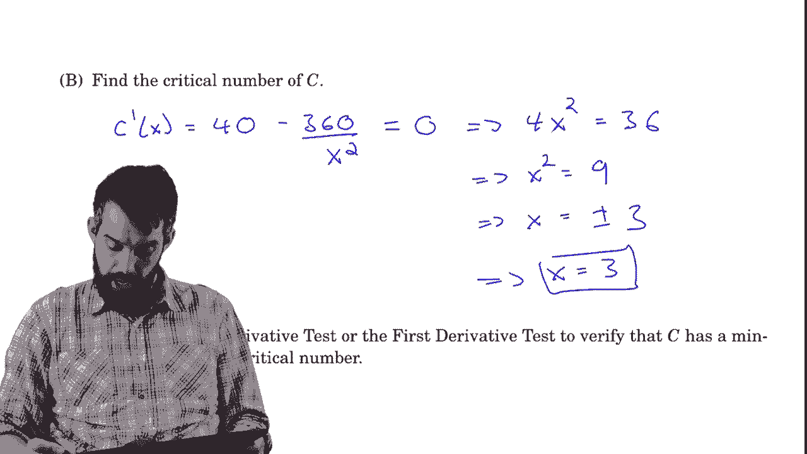

因此：
**∫ x√(x-4) dx = (2/5) u^{5/2} + (8/3) u^{3/2} + C**

将 **u = x - 4** 代回：
**∫ x√(x-4) dx = (2/5)(x-4)^{5/2} + (8/3)(x-4)^{3/2} + C**

---

## 📝 问题十二：优化问题（最小化成本）

一个开口的长方体水箱，底面宽固定为 **4 米**，体积固定为 **36 立方米**。底面造价为 **10美元/平方米**，侧面造价为 **5美元/平方米**。求使总造价最低的底面长度 **x**。

**步骤 1：建立关系式**
设底面长为 **x** 米，高为 **y** 米。
体积约束：**V = 宽 * 长 * 高 = 4 * x * y = 36** => **xy = 9** => **y = 9/x**

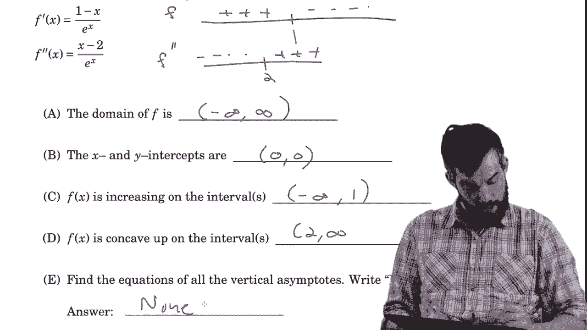

**步骤 2：建立成本函数 C(x)**
*   底面面积 = **4x**，成本 = **10 * 4x = 40x**
*   两个“宽×高”侧面面积 = **2 * (4y)**，成本 = **5 * 8y = 40y**
*   两个“长×高”侧面面积 = **2 * (xy)**，成本 = **5 * 2xy = 10xy**

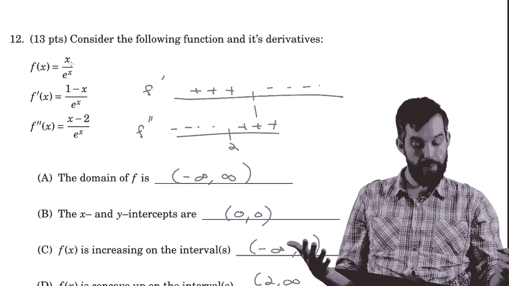

总成本（用 x 和 y 表示）：
**C(x, y) = 40x + 40y + 10xy**

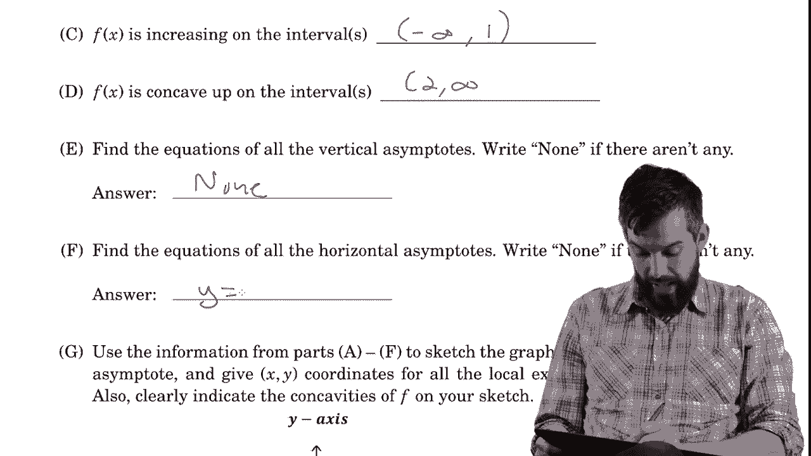

利用 **y = 9/x** 消去 y，得到单变量成本函数：
**C(x) = 40x + 40*(9/x) + 10x*(9/x) = 40x + 360/x + 90**

**步骤 3：求临界点**
求导：**C'(x) = 40 - 360/x²**
令 **C'(x) = 0**：**40 - 360/x² = 0** => **360/x² = 40** => **x² = 9** => **x = 3** (舍去负值)

**步骤 4：验证最小值**
使用一阶导数检验法：
*   当 **x < 3** (例如 x=2)，**C'(2) = 40 - 360/4 = 40 - 90 = -50 < 0**，函数递减。
*   当 **x > 3** (例如 x=4)，**C'(4) = 40 - 360/16 = 40 - 22.5 = 17.5 > 0**，函数递增。
导数符号由负变正，故 **x = 3** 是极小值点，也是最小值点（在定义域 x>0 内）。

因此，当底面长度 **x = 3 米** 时，总造价最低。

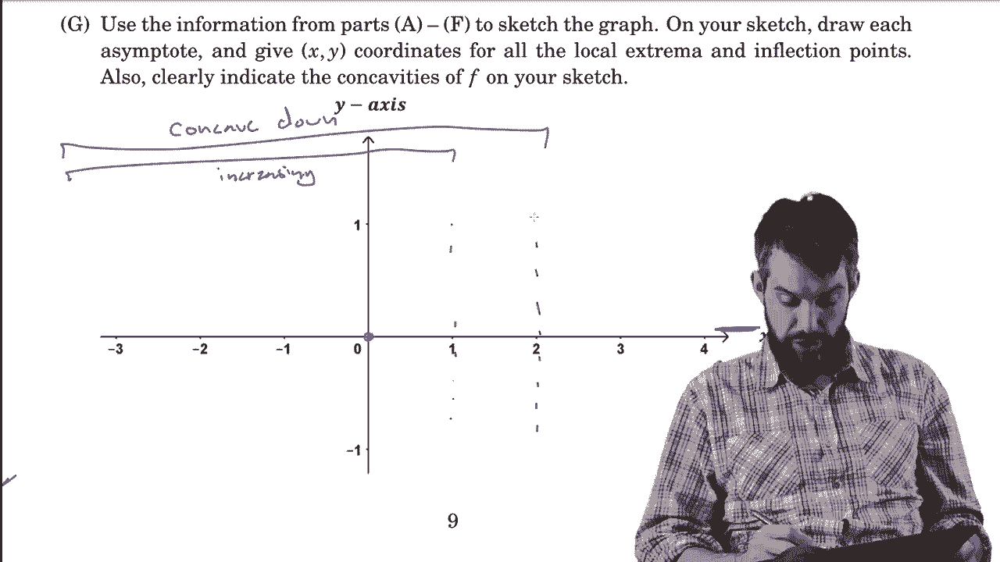

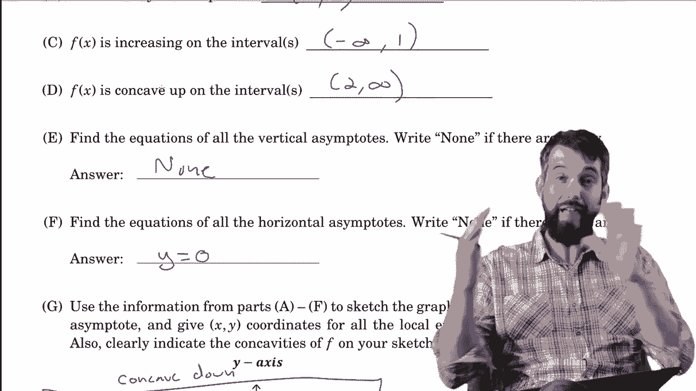

---

## 📝 问题十三：函数作图分析

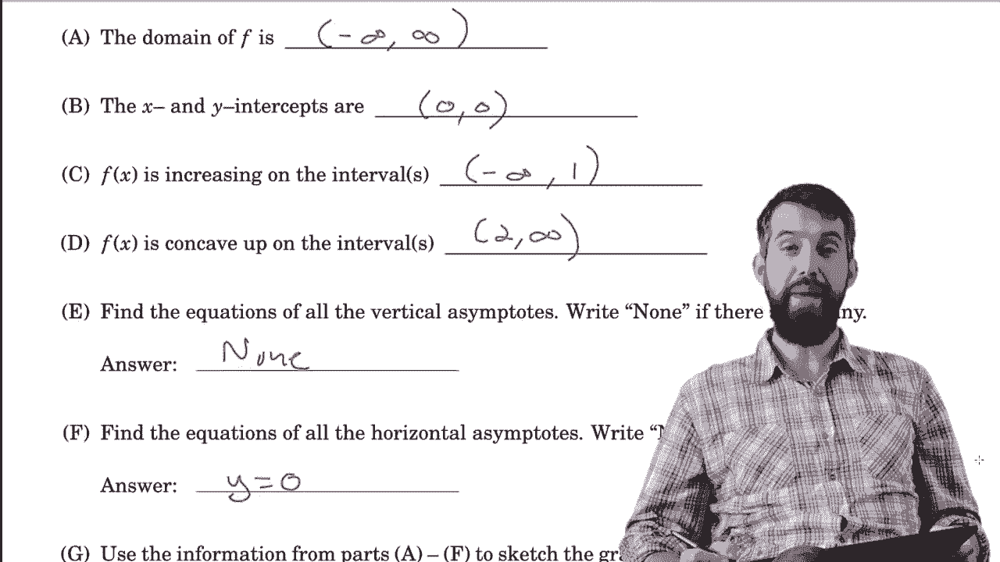

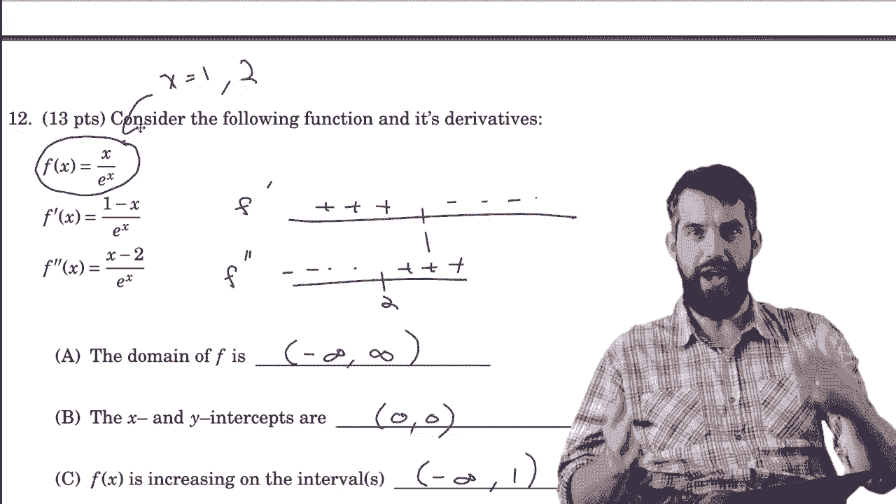

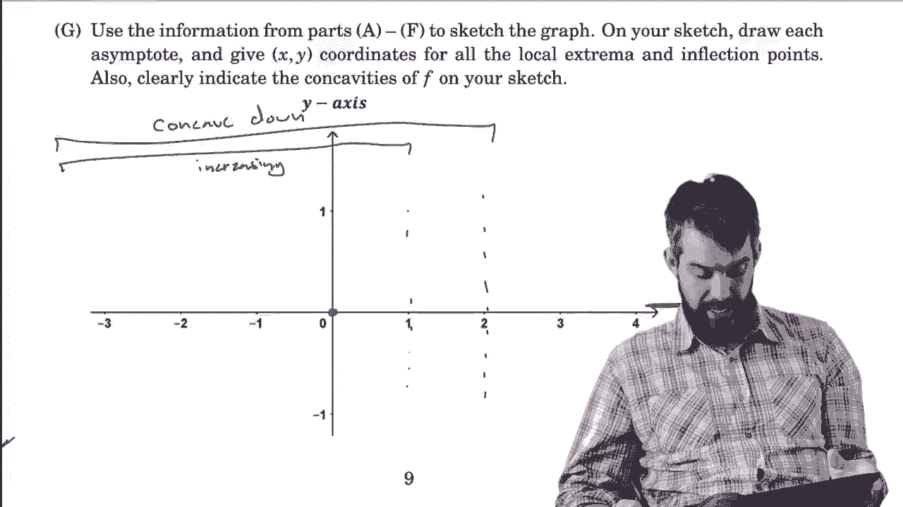

对函数 **f(x) = x / e^x** 进行分析并作图。

**1. 定义域**
分母 **e^x** 恒大于 0，故定义域为 **(-∞, +∞)**。

**2. 截距**
*   **y 截距**：令 x=0，**f(0)=0**。故为 **(0,0)**。
*   **x 截距**：令 f(x)=0，即 **x/e^x = 0**，解得 **x=0**。故也为 **(0,0)**。

**3. 渐近线**
*   **垂直渐近线**：分母永不为零，无垂直渐近线。
*   **水平渐近线**：
    *   当 **x → +∞**，**e^x** 增长远快于 **x**，故 **f(x) = x/e^x → 0**。有一条水平渐近线 **y=0**。
    *   当 **x → -∞**，**e^x → 0⁺**，**f(x) = x / (趋近于0的正数) → -∞**。故左侧无水平渐近线。

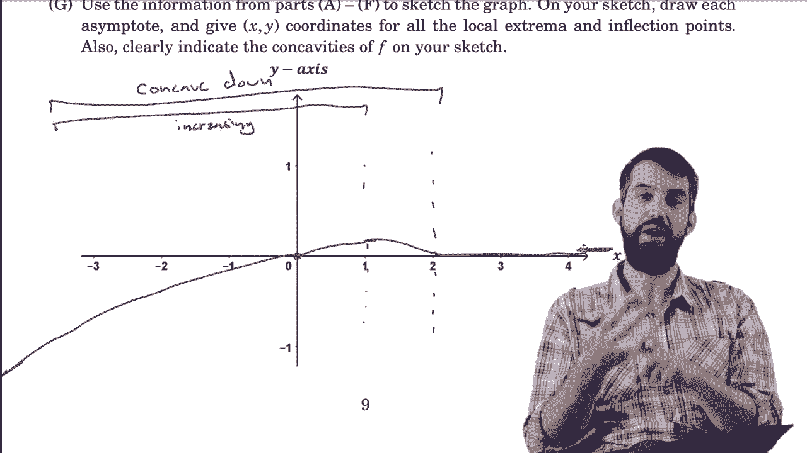

**4. 一阶导数与增减性**
**f'(x) = (1*e^x - x*e^x) / (e^x)² = e^x(1 - x) / e^{2x} = (1 - x)/e^x**
*   令 **f'(x) = 0**，得 **x = 1**。
*   **f'(x)