# 第二部分 10：L10 - 如何选择积分方法（第一部分） 🧮 📚

在本节课中，我们将学习如何为不同的积分问题选择合适的计算方法。面对一个积分时，最困难的部分往往不是执行具体的计算步骤，而是决定应该使用哪种已知的方法。对于可能结合了多种方法的复杂问题，或者方法隐藏在某种巧妙的代换之后的情况，这一点尤为突出。本视频将首先快速回顾一系列较为直接的积分，重点分析选择不同主要方法背后的思考过程。最后，我们将深入探讨一个更复杂的积分，它结合了多种方法，并尝试描述我在解决这类难题时的思考路径。

---

## 🔍 示例一：识别并应用换元法

首先，我们来看第一个积分。我首先注意到的是多项式项之间的关系：分子上有 `x²` 项，而分母上只有一个 `x`。这强烈暗示应该使用换元法。

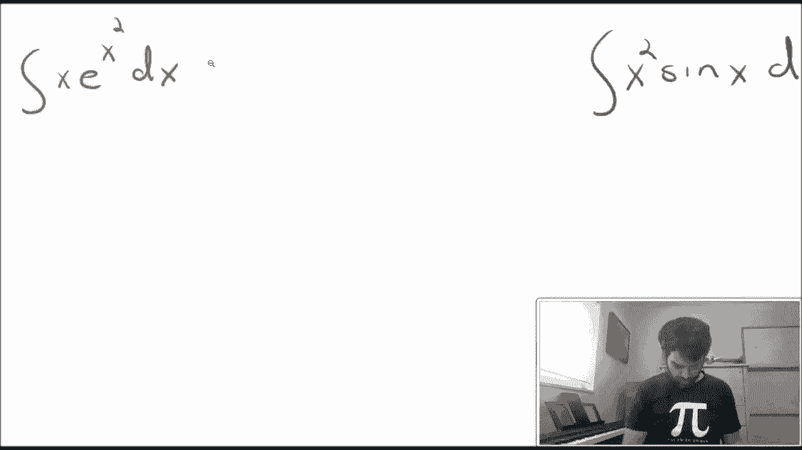

具体来说，我将设 `u` 为较大的多项式 `x²`。那么 `du = 2x dx`。这允许我将积分转化为 `∫ (1/2) * e^u du` 的形式。

一旦我选择了换元法并将其转化为 `∫ e^u du` 的形式，我就知道如何计算了，只需执行过程即可得到最终答案。

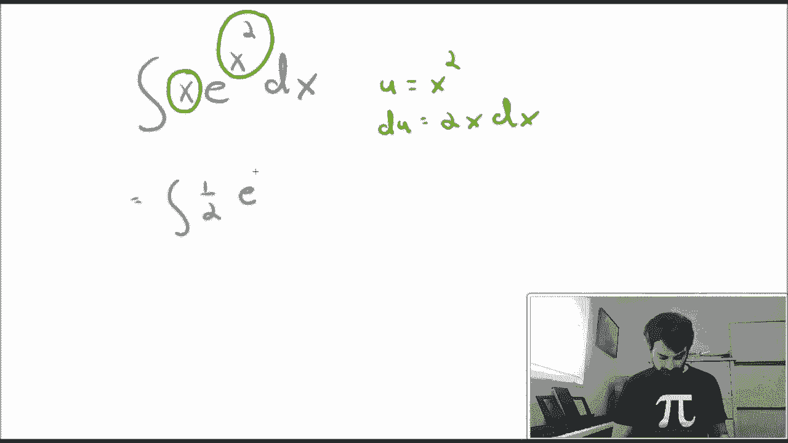

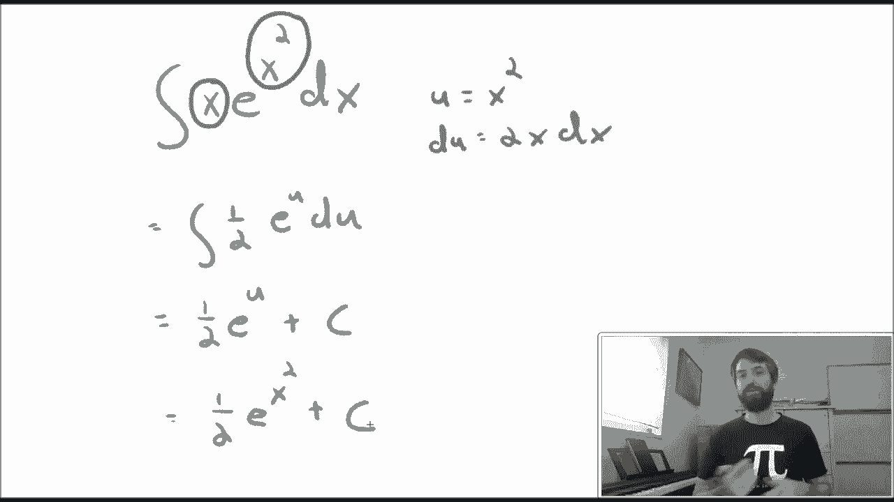
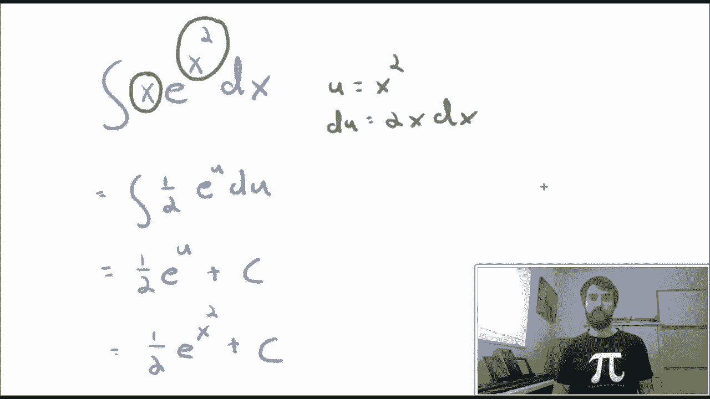

---

## 🔄 示例二：识别分部积分法

接下来，我们研究积分 `∫ x² sin(x) dx`。在这个积分中，我们有一个类似的关系：一个2次多项式和1次多项式。这里有 `x²` 和 `x`，但顺序是反的。此时换元法行不通，因为如果我尝试这样做，外面会有一个 `u`，里面会有 `sin(du)`，这没有意义。

相反，我可以考虑这是两个函数的乘积：一个多项式 `x²` 乘以一个三角函数 `sin(x)`。这对我来说，强烈暗示应该使用分部积分法。

具体来说，当我遇到这类多项式时，通常会将多项式设为 `u`，将 `sin(x) dx` 设为 `dv`。

我预见到分部积分法会将 `x²` 降次为 `2x`，将 `sin` 变为 `cos`，最终会得到一个包含 `x cos(x)` 的积分。这更好，因为 `x²` 降为了 `x`。但我预计实际上需要做两次分部积分：第一次将 `x²` 降为 `x`，第二次将 `x` 降为 `1`。

执行分部积分后，我得到了另一个 `x`，我将其设为新的 `u`；以及 `cos(x) dx`，我将其设为新的 `dv`。我可以再次执行，将 `x` 降为 `1`。

在许多方面，这里执行的细节不如认识到这是一个需要做两次分部积分的题目重要，因为多项式的次数是2。

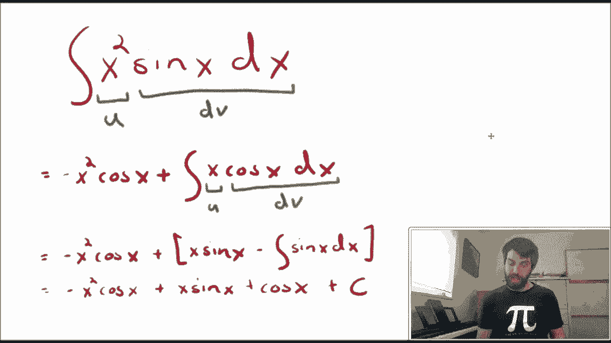

---

## 📐 示例三：处理三角函数的幂次乘积

在这个积分中，我有正弦和余弦的幂次乘积。当遇到 `sin^n(x) * cos^m(x)` 这种形式时，我们有一整套专门的方法来处理。

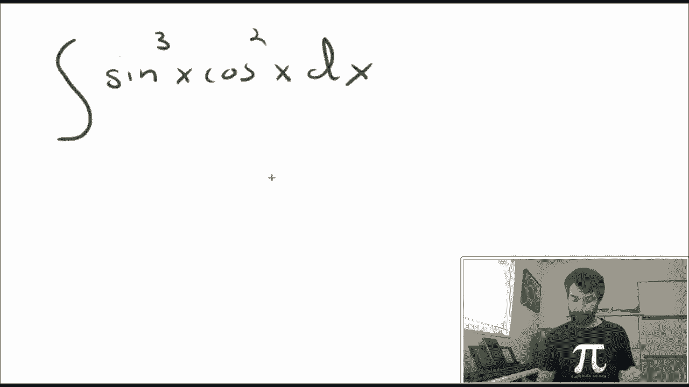

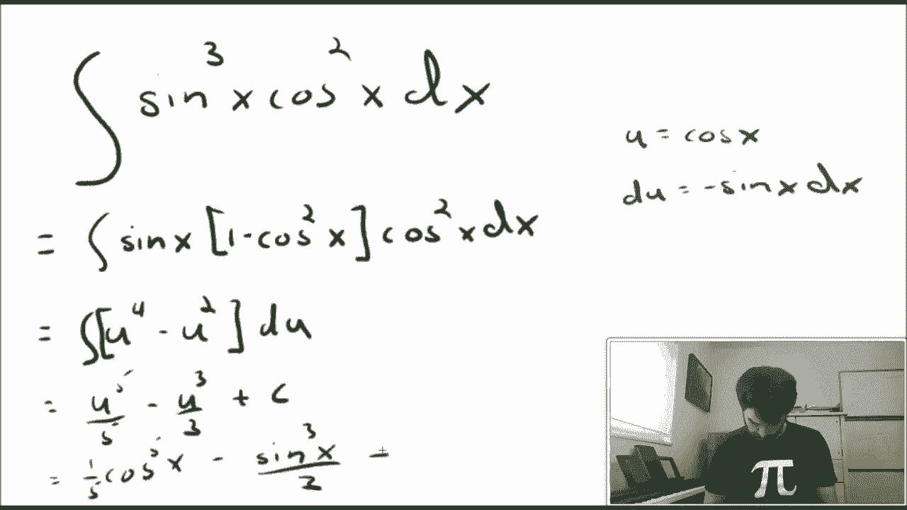

这里我使用了勾股定理恒等式 `sin²θ + cos²θ = 1`，将其转化为一堆余弦乘以一个正弦的形式。这样我就可以设 `cosθ = u`，而剩下的那个 `sinθ` 将代表 `-du`。

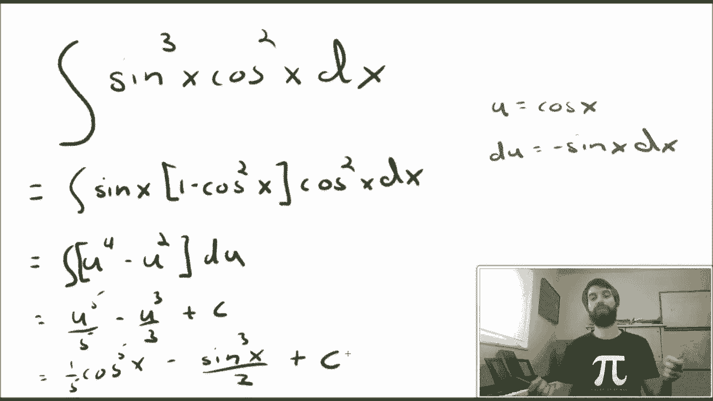

---

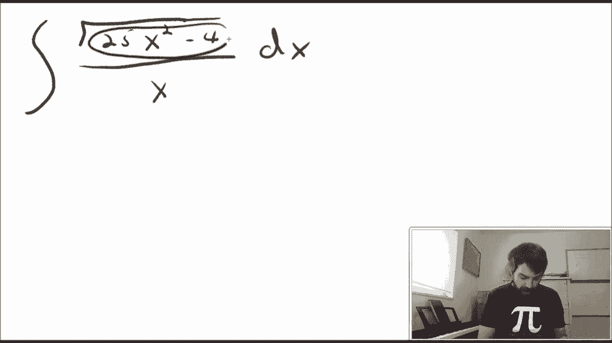

## 🧭 示例四：识别三角代换

下一类积分是我们应该真正开始识别其特定形式的。这里的关键在于，我有一个“某物的平方”减去一个常数，或者加上一个常数，或者常数减去“某物的平方”。有多种可能性。

关键部分是拥有像根号下分子中出现的这种表达式：`(某物)² - 常数`。这对我来说就像敲响了警钟，告诉我应该使用三角代换。

我的一个勾股定理恒等式是 `tan²θ + 1 = sec²θ`。因此，`sec²θ - 1 = tan²θ`。所以我认为在这种情况下，我或许可以操作我们已有的式子。我们并不完全是 `sec²θ - 1`，而是有一些其他奇怪的数字。但我希望 `25x²` 看起来像 `4 sec²θ`。这将使我所有的数字都能对上。

具体来说，我可以设 `5x = 2 secθ`，或者换句话说，`x = (2/5) secθ`。现在我有了一个应该可行的三角代换，剩下的就是执行它。

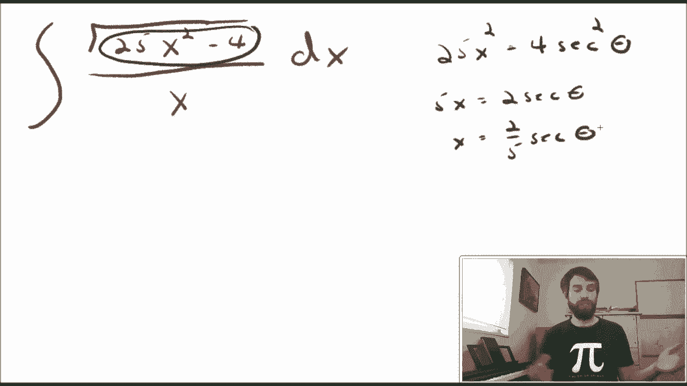

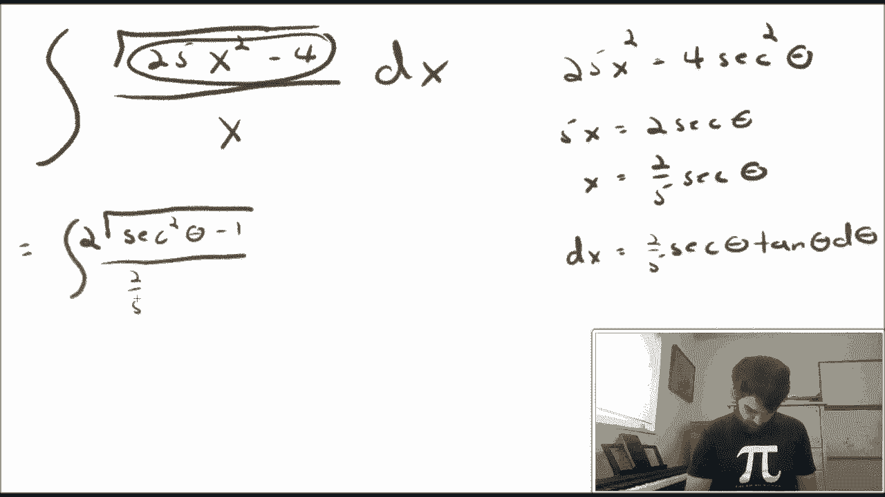

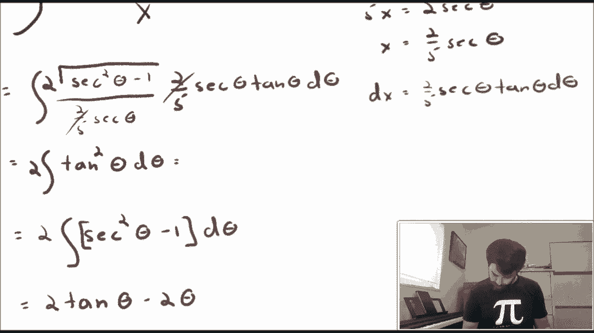
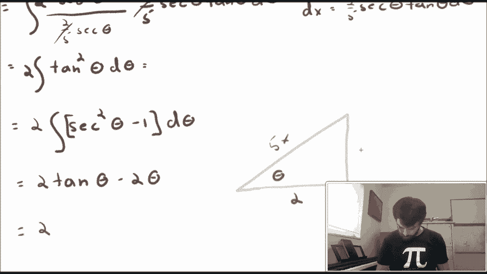

通常，执行一个三角代换问题确实需要一点时间。但一旦我们有了策略，并且在开始时有一个合理的技巧，剩下的就是执行到底，并知道所有的小技巧，比如如何使用三角形进行从 `θ` 回代到 `x` 的最终代换。

---

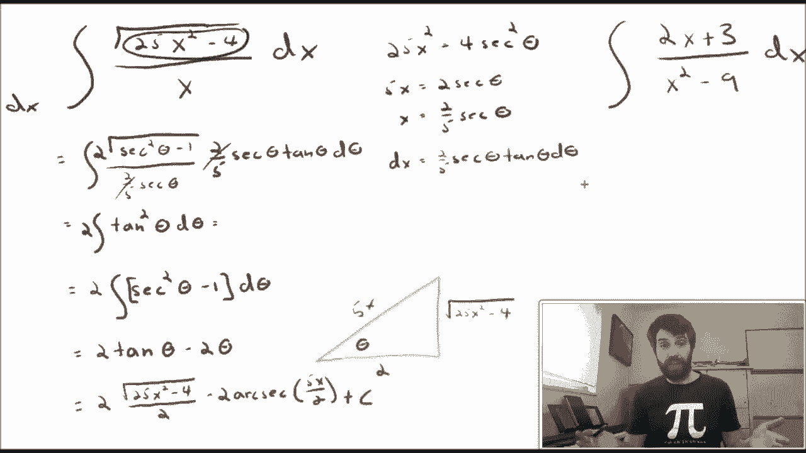

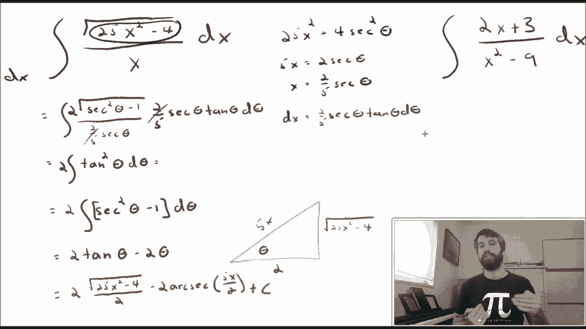

## ➗ 示例五：识别并应用部分分式法

在讨论难题之前，再看最后一个例子。在这个例子中，我想关注的关键点是这是一个多项式的商，换句话说，它是一个有理函数：分子是多项式，分母也是多项式。这应该是使用部分分式法的明显提示。

部分分式法的初始步骤是观察这里的分母，并尝试将其分解为一次式和不可约二次式的乘积。所以在这种情况下，我意识到 `x² - 9` 可以因式分解为 `(x-3)(x+3)`。

然后，部分分式法要求我们看看是否可以将原式写成 `A/(x-3) + B/(x+3)` 的形式。根据分母的具体情况，你可能会对右边有不同的猜测。但做完这一步后，就是通过一系列代数运算来确定常数 `A` 和 `B` 是什么，然后我们就可以进行积分了。

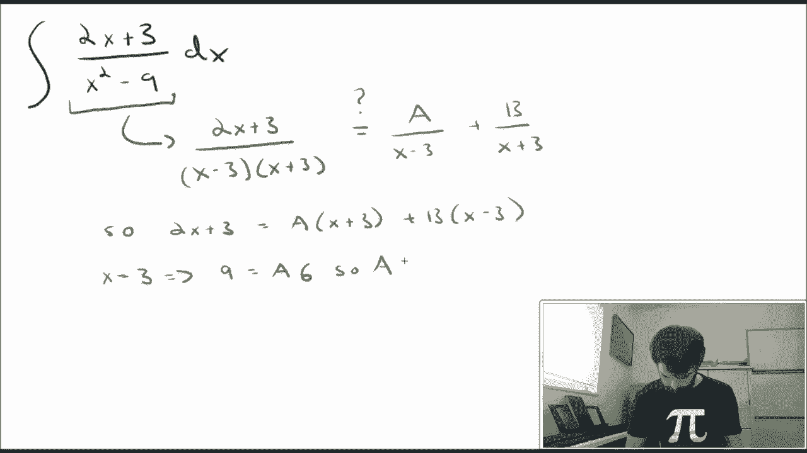
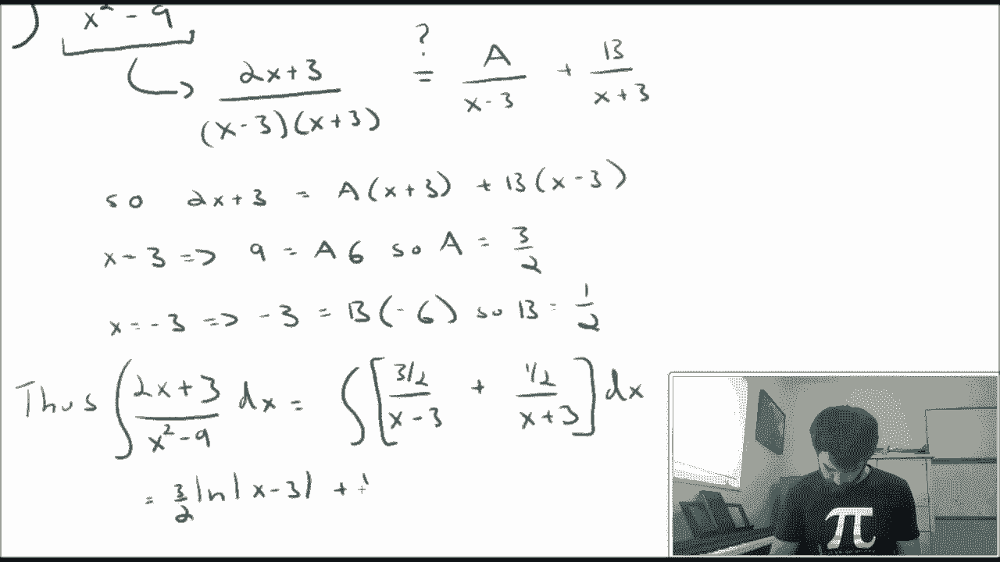

---

## 💡 核心要点与总结

更大的要点是，任何特定方法的细节并不那么重要。这里真正的技能是能够审视这些不同的积分，并为任何一个特定的积分挑选出最合适的方法。

我还应该指出，并非每种类型的积分只有一种方法。通常你可以用多种不同的方式得到正确答案。但关键是要有一些策略，一些关于你为什么要朝某个方向走的想法。

如果你没有明确的想法，那也没关系。完全可以进行一些尝试，巧妙地猜测和测试各种换元法，直到它开始看起来更像你熟悉的东西。有时我们解决积分更像是“跟着感觉走”，而不是从一开始就有一个连贯的计划。

本节课中，我们一起学习了五个较为直接的积分示例，分析了如何根据积分的形式特征（如多项式关系、乘积形式、三角函数幂次、平方差形式、有理函数）来选择合适的积分方法，包括换元法、分部积分法、三角恒等变换、三角代换和部分分式法。关键在于培养识别问题模式并选择相应策略的能力。

在下一个视频中，我将展示一个更复杂的例子，它使用了多种不同的方法，并详细讲解我如何决定在何时使用何种方法的思考过程。

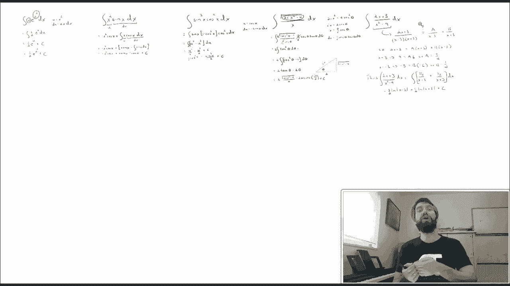

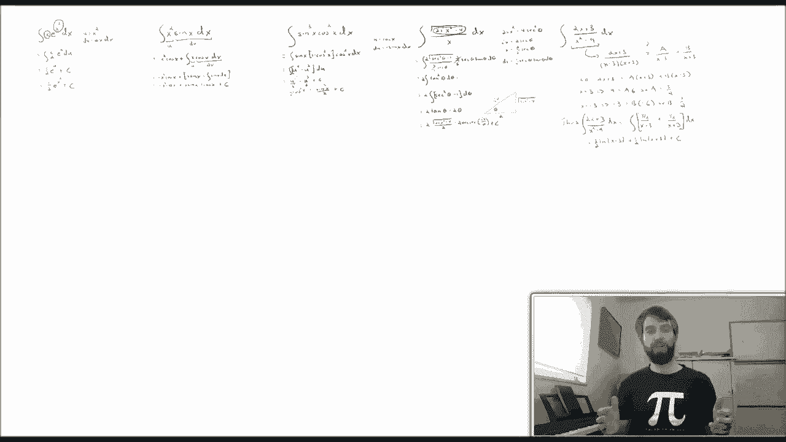

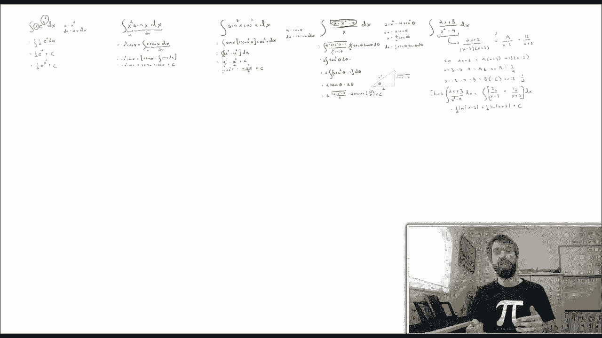

