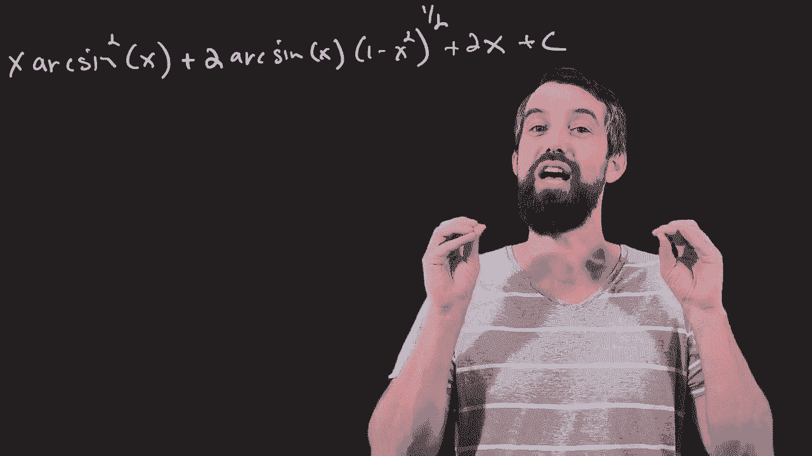
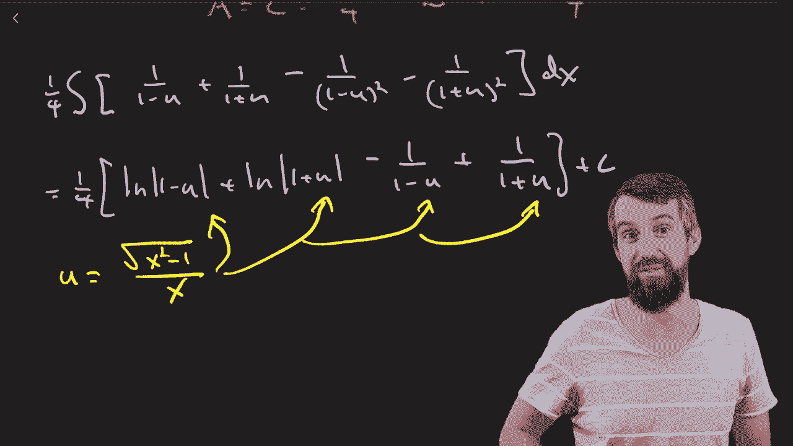

# 第二部分 12：L12 - 数学教授 vs. 刁钻积分 📚

在本节课中，我们将跟随一位数学教授，通过解决三个具有挑战性的积分问题来复习和巩固微积分技巧。我们将主要运用分部积分法、换元积分法、部分分式分解以及三角代换等方法。课程中还会介绍一个名为 Maple Calculator 的工具来辅助验证结果。

---

## 🧮 问题一：求解 ∫ arcsin²(x) dx

面对这个积分，没有明显的简化代换或三角恒等式可用。因此，我们考虑使用分部积分法。

分部积分法的公式是：
**∫ u dv = u * v - ∫ v du**

以下是具体步骤：

1.  设 **u = arcsin²(x)**，**dv = dx**。
2.  计算 du：**du = 2 * arcsin(x) / √(1 - x²) dx**。
3.  计算 v：**v = x**。
4.  代入公式得到：
    **∫ arcsin²(x) dx = x * arcsin²(x) - ∫ 2x * arcsin(x) / √(1 - x²) dx**

现在，我们需要处理这个新的积分。我们再次使用分部积分法。

1.  设 **u = arcsin(x)**，**dv = 2x / √(1 - x²) dx**。
2.  计算 du：**du = 1 / √(1 - x²) dx**。
3.  计算 v：通过观察，**v = -2√(1 - x²)**。
4.  代入分部积分公式，并化简，最终得到：
    **∫ arcsin²(x) dx = x * arcsin²(x) + 2√(1 - x²) * arcsin(x) - 2x + C**

我们可以使用 Maple Calculator 等工具来验证这个结果。虽然工具有助于检查和理解步骤，但亲手练习积分技巧对于培养数学直觉和解决问题的能力至关重要。

---

## 🔄 问题二：求解 ∫ dx / [(1 - tan²x)(1 + tan²x)]

这个积分包含三角函数的平方，直接处理比较困难。一个有效的策略是进行换元，将其转化为有理函数的积分。

我们进行以下换元：
**设 u = tan(x)，则 du = sec²(x) dx = (1 + u²) dx**

代入原积分并整理，得到：
**∫ du / [(1 - u²)(1 + u²)]**

现在，我们面对的是一个有理函数的积分。处理它的标准方法是部分分式分解。

以下是部分分式分解的步骤：

我们需要将积分式分解为更简单的分式之和：
**1 / [(1 - u²)(1 + u²)] = A/(1-u) + B/(1+u) + (Cu+D)/(1+u²)**

通过求解系数 A, B, C, D，我们得到：
**A = 1/4, B = 1/4, C = 0, D = -1/2**

因此，原积分等于：
**(1/4) ∫ [1/(1-u) + 1/(1+u)] du - (1/2) ∫ 1/(1+u²) du**

这些简单分式的积分是已知的：
*   ∫ 1/(1-u) du = -ln|1-u|
*   ∫ 1/(1+u) du = ln|1+u|
*   ∫ 1/(1+u²) du = arctan(u)

最后，将 **u = tan(x)** 代回，并利用 **arctan(tan(x)) = x**（在定义域内），得到最终结果：
**(1/4) ln| (1+tanx)/(1-tanx) | - x/2 + C**

---

## 📐 问题三：求解 ∫ dx / [√(x+1) + √(x-1)]

这个积分包含两个不同的根式，直接换元很麻烦。一个巧妙的代数是使用“有理化共轭”来简化分母。

我们在分子和分母同时乘以分母的共轭式 **√(x+1) - √(x-1)**：
**原式 = ∫ [√(x+1) - √(x-1)] / [(x+1) - (x-1)] dx = (1/2) ∫ [√(x+1) - √(x-1)] dx**

现在，积分被拆分为两个更简单的根式积分：
**(1/2) [ ∫ √(x+1) dx - ∫ √(x-1) dx ]**

这两个积分可以通过简单的幂函数积分公式解决：
*   ∫ √(x+1) dx = (2/3)(x+1)^(3/2)
*   ∫ √(x-1) dx = (2/3)(x-1)^(3/2)

因此，最终答案为：
**(1/3) [ (x+1)^(3/2) - (x-1)^(3/2) ] + C**

---

## 🎯 课程总结

本节课我们一起解决了三个看似复杂的积分问题。我们回顾并应用了多种核心微积分技巧：

1.  **分部积分法**：用于处理反三角函数乘积类积分。
2.  **换元积分法与部分分式分解**：将复杂的三角积分转化为有理函数积分，进而分解求解。
3.  **代数技巧（有理化）**：用于简化包含多个根式的积分表达式。

通过这些练习，我们不仅巩固了积分技能，也体会到将复杂问题分解、转化为已知形式的解题思路。同时，我们也了解到像 Maple Calculator 这样的工具可以作为强大的辅助，用于验证结果和理解解题步骤，但扎实的手算能力依然是数学理解的基石。希望本课程能帮助你更好地掌握积分技巧。