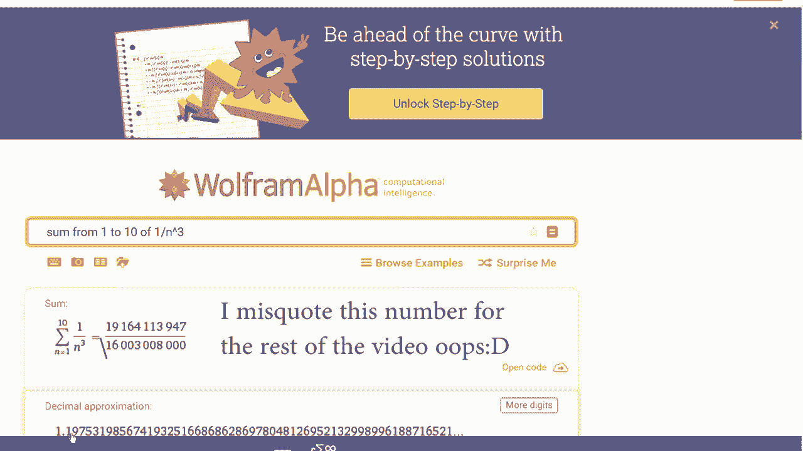

# 第二部分 24：利用积分测试估计级数近似的余项 📚

在本节课中，我们将学习如何估计一个收敛级数与其部分和之间的误差，即“余项”。我们将利用积分测试的原理，为余项的大小找到一个明确的上下界。这对于实际计算中判断近似值的精度至关重要。

## 1️⃣ 部分和与余项

上一节我们介绍了级数收敛的概念。本节中，我们来看看如何量化近似值与真实值之间的差距。

考虑一个级数 ∑ a_k。我们可以将其分解为两部分：前 n 项的和（称为第 n 个部分和 S_n），以及从第 n+1 项开始到无穷的所有项的和（称为余项 R_n）。

用公式表示如下：
```
S_n = a_1 + a_2 + ... + a_n
R_n = a_{n+1} + a_{n+2} + a_{n+3} + ...
```
因此，整个级数的和 S 可以表示为：
```
S = S_n + R_n
```
当我们用 S_n 来近似 S 时，R_n 就是误差项。我们的目标是估计 R_n 的大小。

## 2️⃣ 利用积分进行估计

为了估计余项，我们需要将级数与一个积分联系起来。这与积分测试的思路一脉相承。

假设我们有一个函数 f(x)，它满足：
*   f(x) 在 [n, ∞) 上连续。
*   f(x) 是正的。
*   f(x) 是递减的。
并且我们的级数项 a_k = f(k)。

以下是利用积分对余项进行上下界估计的步骤：

首先，我们考虑从 n 到无穷的积分。通过绘制以右端点为高的矩形，我们发现所有矩形的面积之和（即余项 R_n）小于从 n 到无穷的积分面积。

其次，我们考虑从 n+1 到无穷的积分。通过绘制以左端点为高的矩形，我们发现所有矩形的面积之和（即余项 R_n）大于从 n+1 到无穷的积分面积。

因此，我们得到了余项 R_n 的上下界：
```
∫_{n+1}^{∞} f(x) dx < R_n < ∫_{n}^{∞} f(x) dx
```
这个不等式告诉我们，虽然我们不知道 R_n 的确切值，但我们可以通过计算两个简单的（有时是更容易的）积分来限定它的范围。

## 3️⃣ 应用示例：估计 ∑ 1/n³

现在，让我们通过一个具体例子来应用这个方法。考虑级数 ∑_{n=1}^{∞} 1/n³。

我们知道这是一个 p=3>1 的 p-级数，因此它是收敛的。但我们不知道它收敛到哪个具体数值。假设我们计算了前 10 项的部分和 S_10 作为近似值。


首先，我们计算 S_10：
```
S_10 = ∑_{n=1}^{10} 1/n³ ≈ 1.1975
```
接下来，我们估计余项 R_10。根据我们的方法，需要计算两个积分。这里 f(x) = 1/x³。

计算上界积分：
```
∫_{10}^{∞} 1/x³ dx = lim_{t→∞} ∫_{10}^{t} x^{-3} dx
                  = lim_{t→∞} [ -1/(2x²) ]_{10}^{t}
                  = lim_{t→∞} ( -1/(2t²) + 1/(2*10²) )
                  = 0 + 1/200 = 0.005
```
因此，R_10 < 0.005。

计算下界积分：
```
∫_{11}^{∞} 1/x³ dx = 1/(2*11²) = 1/242 ≈ 0.00413
```
因此，0.00413 < R_10 < 0.005。




## 4️⃣ 结论与精度控制

综合以上信息，我们对级数的总和 S 有如下估计：
```
S ≈ S_10 + (某个介于 0.00413 和 0.005 之间的值)
```
更精确地说：
```
1.1975 + 0.00413 < S < 1.1975 + 0.005
1.2016 < S < 1.2025
```
所以，通过计算 S_10，我们知道了级数和 S 大约在 1.202 左右，并且误差不超过 0.005。

这个精度是否足够，取决于具体的应用场景。如果我们需要更高的精度，可以计算更多的项。例如，计算 S_100，其对应的余项 R_100 将远小于 R_10，从而得到更精确的估计。通过这种方法，我们可以根据需求，将误差控制在任意小的范围内。

## 🎯 本节课总结

在本节课中，我们一起学习了如何利用积分测试来估计一个正项递减级数的余项大小。我们了解到：
1.  级数的和可以分解为部分和与余项。
2.  通过将余项与两个积分进行比较，我们可以得到它的上下界。
3.  这种方法为我们提供了一个量化近似误差的工具，使我们能够判断计算的精度是否满足要求，并通过增加计算项数来进一步提高精度。