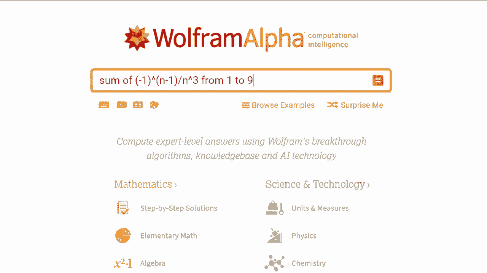
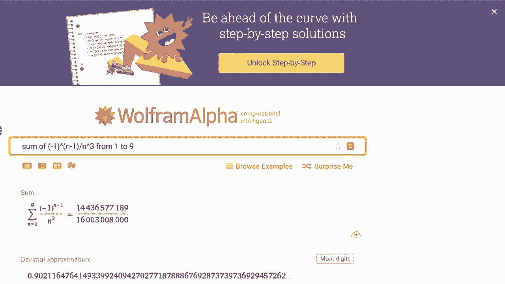
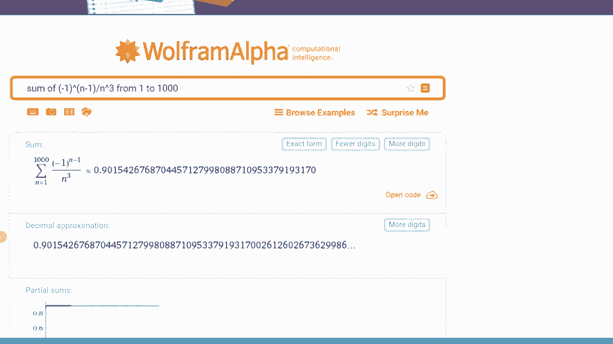

# 第二部分 28：交错级数余项估计 📚

在本节课中，我们将学习如何估计交错级数的余项，即当我们用部分和来近似级数的总和时，误差有多大。我们将学习一个简单而强大的定理，它可以帮助我们控制这个误差，并确保我们的近似值达到所需的精度。

---

## 🔍 交错级数的行为回顾

上一节我们介绍了交错级数的概念，本节中我们来看看如何估计其近似误差。

假设有一个交错级数，其形式如下：

\[
\sum_{i=1}^{\infty} (-1)^{i-1} b_i
\]

其中，序列 \( b_i \) 是正的、递减的，并且极限为 0。

在关于交错级数的第一个视频中，我们看到部分和 \( S_n \) 在数轴上的行为是来回摆动的。\( S_1 \) 会向外走，\( S_2 \) 会向回走，\( S_3 \) 再向外，\( S_4 \) 再向回，如此反复。最终，级数的实际和会收敛，并位于这种交替行为的中间区域。

---

## ❓ 如何估计近似误差？

现在，假设我们想用前七项部分和 \( S_7 \) 来近似这个级数的总和。我们可以将总和写为：

\[
S = S_7 + R_7
\]

其中 \( R_7 \) 是余项，即误差。问题是，这个误差有多大？我们如何控制仅取前七项进行估计的“糟糕”程度？

为了思考余项可能是什么，我们从 \( S_7 \) 出发。想象一下，我们想从 \( S_7 \) 走到 \( S_8 \)。走到 \( S_8 \) 之后，我们会回到 \( S_9 \)，然后再走到 \( S_{10} \)，依此类推。

基于这种收敛方式，从 \( S_7 \) 出发，在整个级数剩余部分中，我们能到达的最远距离就是 \( S_8 \)。因为在那之后，我们会越来越接近真实和。这就是交错级数的工作原理。

因此，无论余项是多少，我们都可以肯定地说，\( R_7 \) 将小于 \( S_8 \) 和 \( S_7 \) 之间的距离，即相邻两项之间的差。而 \( S_8 \) 和 \( S_7 \) 的差正是第 8 项 \( b_8 \)。

换句话说，当我取 7 项时，我的余项 \( R_7 \) 以第 8 项 \( b_8 \) 为界。一般来说，如果我把这里的 7 换成 \( n \)，我可以断言，取 \( n \) 项时的余项 \( R_n \) 将以第 \( n+1 \) 项 \( b_{n+1} \) 为界。

---

## 📝 核心定理：交错级数估计定理

以下是交错级数估计的核心结论：

对于一个满足 \( b_i > 0 \)，\( b_i \) 递减，且 \( \lim_{i \to \infty} b_i = 0 \) 的交错级数 \( \sum (-1)^{i-1} b_i \)，当用前 \( n \) 项部分和 \( S_n \) 近似其和 \( S \) 时，余项 \( R_n \) 满足：

\[
|R_n| = |S - S_n| \le b_{n+1}
\]

这意味着，误差的绝对值不会超过被你忽略的第一项（即第 \( n+1 \) 项）的大小。

---

## 🔧 应用实例：确定所需项数

让我们通过一个具体例子来看看这是如何运作的。

考虑级数：
\[
\sum_{n=1}^{\infty} \frac{(-1)^{n-1}}{n^3}
\]

假设我的应用要求精度达到 0.001。我如何确保有足够的项来达到这个精度？

根据我们的定理，如果我想估计 \( R_n \)，我可以将其界定为第 \( n+1 \) 项。我希望这个第 \( n+1 \) 项小于 0.001。

\[
\frac{1}{(n+1)^3} < 0.001
\]

解这个不等式：

1.  \( 0.001 = \frac{1}{1000} \)，所以不等式变为 \( \frac{1}{(n+1)^3} < \frac{1}{1000} \)。
2.  两边取倒数（注意不等号方向）：\( (n+1)^3 > 1000 \)。
3.  两边开立方根：\( n+1 > 10 \)。
4.  因此，\( n > 9 \)。

这告诉我，只要我取 \( n \) 大于或等于 9，那么我用第 9 个部分和 \( S_9 \) 所做的近似，其精度将在 0.001 以内。

---

## 💡 实际意义与计算验证

需要指出的最后一点是，在你未来的职业生涯中，无论是工程应用还是其他领域，都会存在来自该学科本身的不确定性。这里的理念是，对于微积分而言，无论不确定性是什么都没关系。只要你带着“需要达到某种确定度”的要求进来，你就可以用这个方法来计算出需要多少项才能达到那个期望的确定度。

让我们回到计算上来验证一下。我们计算这个特定级数从 \( n=1 \) 到 \( n=9 \) 的部分和，因为我们知道 9 项就能满足精度要求。

计算 \( S_9 \)：
\[
S_9 = \sum_{n=1}^{9} \frac{(-1)^{n-1}}{n^3} \approx 0.902
\]

我们保证这个值在真实答案的 0.001 范围内。为了好玩，我们计算前 100 项的部分和：
\[
S_{100} \approx 0.9015
\]

是的，这与我们之前看到的 0.902 不完全相同，但确实在 0.001 的误差范围内。我们可以继续添加更多项以获得更精确的结果，但对于这个特定的精度水平，我们不需要超过 9 项。

---

## 📊 总结

本节课中我们一起学习了如何估计交错级数的余项。我们了解到，对于一个正项递减且趋于零的交错级数，用前 \( n \) 项部分和近似其和时，误差不会超过被忽略的第一项（第 \( n+1 \) 项）的绝对值。我们通过一个具体例子演示了如何利用这个性质，根据所需的精度来确定需要计算多少项。这是一个强大而实用的工具，可以确保我们在近似计算时对误差有明确的控制。