# 第二部分 38：参数曲线绘图 📈

在本节课中，我们将学习参数曲线。参数曲线可以绘制出各种有趣且美丽的图形，例如一种被称为**外摆线**的曲线。我们将通过简单的例子理解参数曲线的概念，并使用在线工具 Desmos 进行可视化探索。

## 🔄 什么是参数曲线？

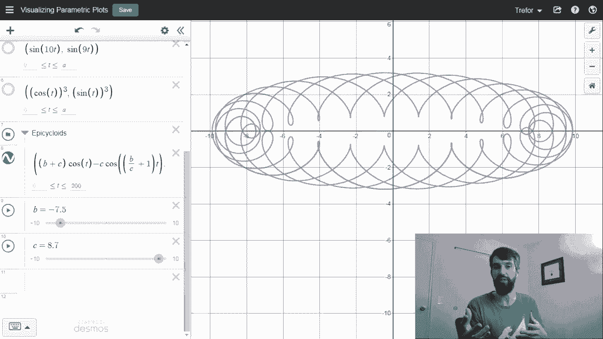

上一节我们提到了参数曲线能绘制出有趣的图形。本节中，我们来看看参数曲线与传统函数的区别。

在传统函数中，通常有一个自变量 **x** 和一个因变量 **y**，它们的关系由公式 **y = f(x)** 定义。**x** 是独立变化的量，**y** 则根据公式随之变化。

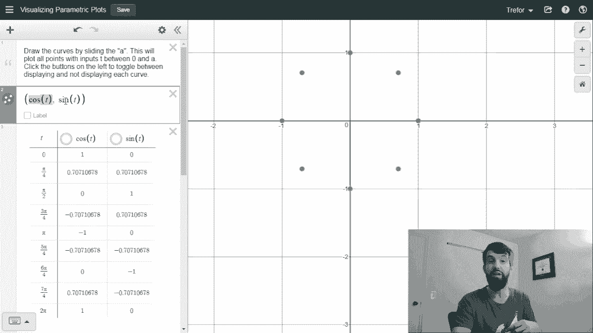

对于参数曲线，**x** 和 **y** 都是某个第三变量（通常称为参数 **t**）的函数。其关系可以表示为：
```
x = f(t)
y = g(t)
```

## 🎯 一个简单的例子：圆

为了说明参数曲线的工作原理，让我们从一个简单的例子开始。我们使用一个名为 Desmos 的网站进行绘图。

以下是一个简单的参数绘图，其中 **x** 坐标由 **cos(t)** 给出，**y** 坐标由 **sin(t)** 给出。

我们可以创建一个数值表，其中 **t** 取标准值，如 0、π/4、π/2 等。绘制点 **(cos(t), sin(t))** 会发现它们看起来像一个圆。

通过绘制一系列点可以帮助我们理解图形，但我们也可以绘制整个曲线，而不仅仅是列表中的点。当我们取消对点的限制后，就得到了一个完整的圆。

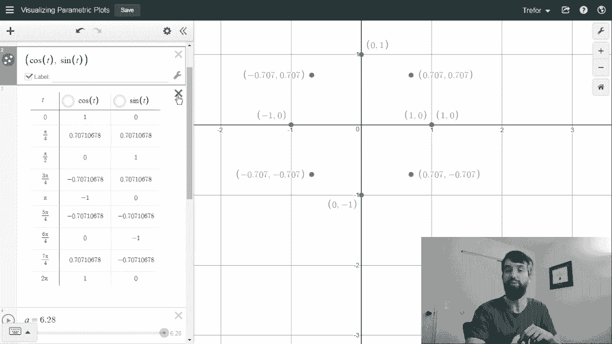

因此，参数曲线 **x = cos(t), y = sin(t)** 绘制出了一个圆。

在 Desmos 中，我们可以看到一个滑块，控制 **t** 的取值范围（例如从 0 到 2π）。拖动滑块减小最大值，可以看到绘制的曲线部分变少。这种动态方式有助于理解参数绘图：从 **t=0** 开始，逐渐增加包含的点数，从而描摹出特定的曲线轨迹。

## 🎨 探索更复杂的曲线

理解了基本概念后，本节我们来看看一些更有趣的参数曲线。

我们可以尝试不同的函数组合。以下是几个例子：

*   **曲线一：x = cos(t), y = sin(2t)**
    这条曲线会绘制出一个类似蝴蝶结的图形。

*   **曲线二：x = cos(10t), y = sin(9t)**
    这里系数较大，在 **t** 从 0 到 2π 的过程中，实际上经历了更多周期，因此曲线会密集地缠绕，形成复杂而美丽的图案。慢慢拖动滑块观察其绘制过程非常有趣。

*   **曲线三：x = cos³(t), y = sin³(t)**
    这条曲线会产生带有尖点的图形。在未来的课程中，当我们对参数曲线进行微积分运算（例如求切线方程、弧长或面积）时，这类尖点可能会在求导时带来问题。

## 🌟 一类特殊的曲线：外摆线

最后，我们介绍一整类曲线，称为**外摆线**。

外摆线的定义中包含多个参数（例如 **B** 和 **C**）。参数 **t** 通常在 0 到某个值（例如 200）之间变化，但图形的形状会随着 **B** 和 **C** 的不同而显著变化。

通过滑动调整 **B** 和 **C** 的滑块，我们可以观察到各种各样、时而简单时而复杂的行为，这些图形通常非常有趣且美观。

## 📝 总结

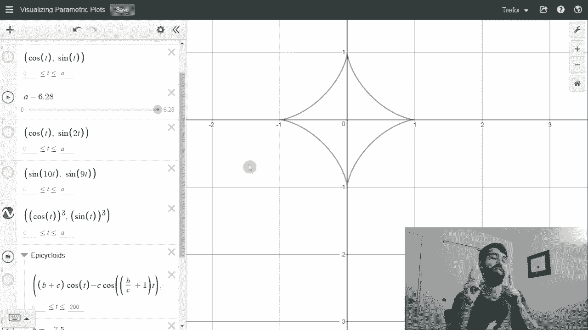

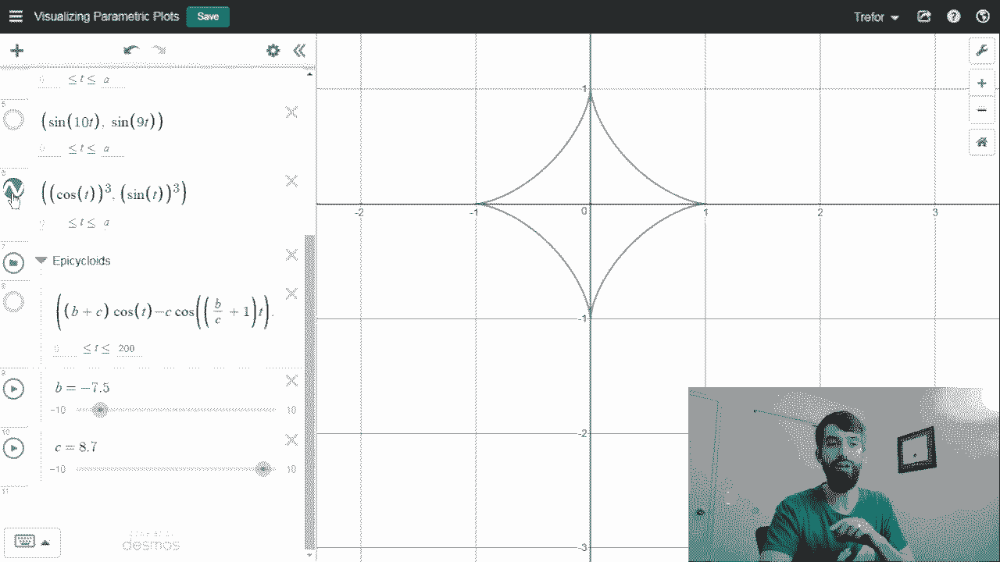

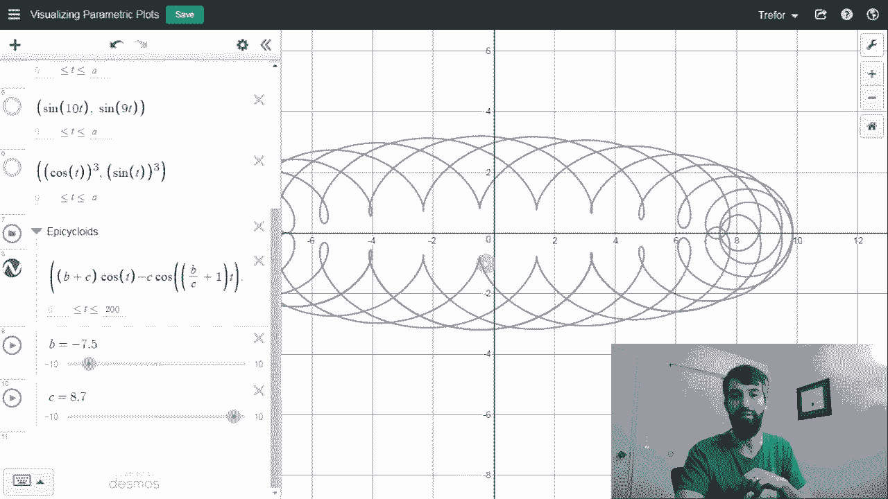

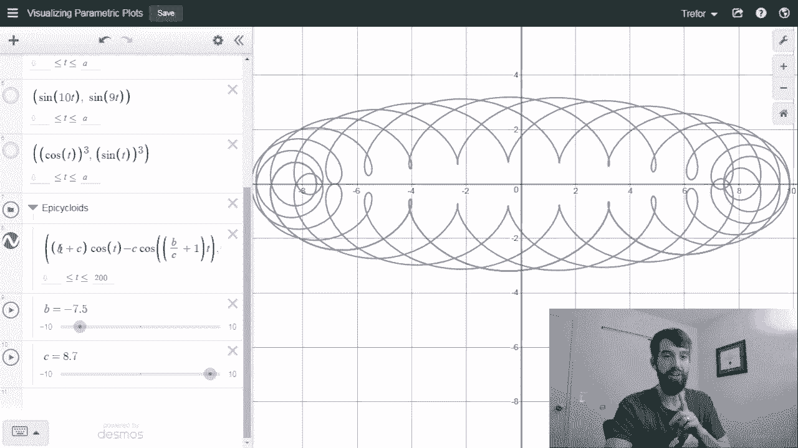

本节课中，我们一起学习了参数曲线的基本概念。我们了解到参数曲线通过 **x = f(t), y = g(t)** 的形式，用参数 **t** 同时控制 x 和 y 坐标，从而能够绘制出传统函数难以表达的复杂图形。

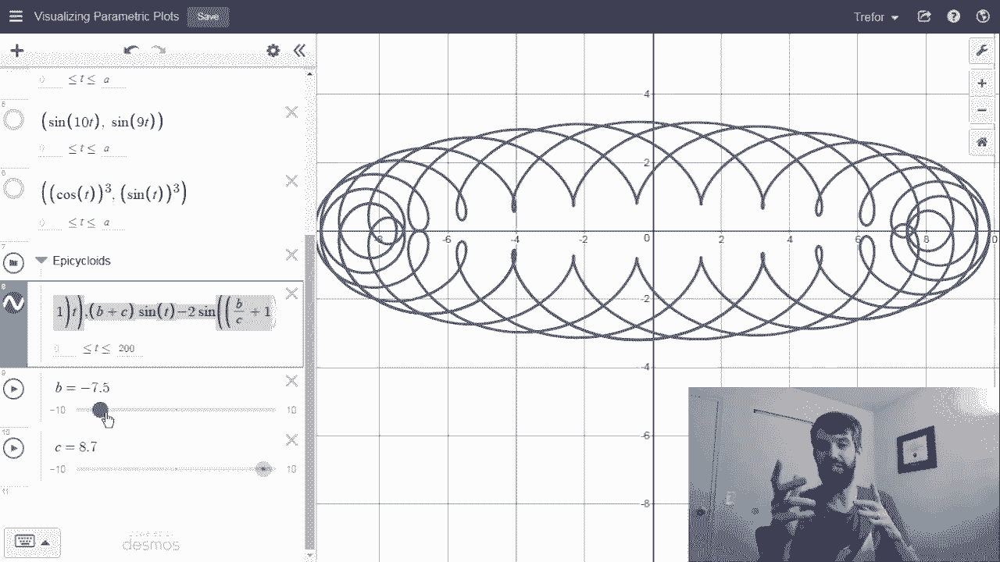

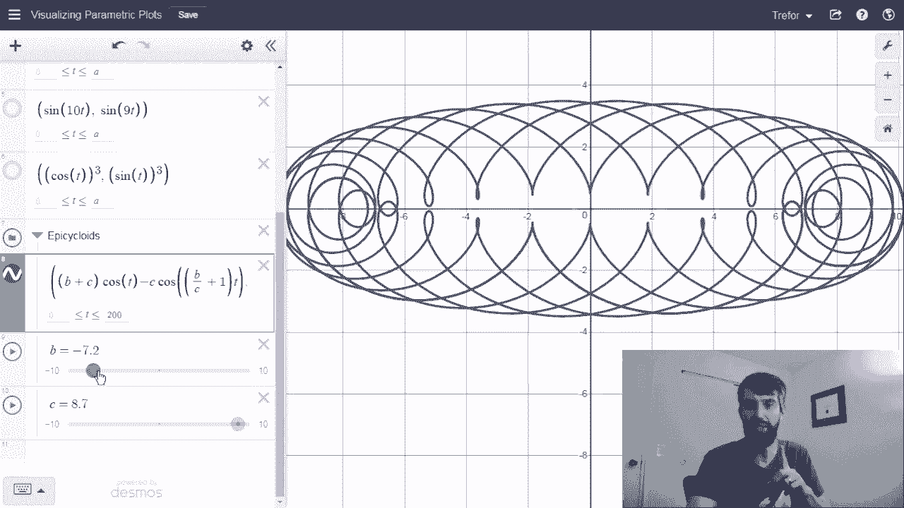

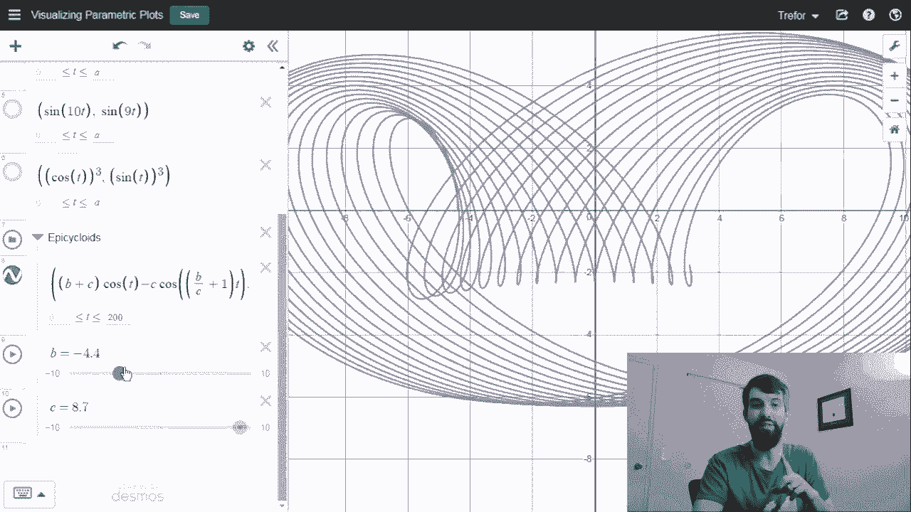

我们从简单的圆开始，逐步探索了更复杂的例子，并最终接触了外摆线这类有趣的曲线族。建议大家使用 Desmos 等工具亲自尝试，调整参数，观察图形的变化。

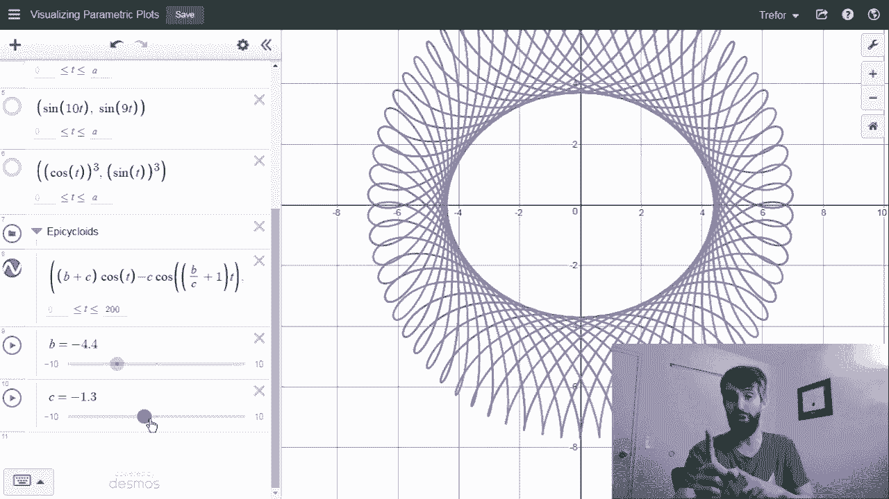

在未来的视频中，我们将讨论如何对这些参数曲线进行微积分运算。