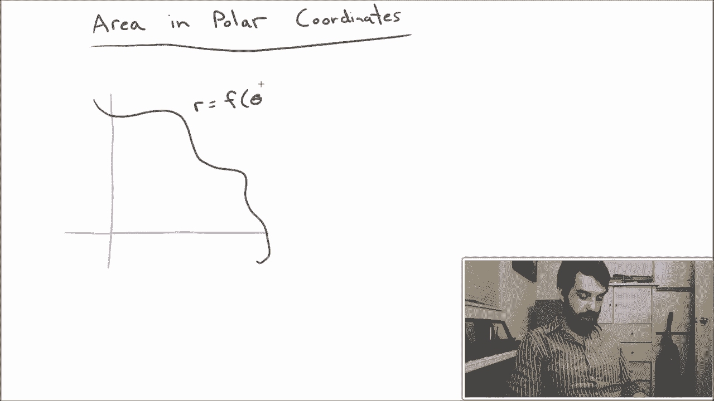
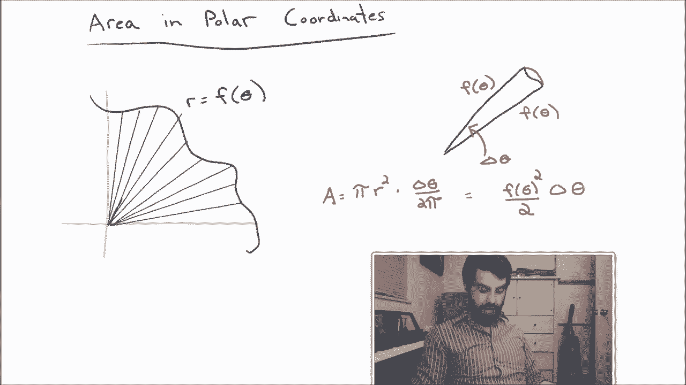
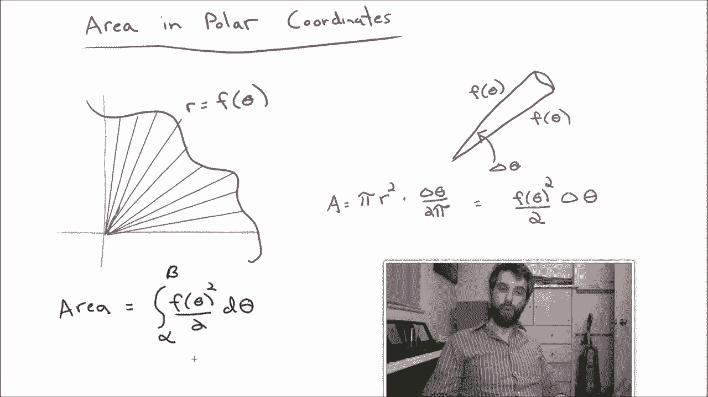

# 第二部分 44：极坐标下的面积计算 📐

在本节课中，我们将学习如何在极坐标系中计算由曲线围成的区域面积。我们将从回顾直角坐标系下的面积概念出发，逐步推导出适用于极坐标的面积积分公式。

---

## 📖 概述：从直角坐标到极坐标

确定区域的面积是微积分背后的主要动机之一。我们曾将定积分定义为某个正函数在区间 `[A, B]` 上曲线下的面积。

现在，当我们用极坐标来描述曲线，而不是用直角坐标系下的函数图像时，我们希望重复类似的过程，为这类区域的面积建立一个积分公式。

---

## 🧩 核心思路：从矩形到“披萨切片”

在直角坐标系中，我们通过累加许多小矩形的面积来进行积分。当矩形的数量趋于无穷且宽度趋于零时，这个极限就定义了积分。

但在极坐标系中，我们希望利用其不同的对称性。具体来说，我们希望将面积表示为一系列“三角形”（更准确地说是扇形切片）的和。

假设我们有一条由极坐标方程 `r = f(θ)` 描述的曲线。我们可以想象从原点出发画出许多“辐条”，每条辐条在角度 `θ` 处的长度为 `f(θ)`。这些辐条将区域分割成许多近似三角形的部分。

---

## 🔍 推导面积公式

上一节我们介绍了将极坐标区域视为“披萨切片”的核心思路。本节中，我们来具体看看如何计算一个切片的面积，并由此推导出积分公式。

让我们放大观察其中一个特定的切片。它看起来像一个三角形，但外侧边缘实际上是曲线，并非完全平直。我们做以下标记和近似：

*   **角度变化**：这个切片的内角非常小，我们记作 `Δθ`。这类似于直角坐标中矩形的宽度 `Δx`。
*   **辐条长度**：两条辐条的长度都近似为 `f(θ)`（假设 `Δθ` 非常小）。
*   **外侧边缘**：我们将曲线外侧的一小段近似看作一个圆弧。

现在，我们想计算这个切片的面积。我们可以将其视为一个半径为 `f(θ)` 的完整圆的一小部分。

一个完整圆的面积是 `π * r²`。我们的切片只占整个圆角度 `2π` 中的 `Δθ` 部分。因此，这个“披萨切片”的面积近似为：

`切片面积 ≈ (Δθ / 2π) * π * [f(θ)]² = (1/2) * [f(θ)]² * Δθ`

---

## ∫ 从求和到积分

上一节我们得到了单个切片的近似面积公式。为了得到整个区域的面积，我们需要将所有这样的切片面积加起来。

整个区域的面积 `A`，可以看作是所有这些不同的小披萨切片面积的总和。当 `Δθ` 无限变小（趋于 `dθ`）时，这个求和过程就变成了积分。

因此，我们得到极坐标下曲线 `r = f(θ)` 所围区域面积的积分公式：

`A = ∫_[α]^[β] (1/2) * [f(θ)]² dθ`

其中，`θ` 的取值范围是从 `α` 到 `β`，这定义了我们的区域。

---

## 📝 总结

本节课中，我们一起学习了如何在极坐标系中计算面积。我们首先回顾了直角坐标下的积分思想，然后利用极坐标的对称性，将区域视为许多“披萨切片”的组合。通过计算单个切片的近似面积并求和取极限，我们最终推导出了极坐标下的面积积分公式：

`A = (1/2) ∫_[α]^[β] r² dθ`，其中 `r = f(θ)`

这个公式是计算极坐标图形面积的基础工具。