# 第二部分 45：极坐标曲线内面积计算示例 📐

在本节课中，我们将学习如何计算一条特定极坐标曲线所围成的面积。我们将以曲线 **r = cos(2θ)** 为例，从绘制曲线草图开始，逐步推导出计算面积的公式，并最终计算出结果。

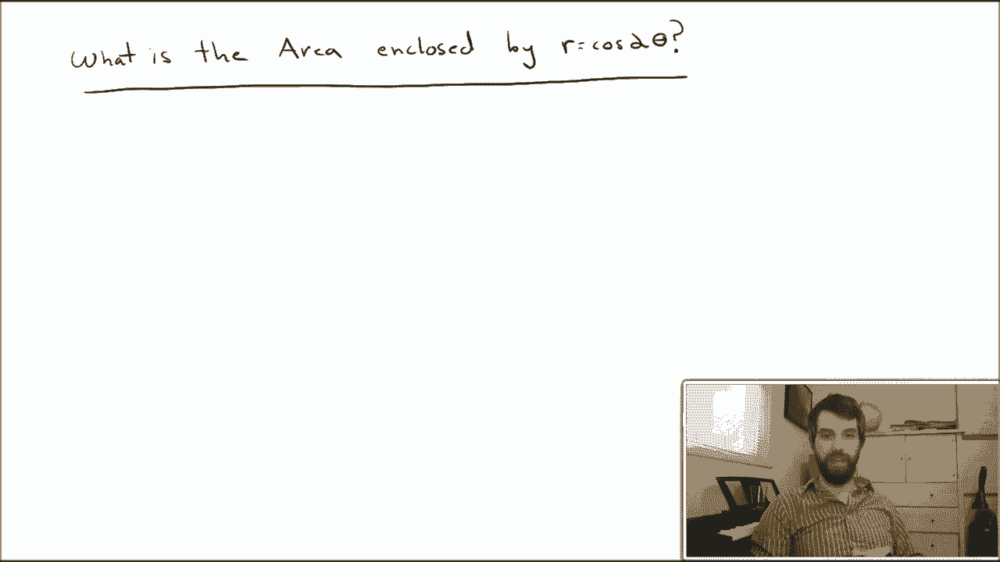

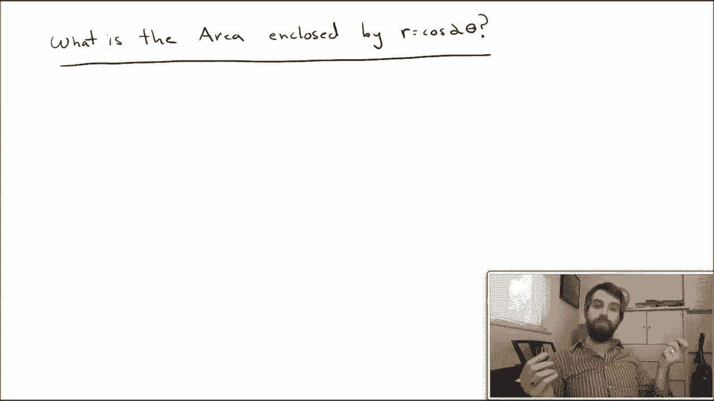

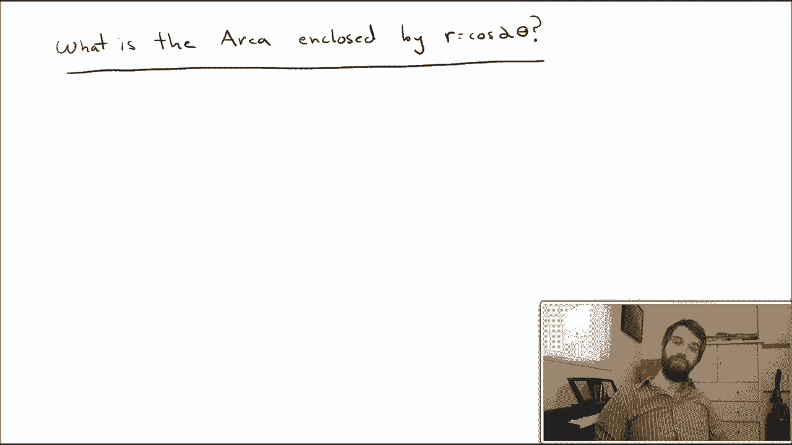

---

## 第一步：绘制极坐标曲线草图

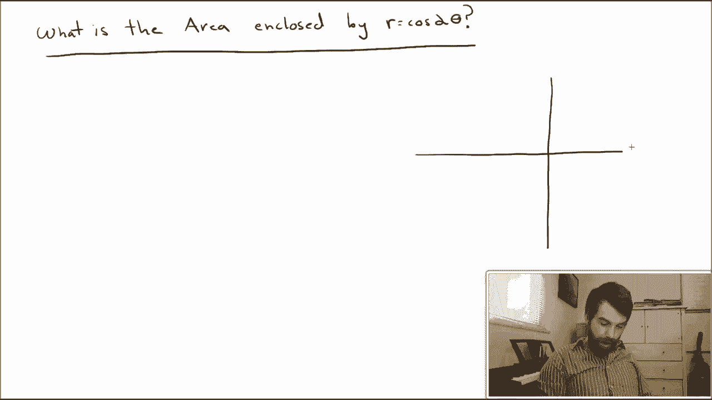

计算极坐标曲线面积的第一步通常是绘制该曲线的草图。我们需要理解 **r = cos(2θ)** 在平面上的形状。

为了做到这一点，我们首先在 **R-θ** 坐标系中绘制 **R** 作为 **θ** 函数的图像。我们知道函数 **y = cos(2x)** 的图像：它从 **1** 开始，下降到 **-1**，再回到 **1**。

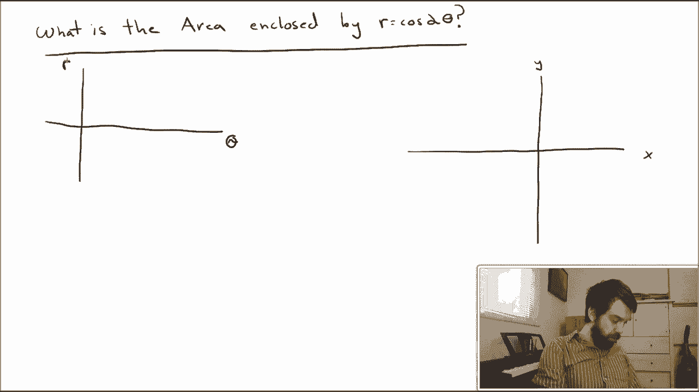

由于是 **cos(2θ)**，周期被压缩了。当 **θ = π** 时，函数完成一个完整周期。通常 **cos(x)** 在 **x = π** 时达到 **-1**，现在则在 **θ = π/2** 时达到 **-1**。通常 **cos(x)** 在 **x = π/2** 时为零，现在则在 **θ = π/4** 时为零。

接下来，我们需要将 **R-θ** 坐标系中的信息转换到 **X-Y** 平面（即极坐标平面）上。

思路是：从 **θ = 0** 开始，让 **θ** 值逐渐增加，而 **R** 值则根据左侧 **R-θ** 图像给出的指令变化。

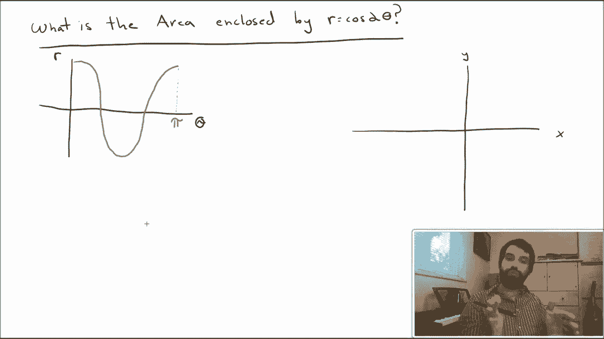

*   当 **θ = 0** 时，**r = 1**。这对应正X轴上的一个点。
*   当 **θ** 从 **0** 增加到 **π/4** 时，**R** 值从 **1** 下降到 **0**。因此，曲线从距原点距离为1的点开始，逐渐向原点靠近，在 **θ = π/4** 时到达原点。
*   当 **θ** 从 **π/4** 增加到 **π/2** 时，**R** 值从 **0** 变为 **-1**。在极坐标中，负的 **R** 值意味着点位于与角度方向相反的方向上。因此，曲线实际上是从原点出发，在 **θ = π/2** 的反方向（即负Y轴方向）上画出距离为1的弧线。
*   按照这个模式继续下去，**θ** 在 **π/2** 到 **3π/4** 时，**R** 从 **-1** 回到 **0**；在 **3π/4** 到 **π** 时，**R** 从 **0** 变为 **1**，以此类推。

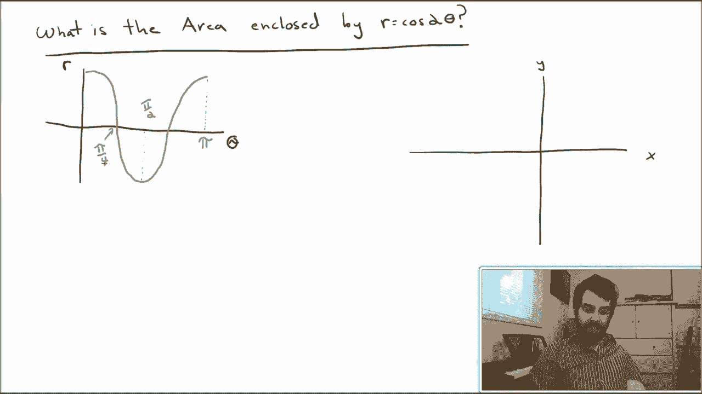

最终，我们得到了一朵四叶玫瑰线的图形。

---

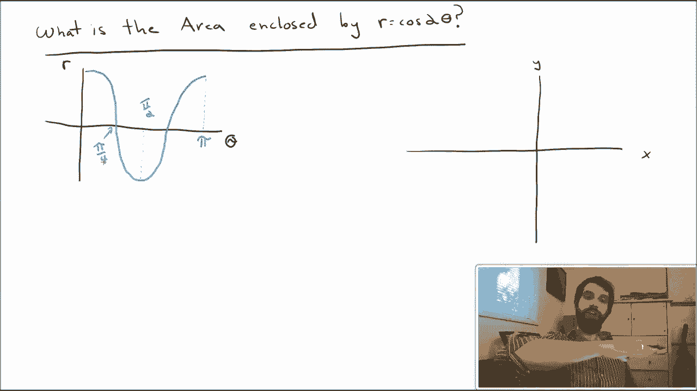

## 第二步：确定待求面积并利用对称性

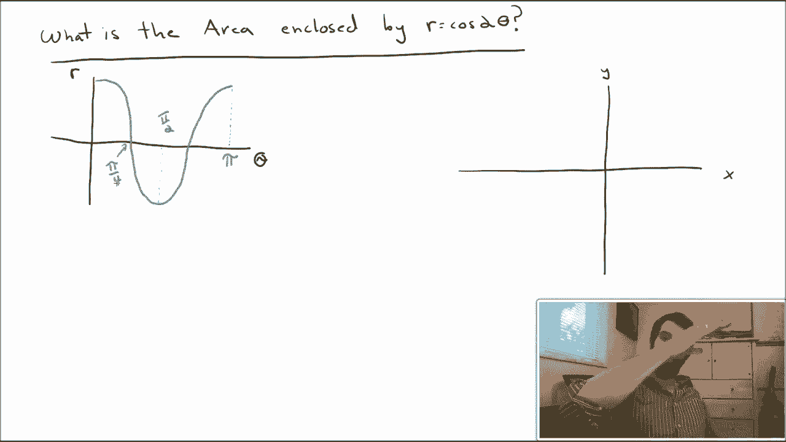

我们的目标是计算这整条曲线所围成的全部面积。观察图形，可以发现它具有高度的对称性：图形由四个完全相同的“花瓣”组成。

因此，我们可以利用对称性来简化计算。我们只需要计算其中一个花瓣的面积，然后乘以4即可得到总面积。更进一步，我们甚至可以只计算**半个花瓣**的面积。

我们选择计算从 **θ = 0** 到 **θ = π/4** 所画出的那半个花瓣（即第一象限中花瓣的右半部分）的面积。这个区域是整个图形面积的 **1/8**。

所以，我们的策略是：
1.  计算这半个花瓣的蓝色区域面积。
2.  将其乘以 **8**，即可得到整个四叶玫瑰线的总面积。

---

## 第三步：应用极坐标面积公式

我们已知极坐标曲线 **r = f(θ)** 从 **θ = α** 到 **θ = β** 所围成的扇形面积公式为：

**面积 = (1/2) ∫[α, β] [f(θ)]² dθ**

对于我们的曲线，**f(θ) = cos(2θ)**。我们想要计算的是从 **θ = 0** 到 **θ = π/4** 的半个花瓣面积。

因此，半个花瓣的面积 **A_half_petal** 为：

**A_half_petal = (1/2) ∫[0, π/4] [cos(2θ)]² dθ**

---

## 第四步：执行积分计算

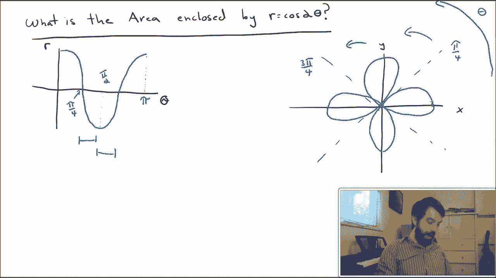

现在，我们进行具体的积分运算。

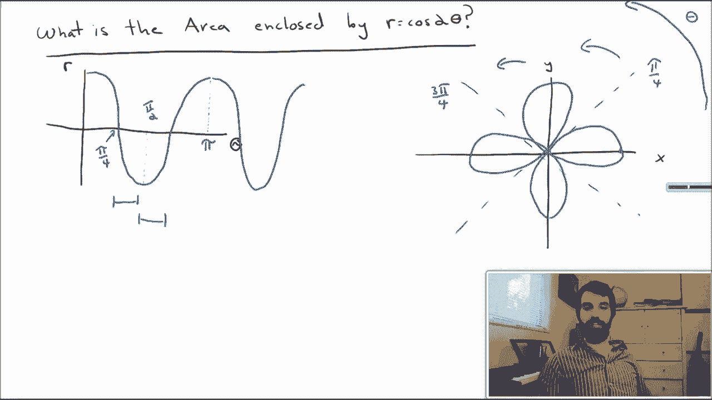

首先展开被积函数：
**[cos(2θ)]² = cos²(2θ)**

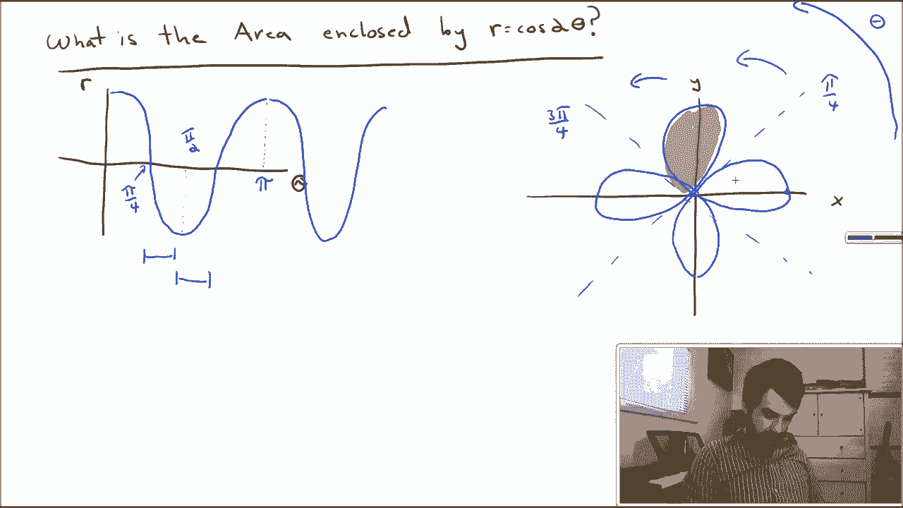

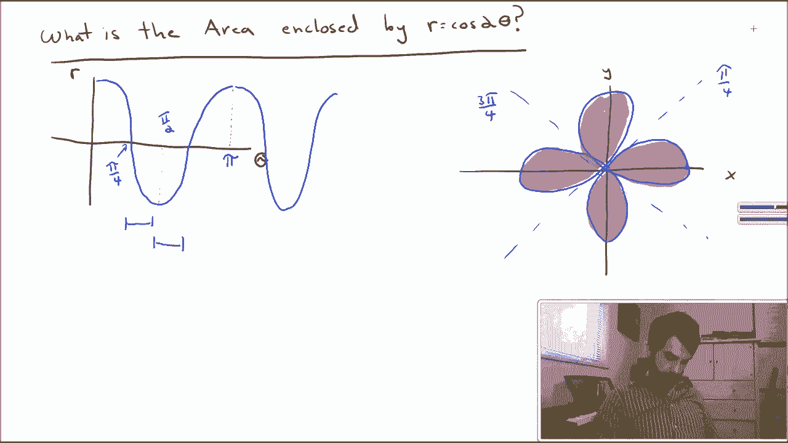

利用三角恒等式 **cos²(x) = (1 + cos(2x))/2**，这里 **x = 2θ**，所以：
**cos²(2θ) = (1 + cos(4θ))/2**

将其代回面积公式：
**A_half_petal = (1/2) ∫[0, π/4] [(1 + cos(4θ))/2] dθ**
**= (1/4) ∫[0, π/4] (1 + cos(4θ)) dθ**

现在计算这个定积分：
∫ **(1 + cos(4θ)) dθ = θ + (1/4) sin(4θ)**

代入上下限 **0** 和 **π/4**：
在 **θ = π/4** 时：**(π/4) + (1/4) sin(π) = π/4 + 0 = π/4**
在 **θ = 0** 时：**0 + (1/4) sin(0) = 0**
因此，积分结果 = **π/4 - 0 = π/4**

所以，半个花瓣的面积为：
**A_half_petal = (1/4) * (π/4) = π/16**

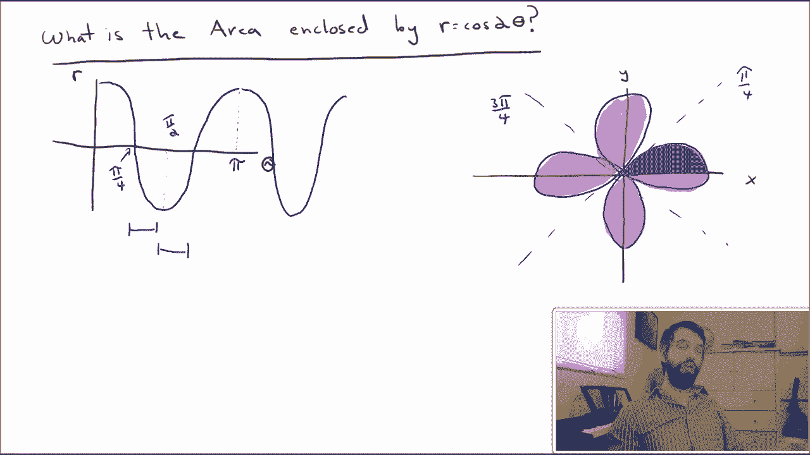

---

## 第五步：推导最终总面积

我们之前指出，这半个花瓣的面积是整个图形面积的 **1/8**。

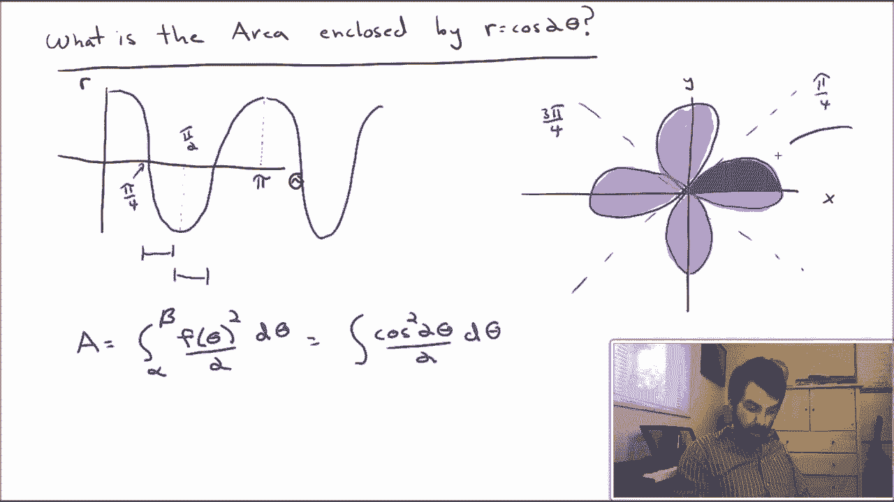

因此，整个四叶玫瑰线的总面积 **A_total** 为：
**A_total = 8 * A_half_petal = 8 * (π/16) = π/2**

---

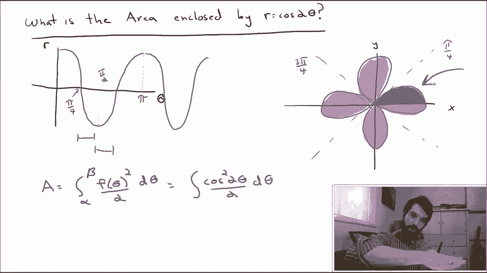

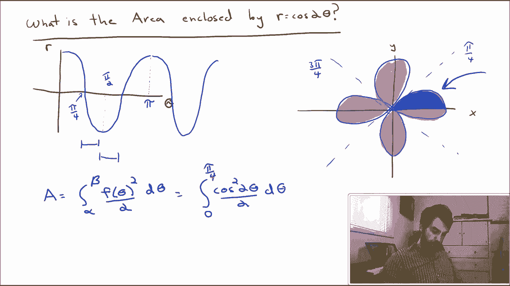

## 总结

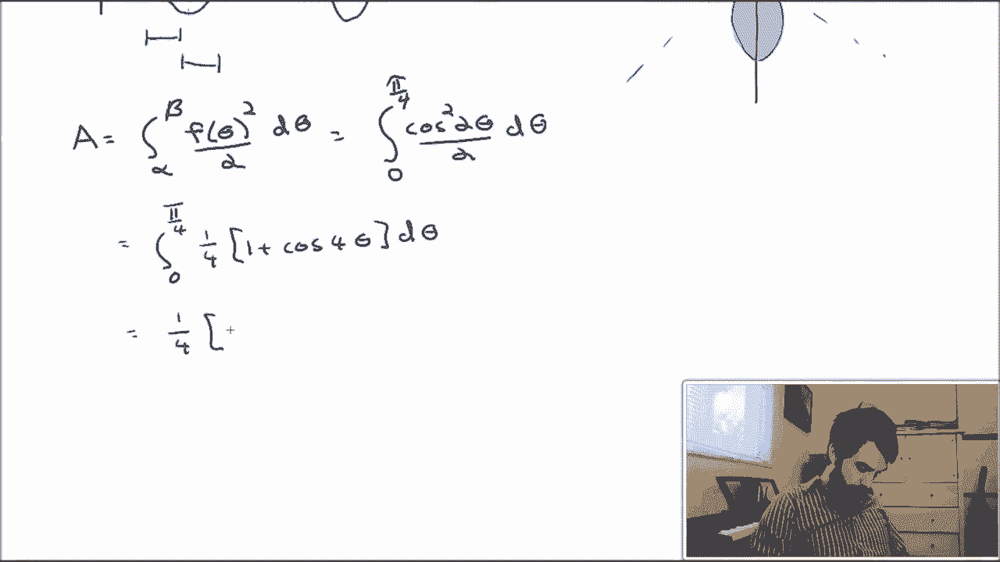

本节课中，我们一起学习了计算极坐标曲线 **r = cos(2θ)** 所围面积的全过程。

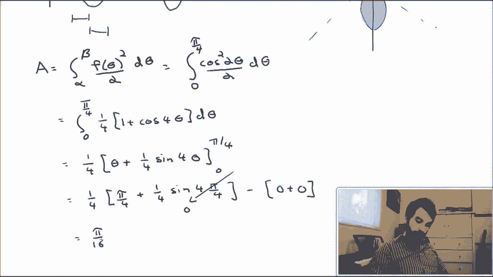

我们首先通过分析 **R-θ** 关系并转换到极坐标平面来绘制曲线草图，得到了一朵四叶玫瑰线。接着，我们利用图形的对称性，将问题简化为计算其中一个花瓣的一部分面积。然后，我们应用了极坐标下的面积公式 **A = (1/2) ∫ [f(θ)]² dθ**，并通过三角恒等式和基本的积分技巧完成了计算。最终，我们得出这条特定曲线所围成的总面积为 **π/2**。

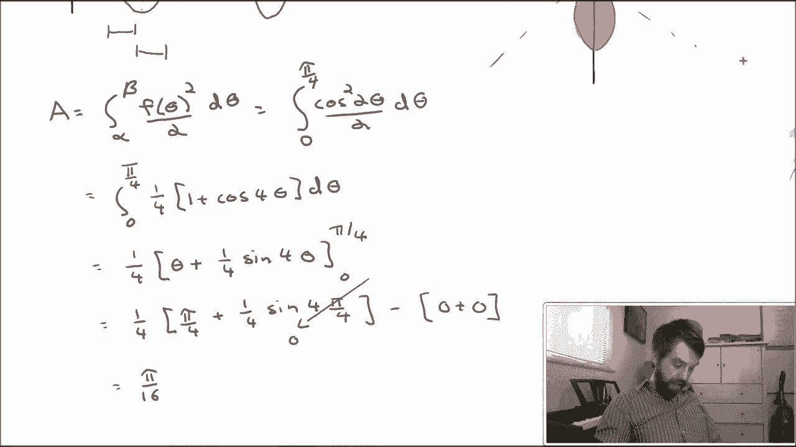

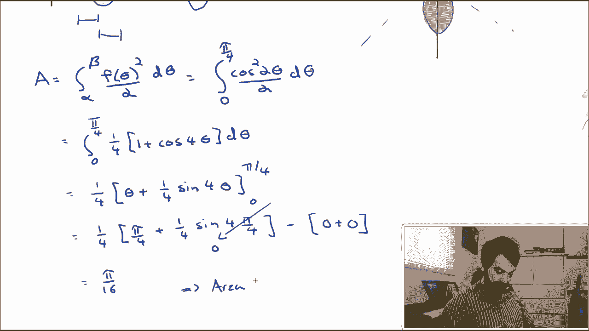

这个例子展示了处理极坐标面积问题的标准流程：绘图、利用对称性简化、应用公式、执行计算。